# P01 - Patient Administration Reconciliation

## 1. Project Goal

The goal of this project is to build a UiPath automation that replaces a repetitive daily check in a fictional Swedish hospital. The check compares referral records between two hospital systems and finds records that are missing, duplicated or in conflict.

### 1.1 Scenario

Every morning, a Patient Administration Officer checks the referral records in two systems:

- **Personalportalen (Staff Portal):** manages patient administration and referrals.
- **Journalsamordning (Coordination):** manages the coordination cases that belong to the referrals.

### 1.2 Before Automation - Manual Process

1. **Get the referrals:** The officer receives the daily CSV or Excel file with the referrals.
2. **Open the Staff Portal:** Each referral from the file is searched in Personalportalen, under Remisser.
3. **Open Coordination:** The cases of the same patient are searched in Journalsamordning.
4. **Compare the information:** The patient, the sending unit and the status of the referral and the case are compared.
5. **Record the problems:** Missing, duplicate and conflicting records are noted by hand.
6. **Repeat:** The steps are repeated until every referral is checked, and a report is prepared for follow-up.

In Personalportalen, the daily file is downloaded from the Remisser page with the Exportera CSV button. The red rectangle shows where the button is.

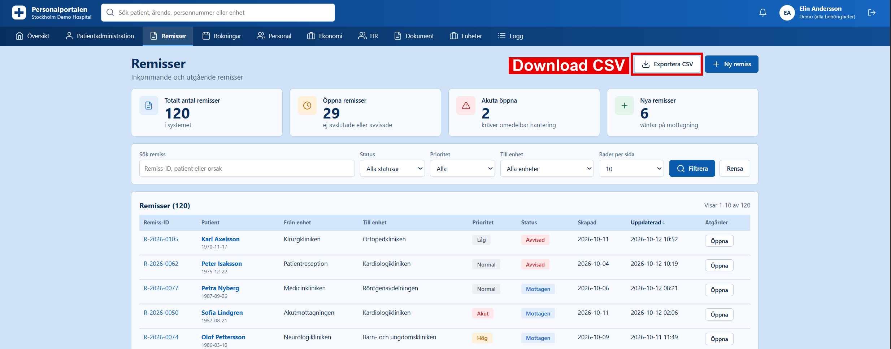

*Figure 1. The Remisser page in Personalportalen. The daily file is downloaded with the Exportera CSV button.*

In Journalsamordning, the cases are searched on the Inkomna ärenden page. An ID is typed in the search field, and the matching case is shown in the list below it.

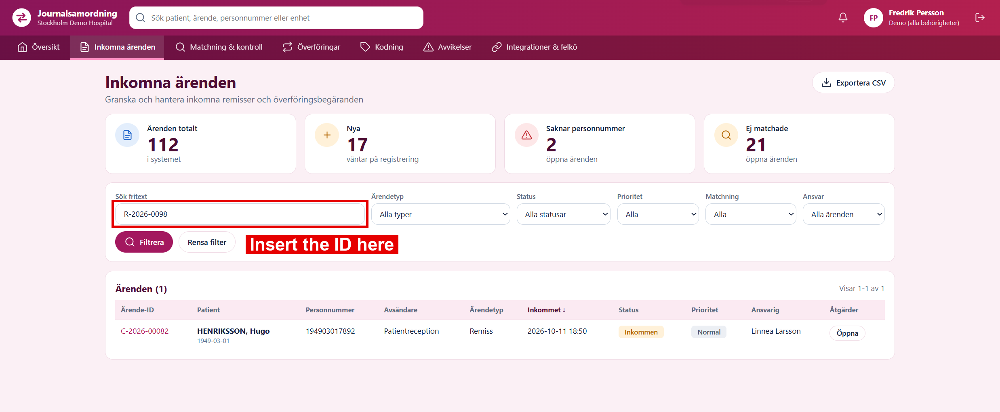

*Figure 2. The Inkomna ärenden page in Journalsamordning. The searched ID is typed in the search field, and the matching case is shown below.*

The problem is repetitive work, slow checks and a risk of human mistakes.

### 1.3 After Automation - UiPath Process

1. **Load the referrals:** UiPath reads a CSV file with fictional referral records.
2. **Open the hospital systems:** UiPath uses browser automation to open Personalportalen and Journalsamordning.
3. **Search automatically:** Each row of the file is processed, and the matching records are searched in both systems.
4. **Compare the information:** Fixed rules are used to find matches, missing records, duplicates and conflicts.
5. **Create the report:** A CSV report is created with the result, the reason and the time of each record.
6. **Handle exceptions:** Technical failures are logged, and records that could not be decided are marked for manual review.

The result is less repetitive work, the same checks every time, clear error reporting, and more time for the staff to handle the cases that need attention.

The picture below shows the whole process in five steps, from the input file to the report for the staff.

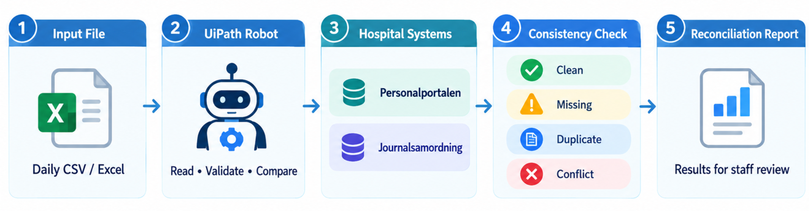

*Figure 3. Overview of the process: a daily file is read by the UiPath robot, the records are checked in both hospital systems, and a report is created for staff review.*

### 1.4 Project Scope

This is a read-only automation with synthetic hospital data. It finds differences, but it never changes hospital records and never makes clinical decisions. A prepared test file is used as input. Downloading the file from Personalportalen is not part of this project.

## 2. Checking the Working Environment

Before building anything, the tools and the hospital systems were checked. A working environment is the base of every automation, and it is easier to find a problem at the start than in the middle of the project.

### 2.1 UiPath Tools

UiPath Studio and the UiPath Robot are installed, and Studio is signed in to UiPath Cloud. The UiPath Browser Automation extension is installed in Edge and Chrome. This extension is needed because both hospital applications are web applications, and UiPath can only control a web page through it.

A new Windows project named `Project1-` was created in Studio. The main workflow, `Main.xaml`, is still empty.

### 2.2 Hospital Systems

The two hospital applications and the REST API run on a separate computer and are reached through a private network (Tailscale). All three were opened and are working:

| System | Address |
|---|---|
| Staff Portal (Personalportalen) | `http://100.99.72.90:8080` |
| Coordination (Journalsamordning) | `http://100.99.72.90:8081` |
| REST API | `http://100.99.72.90:8082` |

The REST API has its own documentation page, which lists all available endpoints.

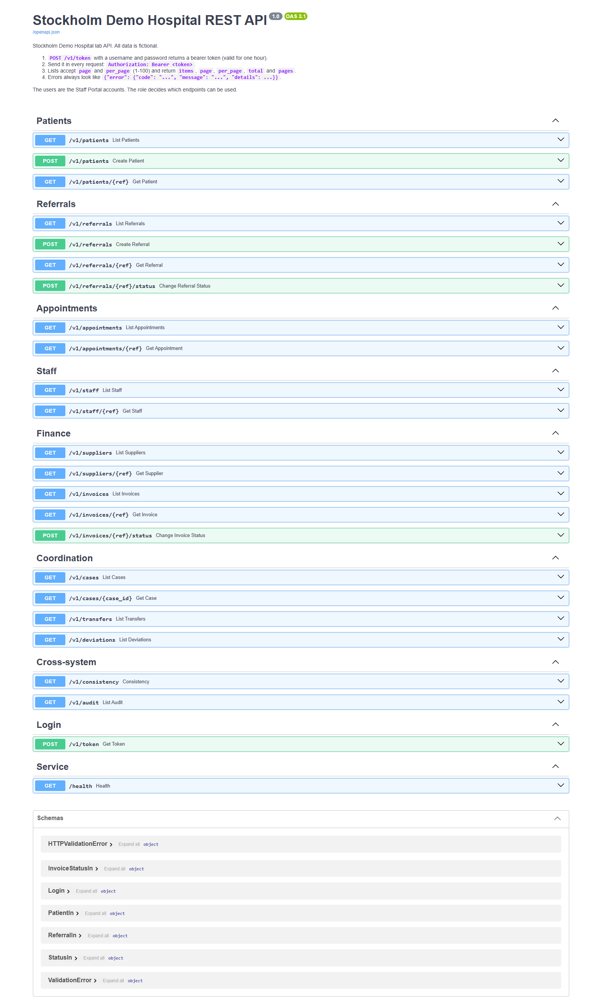

*Figure 4. The documentation page of the hospital REST API.*

In this project, the work is done through the web applications, and the API is not used by UiPath. It was only opened to see what the lab offers.

### 2.3 Orchestrator

Orchestrator is the part of UiPath Cloud where packages are published and jobs are started. It was opened and works fine.

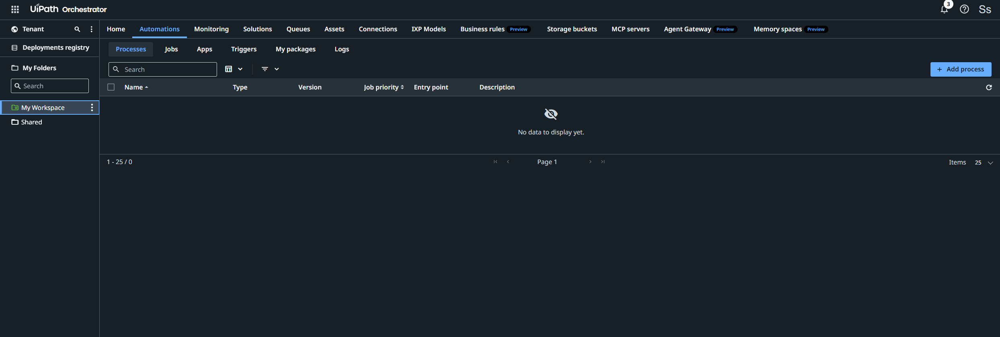

*Figure 5. The Processes page in Orchestrator. It is empty because no process has been published.*

### 2.4 Sample Records

To get to know the data, three records were searched manually in the browser:

| Record | System | Result |
|---|---|---|
| Referral `R-2026-0098` | Staff Portal | Found |
| Case `C-2026-00082` | Coordination | Found, same patient |
| Referral `R-2026-0008` | Coordination | Not found |

The first two belong together and are a normal example. The third is a referral without a case in Coordination, which is an example of missing data.

The lab also contains mismatches that were planted on purpose, according to the lab documentation: duplicate patients, duplicate cases, referrals missing in Coordination, cases without a referral, and referrals and cases with different statuses. They make it possible to test that the automation finds each kind of problem. The exact records are listed in the testing part.

### 2.5 Read-Only Approach

Hospital data is sensitive, so the automation only reads data and never changes it.

## 3. First Browser Test in the Staff Portal

Before building the real process, a very small workflow was created to prove that UiPath can control the hospital web application. If this works, the same method can be used later for the real lookups.

### 3.1 UI Automation Package

To control a web page, the UI Automation package (`UiPath.UIAutomation.Activities`) is needed, so it was installed in Manage Packages.

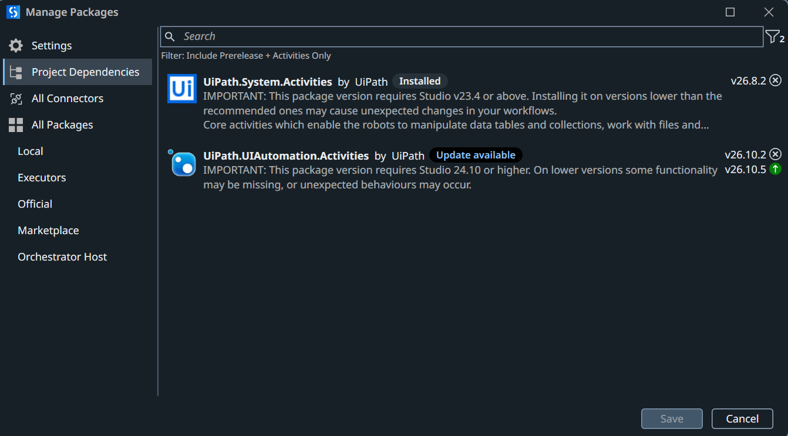

*Figure 6. The packages of the project in Manage Packages: the standard System package and the UI Automation package.*

### 3.2 The Test Workflow

The workflow `Main.xaml` has four steps:

1. **Use Browser** attaches to the Staff Portal page in Chrome.
2. **Go To URL** opens the Referrals page with the search `R-2026-0098`.
3. **Get Text** reads the patient name from the first row of the result table.
4. **Log Message** writes the name to the output log.

The patient name is selected by its place in the table (the Patient column of the first data row) and not by the patient's name or ID. In this way the same selector still works when another referral is searched.

The browser was already signed in, so the workflow does not handle a password. The test only reads data and does not change anything in the hospital system.

### 3.3 Result

The workflow ran without errors in about three seconds. The log shows the patient name `Hugo Henriksson`, which is the same patient that was found manually for referral `R-2026-0098`. This shows that UiPath can find and read an element in the Staff Portal.

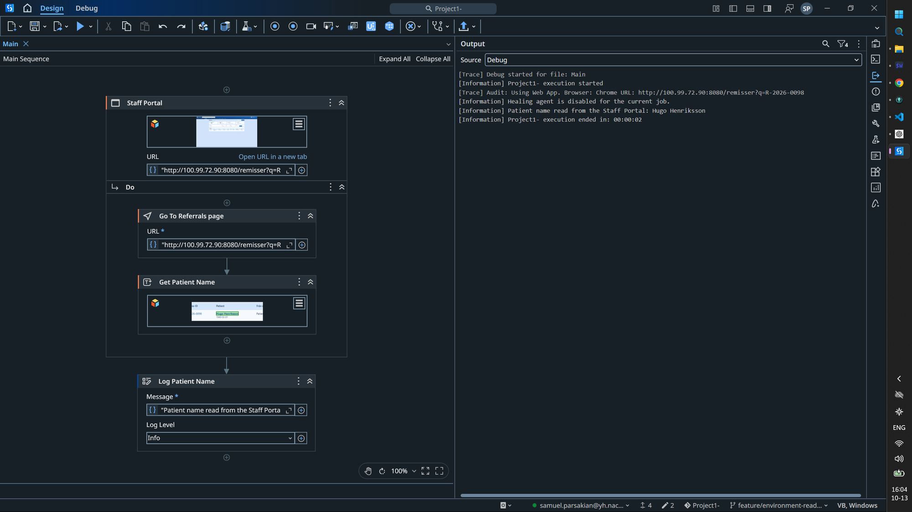

*Figure 7. The test workflow in UiPath Studio (left) and the output log of the run (right).*

## 4. Test Data and Expected Results

Before building the process, the test data was prepared. In this way, it is clear what the automation must find, and the result can be checked afterwards.

### 4.1 Checking the Records in the Hospital Systems

Every record that is used in the test was searched manually in the Staff Portal and in Coordination, because the data can change. The search field of Coordination also accepts a referral number, so the matching case can be found with it.

### 4.2 Why a Small Test File Is Used

The full referral export of Personalportalen (the blue hospital application) contains 120 referrals. Before a file like this is processed, a smaller CSV with 10 carefully selected test records was prepared (`TestData/patient_admin_input.csv`).

A small file makes it possible to build and test the UiPath workflow with known results. It contains normal records and intentionally incorrect records, such as missing records, duplicates and status conflicts, so it can be checked that each problem is found.

Testing on a small file first shows that the automation works before it is used on a larger one.

The columns are separated by semicolons and the file is saved as UTF-8, so Swedish letters such as å, ä and ö are shown correctly in Excel. A practice Excel workbook with the same data was also made, because no ready Excel file exists.

The rows cover one normal case and every problem the automation must find:

| Row | Referral | Test case | Expected result |
|---|---|---|---|
| 1 | R-2026-0098 | Referral and case agree | OK |
| 2 | R-2026-0008 | No case in Coordination | Missing in Coordination |
| 3 | R-2026-0018 | No case in Coordination | Missing in Coordination |
| 4 | R-2026-0055 | Two cases for the same patient and sender | Duplicate case |
| 5 | R-2026-0004 | Referral is Bokad, case is Klar | Status conflict |
| 6 | R-2026-0006 | Patient P-000201 also exists as P-000002 | Duplicate patient |
| 7 | R-2026-9309 | Case C-2026-00105 has no referral | Orphan case |
| 8 | (empty) | Referral number is missing | Rejected |
| 9 | R-26-98 | Referral number has the wrong format | Rejected |
| 10 | R-2026-0098 | Same row as row 1 | Rejected, duplicate row |

The test file can be opened in Excel to check it. The columns must be separated correctly, and Swedish letters must be shown correctly.

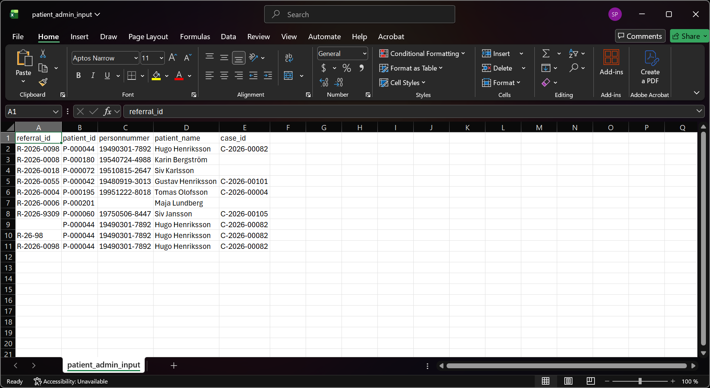

*Figure 8. The test file opened in Excel. The columns are separated correctly and the letter ö in "Bergström" is shown correctly.*

### 4.3 Expected Results

The expected result of each row was written down before anything was built (`TestData/expected_results.csv`). Each row ends as processed, needs review or rejected, with a short reason. The same file is used in the end to compare the real report with what was expected.

## 5. Reading and Checking the Input File

### 5.1 Why the Input File Is Checked First

The automation starts with the input file. If a row in the file is wrong, the lookups in the hospital systems for that row would only waste time or give confusing results. For this reason, every row is checked before anything is searched.

The Excel package (`UiPath.Excel.Activities`) is needed to read a CSV file in UiPath, so it was installed.

### 5.2 How the File Is Read and Checked

The workflow `Workflows/ReadAndValidateInput.xaml` has nine steps. The file is read into a table, two empty result tables are prepared, and then each row is checked in this order:

1. The referral ID must not be empty.
2. The referral ID must have the format `R-2026-0098` (the letter R, four digits for the year and four digits for the number).
3. The row must not be a copy of an earlier row.

A row that passes all three checks is put in the table of valid rows. A row that fails gets a reason and is put in the table of rejected rows. Both tables keep the row number of the file, so it is always clear which row is meant.

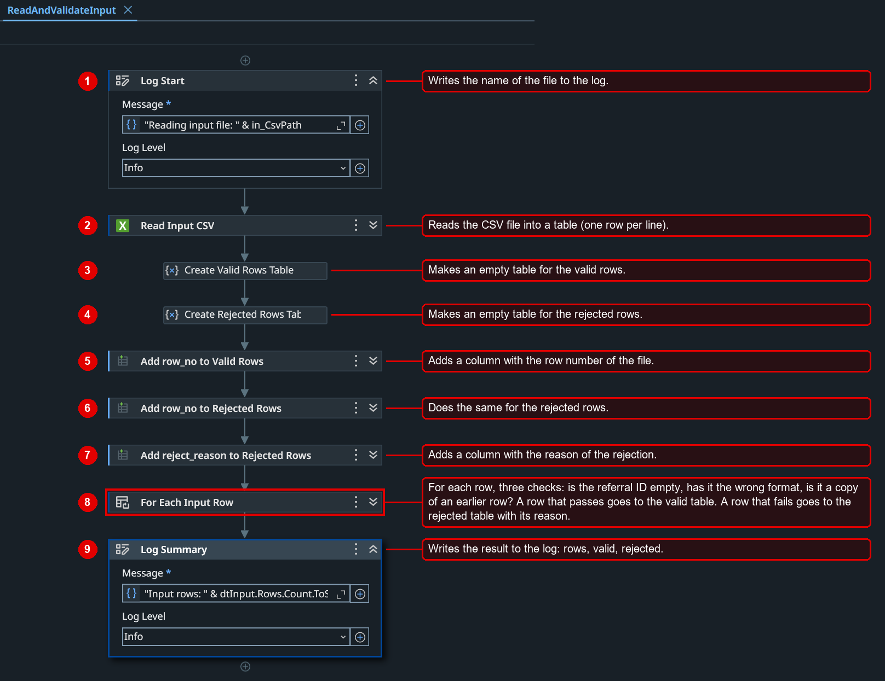

*Figure 9. The workflow `ReadAndValidateInput.xaml` with a short explanation of each step. The details of the checks are inside the activity For Each Input Row, and can be seen in the file.*

### 5.3 Input and Output of the Workflow

The workflow gets one input, the path of the CSV file. It gives back two outputs: a table with the valid rows and a table with the rejected rows. Both tables have the columns of the file and a column with the row number. The table of rejected rows also has a column with the reason.

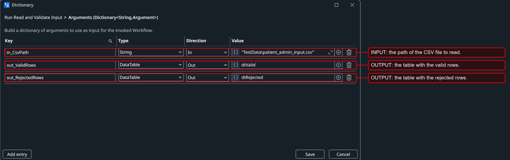

*Figure 10. The arguments of the workflow, as they are given by the test. `in_CsvPath` is the input, and `out_ValidRows` and `out_RejectedRows` are the outputs.*

### 5.4 Testing the Check

The test `Tests/Test_ReadAndValidateInput.xaml` runs the workflow with the test file and compares the result with the expected result from section 4. It expects rows 1 to 7 to be valid. It also expects rows 8, 9 and 10 to be rejected with the reasons "referral_id is empty", "referral_id has the wrong format" and "Same row appears earlier in the file".

If the result is the same as expected, the message TEST PASSED is logged. If not, the test stops with an error that shows the real values.

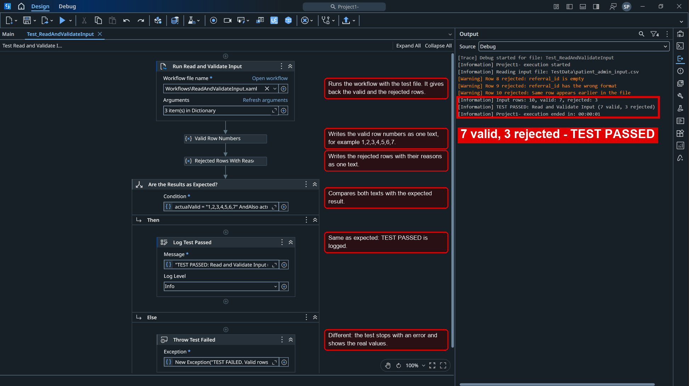

*Figure 11. The test workflow in UiPath Studio and its output. The three rejected rows are listed and the test passed.*

The test makes its decision with three expressions. The first one compares the real result with the expected result, and both texts must be exactly the same. If even one row or one reason is different, the test fails. The other two expressions are the messages for a passed and a failed test.

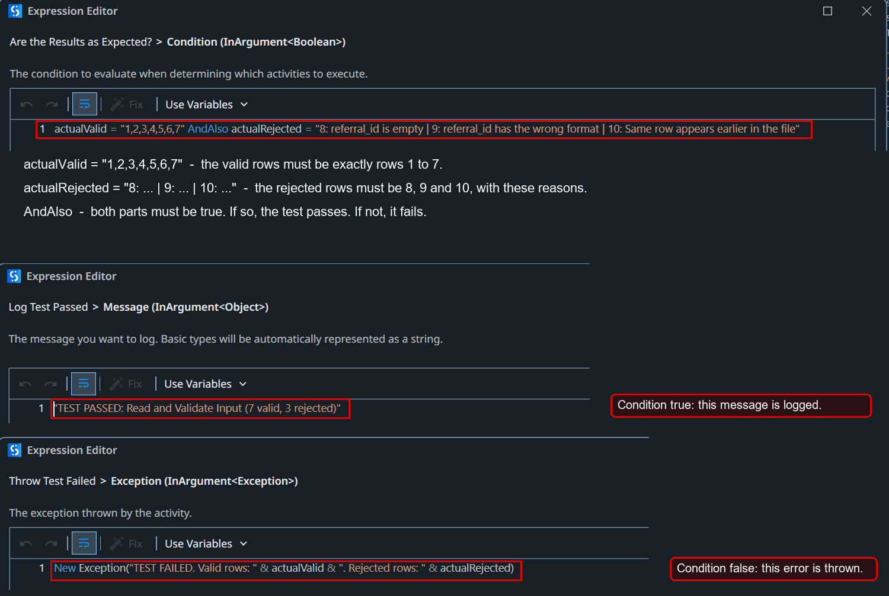

*Figure 12. The three expressions of the test: the condition that compares the result with the expected result, and the two messages for passed and failed.*

## 6. Checking the Rows in Both Hospital Systems

### 6.1 Why the Systems Are Checked Row by Row

After the input file is checked, every valid row must be compared with the real data in the two hospital systems. This is the part of the work that the officer does by hand every morning, so it is the core of the automation.

Both systems need a login, so the robot logs in to each of them first. After that, each valid row is searched in the Staff Portal (blue) and in Coordination (pink), and the two answers are compared with fixed rules.

The result of the comparison is one of the problem types from section 4, or OK when everything agrees.

### 6.2 Logging In

Two small workflows, `Workflows/Login_StaffPortal.xaml` and `Workflows/Login_Coordination.xaml`, open the login page of each system, type the user name and the password, and click the login button. Each of them waits until the first page after the login is shown, so the next step never starts too early. Neither workflow has inputs or outputs.

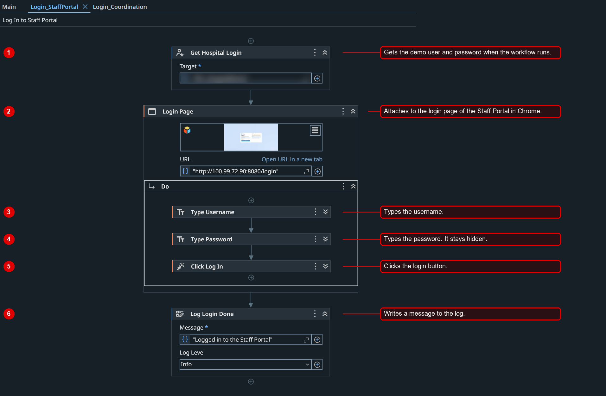

*Figure 13. The workflow `Login_StaffPortal.xaml`, with a short note on each step.*

The workflow for Coordination has the same steps, but it works on the pink application on port 8081.

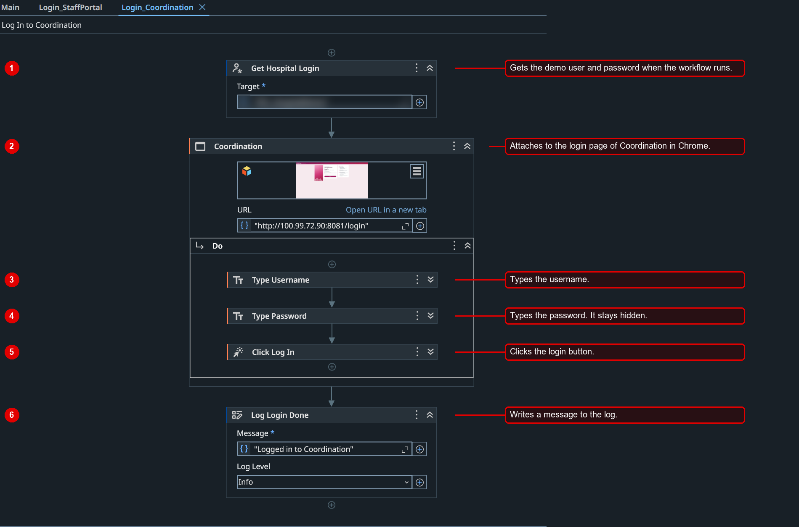

*Figure 14. The workflow `Login_Coordination.xaml`.*

### 6.3 Searching and Deciding

Three workflows read data from the systems, and one workflow decides:

| Workflow | What it does |
|---|---|
| `LookupReferral.xaml` | Searches the referral ID in the Staff Portal and reads the patient, the sending unit and the status. |
| `LookupPatients.xaml` | Searches the patient name in the Staff Portal and reads every patient with that name. Two patients with the same name and birth date are a duplicate patient. |
| `LookupCoordination.xaml` | Searches the referral ID in Coordination and reads every case that is found. If the referral is not in the Staff Portal, the case ID from the file is searched instead. |
| `ClassifyRow.xaml` | Compares the answers and decides the result and the reason of the row. |

The statuses of the two systems have different names, so they are mapped before they are compared: Ny is Inkommen, Mottagen is Registrerad, Under utredning and Bokad are Under handläggning, Avslutad is Klar and Avvisad is Avvisad. The workflow `ReconcileRows.xaml` goes through all valid rows, calls the other workflows for each row and collects one result per row in a table.

### 6.4 Testing the Check

The test `Tests/Test_ReconcileRows.xaml` reads and checks the test file, runs the check of the seven valid rows in the real systems, and compares the result of every row with `expected_results.csv`. Both the result and the reason must be the same.

The picture below shows the steps of the test. The first workflow checks the input file, the second one checks the valid rows in both systems, and the result is compared with the expected results.

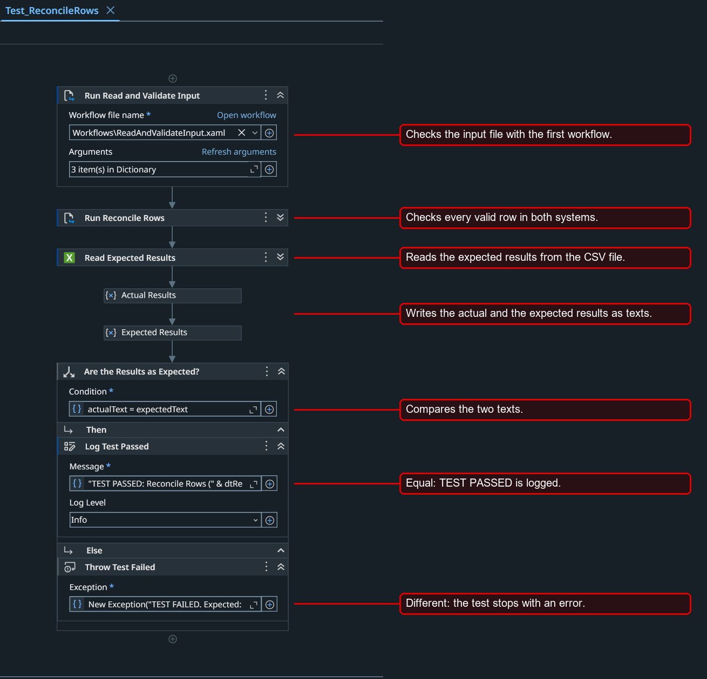

*Figure 15. The test `Test_ReconcileRows.xaml` in UiPath Studio, with a short note on each step.*

The first step gets the path of the CSV file and gives back the valid and the rejected rows. This is the input and the output of the invoked workflow, as they are set in the test.

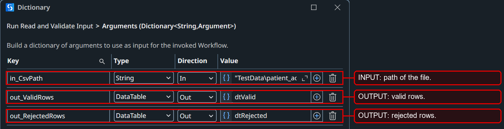

*Figure 16. The arguments of the first step. `in_CsvPath` is the input, and `out_ValidRows` and `out_RejectedRows` are the outputs.*

The test makes its decision by comparing the actual and the expected results as texts. If they are equal, a message with the number of rows is logged. If not, the test stops with an error that shows both texts.

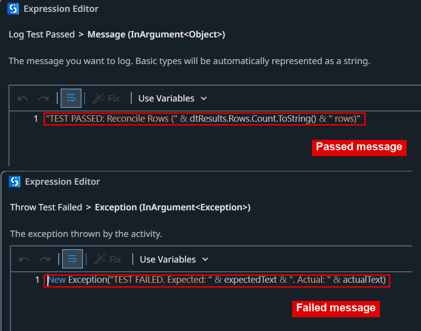

*Figure 17. The message of a passed test and the error of a failed test.*

The test passed. All seven rows got the expected result, and the whole run took 1 minute and 57 seconds. The Output panel shows the lookups of the last rows and the message TEST PASSED.

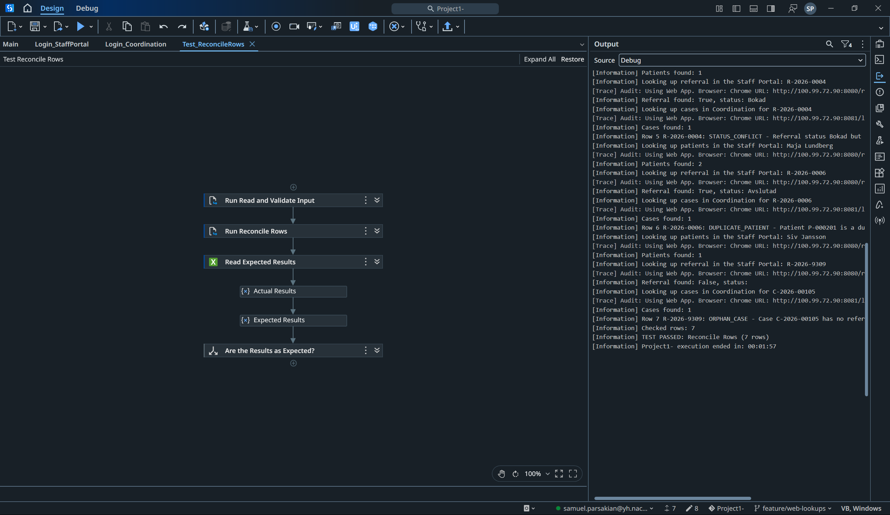

*Figure 18. The test in UiPath Studio and its output. The seven valid rows were checked in both systems and the test passed.*

## 7. Creating the Report

### 7.1 Why a Report Is Needed

The result of the check must reach the staff in a form that is easy to read and to keep. For this reason, the result of every row is written to a CSV report that can be opened in Excel.

The report contains the rows that were checked in both systems and also the rows that were rejected at the start, so no row of the input file is missing. Each row has the result, the reason and the time of the check.

In this way, the staff can see at once which records are fine and which ones need a manual follow-up.

### 7.2 How the Report Is Created

The workflow `Workflows/CreateReport.xaml` takes the time of the check and makes an empty table with six columns: `row_no`, `referral_id`, `result`, `outcome`, `reason` and `checked_at`. A row is added for every checked row and for every rejected row. A rejected row gets the code `REJECTED_DUPLICATE_ROW` if it is a copy of an earlier row, and `REJECTED_INVALID_INPUT` in the other cases. At the end, the rows are sorted by the row number and the table is written to a CSV file.

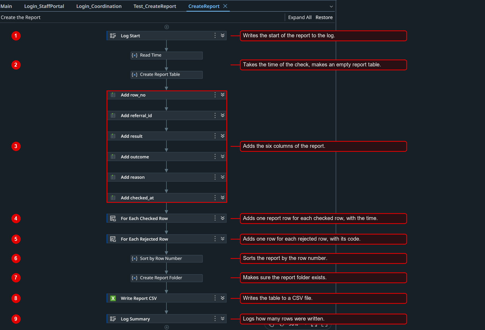

*Figure 19. The workflow `CreateReport.xaml` with a short explanation of each step.*

The only decision in this workflow is made when a rejected row is added to the report. The code depends on the reason of the rejection, as the expression below shows.

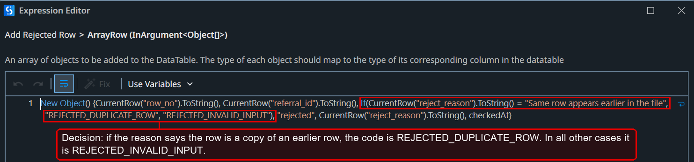

*Figure 20. The expression of the activity Add Rejected Row. The marked part chooses between the two codes.*

### 7.3 Input and Output of the Workflow

The workflow has three inputs and no output, because the result is the report file itself. The inputs are the table of the checked rows (`in_Results`), the table of the rejected rows (`in_RejectedRows`) and the path of the report file (`in_ReportPath`).

### 7.4 Testing the Report

The test `Tests/Test_CreateReport.xaml` runs the whole check with the test file, creates the report, reads it again and compares all ten rows with `expected_results.csv`. The result, the outcome and the reason must be the same, and each row must have a time.

The test passed. The log shows that 10 rows were written, and the whole run took 1 minute and 56 seconds.

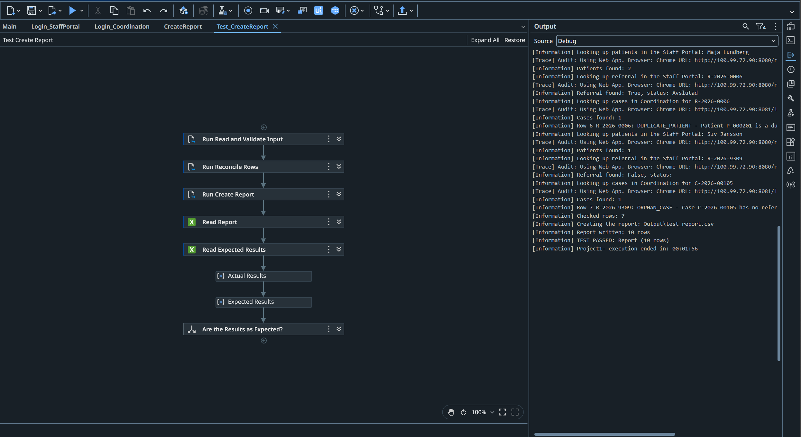

*Figure 21. The test in UiPath Studio and its output. The report has 10 rows and the test passed.*

The report file was also opened in Excel. The seven checked rows come first, then the three rejected rows (marked in yellow and green), and every row has the time of the check.

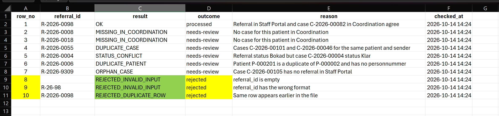

*Figure 22. The report opened in Excel. The rejected rows 8, 9 and 10 are marked.*

## 8. Running the Whole Process and Handling Errors

### 8.1 Why Error Handling Is Needed

The whole check takes about two minutes and works in two web systems at the same time. During this time, a login can expire or a page can fail to load. Without error handling, one such problem would stop the run, and no report would be created.

For this reason, a problem with one row is handled inside the row check, and the other rows are still checked. Only a problem outside the row check stops the run.

### 8.2 The Main Workflow

The workflow `Main.xaml` connects all parts of the process. It logs in to both systems, reads and validates the input file, checks the valid rows, creates the report and writes a short summary to the log. All steps are placed in a Try Catch, so an unexpected error is written to the log before the run stops.

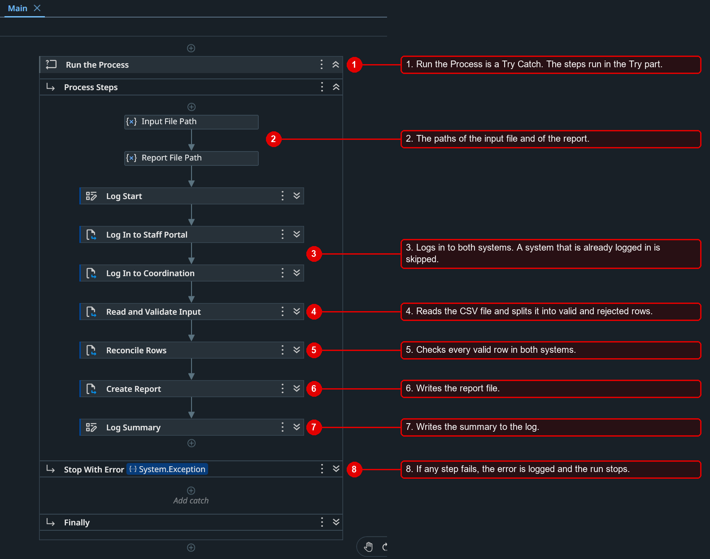

*Figure 23. The workflow `Main.xaml` with a short explanation of each step.*

### 8.3 Trying a Row Again

In `ReconcileRows.xaml`, each row is checked inside a loop. When the Staff Portal or Coordination shows the login page instead of the data, the lookup workflow reports that the session has expired. The row is then marked as failed. The same happens when an activity stops with an error.

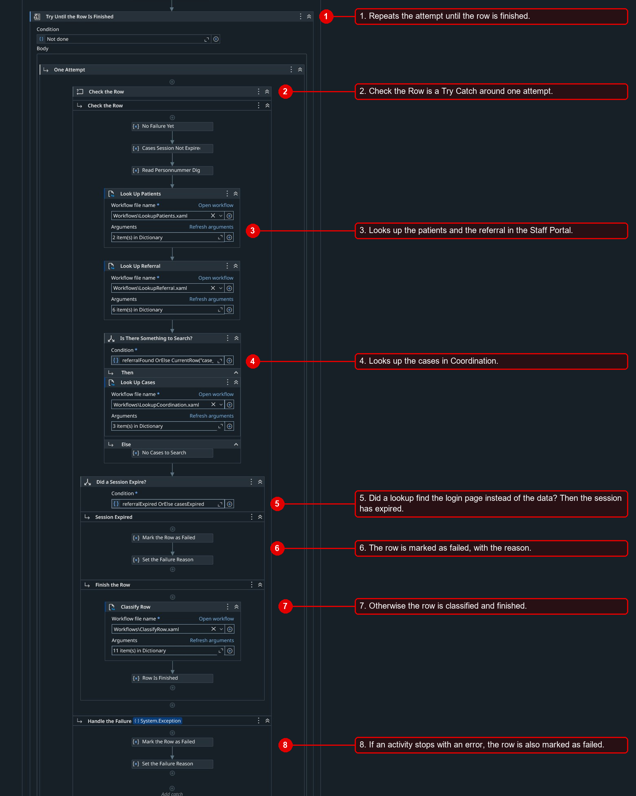

*Figure 24. One attempt to check a row, with a short explanation of each step.*

After a failed attempt, the robot logs in to both systems again and checks the row once more. A row can be tried two times. If the second attempt also fails, the row gets the result `TECHNICAL_ERROR` and the outcome needs review, and the next row is checked.

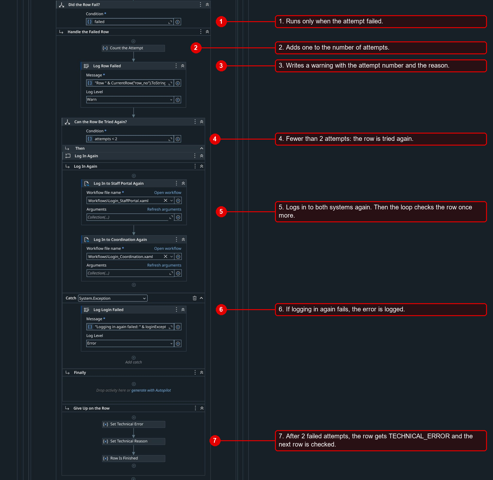

*Figure 25. What happens after a failed attempt. The condition `attempts < 2` decides between trying again and giving up.*

### 8.4 Testing the Whole Process

The whole process was started from `Main.xaml` with the test file. The report was written with 10 rows, and the summary in the log matched the expected result: 1 row processed, 6 rows that need review and 3 rejected rows. The run took 2 minutes and 4 seconds.

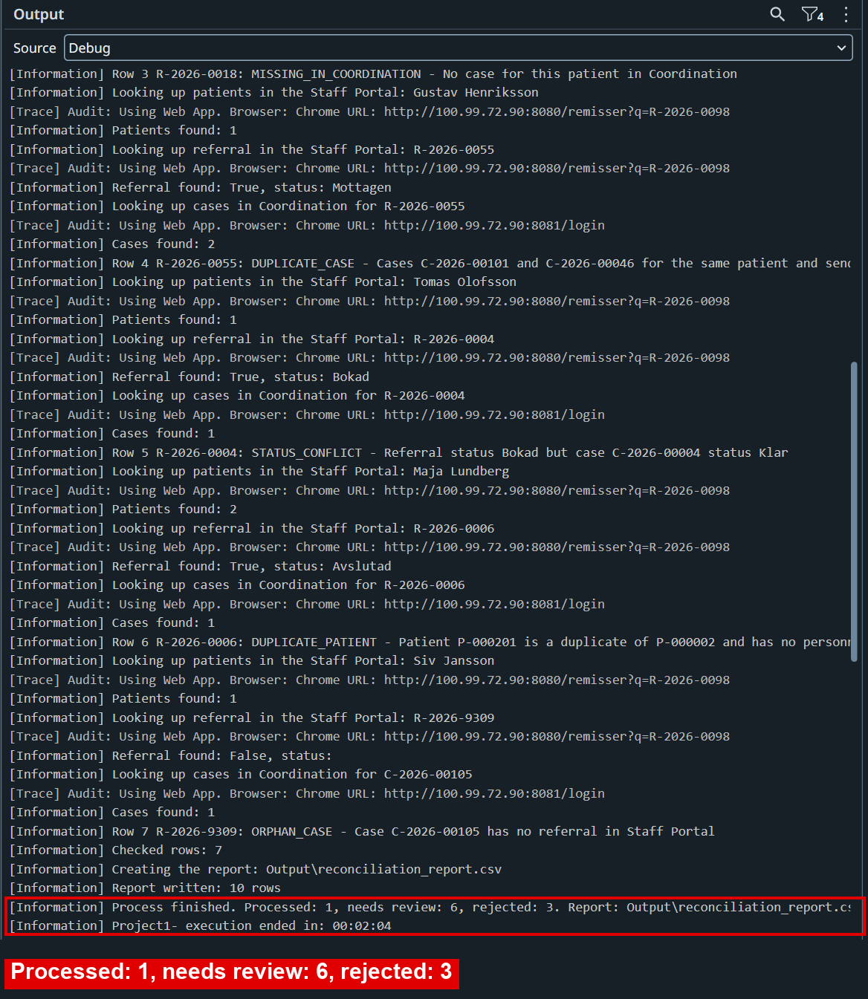

*Figure 26. The output of `Main.xaml`. The last lines show the summary of the run.*

The handling of an expired login was tested by hand. Before the test `Test_ReconcileRows.xaml` was started, the user was logged out of Coordination in Chrome. The log showed that the first row failed, the robot logged in again, and the row was checked once more:

```
Looking up cases in Coordination for R-2026-0098
Row 1 R-2026-0098 failed (attempt 1): the login page is shown
Already logged in
Logged in to the Staff Portal
Logged in to Coordination
Looking up patients in the Staff Portal: Hugo Henriksson
```

The Staff Portal was still logged in, so only Coordination needed a new login. After this, all seven rows were checked, and the test passed in 2 minutes and 20 seconds. No error was written to the log.
