# P02 - Finance Invoice Intake and Exception Routing

## 1. Project Goal

The goal of this project is to build a UiPath automation for the finance office of a fictional Swedish hospital. Supplier invoices arrive as PDF attachments in a shared Outlook mailbox. The automation reads each email and its invoice, checks the invoice against the hospital's finance data, and moves the email to the right folder: processed, review or error. When a person needs to look at an invoice, a notification is sent, and a short report shows what happened to every email. No payment is ever made by the robot.

### 1.1 Scenario

The finance office (Ekonomienheten) receives supplier invoices in a shared mailbox called **Ekonomi - Leverantörsfakturor**. Several people in the office can open this mailbox. The invoice data is checked against two kinds of records in **Personalportalen (Staff Portal)**:

- **Suppliers (Leverantörer):** the companies the hospital buys from, with their organisation number and email address.
- **Purchase orders (Inköpsordrar):** what was ordered, from which supplier, and for which amount.

### 1.2 Before Automation - Manual Process

1. **Open the mailbox:** A finance assistant opens the shared mailbox and goes through the new emails one by one.
2. **Open the invoice:** The PDF attachment of each email is saved, opened and read.
3. **Check the invoice:** The supplier, the purchase order number and the amounts are compared with the records in Personalportalen.
4. **Decide:** The invoice is either correct, needs a check by the controller, or is broken and must be sent again by the supplier.
5. **Sort the email:** The email is moved to the folder that matches the decision:
   - **Processed:** the invoice is correct and can be paid in the normal way.
   - **Review:** the invoice has a business problem, for example an unknown supplier, a wrong amount or a missing order number. The controller is told about it.
   - **Error:** the file or the data is broken, for example a damaged PDF or a wrong total. The supplier is asked to send a new invoice.
   - **Inbox:** emails that are not invoices, for example newsletters or delivery notes, stay in the Inbox.

The shared mailbox is shown under the assistant's own mailbox in Outlook. The red rectangles show the incoming invoice emails and the three folders Error, Processed and Review, where the emails are moved after the check.


*Figure 1. The shared mailbox Ekonomi - Leverantörsfakturor in Outlook on the web. The number next to Inbox shows the unread emails.*

The suppliers are found under Ekonomi > Leverantörer in Personalportalen. The organisation number and the email address of the supplier are compared with the invoice and with the sender of the email.


*Figure 2. The Leverantörer page in Personalportalen. Each supplier has an organisation number, an email address and a status.*

The purchase orders are found under Ekonomi > Inköpsordrar. The amount of the order without VAT is the value that the invoice is compared with.


*Figure 3. The Inköpsordrar page in Personalportalen. Each order shows the supplier and the order amount without VAT.*

The problem is slow and repetitive work. Many emails are not even invoices, and small mistakes, like a wrong total or a missing order number, are easy to miss.

### 1.3 After Automation - UiPath Process

1. **Read the mailbox:** UiPath reads the emails in the Inbox of the shared mailbox.
2. **Read the invoice:** The PDF attachments are opened, and the invoice fields are read from the text.
3. **Check the invoice:** The supplier, the purchase order and the amounts are checked against the hospital finance data.
4. **Sort the email:** Each email is moved to Processed, Review or Error. Emails that are not invoices stay in the Inbox with a label.
5. **Inform people:** The controller gets a notification for invoices that need a check, and a reply is prepared for broken invoices.
6. **Create the report:** A report shows the result and the reason for every email.

The result is less manual work, the same checks every time, and more time for the invoices that really need a person.

### 1.4 Project Scope

All data in this project is fictional. The emails exist only in a test mailbox, and messages are only sent between test accounts inside the same test organisation. The automation reads the hospital finance data but never changes it, never changes bank details, and never pays an invoice.

## 2. Checking the Working Environment

Before building anything, the tools, the mailbox and the hospital systems were checked. It is easier to find a problem at the start than in the middle of the project.

### 2.1 UiPath Tools

UiPath Studio and the UiPath Robot are installed, and Studio is signed in to UiPath Cloud. A new Windows project named `P02_FinanceInvoiceIntake` was created in Studio. The main workflow, `Main.xaml`, is still empty.

Orchestrator was opened and works fine. Integration Service, the part of UiPath Cloud that connects UiPath to other services, offers a ready connector for Microsoft Outlook 365. This connector is needed, because the robot must sign in to the mailbox in a safe way without a password inside the workflow.

### 2.2 Shared Mailbox

The test mailbox was opened in Outlook on the web with the account of the finance assistant. The shared mailbox was added to the account once, under Settings > Account > Shared with me. After that, it appears under the assistant's own mailbox, with the folders Inbox, Processed, Review and Error (see Figure 1).

The Inbox contains the test emails, and 33 of them are unread. The emails were only looked at, not opened, so the start state of the mailbox is not changed.

### 2.3 Hospital Systems

The hospital applications and the REST API run on a separate computer and are reached through a private network (Tailscale). All of them are working:

| System | Address |
|---|---|
| Staff Portal (Personalportalen) | `http://100.99.72.90:8080` |
| REST API | `http://100.99.72.90:8082` |

The finance pages of Personalportalen (invoices, suppliers, purchase orders) need a login. The REST API also needs a login, and it offers suppliers and invoices, but not purchase orders. For this reason, the order amounts are read from the Inköpsordrar page (see Figure 3).

### 2.4 Safe Approach

Invoices and payments are sensitive, so the automation only reads the finance data. Emails are only moved inside the shared mailbox, and notifications go only to test accounts.

## 3. First Outlook Test with UiPath

Before building the real process, a very small workflow was created to prove that UiPath can read the shared mailbox and save an invoice. If this works, the same connection can be used later for the whole process.

### 3.1 Outlook Package

To work with Outlook, the Microsoft Office 365 package (`UiPath.MicrosoftOffice365.Activities`) is needed, so it was installed in the project. Its Outlook activities read, move and send emails through the mailbox service of Microsoft 365, so the Outlook program does not need to be open on the computer.

The package was added in Studio under Manage Packages > All Packages, by searching for "Microsoft 365" and clicking Install. After saving, it is listed under Project Dependencies.

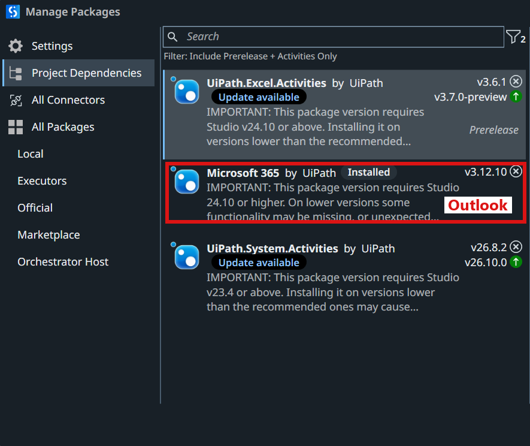

*Figure 4. Manage Packages in UiPath Studio. The red rectangle shows the installed Microsoft 365 package, version 3.12.10.*

### 3.2 Connecting UiPath to the Mailbox

UiPath signs in to Microsoft 365 with a connection in Integration Service. The connection is created once, with the account of the finance assistant Andreas Henriksson, who has access to the shared mailbox. The password is entered only in the Microsoft sign-in window and is never stored in the workflow.

When the connection is created, the needed permissions are selected. The robot needs to read and change emails and to send emails, also in a shared mailbox. Calendar permissions are not needed, so they were removed. The shared mailbox field is left empty, because the shared mailbox is chosen in each Outlook activity instead.


*Figure 5. The new Outlook connection. The red rectangle shows the mail permissions, including the two permissions for the shared mailbox.*

The first sign-in showed the message "Need admin approval", because the organisation must allow the UiPath app once. The approval was given with the administrator account. During this step, a second connection with the administrator account was also created. It was removed, because the robot must only work with the account of the finance assistant.


*Figure 6. The Connections page in Orchestrator. Only the connection of the finance assistant is left, and its status is Connected.*

### 3.3 The Test Workflow

The test workflow was built in `Main.xaml` in UiPath Studio. The activities were dragged from the Activities panel into the designer and placed one under the other. The numbers in Figure 7 match the steps below:

1. **Get Email List** (named "Get Inbox Emails") uses the Outlook connection from Figure 6. The option "Use shared mailbox" is switched on, the shared mailbox is `fakturor@stockholmdemohospital.onmicrosoft.com` and the email folder is `Inbox`. The result is saved in the variable `inboxEmails`.
2. **Log Message** writes the number of emails and unread emails to the Output panel.
3. **For Each** goes through `inboxEmails` and writes the date, the sender, the subject and the number of attachments of every email.
4. **Assign** finds the email with the subject `Faktura 49838 från Norrlands Livsmedelsgrossist AB`.
5. **If** checks that the email was found. In the Then branch, **Create Folder** makes the folder `Output\Attachments`, because the download activity needs a folder that already exists.
6. **Download Email Attachments** saves the PDF of that email in the folder. If the email is not found, the Else branch writes a warning instead.

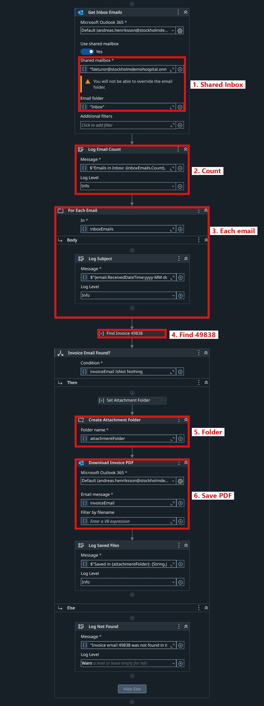

*Figure 7. The workflow `Main.xaml` in the Studio designer. The red rectangles show the six steps.*

Some options of Get Email List are not shown in the designer, but in the Properties panel. When the activity is selected, the panel shows that "Mark as read" is set to No, so the emails stay unread. The list of emails is saved in the output variable `inboxEmails`. The test does not move, label or send any email.

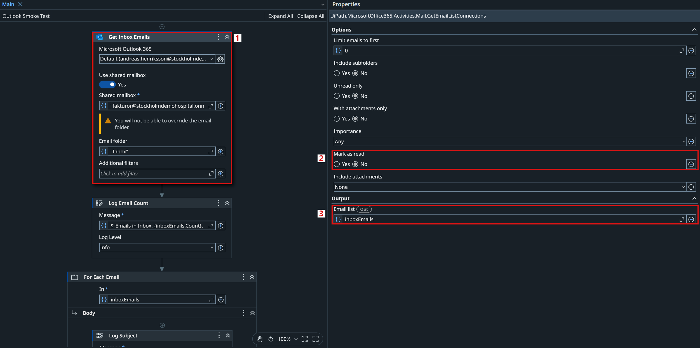

*Figure 8. Get Inbox Emails is selected, and the Properties panel shows its options. "Mark as read" is No, and the result goes to `inboxEmails`.*

### 3.4 Result

The workflow was started with Debug File in Studio. The Output panel shows 40 emails in the Inbox, and 33 of them are unread. This is the same as in Outlook on the web. The newest email in the list is `Order PO-2026-0011 - faktura 55655 betald?`. The invoice 49838 appears twice, because the same email was sent twice on purpose, to test duplicates. The last lines show that the PDF was saved and that the run took 10 seconds.

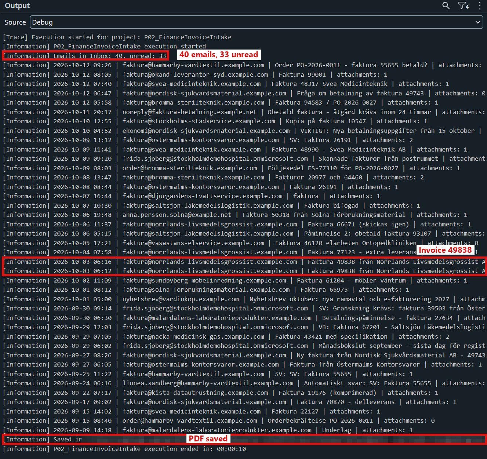

*Figure 9. The Output panel of the test run. The red rectangles show the number of emails, the invoice 49838 and the saved PDF. The local folder path is blurred.*

The invoice file `norrlands-livsmedelsgrossist-ab_49838.pdf` was saved, and it opens as a normal invoice. The red rectangle shows the fields that the robot must read from each invoice later: supplier, organisation number, invoice number, dates, purchase order, cost centre, amounts and bankgiro.


*Figure 10. The invoice that was saved by the test workflow.*

After the test, the Inbox still had 33 unread emails, and no email was moved. This shows that UiPath can read the shared mailbox and its attachments without changing it.

## 4. Test Data and Expected Results

Before building the process, the test data was prepared. In this way, it is clear what the automation must do with every email, and the result can be checked afterwards.

### 4.1 Why the Expected Results Are Written First

The test mailbox contains 40 emails in the Inbox. Some are normal invoices, but many have a problem on purpose, for example a wrong amount, a broken file or a fake bank detail change. If the expected result of each email is known before the robot is built, it is easy to see later if the robot made the right decision.

The expected result of every email was written down in `TestData/expected_results.csv`. Each row has the scenario ID, the subject, the sender, the attachments, the supplier, the invoice number, the purchase order, and the folder where the email must end. The file also contains the message ID of each email, which never changes, so the robot can match an email with its row in the file.

The 40 emails are expected to end like this:

| Expected result | Emails | Examples |
|---|---|---|
| Processed | 9 | normal invoices, one email with two invoices, an invoice with an extra CSV file |
| Review, with a notification to the controller | 21 | wrong amount, wrong VAT, unknown supplier, duplicate, reminder, scanned invoice, suspicious email |
| Error, with a reply asking for a new invoice | 4 | not a real PDF, damaged PDF, missing invoice number, wrong total |
| Stay in the Inbox with the label "Robot: Ignored" | 6 | order confirmation, delivery note, newsletter, out-of-office reply |

### 4.2 Saving the Attachments with UiPath

To test the reading of the invoices without touching the mailbox every time, a copy of all attachments was saved in the project. This was done with a small helper workflow, `Tools/DownloadTestAttachments.xaml`.

The CSV file is read with the activity Read CSV, which comes from the Excel package (`UiPath.Excel.Activities`). This package was added in Manage Packages in the same way as the Microsoft 365 package. It can also read and write Excel files without opening Excel.

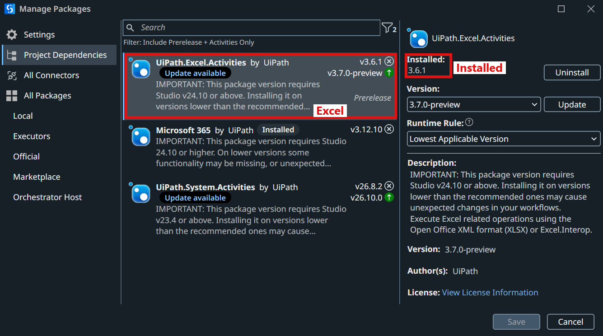

*Figure 11. Manage Packages with the installed Excel package, version 3.6.1.*

The numbers in Figure 12 match the steps of the workflow:

1. **Read CSV** reads the file with the expected results into a data table.
2. **Get Email List** reads all emails in the Inbox of the shared mailbox, with the same settings as in Figure 7.
3. **For Each** goes through the emails one by one.
4. **Assign** finds the scenario ID of the email by its message ID in the data table.
5. **If** checks that the email is known and has attachments. Then **Create Folder** makes a folder with the scenario ID, for example `TestData/Attachments/P02-E09`.
6. **Download Email Attachments** saves the attachments of the email in that folder. Images inside the email text, such as a company logo, are skipped.
7. **Log Message** writes the scenario ID and the names of the saved files.
8. If the email is not in the expected results, the Else branch writes a warning. This would show that the mailbox and the CSV file do not match.
9. **Log Message** writes a summary at the end.

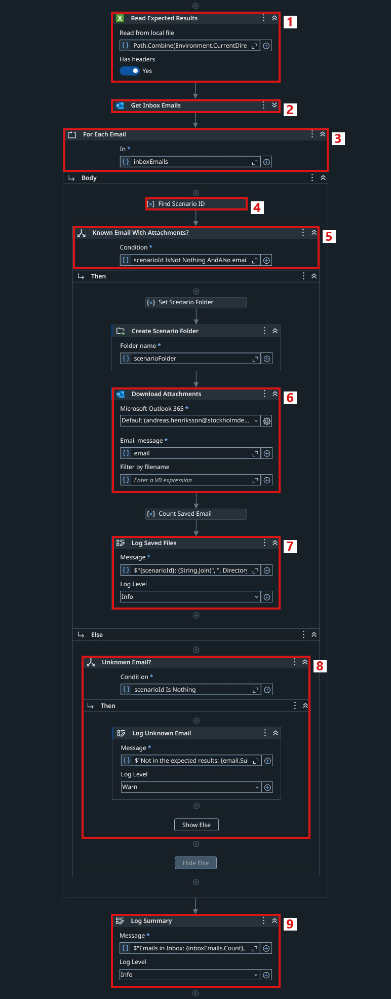

*Figure 12. The workflow `Tools/DownloadTestAttachments.xaml` in the Studio designer.*

The workflow was run with Debug File. No warning about an unknown email was shown, so all 40 emails were found in the CSV file. The attachments of the 32 emails that have attachments were saved. Like the first test, it does not mark, move or send any email.

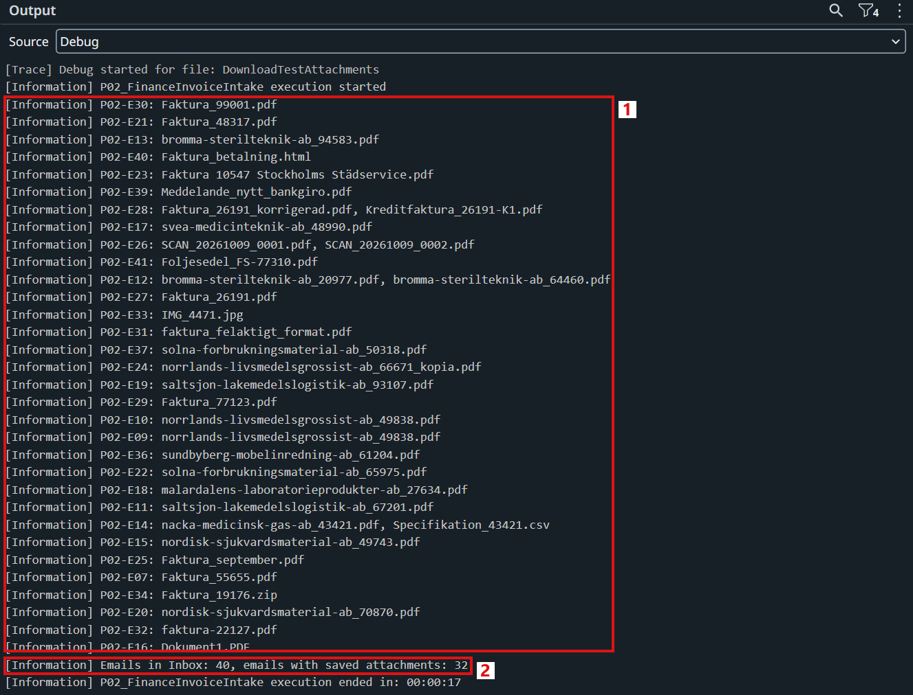

*Figure 13. The Output panel. Each line shows a scenario ID and its saved files, and the last line shows that 32 emails had attachments.*

The files were only saved, never opened. Some of them, such as the HTML file, the ZIP file and the photo, are suspicious or not readable on purpose.

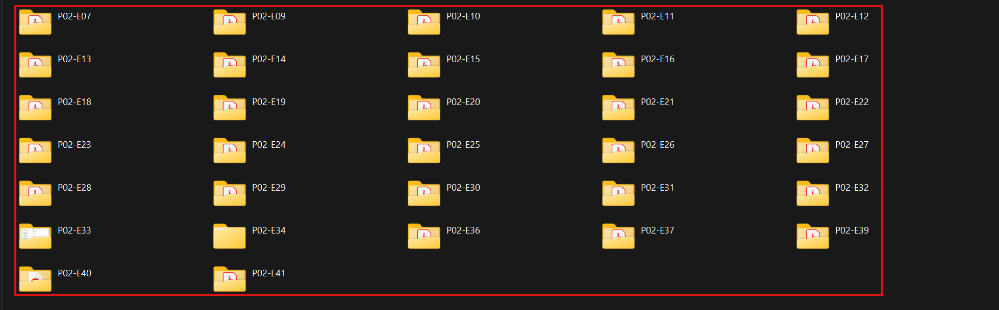

*Figure 14. The folder `TestData/Attachments` with one folder for each email that has attachments.*

### 4.3 Checking Samples in Personalportalen

Two emails were checked manually in Personalportalen, to make sure that the expected results match the hospital data.

The normal invoice 49838 from Norrlands Livsmedelsgrossist AB is found under Ekonomi > Fakturor. The invoice number, the purchase order PO-2026-0001 and the total 17 851,68 kr are the same as in the PDF. The amount of the purchase order without VAT (14 281,34 kr) is also the same as on the invoice, so this invoice is expected to be processed.

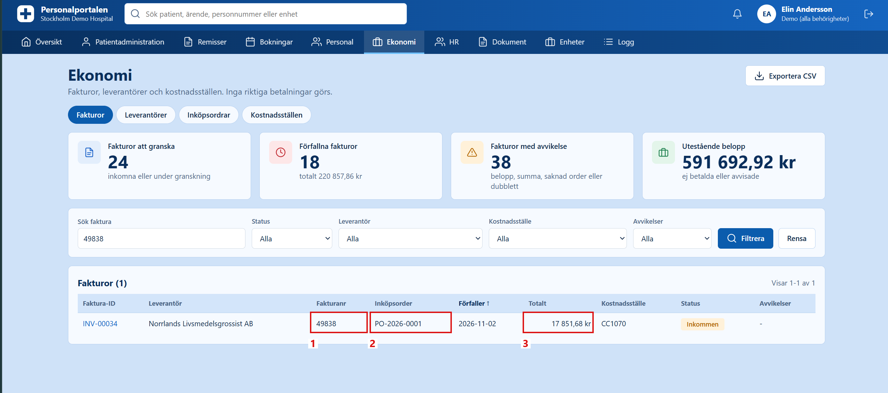

*Figure 15. Invoice 49838 in Personalportalen. The supplier, the purchase order and the total match the PDF.*

Invoice 70870 from Nordisk Sjukvårdsmaterial AB has 58 061,41 kr without VAT, but its purchase order PO-2026-0024 has 64 512,68 kr. The amounts are different, so this invoice is expected to go to Review.

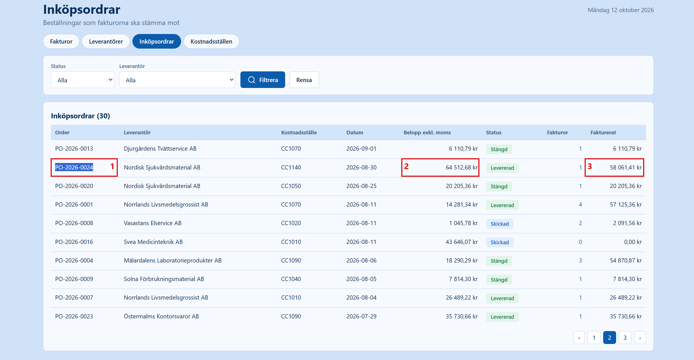

*Figure 16. Purchase order PO-2026-0024 in Personalportalen. The order amount is 64 512,68 kr, but the invoice has 58 061,41 kr.*

### 4.4 The Order of the Checks

Some emails have more than one problem, so the checks are always done in the same order, and the first problem that is found decides the result:

1. **Already handled:** an email that already has the label "Robot: Processed" is only moved to Processed.
2. **Not an invoice:** order confirmations, delivery notes, newsletters, automatic replies and internal messages stay in the Inbox.
3. **Suspicious:** a look-alike sender address, a bank detail change or an HTML attachment with a payment link goes to Review.
4. **No readable invoice:** a photo, a ZIP file or an email without an attachment goes to Review. These files are never opened.
5. **Broken file or data:** a file that is not a real PDF, a damaged PDF, a missing invoice number or a wrong total goes to Error.
6. **Scanned invoice:** a PDF without text goes to Review.
7. **Business check:** an unknown or inactive supplier, a wrong sender, a missing purchase order, a wrong amount, a wrong VAT, a duplicate, a reminder or a credit note goes to Review.
8. **Everything correct:** the email goes to Processed.

### 4.5 The Config File

The settings of the process are kept in `Data/Config.xlsx`, so they can be changed without changing the workflows. It contains the shared mailbox, the names of the folders and labels, the controller who gets the notifications, the addresses of the hospital systems, and the folders for the report. The lab login is only named there. The password itself is kept in the Windows Credential Manager.

The file was created with a second helper workflow, `Tools/CreateConfig.xaml`. The numbers in Figure 17 match the steps:

1. **Build Data Table** holds the settings.
2. **Create Folder** makes the folder `Data`.
3. **Write Range Workbook** writes the table to the sheet Settings, starting in cell A1. This activity writes the Excel file directly, so Excel does not need to be open.
4. **Log Message** writes how many settings were saved.

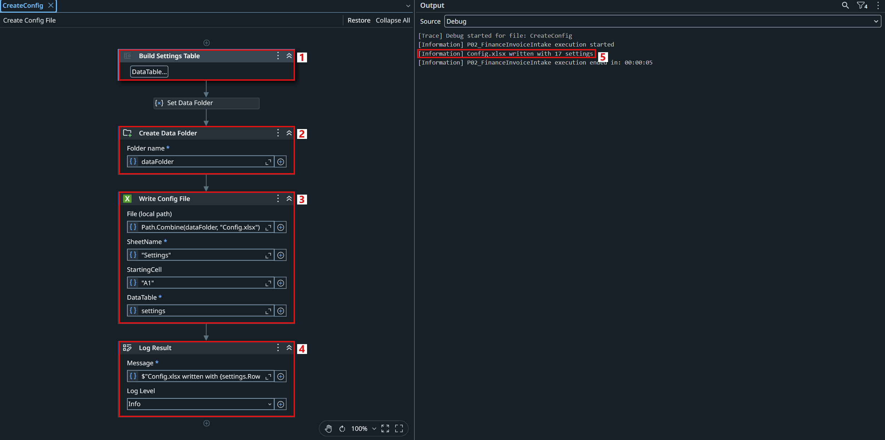

*Figure 17. The workflow `Tools/CreateConfig.xaml` on the left and its Output panel on the right. The log shows that 17 settings were written.*

The settings were typed in the Build Data Table window, which opens with the button DataTable... The table has three text columns: Name, Value and Description. The row LabCredential holds only the name of the Windows credential, not the password.

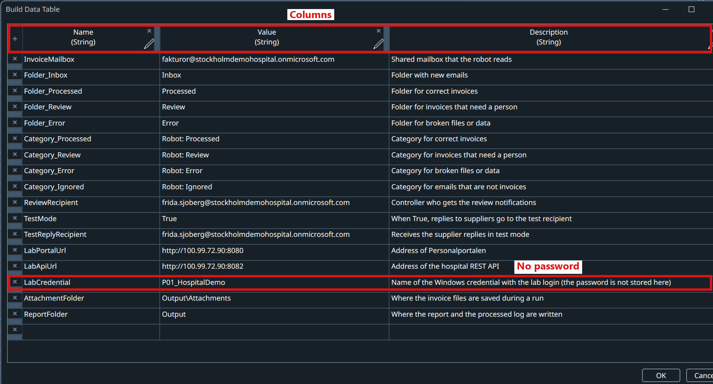

*Figure 18. The Build Data Table window with the 17 settings.*

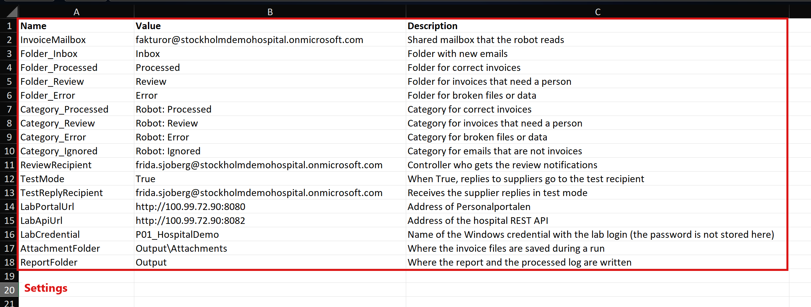

*Figure 19. The sheet Settings in `Data/Config.xlsx`. Each setting has a name, a value and a short description.*

## 5. Reading the Invoice PDFs

Each invoice arrives as a PDF attachment. Before the robot can compare an invoice with the hospital data, it must read the fields from the PDF: supplier, organisation number, invoice number, dates, purchase order, cost centre, amounts and bankgiro. Some test files are broken on purpose, so the reading must also find these problems without stopping the robot.

### 5.1 PDF Package

The text of a PDF is read with the activity Read PDF Text, which comes from the PDF package (`UiPath.PDF.Activities`). It was added in Manage Packages in the same way as the other packages.

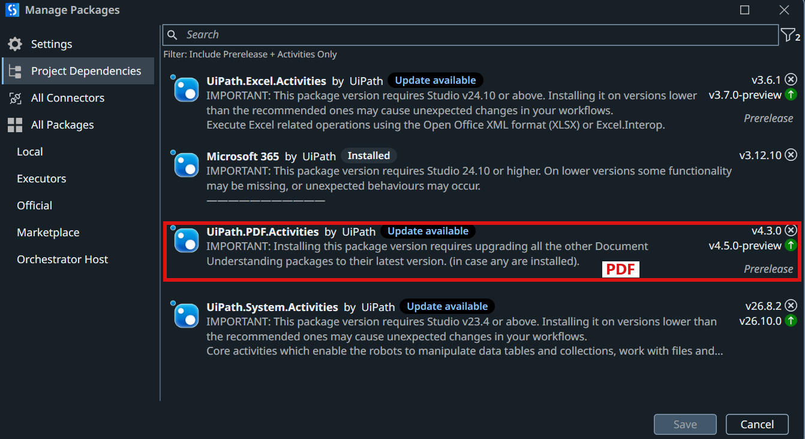

*Figure 20. Manage Packages with the installed PDF package, version 4.3.0.*

### 5.2 Looking at the PDF Text First

To find the fields, it must be known what the text of an invoice looks like after it is read. For this, a small helper workflow, `Tools/ExportPdfText.xaml`, reads every PDF in `TestData/Attachments` and saves its text as a text file in `Output/PdfText`. The numbers in Figure 21 match the steps:

1. **Assign** finds all files with the extension `.pdf`, also in upper case, such as `Dokument1.PDF`.
2. **Create Folder** makes the folder for the text files.
3. **For Each** goes through the PDF files.
4. **Read PDF Text** reads the text of one PDF.
5. **Write Text File** saves the text, and **Log Message** writes the number of characters.
6. **Try Catch** catches the error if a file cannot be read, so the loop continues with the next file.
7. **Log Message** writes the number of PDF files at the end.

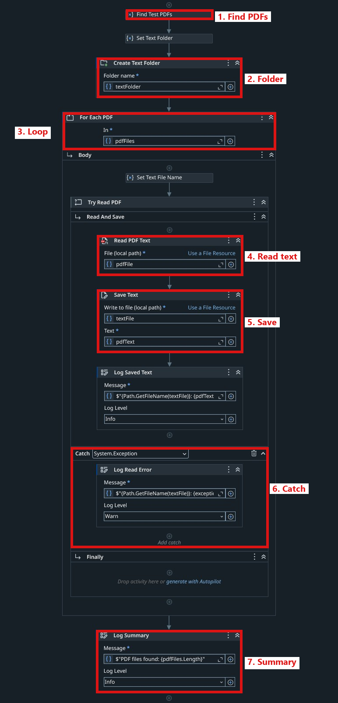

*Figure 21. The workflow `Tools/ExportPdfText.xaml` in the Studio designer.*

The workflow was run with Debug File. At the file `faktura_felaktigt_format.pdf` (P02-E31), Studio paused at Read PDF Text and showed an error. This file ends with `.pdf`, but it contains only plain text. In Debug mode, Studio stops at every error, even inside a Try Catch. After Continue was pressed, the Catch wrote a warning and the loop went on.

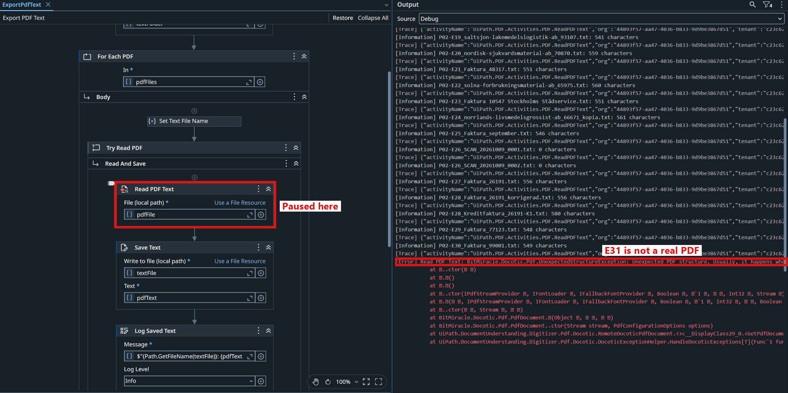

*Figure 22. Debug mode stopped at Read PDF Text, because P02-E31 is not a real PDF.*

The run found 32 PDF files. The text of 29 files was saved. The two scanned files of P02-E26 and the damaged file `faktura-22127.pdf` (P02-E32) gave 0 characters. The damaged file did not give an error, so an empty text alone does not show if a PDF is scanned or broken.

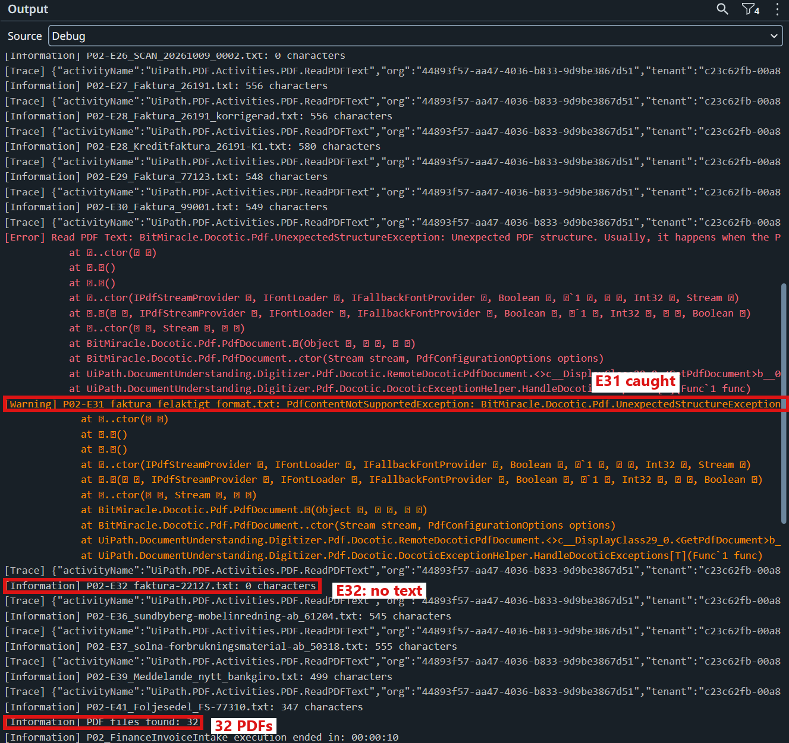

*Figure 23. The end of the run. The warning for P02-E31, the empty text of P02-E32 and the number of PDF files are marked.*

The text of a normal invoice has one field on each line, with the label first and the value after it. This is the text of invoice 49838:

```text
FAKTURA
Stockholm Demo Hospital
Från Norrlands Livsmedelsgrossist AB
Organisationsnummer 556510-7961
Fakturanummer 49838
Fakturadatum 2026-10-03
Förfallodatum 2026-11-02
Er referens PO-2026-0001
Kostnadsställe CC1070
Belopp exkl. moms 14 281,34 kr
Moms 25 % 3 570,34 kr
Att betala 17 851,68 kr
Bankgiro 5319-9756
```

Some lines, such as the address and the description, are left out here. In the invoice without an invoice number (P02-E25), the line `Fakturanummer` has no value. The first line is the title of the document: `FAKTURA` for an invoice, `KREDITFAKTURA` for a credit note and `FÖLJESEDEL` for a delivery note.

### 5.3 The ReadInvoice Workflow

The reading is done in one reusable workflow, `Workflows/ReadInvoice.xaml`. It gets the path of one file and gives back the fields and a result. The result is one of five values:

| Result | Meaning |
|---|---|
| Invoice | The fields were found, and the total is net plus VAT |
| CreditNote | The PDF is a credit note, which is handled by a person |
| NotInvoice | The PDF is another document, for example a delivery note |
| Scanned | The PDF has no text, so it is probably a scanned paper invoice |
| Error | The file is broken or important data is missing |

With every result except Invoice, the argument `out_Reason` explains the problem in a short sentence.

The arguments were created in the Data Manager under Arguments. The workflow has one input, `in_FilePath`, and 14 outputs: the result, the reason and the fields. The amounts have the type Decimal, so they can be used in calculations. When all activities are collapsed, the designer shows the order of the work: first the file bytes, then the file checks, then the fields, and last the content checks.

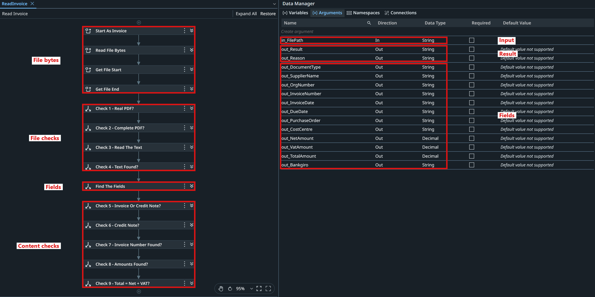

*Figure 24. `Workflows/ReadInvoice.xaml` with all activities collapsed on the left, and its arguments in the Data Manager on the right.*

The workflow starts with the result Invoice. Then it runs a list of checks. Each check is an **If** activity, and it only runs if no earlier check has found a problem. For this reason, every condition starts with `out_Result = "Invoice"`. In this way, the first problem decides the result.

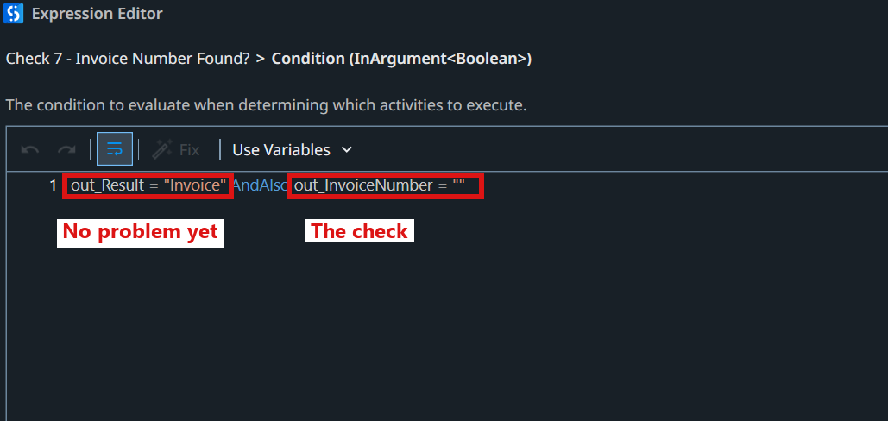

*Figure 25. The condition of Check 7 in the Expression Editor. The first part makes sure that no earlier check has found a problem, the second part is the check itself.*

The first part checks the file itself (Figure 26):

1. **Assign** sets the result to Invoice.
2. **Assign** reads all bytes of the file and takes the first 5 characters and the last part of the file.
3. **Check 1:** a real PDF file always starts with `%PDF-`. The name of the file is not trusted, only its content.
4. **Check 2:** a complete PDF file ends with `%%EOF`. If this mark is missing, the file was cut off and is damaged.
5. **Check 3:** **Read PDF Text** reads the text inside a **Try Catch**. If the file cannot be opened, the Catch sets the result to Error. If the error message talks about a password, the reason says that the PDF is protected with a password.
6. **Check 4:** if the text is empty, the result is Scanned. Scanned invoices are not read with OCR in this project, so a person checks them.

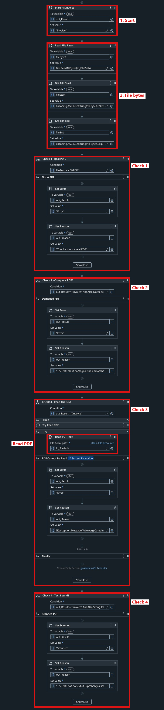

*Figure 26. The first part of `Workflows/ReadInvoice.xaml`: the start and checks 1 to 4.*

The second part finds the fields with regular expressions (Figure 28). Each field has its own **Assign** with `Regex.Match`. For example, the invoice number is found with this pattern:

```text
(?m)^(?:Fakturanummer|Kreditfakturanummer)[ \t]+(\S+)
```

It means: a line that starts with `Fakturanummer` or `Kreditfakturanummer`, then spaces, then the value. `[ \t]` allows only spaces and tabs, so an empty field does not take the value from the next line. The part in brackets, `(\S+)`, is the value, and `.Groups(1).Value` takes it out of the match. If the line is not found, the result is an empty text.

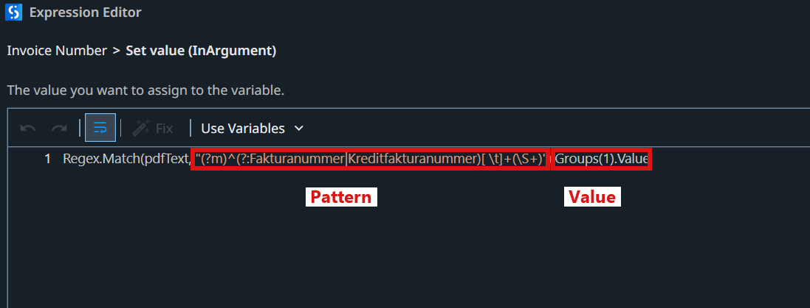

*Figure 27. The Assign "Invoice Number" in the Expression Editor, with the pattern and the part that takes the value.*

The amounts are first read as text, for example `14 281,34`. Then the spaces are removed and the decimal comma is changed to a point, so the text can be turned into a number with `Decimal.Parse`.

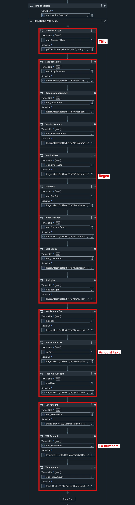

*Figure 28. The second part: the document title, the fields with regular expressions, the amount texts and the conversion to numbers.*

The last part checks the content (Figure 29):

1. **Check 5:** if the title is not `FAKTURA` or `KREDITFAKTURA`, the result is NotInvoice.
2. **Check 6:** if the title is `KREDITFAKTURA`, the result is CreditNote. Credit notes are not checked further, because a person handles them.
3. **Check 7:** if no invoice number was found, the result is Error.
4. **Check 8:** if the net amount, the VAT or the total is missing, the result is Error.
5. **Check 9:** if net plus VAT is not exactly the total, the result is Error. The reason shows the three amounts.

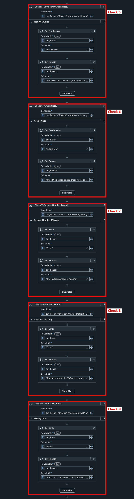

*Figure 29. The third part: checks 5 to 9.*

### 5.4 Testing ReadInvoice

The expected result of each test PDF was written in `TestData/read_invoice_expected.csv`, with the expected invoice number and purchase order. The test workflow `Tests/Test_ReadInvoice.xaml` reads this file and calls ReadInvoice for every row (Figure 30):

1. **Read CSV** reads the expected results.
2. **Build Data Table** makes an empty table for the test results.
3. **For Each Row** goes through the test files.
4. **Invoke Workflow File** runs `Workflows\ReadInvoice.xaml` with the path of the file.
5. **Assign** compares the result with the expected result. For an invoice, the invoice number and the purchase order must also match.
6. **Add Data Row** saves all fields and the result in the table.
7. **If** counts the passed files and writes OK or FAIL to the log.

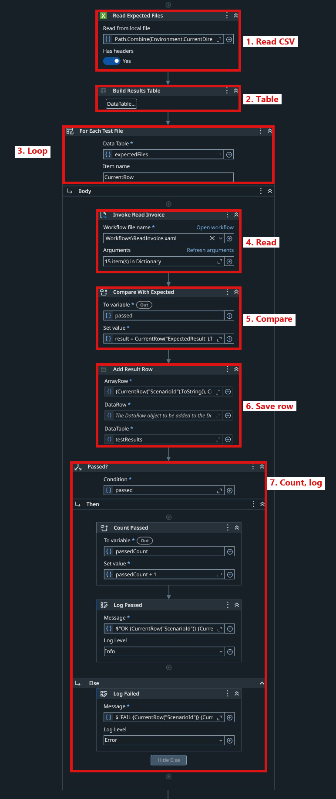

*Figure 30. The first part of `Tests/Test_ReadInvoice.xaml`.*

None of the test emails has a password-protected PDF. To test this case anyway, the second part of the test makes its own locked file (Figure 31):

1. **Manage PDF Password** saves a copy of invoice 49838 with a password. The password is a random value (`Guid.NewGuid()`) that is created during the run and never saved.
2. **Invoke Workflow File** runs ReadInvoice with the locked copy.
3. **Assign** checks that the result is Error and that the reason talks about the password.
4. **If** counts the result and writes OK or FAIL to the log.
5. **Write CSV** saves the table of all results as `Output/read_invoice_results.csv`.
6. **Log Message** writes the summary.

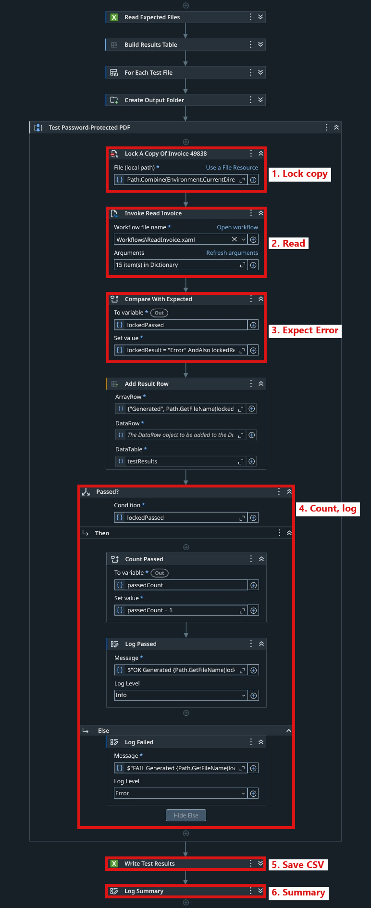

*Figure 31. The second part of `Tests/Test_ReadInvoice.xaml`: the test with the locked PDF and the end of the test.*

The first run found one problem: the credit note `Kreditfaktura_26191-K1.pdf` (P02-E28) got the result Error, because its own amounts do not add up. It credits the wrong total of invoice 26191. Credit notes are handled by a person anyway, so Check 6 was added, and the credit note now gets the result CreditNote.

After this change, the test was run with Debug File, and all 33 test files passed.

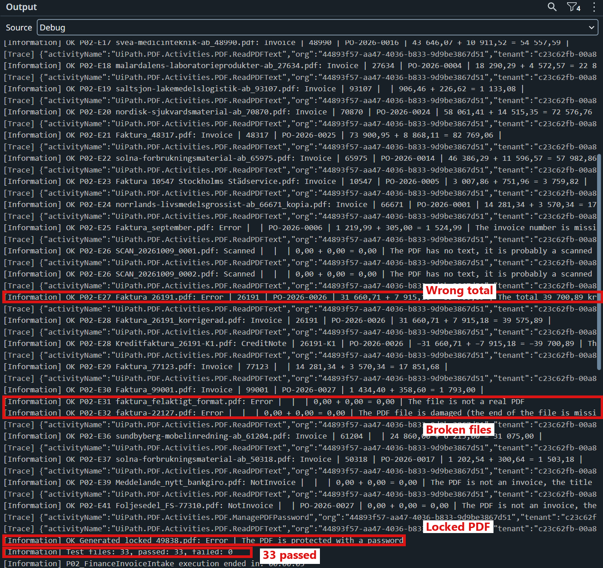

*Figure 32. The end of the test run. The wrong total of P02-E27, the two broken files, the locked PDF and the summary are marked.*

| Result | Files | Examples |
|---|---|---|
| Invoice | 23 | normal invoices, also reminders, duplicates and invoices with a wrong amount or VAT |
| CreditNote | 1 | the credit note of P02-E28 |
| NotInvoice | 2 | the delivery note (P02-E41) and the letter about a new bankgiro (P02-E39) |
| Scanned | 2 | the two scanned invoices of P02-E26 |
| Error | 5 | not a real PDF, damaged PDF, no invoice number, wrong total, locked PDF |

Many files with the result Invoice still have a business problem, for example an amount that differs from the purchase order (P02-E20) or a wrong VAT (P02-E21). ReadInvoice only checks that the PDF can be read and that its own numbers add up. The VAT of P02-E21 is 12 % instead of 25 %, but net plus VAT is still the total, so only a VAT check against the purchase order and the VAT rate can find it.

## 6. Checking the Invoices Against the Finance Data

After the PDF is read, the invoice is compared with the finance data of the hospital. The suppliers and the registered invoices are read from the lab API, and the purchase orders are read from Personalportalen with the browser, because the API has no purchase orders. Then every email gets a class and a target folder. In this part, nothing in the mailbox is changed: the result is tested in a dry run.

### 6.1 New Packages

Three packages were added in Manage Packages (Figure 33):

1. **UiPath.Credentials.Activities** for the activity Get Credential, which reads a login from the Windows Credential Manager.
2. **UiPath.UIAutomation.Activities** for the browser automation in Personalportalen.
3. **UiPath.WebAPI.Activities** for the activities HTTP Request and Deserialize JSON.

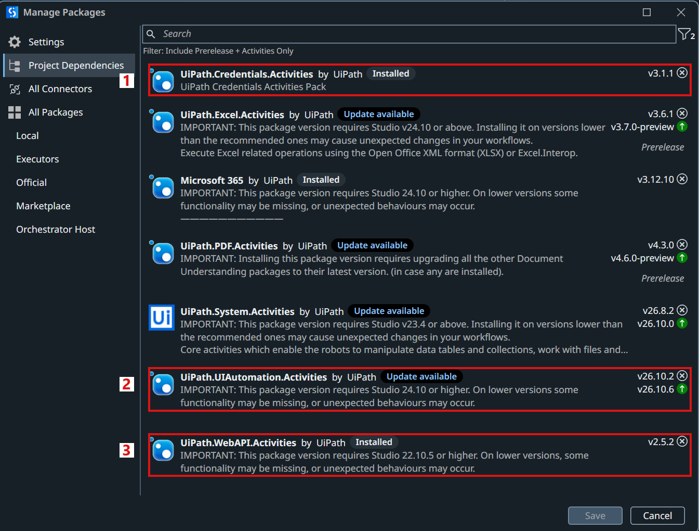

*Figure 33. Manage Packages with the Credentials, UI Automation and Web API packages.*

### 6.2 Reading the Config Once

Several workflows need the settings, so `Workflows/ReadConfig.xaml` reads `Data/Config.xlsx` once and gives back a dictionary. **Read Range Workbook** reads the sheet Settings, and **For Each Row** adds each name and value to the dictionary. The other workflows get this dictionary as the argument `in_Config` and read a setting with, for example, `in_Config("LabApiUrl")`.

The numbers in Figure 34 match the steps:

1. **Read Range Workbook** reads the sheet Settings of `Data/Config.xlsx` into a data table.
2. **Assign** makes an empty dictionary.
3. **For Each Row** goes through the settings.
4. **If** skips empty rows, and **Assign** adds the name and the value to the dictionary.
5. **Log Message** writes how many settings were read.

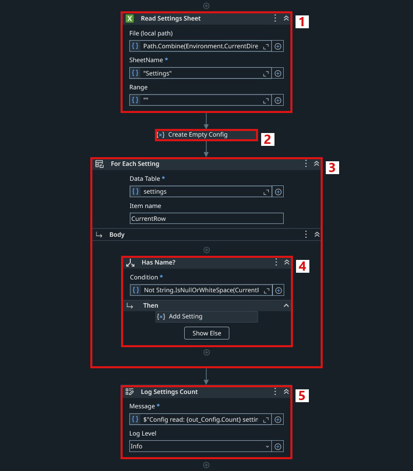

*Figure 34. The workflow `Workflows/ReadConfig.xaml`.*

One new setting was added in `Tools/CreateConfig.xaml`: `LabApiCredential = P02_LabApi`. After the workflow was run again, the config file had 18 settings.

### 6.3 Logging In to the Lab API

The API needs a token. The token is received from `POST /v1/token` with a user name and a password, and then it is sent with every other call.

The first try used the same Windows credential as the portal login, and the API answered **401 Wrong username or password**. The API uses the same accounts as Personalportalen, but it needs the exact values of the finance account. So a separate generic credential, `P02_LabApi`, was created in the Windows Credential Manager with the user name `finance` (Figure 35). The password is only stored there.

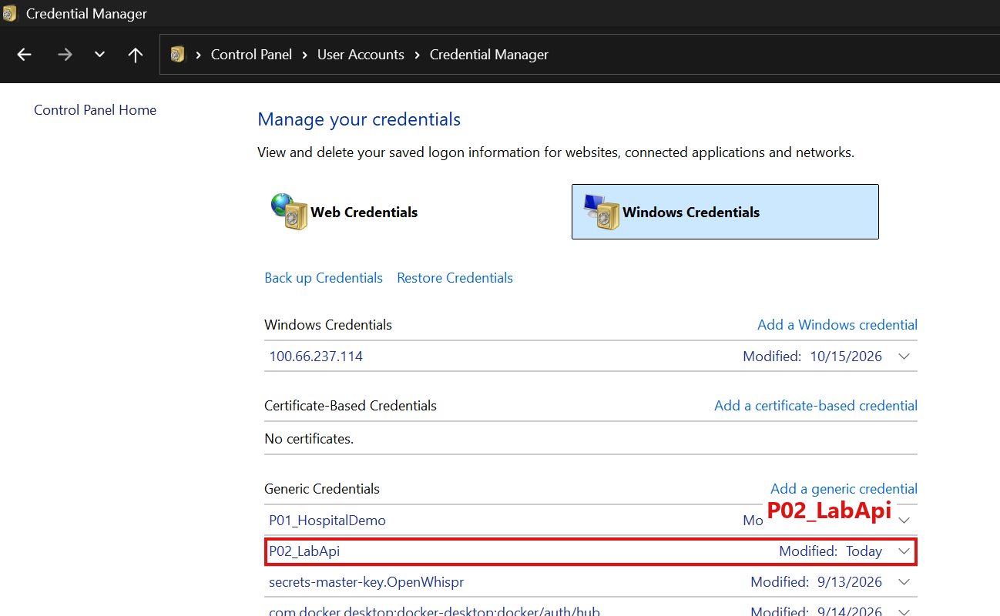

*Figure 35. The generic credential `P02_LabApi` in the Windows Credential Manager.*

The login is the first part of `Workflows/GetFinanceData.xaml`. The numbers in Figure 36 match the steps:

1. **Get Credential** reads the user name and the password of `P02_LabApi`. The password is a SecureString.
2. **Assign** "Build Login Body" makes the JSON text `{"username": ..., "password": ...}` with Newtonsoft `JObject`. This is the only place where the password is turned into normal text, with `New NetworkCredential("", password).Password`.
3. **HTTP Request** sends the body with POST to `/v1/token`, with the content type `application/json`.
4. **If** stops the workflow with an error if the status is not 200.
5. **Deserialize JSON** turns the answer into a JSON object.
6. **Assign** takes the token and the role from the answer.
7. **If** stops the workflow if the role is not `finance`.
8. **Log Message** writes the user name and the role. The password and the token are never written to the log.

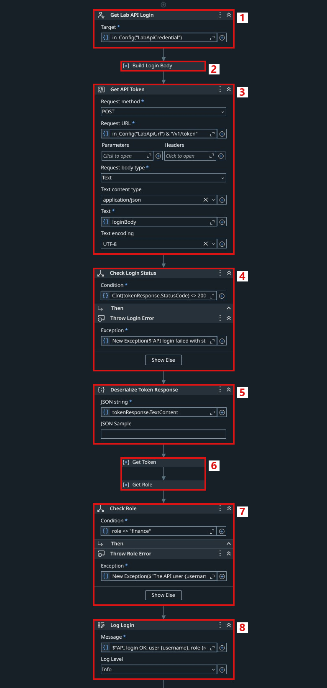

*Figure 36. The login part of `Workflows/GetFinanceData.xaml`.*

Figure 37 shows the properties of the login call. The URL comes from the config (2), the body is the variable `loginBody` (3), and the call itself has no authentication (4), because the token does not exist yet. Continue on error is No (5), so a failed call stops the workflow.

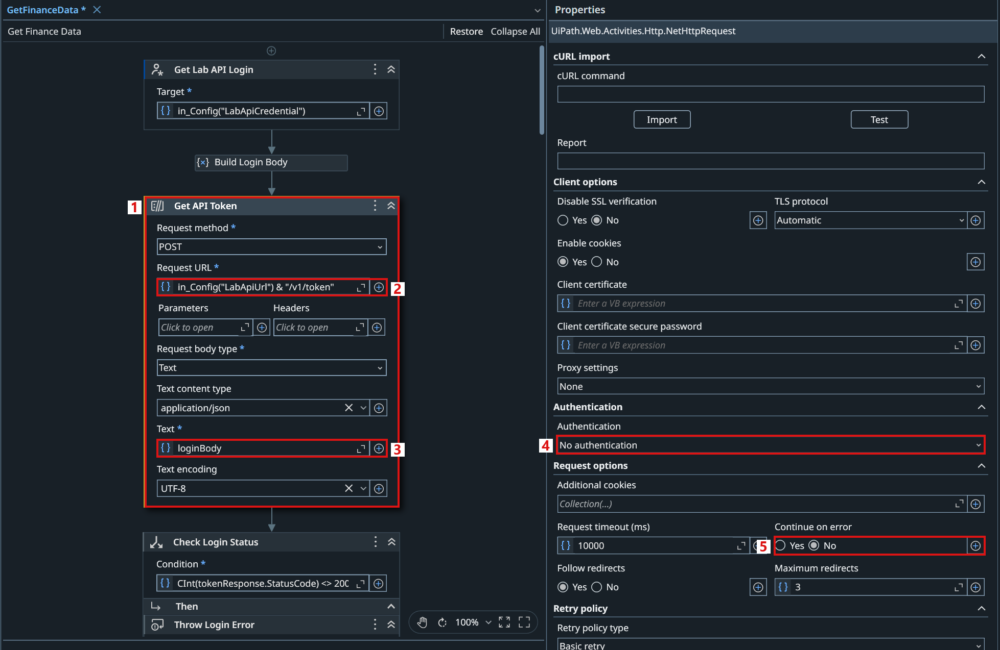

*Figure 37. The HTTP Request "Get API Token" and its Properties panel.*

Studio has a Workflow Analyzer rule, **ST-SEC-009 SecureString Misusage**, that treats every change from SecureString to normal text as an error. The API needs the password as normal text in the JSON body, so this change cannot be avoided. The rule was set to **Warning** for this project in Project Settings > Workflow Analyzer (Figure 38). The rule is still on, so Studio still shows the warning.

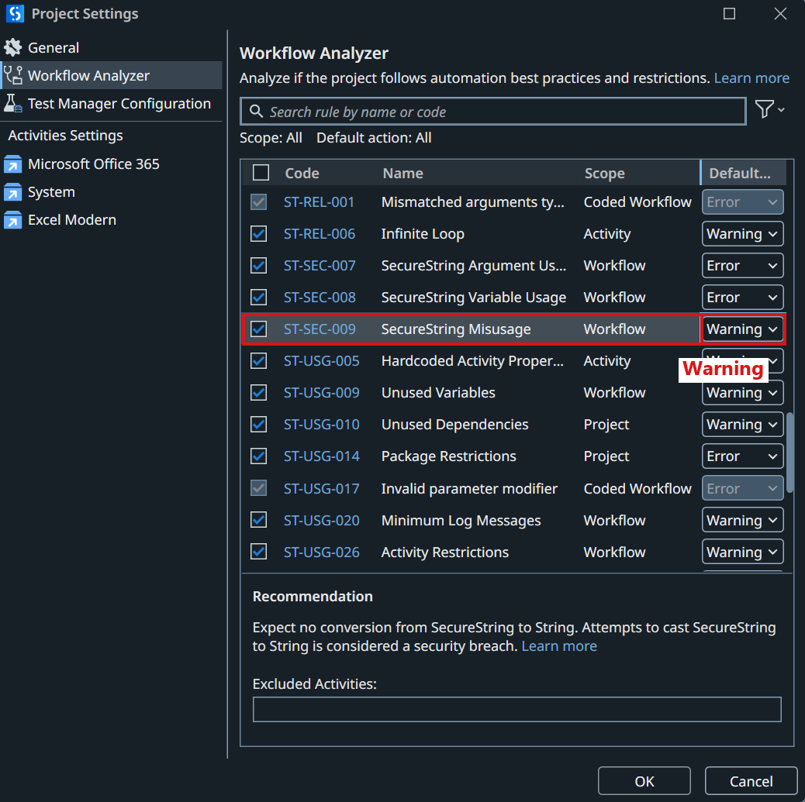

*Figure 38. The rule ST-SEC-009 with the level Warning.*

The second part reads all suppliers and all invoices (Figure 39):

1. **Build Data Table** makes the two empty tables.
2. **Assign** starts at page 1.
3. **Do While** repeats the reading while there are more pages.
4. **HTTP Request** sends GET to `/v1/suppliers` with the parameters `page` and `per_page` (100). Here the authentication is the bearer token.
5. **If** stops the workflow if the status is not 200.
6. **Deserialize JSON** reads the page, and **Assign** reads the number of pages.
7. **For Each** goes through the items of the page, and **Add Data Row** adds each supplier to the table.
8. **Assign** goes to the next page.
9. The loop ends when the last page has been read.
10. The invoices are read in the same way from `/v1/invoices`.

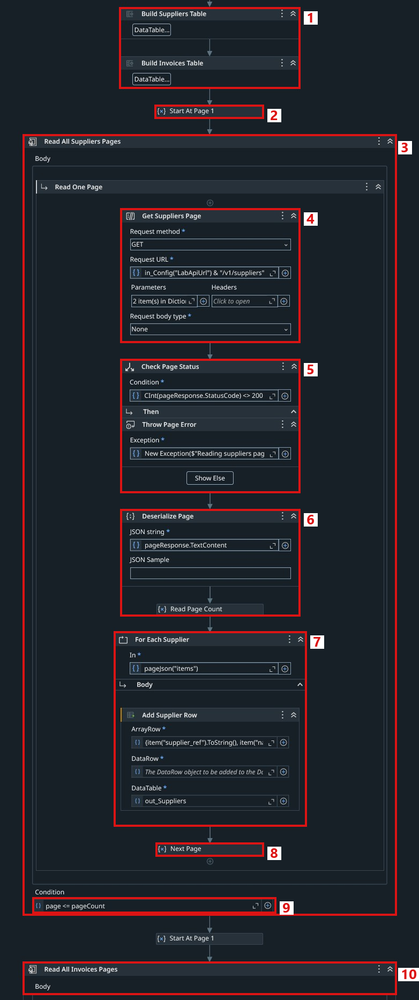

*Figure 39. The second part of `Workflows/GetFinanceData.xaml`: reading all pages of the suppliers.*

The test workflow `Tests/Test_GetFinanceData.xaml` calls ReadConfig and GetFinanceData and checks some known values: 15 suppliers, 73 invoices, SUP-015 has the status Inaktiv and INV-00011 has the status Betald (Figure 40).

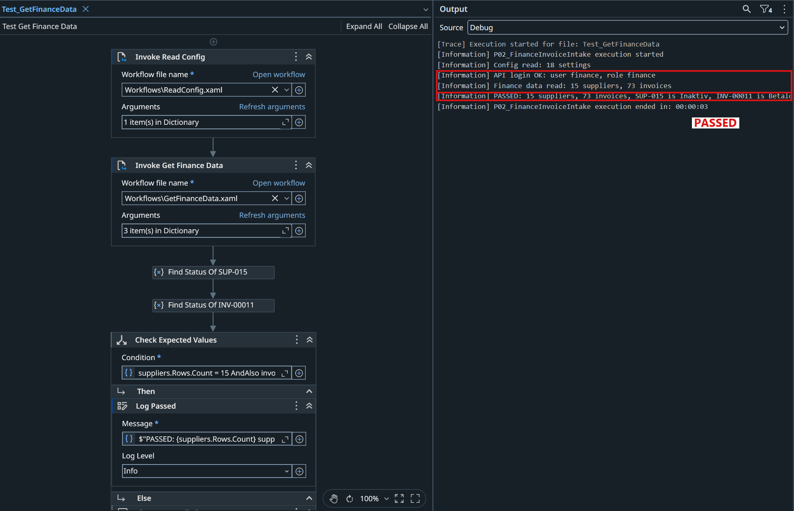

*Figure 40. `Tests/Test_GetFinanceData.xaml` and its Output panel with the login line and the PASSED line.*

**What should be done from the start in a new project:**

- Use a separate Windows credential for the API, with the exact user name and password of a finance account, and put only its name in the config.
- Turn the SecureString into text in only one Assign, and build the JSON with Newtonsoft, not by joining strings.
- Check both the status code and the role after the login, and never log the password or the token.
- Set ST-SEC-009 to Warning for the project before the first build, and explain why.

### 6.4 Reading the Purchase Orders in Personalportalen

The purchase orders are shown in a table on the page Ekonomi > Inköpsordrar, 10 orders on each page. `Workflows/GetPurchaseOrders.xaml` reads the order number, the supplier and the amount without VAT from every row, in the same way as the patient tables in project 1.

The numbers in Figures 41 to 43 match the steps:

1. **Build Data Table** makes the table for the purchase orders.
2. **Use Application/Browser** opens Personalportalen in Chrome, or uses the tab that is already open.
3. **Go To URL** opens the purchase orders page and waits until it has loaded.
4. **Check App State** looks for the login form for up to 5 seconds.
5. If the form is shown, **Get Credential** reads the portal login, and **Type Into** and **Click** log in.
6. If the form is not shown, the robot is already logged in.
7. **Assign** starts at page 1.
8. **While** repeats the reading for each page.
9. **Go To URL** opens the page with the number `page`.
10. **Assign** starts at the first row of the table.
11. **While** repeats the reading for each row, at most 10 rows.
12. **Check App State** checks that the row exists. If it does not exist, the page has no more rows.
13. **Get Text** reads the order number, the supplier and the amount without VAT of the row.
14. **Assign** turns the amount text, for example `73 900,95 kr`, into a number, and **Add Data Row** adds the row to the table.
15. **Check App State** looks for the "Nästa sida" (next page) link. If it exists, the next page is read, otherwise the loop ends.
16. **If** stops the workflow with an error when no purchase order was read.
17. **Log Message** writes the number of purchase orders and pages.

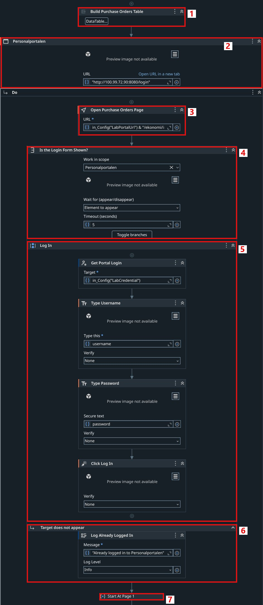

*Figure 41. The first part of `Workflows/GetPurchaseOrders.xaml`: opening the page and the login.*

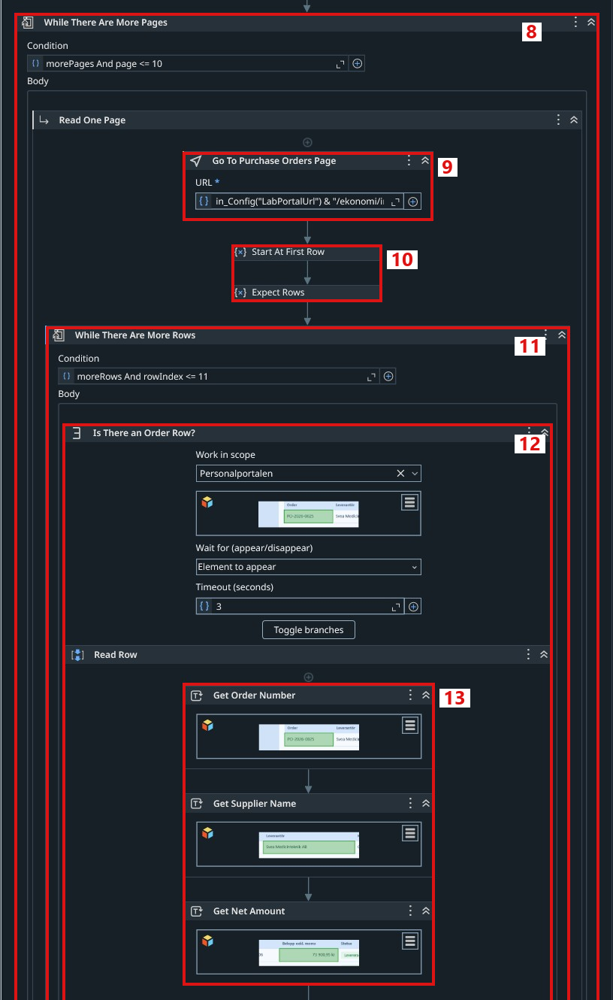

*Figure 42. The loop over the pages and the rows, with the three Get Text activities.*

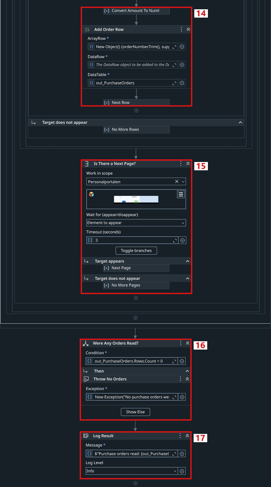

*Figure 43. The end of the row loop, the check for the next page and the check that orders were read.*

The four targets were added to the Object Repository: one screen with the order cell, the supplier cell, the amount cell and the "Nästa sida" (next page) link (Figure 44).

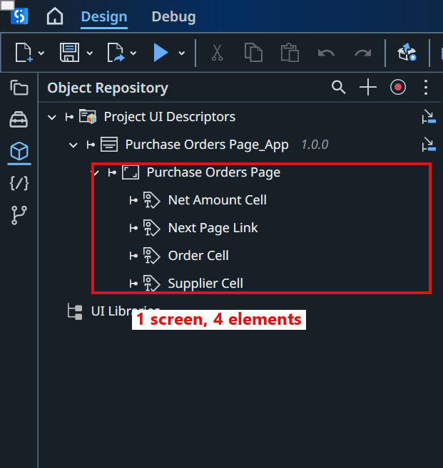

*Figure 44. The Object Repository with the screen "Purchase Orders Page" and its four elements.*

The same Get Text activity must read row 1, row 2, row 3 and so on. So the row number in the selector is a variable (Figures 45 and 46). The selector is made with `string.Format`, and `tableRow='{0}'` is filled with the variable `rowIndex`. The first data row is row 2, because row 1 is the header.

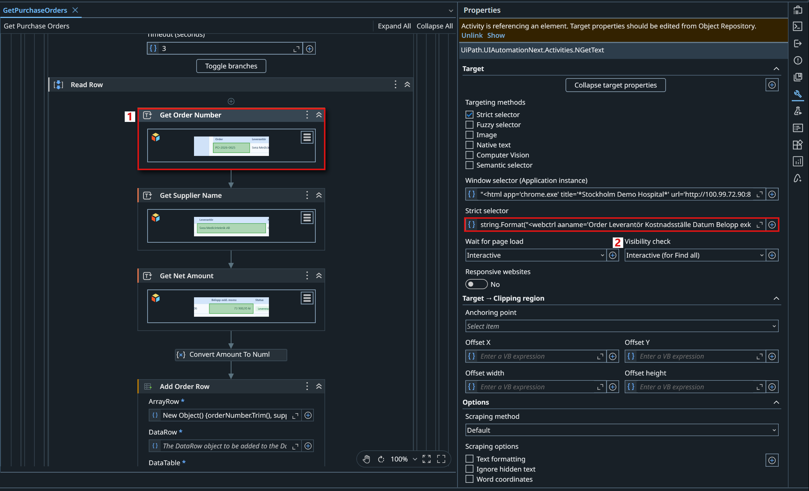

*Figure 45. Get Order Number (1) is linked to the Object Repository. Its strict selector (2) contains the row number.*

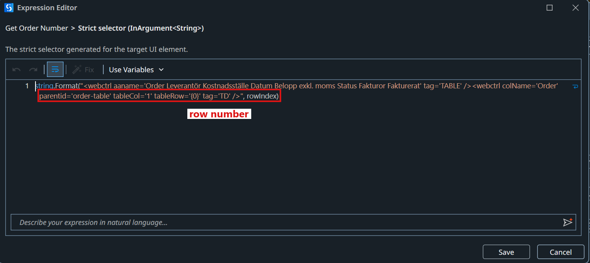

*Figure 46. The strict selector in the Expression Editor. `tableRow='{0}'` is replaced by `rowIndex`.*

The first run from Studio gave a wrong result. Most invoices got the class "Wrong PO", and only 26 of 40 emails were correct (Figure 47). The log showed "Already logged in to Personalportalen", but the browser showed the login page, and 0 purchase orders were read. The check for the login form had run while the new browser tab was still loading. It did not find the form within 3 seconds, so the robot thought it was already logged in.

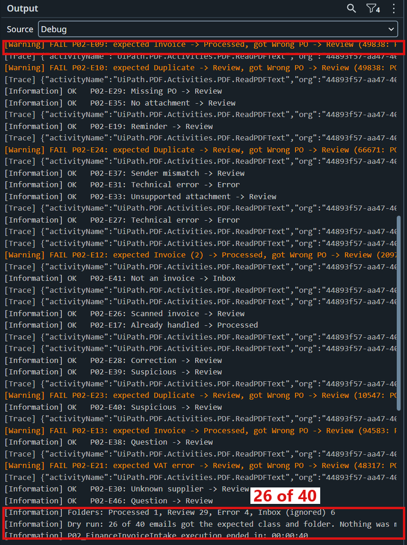

*Figure 47. The first run from Studio. The FAIL lines say "got Wrong PO", and only 26 of 40 emails got the expected result.*

Two changes fixed it. First, **Go To URL** opens the purchase orders page before the login check, and this activity waits until the page has loaded. If the session has ended, the portal shows the login page, and the check now finds the form, with a timeout of 5 seconds. Second, if no purchase order is read, the workflow now stops with the error "No purchase orders were read". A missing login or an empty page can no longer give a silent wrong result. After the fix, the robot logged in by itself when the portal session had ended, and all 30 purchase orders were read.

### 6.5 The History of Processed Invoices

An invoice is a duplicate if the same supplier and invoice number was handled before. One email in the test data (P02-E24) is a copy of an invoice that is already in the folder Processed from an earlier run. In the portal, this invoice only has the status Inkommen, so the portal alone does not show the problem.

`Workflows/GetProcessedHistory.xaml` reads the emails in the folder Processed, downloads their PDF attachments to `Output/History`, and reads each PDF with ReadInvoice. The organisation number and the invoice number of every invoice are saved in a history table. During the run, every correct invoice is also added to this table, so the second email with invoice 49838 (P02-E10) is found as a duplicate of P02-E09.

The numbers in Figures 48 and 49 match the steps:

1. **Build Data Table** makes the history table with the columns OrgNumber, InvoiceNumber and Source.
2. **Assign** sets the folder `Output/History`.
3. **Get Email List** reads the emails in the folder Processed of the shared mailbox.
4. **For Each** goes through the emails. Only emails with attachments are used.
5. **Create Folder** and **Download Email Attachments** save the attachments of the email in its own folder.
6. **For Each** goes through the saved files.
7. **If** keeps only the PDF files.
8. **Invoke Workflow File** reads the PDF with ReadInvoice.
9. **If** adds an invoice or a credit note to the history table.
10. **Assign** counts the emails, so the next email gets the next folder.
11. **Log Message** writes the number of emails and invoices.

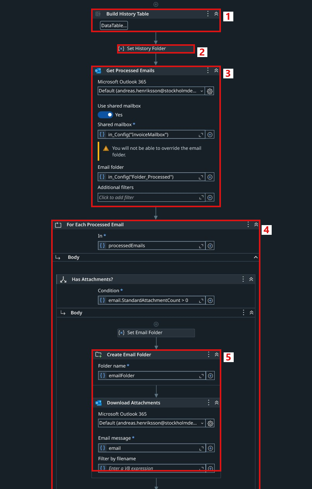

*Figure 48. The first part of `Workflows/GetProcessedHistory.xaml`: reading the emails in Processed and saving their attachments.*

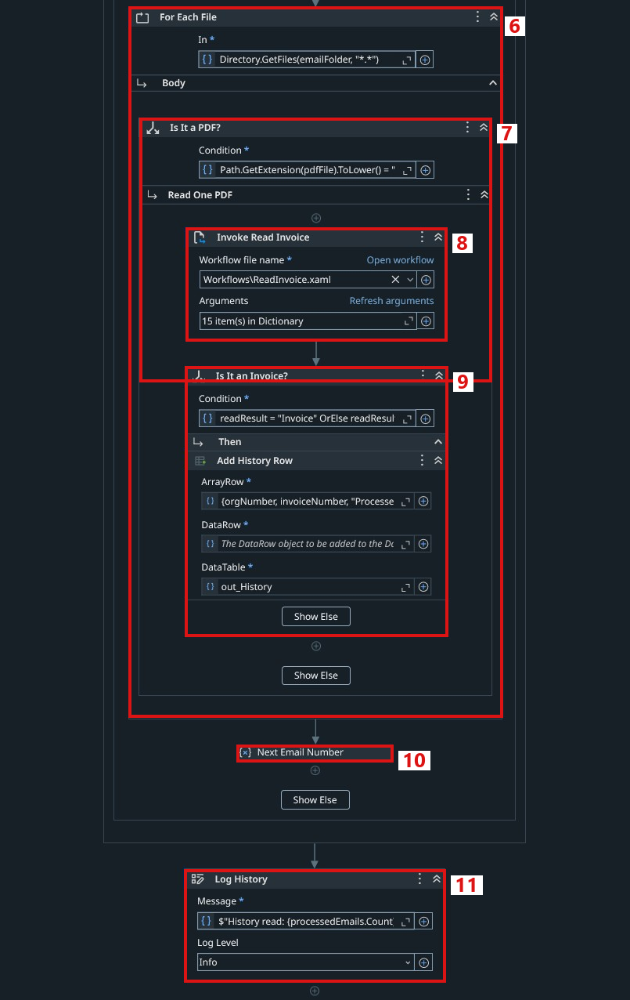

*Figure 49. The second part: reading each PDF and adding it to the history table.*

In the test mailbox, the folder Processed has 2 emails with 2 invoices, 66671 and 74456.

### 6.6 The Business Checks

`Workflows/CheckInvoice.xaml` checks one invoice. It works like ReadInvoice: each check is an **If** that only runs if no earlier check has found a problem (`out_Class = ""`), so the first problem decides the result. The labels in Figures 50 to 52 match the list:

- **A** starts with no result and finds the supplier by the organisation number from the PDF.
- **Check 1:** the supplier must be in the supplier register (Unknown supplier).
- **B** reads the name, email address and status of the supplier.
- **Check 2:** the supplier must have the status Aktiv (Inactive supplier).
- **C** checks if the sender is an internal hospital address. Internal senders may forward invoices.
- **Check 3:** an external sender must be the registered email address of the supplier (Sender mismatch).
- **Check 4:** a subject with "påminnelse" is a reminder (Reminder).
- **Check 5:** a credit note is handled by a person (Correction).
- **Check 6:** the invoice must have a purchase order (Missing PO).
- **D** finds the purchase order in the table from Personalportalen.
- **Check 7:** the purchase order must exist (Wrong PO).
- **E** reads the supplier and the amount of the purchase order.
- **Check 8:** the purchase order must belong to the same supplier (Wrong PO).
- **Check 9:** the amount without VAT must be the amount of the purchase order (Amount mismatch).
- **F** calculates 25 % of the amount without VAT.
- **Check 10:** the VAT must be 25 %, with a difference of at most 0,01 kr (VAT error).
- **Check 11:** the invoice must not be in the history table (Duplicate).
- **Check 12:** the invoice must not be in the portal with the status Betald or Godkänd (Duplicate).
- **13:** if no check found a problem, the result is Invoice.

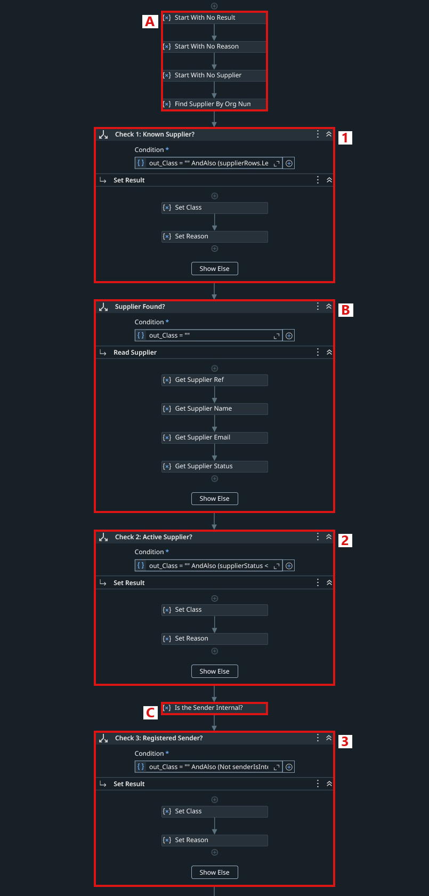

*Figure 50. The first part of `Workflows/CheckInvoice.xaml`: checks 1 to 3.*

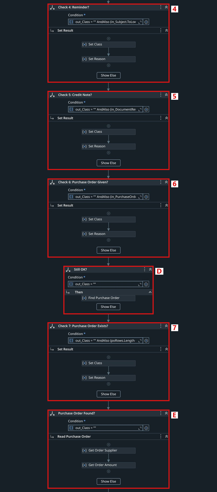

*Figure 51. The second part: checks 4 to 7.*

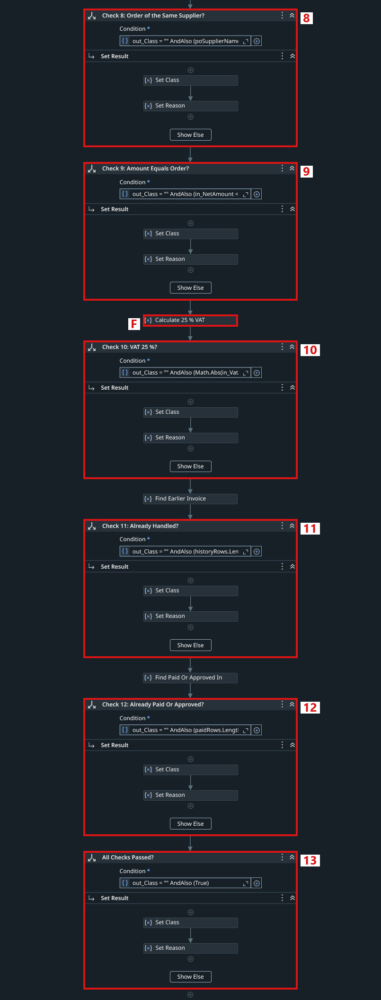

*Figure 52. The third part: checks 8 to 12 and the result Invoice.*

The order of the checks comes from the expected results. For example, P02-E20 and P02-E21 are approved in the portal, but the expected class is the amount problem and the VAT problem. So the duplicate checks come last. P02-E19 is a reminder without a purchase order, and the expected class is Reminder, so the reminder check comes before the purchase order check. Invoices with the portal status Inkommen are not duplicates: P02-E13 has an extra Inkommen record in the portal, and it is still a correct invoice.

### 6.7 Classifying One Email

`Workflows/ClassifyEmail.xaml` decides the class and the target folder of one email. It follows the rule order from section 4.4, and it uses the same pattern with `out_Class = ""`.

The first rules only need the email itself (Figures 53 to 55):

- **A** reads the subject, the sender address and domain, the hospital domain and the names of the attachments.
- **Rule 1:** an email with the category "Robot: Processed" was already handled in an earlier run.
- **Rules 2 to 5:** automatic replies, newsletters, order confirmations and internal messages without an attachment are not invoices. They stay in the Inbox.
- **B** looks through the attachment names for HTML files.
- **Rule 6a:** an HTML attachment is suspicious. It is never opened.
- **Rule 6b:** a subject about new payment details is suspicious.
- **C** looks for a supplier with the same name as the sender.
- **Rule 6c:** a sender who uses the name of a supplier, but a different domain, is suspicious. This finds the look-alike domain of P02-E39.
- **Rules 7a and 7b:** an email without an attachment is a question or a missing attachment.

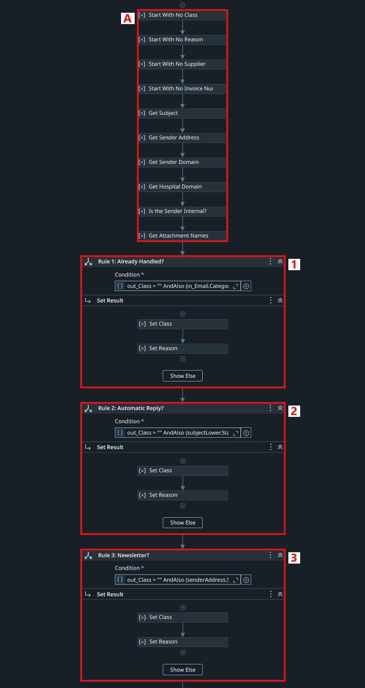

*Figure 53. The first part of `Workflows/ClassifyEmail.xaml`: the email data and rules 1 to 3.*

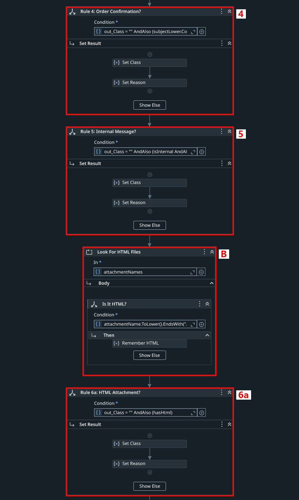

*Figure 54. Rules 4 and 5, the search for HTML files and rule 6a.*

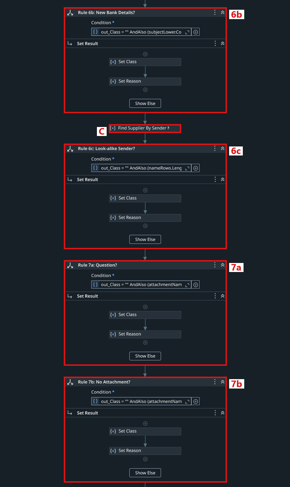

*Figure 55. Rules 6b, 6c, 7a and 7b.*

Only if no rule has found a class yet are the attachments downloaded (D in Figure 56):

1. **Create Folder** makes a folder for the email in `Output/Attachments`.
2. **Download Email Attachments** saves the attachments. Inline images such as logos are not saved.
3. **For Each** goes through the attachment names in the order of the email and keeps the PDF files. The file content is checked later by ReadInvoice, so a file name like `Dokument1.PDF` also works.
4. **Rule 8:** if there is no PDF, for example only a photo or a ZIP file, the email goes to Review. These files are never opened.

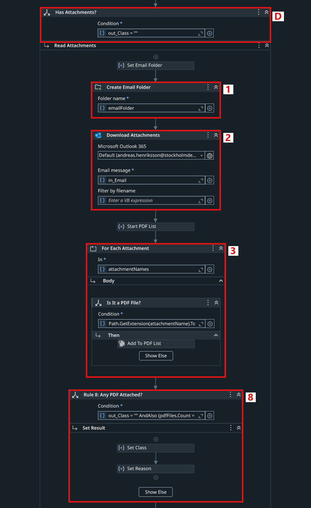

*Figure 56. Downloading the attachments and rule 8.*

Then every PDF is read (Figures 57 and 58):

1. **Assign** starts the lists of correct invoices and invoice numbers, and starts with no error and no problem.
2. **For Each** goes through the PDF files.
3. **Invoke Workflow File** runs ReadInvoice.
4. The invoice number is saved for the report.
5. The supplier name from the PDF is saved, in case the supplier is not in the register.
6. **Switch** looks at the result of ReadInvoice. **Error** saves the first technical error, **Scanned** saves the problem "Scanned invoice", and **NotInvoice** counts other documents, such as a delivery note. The **Default** case is used for invoices and credit notes:
   1. **Invoke Workflow File** runs CheckInvoice.
   2. The supplier name from the register is used for the report.
   3. **If** saves a correct invoice in the list. Otherwise, the first problem is saved.


*Figure 57. The loop over the PDF files: ReadInvoice and the Switch with the cases Error and Scanned.*


*Figure 58. The cases NotInvoice and Default with CheckInvoice.*

At the end, the result of the email is decided (Figure 59):

1. **Assign** joins the invoice numbers.
2. **Rule 9:** a technical error in any PDF gives Technical error. The supplier is asked for a new invoice.
3. **Rule 10:** otherwise, the first business problem decides the class.
4. **Rule 11:** otherwise, all invoices are correct. The class is "Invoice", or "Invoice (2)" for an email with two invoices, and the invoices are added to the history table.
5. **Rule 12:** if the PDFs were only other documents, the email is not an invoice.
6. **If** chooses the folder: Inbox for "Not an invoice", Error for "Technical error", Processed for "Invoice" and "Already handled", and Review for everything else.


*Figure 59. Rules 9 to 12 and the choice of the folder.*

### 6.8 Dry Run Over the Inbox

`Tests/Test_ClassifyEmails.xaml` runs the whole classification over the real Inbox, but it does not move, mark or send anything. The numbers in Figures 60 and 61 match the steps:

1. **Invoke Workflow File** runs ReadConfig.
2. GetFinanceData reads the suppliers and invoices from the API.
3. GetPurchaseOrders reads the purchase orders from Personalportalen.
4. GetProcessedHistory reads the history from the folder Processed.
5. **Read CSV** reads `TestData/expected_results.csv`.
6. **Get Email List** reads all emails in the Inbox of the shared mailbox. The emails are not marked as read.
7. **Assign** sorts the emails with the oldest first, so the first copy of an invoice is handled first.
8. **Build Data Table** makes the results table.
9. **For Each** goes through the emails.
10. **Invoke Workflow File** runs ClassifyEmail.
11. **Assign** activities find the expected class and folder of the email and compare them with the result (see section 7.4).
12. **Add Data Row** saves the result.
13. **If** counts the passed emails and writes OK or FAIL to the log.
14. **Write CSV** saves the table as `Output/classify_results.csv`.
15. **Log Message** writes the number of emails for each folder.
16. **Log Message** writes the summary.


*Figure 60. The first part of `Tests/Test_ClassifyEmails.xaml`: reading the data and the emails.*


*Figure 61. The second part: the loop over the emails and the end of the test.*

After the login fix, the test was run from Studio again, and all 40 emails got the expected class and folder (Figure 62).


*Figure 62. The end of the dry run: an OK line for each email, the number of emails for each folder and "40 of 40".*

| Folder | Emails | Classes |
|---|---|---|
| Processed | 9 | Invoice (8 emails, one of them with two invoices), Already handled |
| Review | 21 | Duplicate, Reminder, Amount mismatch, VAT error, Missing PO, Unknown supplier, Inactive supplier, Sender mismatch, Correction, Scanned invoice, Unsupported attachment, No attachment, Question, Suspicious |
| Error | 4 | Technical error |
| Inbox | 6 | Not an invoice |

These are the same numbers as the expected result of the test mailbox: 9 emails with 10 invoices to Processed, 21 to Review, 4 to Error and 6 that stay in the Inbox. The file `Output/classify_results.csv` also has the reason for every email, for example "Net amount 58 061,41 kr is not the amount of PO-2026-0024 (64 512,68 kr)" for P02-E20, or "Invoice 65975 is already in the portal as INV-00011 with status Betald" for P02-E22.

## 7. Routing the Emails and Writing the Report

When the class and the folder of an email are known, the email is marked and moved in the shared mailbox. A person is told about the emails that need a review, and the sender of a broken invoice gets an answer. Every handled email is written to a processed log and to an Excel report. No new packages were needed, because the Outlook and Excel packages were already installed.

### 7.1 Moving and Marking One Email

`Workflows/RouteEmail.xaml` handles one email. It gets the email, the config and the result of ClassifyEmail as arguments, and it gives back which message was sent. The numbers in Figures 63 to 65 match the steps:

1. **Assign** starts with "None", because most emails do not need a message.
2. **If** chooses the category. An email that stays in the Inbox gets `Robot: Ignored`. The other emails get the category of their folder, for example `Robot: Review`.
3. **Set Email Categories** sets the category in the shared mailbox. The category is set first, so the email is already marked even if the next step fails.
4. **If** checks that the folder is not the Inbox, and **Move Email** moves the email to Processed, Review or Error.
5. **Assign** gets the supplier name for the message. When no supplier was found, the display name of the sender is used.
6. **If** checks if the email is in Review.
7. Two **Assign** activities build the subject and the text of the review notification.
8. **Send Email** sends the notification from the shared mailbox to the review person in the config. *Save as draft* is set to No, so the email is really sent.
9. **Assign** saves "Review notification" as the sent message.
10. **If** checks if the email is in Error.
11. **If** checks the setting `TestMode` in the config.
12. In test mode, **Send Email** sends the reply to the test person in the config, not to the supplier. The real address of the supplier is written in the first line of the text.
13. When the test mode is off, **Log Message** only writes a warning. In this lab, a supplier never gets an email from the robot.
14. **Log Message** writes the class, the folder, the category and the sent message.


*Figure 63. The first part of `Workflows/RouteEmail.xaml`: the category and the move to the folder.*


*Figure 64. The review notification. The email is sent as the shared mailbox (Send as) and not saved as a draft.*


*Figure 65. The reply for a technical error, which is only sent in test mode, and the log line.*

The folder names, the categories and the receivers of the messages come from `Data/Config.xlsx`, so the workflow has no mailbox names in the code (Figure 66). The same Integration Service connection as before is used in all three Outlook activities.


*Figure 66. The settings in `Data/Config.xlsx` for the messages: the review person (1), the test mode (2) and the test person for the replies (3).*

### 7.2 The Messages From the Robot

The messages are written in Swedish, like the other emails in the mailbox. The review notification has the subject "Granskning krävs: faktura (number) från (supplier)", or "Granskning krävs: (subject)" when the email has no invoice number. The text has the subject, the sender, the supplier, the invoice number, the reason and the folder of the email (Figure 67).


*Figure 67. Sent Items of the shared mailbox (1) after the run. The notifications (2) were sent from "Ekonomi - Leverantörsfakturor" to Frida Sjöberg (3). The text (4) shows the reason from the checks.*

The reply for a technical error has the subject "SV: (original subject)". The first line says that it is a test and which supplier address would get the reply. Then the reason is written, and the supplier is asked to send the invoice again as a readable PDF file (Figure 68).


*Figure 68. The 4 replies in Sent Items (1). They were sent from the shared mailbox to Frida Sjöberg (2). The first line names the supplier address that would get the reply (3), and the reason comes from ReadInvoice (4).*

### 7.3 Handling the Whole Inbox

`Workflows/ProcessInbox.xaml` goes through the Inbox and calls ClassifyEmail and RouteEmail for each email. The numbers in Figures 69 to 71 match the steps:

1. **Invoke Workflow File** runs ReadConfig.
2. GetFinanceData, GetPurchaseOrders and GetProcessedHistory read the suppliers, the invoices, the purchase orders and the history.
3. Two **Assign** activities set the attachment folder and the report folder.
4. **Create Folder** makes sure that the report folder `Output` exists.
5. Two **Assign** activities set the path of the processed log and of the report. The report name has the date and time, for example `Report_2026-10-23_142707.xlsx`.
6. **Path Exists** checks if the processed log `Output/processed_log.csv` exists.
7. **If** reads the log with **Read CSV**. On the first run there is no log, so **Build Data Table** makes an empty one.
8. **Build Data Table** makes the report table.
9. **Get Email List** reads all emails in the Inbox of the shared mailbox.
10. **Assign** sorts the emails with the oldest first.
11. **For Each** goes through the emails.
12. **Assign** looks for the InternetMessageId of the email in the processed log.
13. **If** the email is already in the log, **Log Message** writes "Skipped" and the email is counted as skipped.
14. Otherwise the email is handled:
15. **Invoke Workflow File** runs ClassifyEmail.
16. **Invoke Workflow File** runs RouteEmail.
17. **Assign** gets the time.
18. Two **Add Data Row** activities add a row to the report and a row to the processed log.
19. **Write CSV** saves the processed log at once, after every email.
20. **Assign** counts the handled email.
21. **If** there were new emails, **Write Range** writes the report to the sheet Report. Otherwise only a log line is written.
22. **Log Message** writes how many emails were handled and skipped.


*Figure 69. The first part of `Workflows/ProcessInbox.xaml`: reading the data and the processed log.*


*Figure 70. Reading the Inbox and the check against the processed log.*


*Figure 71. Handling a new email, saving the log and writing the report.*

The processed log uses the InternetMessageId of the email as the key. This ID is a header of the email itself, so it stays the same when the email is moved to another folder. The Graph ID that Outlook uses changes when an email is moved, so it cannot be used as the key.

The log is saved after every email. If a run stops in the middle, the emails that were already handled are in the log. Emails that were moved are not in the Inbox any more, and the emails in the Inbox that were already handled are skipped, so no email is handled twice and no message is sent twice.

The report has one row per handled email with these columns: ProcessedAt, Sender, Subject, Supplier, InvoiceNumbers, Class, Reason, Folder, MailSent and InternetMessageId.

### 7.4 Matching the Test Emails After a Mailbox Reset

Before the live run, the test mailbox was reset to its start state. After the reset, the dry run from section 6.8 still gave the right folders (9, 21, 4 and 6), but every email was "unknown" and the test said "0 of 40". The reset creates the test emails again, and new emails get a new InternetMessageId. The IDs in `TestData/expected_results.csv` were from the first setup of the mailbox, so no email was found in the file.

The InternetMessageId is still the right key inside one mailbox state, so the processed log was not changed. Only the tests were changed: they now find the expected row by the subject and the sender address of the email. Two emails in the test data have the same subject and sender, because the same invoice 49838 was sent twice. To handle this, **Add Data Column** adds a column Used (Figure 72) to the expected results, and a row that was found is marked as used. The next email with the same subject gets the next row. The emails are handled oldest first, so the first copy gets the first row (P02-E09) and the copy gets the second row (P02-E10).


*Figure 72. In `Tests/Test_ClassifyEmails.xaml`, Read CSV reads the expected results (1), and Add Data Column adds the column Used (2).*

After this change, the dry run gave 40 of 40 again (Figure 73).


*Figure 73. The dry run after the mailbox reset: every email is found in the expected results, and the test gives 40 of 40.*

### 7.5 The Live Run

After the reset, `Workflows/ProcessInbox.xaml` was run from Studio. The run took 2 minutes and 11 seconds (Figure 74).


*Figure 74. The live run: a "Routed" line for each email with the class, the folder, the category and the sent message (1), and the summary "40 emails, 40 handled" (2).*

The result in the mailbox:

| Folder | Emails | Category | Message sent |
|---|---|---|---|
| Processed | 9 | Robot: Processed | None |
| Review | 21 | Robot: Review | 21 review notifications to Frida Sjöberg |
| Error | 4 | Robot: Error | 4 replies in test mode to Frida Sjöberg |
| Inbox | 6 | Robot: Ignored | None |


*Figure 75. The folder Review has 21 emails (1), and each email has the category Robot: Review (2).*

The 6 emails that are not invoices stay in the Inbox with the category Robot: Ignored (Figure 76). In the folder Error, the 4 emails of this run have the category Robot: Error (Figure 77). The fifth email in Error is the first attempt of invoice 55655 (P02-E05), which was already there before the run. The numbers next to the folder names count the unread emails, not all emails.


*Figure 76. The Inbox of the shared mailbox (1) after the run. The 6 emails that stay there have the category Robot: Ignored (2).*


*Figure 77. The folder Error (1). The 4 emails of this run have the category Robot: Error (2). The email from Hammarby Vårdtextil (3) was in the folder before the run.*

The report `Output/Report_2026-10-23_142707.xlsx` has 40 rows, one for each email (Figure 78).


*Figure 78. The report of the live run. Row 1 has the column names (1). The columns Folder and MailSent (2) show where each email went and which message was sent.*

`Tests/Test_CheckReport.xaml` checks the report against the expected results. It sends and moves nothing. The numbers in Figures 79 to 81 match the steps:

1. **Invoke Workflow File** runs ReadConfig.
2. Two **Assign** activities set the report folder and an empty report path.
3. **For Each** goes through the report files in the folder.
4. **If** keeps the newest file.
5. **If** stops the test with an error when no report was found.
6. **Log Message** writes the name of the report.
7. **Read Range** reads the sheet Report.
8. **Read CSV** reads the expected results.
9. **Add Data Column** adds the column Used.
10. **For Each Row** goes through the report rows.
11. **Assign** finds the expected row by the subject and the sender.
12. **If** no row was found, the email is "unknown". Otherwise the row is marked as used, and the expected class, folder and message are read. The expected message is "Review notification" when a notification is expected, "Error reply (test mode)" when a reply is expected, and "None" otherwise.
13. **Assign** compares the class, the folder and the sent message.
14. **If** counts the passed emails and writes OK or FAIL to the log.
15. **Log Message** writes the summary.
16. **If** stops the test with an error when an email did not pass.


*Figure 79. The first part of `Tests/Test_CheckReport.xaml`: finding the newest report.*


*Figure 80. Reading the report and the expected results, and finding the expected row.*


*Figure 81. The comparison and the end of the test.*

The test found the report of the live run, and all 40 emails had the expected class, folder and message (Figure 82).


*Figure 82. Test_CheckReport checks the report of the live run (1) and gives 40 of 40 (2).*

### 7.6 Running the Process a Second Time

To check that nothing is done twice, ProcessInbox was run again without a reset. The 6 emails that stay in the Inbox were found in the processed log and skipped. No email was moved, no message was sent and no new report was written (Figure 83).


*Figure 83. The second run: the 6 emails in the Inbox are skipped (1), and no email is handled and no report is written (2).*

## 8. Running the Whole Process and Handling Errors

In the last part, the whole process got one start point, `Main.xaml`. Errors were also handled, so one broken email does not stop the run, and a short problem with the lab API is tried again. Two failure tests were run to see what really happens when something goes wrong.

### 8.1 The Main Workflow

Until now, `Main.xaml` was the Outlook test from section 3. That test was moved to `Tests/Test_OutlookConnection.xaml`, and `Main.xaml` now starts the whole process. The numbers in Figure 84 match the steps:

1. **Log Message** writes that the run has started.
2. **Try Catch** runs ProcessInbox with **Invoke Workflow File**.
3. If an error stops the run, **Log Message** writes the activity and the error text.
4. **Log Message** explains that the emails that were already handled are in the processed log, so the next run continues with the rest.
5. **Rethrow** throws the error again, so the run ends as failed and the error is not hidden.
6. **Log Message** writes that the run has finished.


*Figure 84. `Main.xaml` with the Try Catch around ProcessInbox.*

### 8.2 An Error in One Email

In `Workflows/ProcessInbox.xaml`, the handling of each new email is now inside a **Try Catch**. The numbers in Figures 85 and 86 match the steps:

1. **Try Catch** "Try Handle Email" holds all steps for one email.
2. **Invoke Workflow File** runs ClassifyEmail.
3. **Invoke Workflow File** runs RouteEmail.
4. **Add Data Row** adds the row to the report and to the processed log.
5. **Write CSV** saves the processed log.
6. The **Catch** for `System.Exception` runs when any of these steps fails.
7. **Assign** builds the error text from the name of the activity that failed and the error message.
8. **Log Message** writes "Failed:", the subject and the error text with the level Error.
9. **Add Data Row** adds a row with the class "Robot error" to the report.
10. **Assign** counts the failed email. The loop then goes on with the next email.


*Figure 85. The Try part of the Try Catch for one email.*


*Figure 86. The end of the Try part and the Catch part.*

A failed email is not written to the processed log, so the next run tries it again. The steps in RouteEmail are in the order category, move and message. If the move fails, no message is sent, and if the run is started again, the email is handled once more from the start. RouteEmail was also changed in one small way: the category is now chosen by comparing the folder with the folder names in the config. In this way a wrong folder name stops the email at the move, where the error is clear.

### 8.3 Trying the Lab API Again

The lab API can be slow or down for a short time. In `Workflows/GetFinanceData.xaml`, the login and the reading of the suppliers and invoices were put inside a **Retry Scope** (Figure 87). The numbers match these parts:

1. **Retry Scope** "Retry Lab API" runs its steps again when one of them fails.
2. **Get Credential** reads the API login.
3. **HTTP Request** gets the token.


*Figure 87. The Retry Scope (1) around the login (2) and the token request (3).*

The properties of the Retry Scope are set in the Properties panel (Figure 88). The numbers match these settings:

1. **Number of attempts** is 3.
2. **Retry interval** is 5 seconds, the wait between two tries.
3. **Log exceptions** is Yes with the level Warn, so every failed try is written to the log.


*Figure 88. The selected Retry Scope "Retry Lab API" and its properties: the number of attempts (1), the retry interval (2) and the logging of the failed tries (3).*

The condition part is empty, so any error starts a new try. The tables are built inside the Retry Scope, so a new try does not add the same rows twice.

The Workflow Analyzer showed the error ST-SEC-008 at the first build: the password variable must be used in the same scope where it is made. The variables for the user name, the password and the login body were moved into the sequence inside the Retry Scope, and the error was gone.

### 8.4 Test A: The Lab API Is Not Available

For the first test, the setting `LabApiUrl` in `Data/Config.xlsx` was changed to the port 8099, where nothing answers (Figure 89). Then `Main.xaml` was run.


*Figure 89. The lab API address with the wrong port 8099.*

The robot tried three times. Every try waited for an answer and then stopped with "A task was canceled". After the third try, the Retry Scope gave the error to Main (Figure 90).


*Figure 90. Test A: three warnings for the failed tries (1) and the error from the Retry Scope (2).*

Main wrote "The run stopped: Invoke Get Finance Data: Retry Lab API: A task was canceled." to the log, and Studio showed the error in a window (Figure 91). The API is read before the Inbox, so no email was read, moved or marked. After the test, the port was changed back to 8082.


*Figure 91. The error window after test A. The source is the Retry Scope "Retry Lab API".*

### 8.5 Test B: A Wrong Folder Name

For the second test, the mailbox was reset, and the setting `Folder_Error` was changed from `Error` to `Errors`, a folder that does not exist (Figure 92).


*Figure 92. The folder for broken invoices with the wrong name Errors.*

In the first run, the 4 emails with a technical error could not be moved, and each of them got a "Failed" line in the log. The other 36 emails were handled as normal (Figure 93):

```
Failed: Faktura 26191: Move Email To Folder: Value cannot be null. (Parameter 'Folder named 'Errors' could not be found on this account.')
Inbox: 40 emails, 36 handled, 4 failed, 0 skipped (already processed).
```


*Figure 93. Test B, first run: a "Failed" line for an email that could not be moved (1), and the summary with 36 handled and 4 failed emails (2).*

The 4 emails stayed in the Inbox, and no reply was sent for them. Then the folder name was changed back to `Error`, and `Main.xaml` was run again. The 6 emails that are not invoices were skipped, because they were in the processed log, and the 4 failed emails were handled again. They were moved to Error, and the 4 replies in test mode were sent (Figure 94).


*Figure 94. Test B, second run: the history line (1), the 4 emails with a technical error, now moved to Error with a reply (2), and the summary with 4 handled and 6 skipped emails (3).*

### 8.6 Checking Both Reports and an Error in the History

Test B wrote two reports. `Tests/Test_CheckReport.xaml` was changed so it reads all reports in the folder `Output`, the oldest first. A row with the class "Robot error" is skipped, because that email is checked in a later report. Before the test, the reports and the processed log of section 7 were moved to a folder `Output/Archive_step6`, so only the reports of this test were checked.

The check found 39 of 40 emails with the expected result (Figure 95). P02-E13 (invoice 94583 from Bromma Sterilteknik AB) was expected as Invoice in Processed, but it was found as Duplicate, so it went to Review and a review notification was sent.


*Figure 95. The failed check for P02-E13 (1), and the summary with 39 of 40 emails and the error that stops the test (2).*

The reason was in GetProcessedHistory. The workflow saves the attachments of the emails in Processed in the folders `Output/History/1`, `Output/History/2` and so on, and then reads every PDF in these folders. The folders were never emptied. One extra run before the reset had saved the invoice 94583 in `Output/History/1`. In the next run, this old file was still in the folder and was read as if it was in Processed, so invoice 94583 was a duplicate. The second run of test B shows the problem in the history line: 10 emails in Processed, but 24 invoices (Figure 94, number 1).

To fix it, two activities were added at the start of `Workflows/GetProcessedHistory.xaml` (Figure 96):

1. **Path Exists** checks if the folder `Output/History` exists.
2. **If** it exists, **Delete Folder** deletes it with all old files, before the attachments are saved again.


*Figure 96. Path Exists (1) and the If with Delete Folder (2) at the start of GetProcessedHistory.*

After the fix, the dry run read the history again without moving or sending anything. The log showed one invoice for each PDF in Processed, and no old file was left:

```
History read: 10 emails in Processed, 11 invoices
```

### 8.7 A Clean Run After the Fix

To check the fix with the whole process, the mailbox was reset again, and the reports of test B were moved to the folder `Output/Archive_testB`. Then `Main.xaml` was run once. The history line showed only the 2 emails that are in Processed after a reset, with one invoice each:

```
History read: 2 emails in Processed, 2 invoices
```

All 40 emails in the Inbox were handled, and no email failed (Figure 97). P02-E13 was now found as Invoice and moved to Processed.


*Figure 97. The summary of the clean run: 40 emails, 40 handled, 0 failed.*

`Tests/Test_CheckReport.xaml` was then run on the new report. All emails had the expected class, folder and mail:

```
OK   P02-E13: Invoice -> Processed, mail: None
Report check: 40 of 40 emails have the expected class, folder and mail (1 reports).
```
