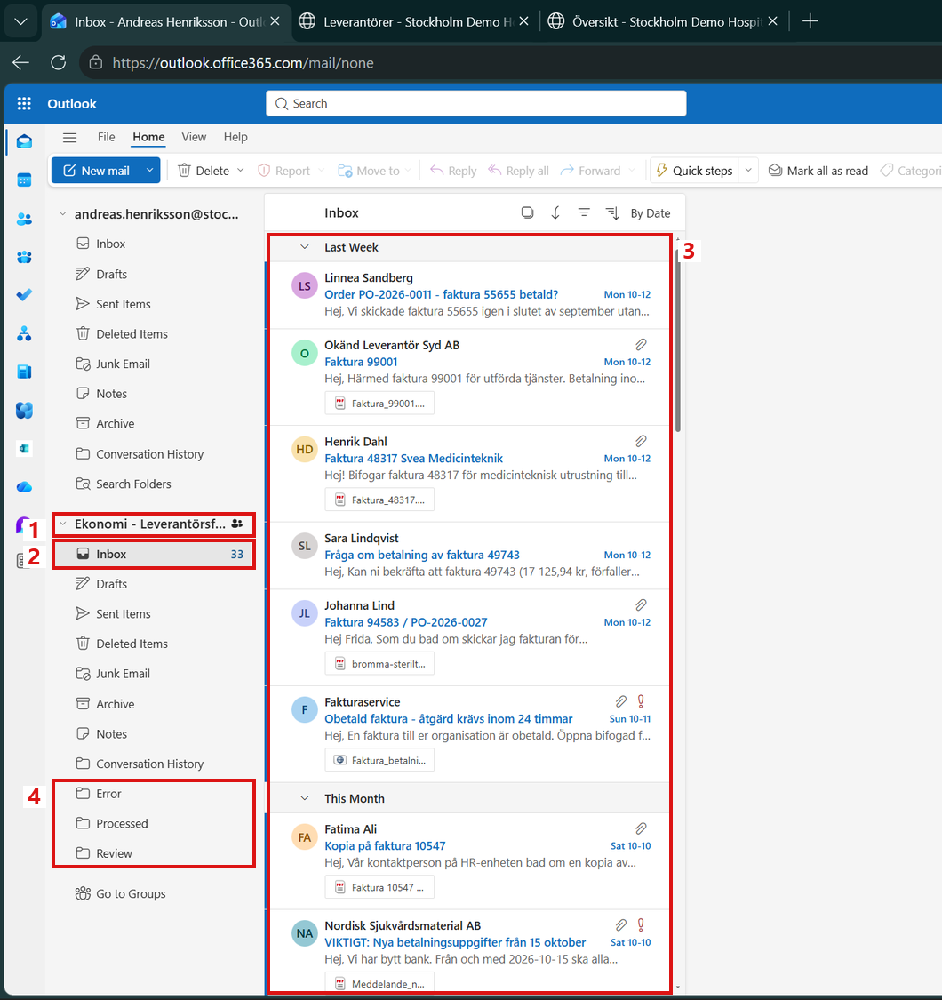
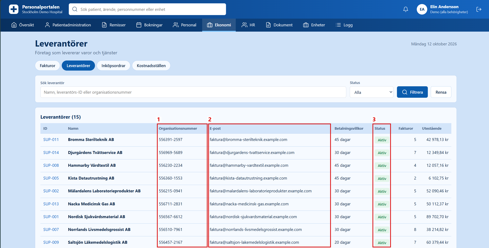
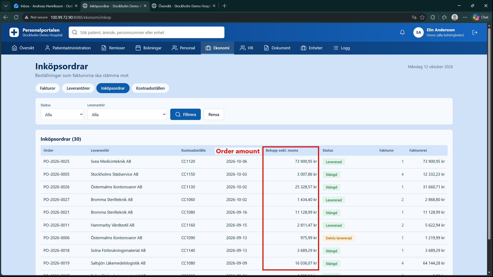
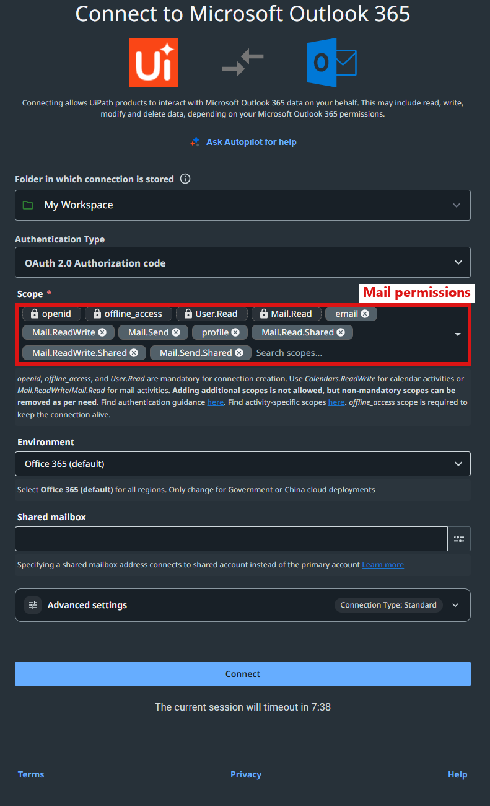
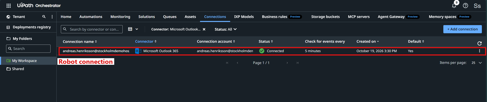
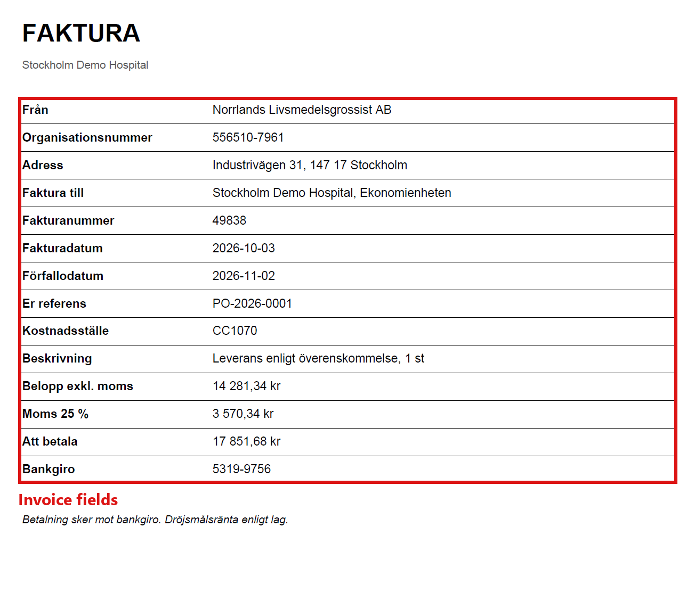

# P02 - Finance Invoice Intake and Exception Routing

## 1. Project Goal

The goal of this project is to build a UiPath automation for the finance office of a fictional Swedish hospital. Supplier invoices arrive as PDF attachments in a shared Outlook mailbox. The automation reads each email and its invoice, checks the invoice against the hospital's finance data, and moves the email to the right folder: processed, review or error. When a person needs to look at an invoice, a notification is sent, and a short report shows what happened to every email. No payment is ever made by the robot.

### 1.1 Scenario

The finance office (Ekonomienheten) receives supplier invoices in a shared mailbox called **Ekonomi - Leverantörsfakturor**. Several people in the office can open this mailbox. The invoice data is checked against two kinds of records in **Personalportalen (Staff Portal)**:

- **Suppliers (Leverantörer):** the companies the hospital buys from, with their organisation number and email address.
- **Purchase orders (Inköpsordrar):** what was ordered, from which supplier, and for which amount.

### 1.2 Before Automation - Manual Process

1. **Open the mailbox:** A finance assistant opens the shared mailbox and goes through the new emails one by one.
2. **Open the invoice:** The PDF attachment of each email is saved, opened and read.
3. **Check the invoice:** The supplier, the purchase order number and the amounts are compared with the records in Personalportalen.
4. **Decide:** The invoice is either correct, needs a check by the controller, or is broken and must be sent again by the supplier.
5. **Sort the email:** The email is moved to the folder that matches the decision:
   - **Processed:** the invoice is correct and can be paid in the normal way.
   - **Review:** the invoice has a business problem, for example an unknown supplier, a wrong amount or a missing order number. The controller is told about it.
   - **Error:** the file or the data is broken, for example a damaged PDF or a wrong total. The supplier is asked to send a new invoice.
   - **Inbox:** emails that are not invoices, for example newsletters or delivery notes, stay in the Inbox.

The shared mailbox is shown under the assistant's own mailbox in Outlook. The red rectangles show the incoming invoice emails and the three folders Error, Processed and Review, where the emails are moved after the check.

*Figure 1. The shared mailbox Ekonomi - Leverantörsfakturor in Outlook on the web. The number next to Inbox shows the unread emails.*

The suppliers are found under Ekonomi > Leverantörer in Personalportalen. The organisation number and the email address of the supplier are compared with the invoice and with the sender of the email.

*Figure 2. The Leverantörer page in Personalportalen. Each supplier has an organisation number, an email address and a status.*

The purchase orders are found under Ekonomi > Inköpsordrar. The amount of the order without VAT is the value that the invoice is compared with.

*Figure 3. The Inköpsordrar page in Personalportalen. Each order shows the supplier and the order amount without VAT.*

The problem is slow and repetitive work. Many emails are not even invoices, and small mistakes, like a wrong total or a missing order number, are easy to miss.

### 1.3 After Automation - UiPath Process

1. **Read the mailbox:** UiPath reads the emails in the Inbox of the shared mailbox.
2. **Read the invoice:** The PDF attachments are opened, and the invoice fields are read from the text.
3. **Check the invoice:** The supplier, the purchase order and the amounts are checked against the hospital finance data.
4. **Sort the email:** Each email is moved to Processed, Review or Error. Emails that are not invoices stay in the Inbox with a label.
5. **Inform people:** The controller gets a notification for invoices that need a check, and a reply is prepared for broken invoices.
6. **Create the report:** A report shows the result and the reason for every email.

The result is less manual work, the same checks every time, and more time for the invoices that really need a person.

### 1.4 Project Scope

All data in this project is fictional. The emails exist only in a test mailbox, and messages are only sent between test accounts inside the same test organisation. The automation reads the hospital finance data but never changes it, never changes bank details, and never pays an invoice.

## 2. Checking the Working Environment

Before building anything, the tools, the mailbox and the hospital systems were checked. It is easier to find a problem at the start than in the middle of the project.

### 2.1 UiPath Tools

UiPath Studio and the UiPath Robot are installed, and Studio is signed in to UiPath Cloud. A new Windows project named `P02_FinanceInvoiceIntake` was created in Studio. The main workflow, `Main.xaml`, is still empty.

Orchestrator was opened and works fine. Integration Service, the part of UiPath Cloud that connects UiPath to other services, offers a ready connector for Microsoft Outlook 365. This connector is needed, because the robot must sign in to the mailbox in a safe way without a password inside the workflow.

### 2.2 Shared Mailbox

The test mailbox was opened in Outlook on the web with the account of the finance assistant. The shared mailbox was added to the account once, under Settings > Account > Shared with me. After that, it appears under the assistant's own mailbox, with the folders Inbox, Processed, Review and Error (see Figure 1).

The Inbox contains the test emails, and 33 of them are unread. The emails were only looked at, not opened, so the start state of the mailbox is not changed.

### 2.3 Hospital Systems

The hospital applications and the REST API run on a separate computer and are reached through a private network (Tailscale). All of them are working:

| System | Address |
|---|---|
| Staff Portal (Personalportalen) | `http://100.99.72.90:8080` |
| REST API | `http://100.99.72.90:8082` |

The finance pages of Personalportalen (invoices, suppliers, purchase orders) need a login. The REST API also needs a login, and it offers suppliers and invoices, but not purchase orders. For this reason, the order amounts are read from the Inköpsordrar page (see Figure 3).

### 2.4 Safe Approach

Invoices and payments are sensitive, so the automation only reads the finance data. Emails are only moved inside the shared mailbox, and notifications go only to test accounts.

## 3. First Outlook Test with UiPath

Before building the real process, a very small workflow was created to prove that UiPath can read the shared mailbox and save an invoice. If this works, the same connection can be used later for the whole process.

### 3.1 Outlook Package

To work with Outlook, the Microsoft Office 365 package (`UiPath.MicrosoftOffice365.Activities`) is needed, so it was installed in the project. Its Outlook activities read, move and send emails through the mailbox service of Microsoft 365, so the Outlook program does not need to be open on the computer.

### 3.2 Connecting UiPath to the Mailbox

UiPath signs in to Microsoft 365 with a connection in Integration Service. The connection is created once, with the account of the finance assistant Andreas Henriksson, who has access to the shared mailbox. The password is entered only in the Microsoft sign-in window and is never stored in the workflow.

When the connection is created, the needed permissions are selected. The robot needs to read and change emails and to send emails, also in a shared mailbox. Calendar permissions are not needed, so they were removed. The shared mailbox field is left empty, because the shared mailbox is chosen in each Outlook activity instead.

*Figure 4. The new Outlook connection. The red rectangle shows the mail permissions, including the two permissions for the shared mailbox.*

The first sign-in showed the message "Need admin approval", because the organisation must allow the UiPath app once. The approval was given with the administrator account. During this step, a second connection with the administrator account was also created. It was removed, because the robot must only work with the account of the finance assistant.

*Figure 5. The Connections page in Orchestrator. Only the connection of the finance assistant is left, and its status is Connected.*

### 3.3 The Test Workflow

The workflow `Main.xaml` has five steps:

1. **Get Email List** reads all emails in the Inbox of the shared mailbox `fakturor@stockholmdemohospital.onmicrosoft.com`.
2. **Log Message** writes the number of emails and unread emails to the output log.
3. **For Each** writes the date, the sender, the subject and the number of attachments of every email to the log.
4. **Assign** finds the email with the subject `Faktura 49838 från Norrlands Livsmedelsgrossist AB`.
5. **Download Email Attachments** saves the PDF of that email in the folder `Output\Attachments`.

The option "Mark As Read" is switched off, so the emails stay unread. The test does not move, label or send any email.

### 3.4 Result

The log shows 40 emails in the Inbox, and 33 of them are unread. This is the same as in Outlook on the web. The newest email in the list is `Order PO-2026-0011 - faktura 55655 betald?`.

The invoice file `norrlands-livsmedelsgrossist-ab_49838.pdf` was saved, and it opens as a normal invoice. The red rectangle shows the fields that the robot must read from each invoice later: supplier, organisation number, invoice number, dates, purchase order, cost centre, amounts and bankgiro.

*Figure 6. The invoice that was saved by the test workflow.*

After the test, the Inbox still had 33 unread emails, and no email was moved. This shows that UiPath can read the shared mailbox and its attachments without changing it.
