# P03 - Attended Hospital Staff Assistant

## 1. Project Goal

The goal of this project is to build an attended UiPath assistant for the administrative staff of a fictional Swedish hospital. The staff member enters a case ID, and the assistant looks up the case in Journalsamordning and the linked referral in Personalportalen. It shows a short summary and, when the records agree, proposes one simple administrative action: registering the incoming case. The action is only performed after the staff member clicks Confirm, and the case is read again afterwards to check the real result. Cancel always means that nothing is changed.

### 1.1 Scenario

The coordination office receives cases from other units, for example a referral from the patient reception. Each new case arrives in **Journalsamordning** with the status **Inkommen** (received). Before a coordinator starts working on it, the case is registered, which changes the status to **Registrerad**.

The referral behind the case is kept in **Personalportalen (Staff Portal)**. The two systems are separate, so the coordinator checks by hand that the case really belongs to an existing referral and to the right patient before the case is registered.

### 1.2 Before Automation - Manual Process

1. **Open the case:** The coordinator opens the case in Journalsamordning and reads the patient details and the referral ID.
2. **Find the referral:** The referral is looked up in Personalportalen, and its status is checked.
3. **Compare the patient:** The name, the birth date and the personal number in the case are compared with the patient in Personalportalen.
4. **Register the case:** If everything agrees, the coordinator selects the new status Registrerad and saves it.

The case page in Journalsamordning holds everything that is needed for the check and for the action. The numbers in Figure 1 match these parts:

1. The patient details: name, personal number, birth date and the shared patient ID.
2. The shared referral ID, which points to the referral in Personalportalen.
3. The current status of the case, Inkommen.
4. The status form. **Ny status** offers Registrerad, and **Spara status** saves it.
5. The buttons for changing the case, which are shown because the user may edit cases.
6. The logged-in user and the role, Samordnare (coordinator).

*Figure 1. Case C-2026-00082 in Journalsamordning, opened by a coordinator.*

The referral is found under Remisser in Personalportalen (Figure 2):

1. **Remiss-ID**, the same ID as in the case.
2. **Patient**, with the name and the birth date.
3. **Status**. The referral is still **Ny** (new), so it is open.

*Figure 2. Referral R-2026-0098 in the Remisser list of Personalportalen.*

The personal number of the patient is shown in Patientadministration (Figure 3):

1. **Personnummer**, written with a dash in this system, but without a dash in Journalsamordning.
2. **Födelsedatum**, the birth date.

*Figure 3. Patient P-000044 in Patientadministration.*

The work is not difficult, but it needs two systems and careful reading. A small difference, like one wrong digit in a personal number or a second case for the same referral, is easy to miss.

### 1.3 After Automation - UiPath Process

1. **Ask for the case:** The assistant asks the staff member for a case ID.
2. **Read both systems:** The case is read in Journalsamordning, and the referral and the patient are read in Personalportalen.
3. **Show a summary:** The assistant shows the case, the differences it found, and the proposed action, or the reason why no action is proposed.
4. **Ask for confirmation:** Nothing is changed until the staff member clicks Yes. No stops without any change.
5. **Register the case:** The case is read again to make sure it has not changed, and then the status is set to Registrerad.
6. **Check the result:** The case is read once more, the real status is shown to the staff member, and an audit line is written.

The staff member stays in control the whole time, and the assistant only removes the slow looking up and comparing.

### 1.4 Project Scope

All data in this project is fictional. The assistant only performs one action, registering an incoming case, which is a simple administrative step and not a medical decision. It works with the rights of the logged-in role and never tries to get around them.

## 2. Checking the Working Environment

Before building the assistant, the tools, the hospital systems and the user roles were checked.

### 2.1 UiPath Tools

A new Windows project named `P03_AttendedStaffAssistant` was created in UiPath Studio, with VB as the expression language. Two packages were added under Manage Packages (Figure 4):

1. `UiPath.Credentials.Activities` reads the logins from Windows Credential Manager, so no password is stored in the workflows.
2. `UiPath.UIAutomation.Activities` works with the web pages in Chrome. Version 26.10.2 is the same version as in the earlier projects.

*Figure 4. Project Dependencies in Manage Packages.*

### 2.2 Hospital Systems

The hospital applications run on a separate computer and are reached through a private network (Tailscale). Both are working:

| System | Address |
|---|---|
| Journalsamordning (case coordination) | `http://100.99.72.90:8081` |
| Personalportalen (Staff Portal) | `http://100.99.72.90:8080` |

The status of a case can only be changed on the case page in Journalsamordning (see Figure 1). There is no other supported way to change it, so the assistant works with the same page as a person.

### 2.3 User Roles in Journalsamordning

Journalsamordning gives each user a role, and the role decides what the user may do. Two roles are used in this project:

| Role | User | Rights |
|---|---|---|
| Samordnare (coordinator) | `samordnare` | Can see and change cases |
| Kodare (coder) | `kodare` | Can see cases, but not change them |

The same case was opened with the coder account (Figure 5):

1. The menu is shorter, because the coder has no access to matching and transfers.
2. The logged-in role is Kodare.
3. The status is shown, but the status form and the buttons from Figure 1 are missing.

*Figure 5. The same case opened by a coder. The status cannot be changed.*

The coder account is useful for testing. It shows what the assistant does when the logged-in role is not allowed to make the change.

### 2.4 Logins in Windows Credential Manager

The logins of both roles were saved in Windows Credential Manager as generic credentials (Figure 6):

1. **Internet or network address** is the name the workflow uses to find the login, here `P03_Samordnare`.
2. **User name** is the account in Journalsamordning.
3. **Password** is stored only here, never in the project.

*Figure 6. Adding the login of the coordinator.*

After both logins were added, they are listed next to the logins of the earlier projects (Figure 7, number 1).

*Figure 7. The generic credentials, with the two new P03 logins.*

### 2.5 The Login Workflow

The login is done in one reusable workflow, `Workflows/Login_Coordination.xaml`. It gets the name of a credential and gives back the role of the user who logged in. In this way, the same workflow is used for both accounts.

The first part opens the page and gets the login (Figure 8):

1. **Use Application/Browser** opens Journalsamordning in Chrome, or uses the tab that is already open.
2. **Check App State** looks for the logout button. If someone is still logged in, **Click Log Out** logs that user out first, so the right account is used.
3. **Get Secure Credential** reads the user name and the password from Credential Manager. The password is kept as a secure text and never written to the log.

*Figure 8. The first part of `Workflows/Login_Coordination.xaml`.*

The second part logs in and checks the result (Figure 9):

4. **If** the credential is missing in Credential Manager, the workflow stops with a clear message.
5. **Type Into** types the user name.
6. **Type Into** types the password from the secure text.
7. **Click** presses Logga in.
8. **Check App State** waits up to 10 seconds for the logout button, which is only shown to a logged-in user. If it appears, **Get Text** reads the role under the user name. If it does not appear, the login failed, and the workflow stops with the message that the user name or the password is wrong.
9. **Log Message** writes the user and the role to the log.

*Figure 9. The second part of `Workflows/Login_Coordination.xaml`.*

The arguments were created in the Data Manager (Figure 10):

1. `in_CredentialTarget` is the name of the credential, for example `P03_Samordnare`.
2. `out_UserRole` is the role that was read after the login.

*Figure 10. The arguments of `Workflows/Login_Coordination.xaml`.*

### 2.6 Testing the Two Logins

The test workflow `Tests/Test_Logins.xaml` calls the login workflow once for each account and checks the role that comes back (Figure 11):

1. The test: log in as coordinator, check the role, then the same for the coder.
2. The coordinator login worked, and the role is Samordnare.
3. The coder login worked, and the role is Kodare.

*Figure 11. `Tests/Test_Logins.xaml` and its result in the Output panel.*

The first run of the test failed with the message that the user name or the password was wrong, for both accounts. The new login check found the problem at once: the passwords that had been saved were not the passwords of the lab accounts. After the two credentials were corrected in Credential Manager, both logins worked, as shown in Figure 11.

In this step, everything the assistant needs was checked: UiPath Studio, the two hospital systems and the two user accounts. A login workflow was also built and tested. The assistant can now log in to Journalsamordning, which is the first thing it does every time it runs.

## 3. Test Data and Expected Results

Before the assistant was built, the test cases were chosen and the expected result of each one was written down. In this way, it is clear what the assistant must do in every situation, and the real result can be compared with the expected one afterwards.

### 3.1 The Order of the Checks

Some cases have more than one problem, so the checks are always done in the same order, and the first problem that is found decides the result:

1. **Case ID:** the ID must have the form `C-2026-00082`. An empty or wrong ID is asked for again.
2. **Case exists:** the case must be found in Journalsamordning.
3. **Status:** the case must still be Inkommen. A case with another status is not changed.
4. **Role:** the logged-in role must be allowed to change cases.
5. **Referral exists:** the referral of the case must be found in Personalportalen.
6. **One case per referral:** only one case may point to the referral.
7. **Referral open:** the referral must not be rejected or closed.
8. **Patient agrees:** the name, the birth date and the personal number must be the same in both systems. The dash in the personal number is ignored, and a missing personal number counts as a difference.

Only when all checks pass, the assistant proposes to register the case. In every other situation, it shows the reason and proposes no action.

### 3.2 Finding Test Cases in the Lab

The hospital data already contains cases with typical problems. Two of them were checked manually before they were used as test cases.

The referral R-2026-0055 was searched in the list of incoming cases in Journalsamordning (Figure 12):

1. The search text R-2026-0055.
2. Two cases are found for the same referral, C-2026-00101 and C-2026-00046.
3. One case is Inkommen and the other one is already Registrerad.

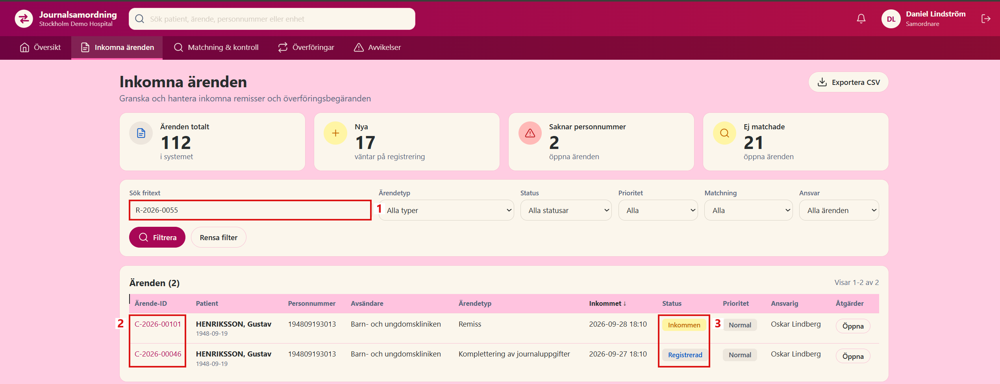

*Figure 12. Two cases in Journalsamordning that point to the same referral.*

A person cannot tell which of the two cases is the right one, so the assistant must not register case C-2026-00101. It shows both case IDs instead.

The second sample is case C-2026-00020. Its personal number is 198204044654 (Figure 13).

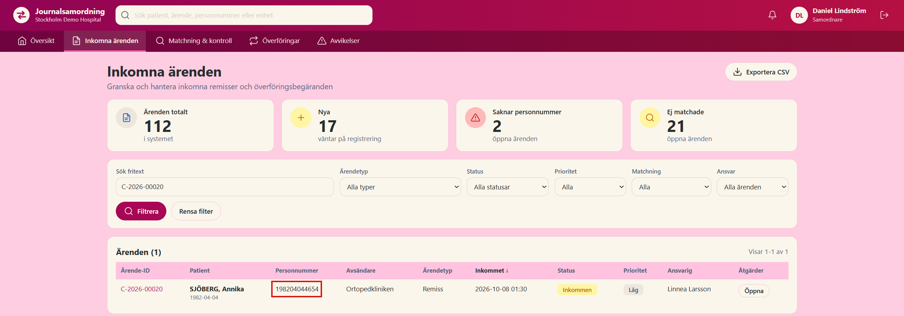

*Figure 13. Case C-2026-00020 and its personal number in Journalsamordning.*

The same patient, P-000105, has the personal number 19820404-4644 in Personalportalen (Figure 14). The name and the birth date are the same, but one digit of the personal number is different. This is exactly the kind of small difference that is easy to miss when reading by hand.

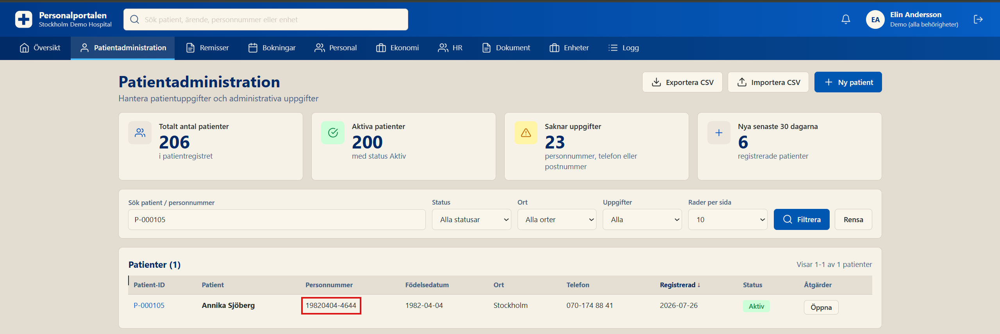

*Figure 14. Patient P-000105 and the personal number in Personalportalen.*

### 3.3 The Expected Results

The expected results were written in `TestData/expected_results.csv`. Each row has the test ID, the scenario, the case ID, the role, the choice of the staff member, the expected proposal, the expected result and the expected status of the case afterwards.

| Group | Tests | Examples |
|---|---|---|
| Normal use | T01-T03 | Cancel, Confirm, and the same case once more after it was registered |
| Wrong input | T04-T05 | an empty or wrong case ID, a case that does not exist |
| Data problems | T06-T10 | two cases for one referral, different statuses, a personal number that differs or is missing, a missing referral |
| Safety | T11-T13 | a role without permission, a case that was changed before the confirmation, Personalportalen not available |
| Lost connection | T14-T15 | the connection is lost just after or just before the click on Spara status |

The two tests with a lost connection are important for an action that changes data. If the connection is lost after the click, the assistant does not know if the status was saved. Clicking again could register the case twice, so the real status of the case is read first. Only if the case is still Inkommen, one more attempt is made.

The whole file is shown in Figure 15.

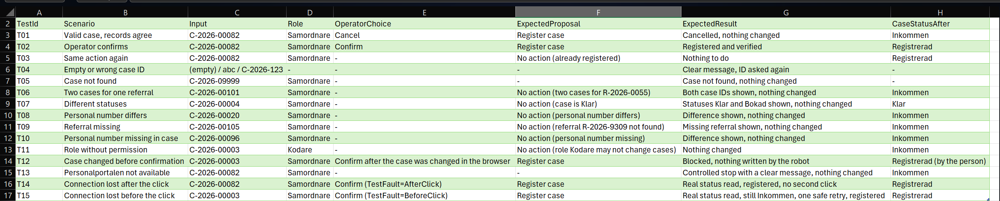

*Figure 15. The 15 test cases in `TestData/expected_results.csv`.*

### 3.4 The Config File

The settings of the assistant are kept in `Data/Config.xlsx`, so they can be changed without changing the workflows. The Excel file is written and read with the Excel package `UiPath.Excel.Activities`, version 3.6.1, which was added under Manage Packages (Figure 16).

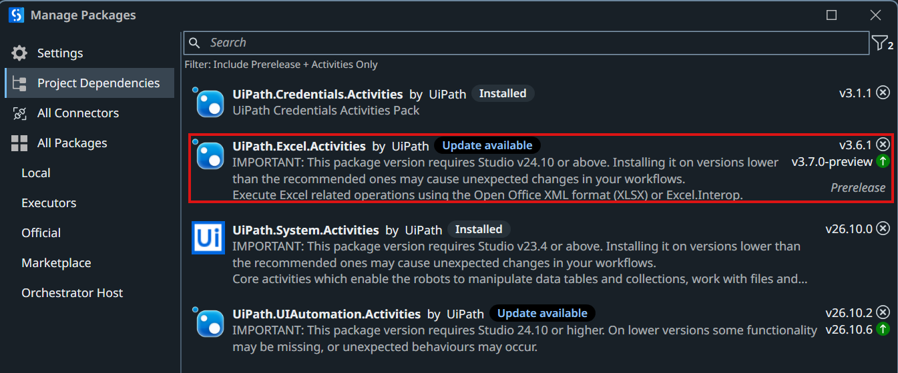

*Figure 16. The Excel package in the project dependencies.*

The file was created with a small helper workflow, `Tools/CreateConfig.xaml` (Figure 17):

1. **Build Data Table** holds the settings.
2. **Assign** sets the path of the folder `Data`, and **Create Folder** creates it.
3. **Write Range Workbook** writes the table to the sheet Settings, starting in cell A1. Excel does not need to be open for this.
4. **Log Message** writes how many settings were saved.
5. The Output panel shows that 9 settings were written.

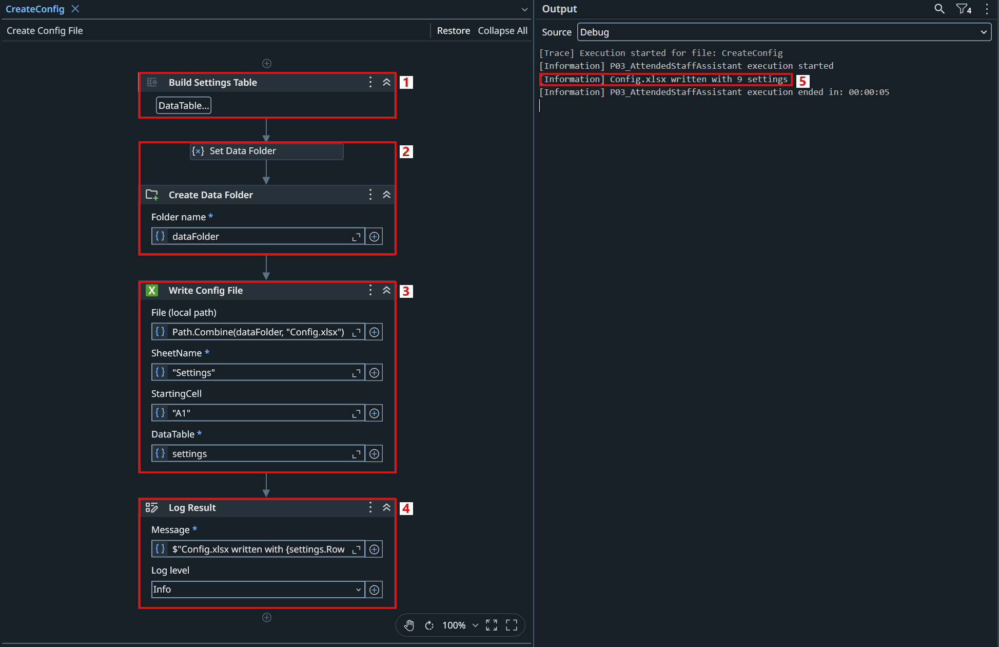

*Figure 17. `Tools/CreateConfig.xaml` on the left and its Output panel on the right.*

The settings were typed in the Build Data Table window, which opens with the button DataTable... (Figure 18):

1. The addresses of Journalsamordning and Personalportalen.
2. The names of the two logins in Windows Credential Manager. Only the names are stored here, never the passwords.
3. The rules of the action: the form of a case ID, the status the case must have, and the new status.
4. The folder for the audit log.
5. A test setting. With the value None, the assistant works normally. The values BeforeClick and AfterClick simulate a lost connection around the click on Spara status, for tests T14 and T15.

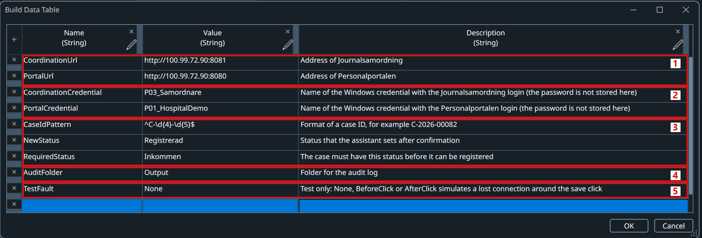

*Figure 18. The Build Data Table window with the 9 settings.*

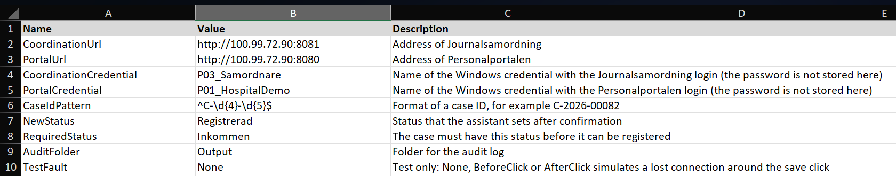

*Figure 19. The sheet Settings in `Data/Config.xlsx`.*

The config file is read by the workflow `Workflows/ReadConfig.xaml`, which gives back all settings as a dictionary (Figure 20):

1. **Read Range Workbook** reads the sheet Settings into a data table.
2. **Assign** creates an empty dictionary.
3. **For Each Row in Data Table** goes through the settings one by one.
4. **If** skips empty rows. Every other row is added to the dictionary with its name as the key.
5. **Log Message** writes how many settings were read.
6. The Output panel shows that 9 settings were read.

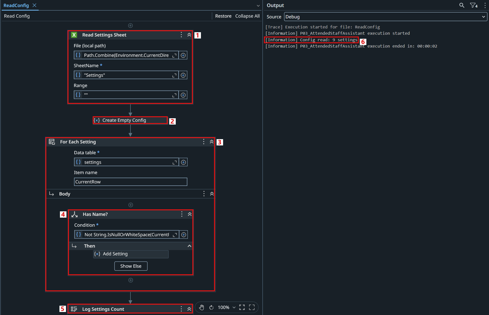

*Figure 20. `Workflows/ReadConfig.xaml` on the left and its Output panel on the right.*

In this step, the rules of the assistant were decided before it was built. The checks have a fixed order, 15 test cases were chosen from the hospital data, and the expected result of each test was written down. All settings are kept in one config file. With this, every real result of the assistant can be compared with the expected result.

## 4. Looking Up a Case

In this part, the assistant learned to read everything it needs for the decision, without changing anything. It asks for a case ID, reads the case in Journalsamordning and the referral and the patient in Personalportalen, and runs the checks from Section 3.1.

### 4.1 Asking for the Case ID

The staff member enters the case ID in a small dialog (Figure 21).

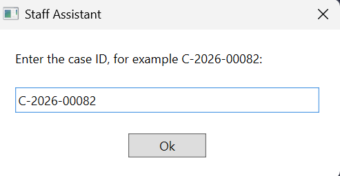

*Figure 21. The dialog of the assistant with the case ID C-2026-00082.*

The dialog is shown by the workflow `Workflows/AskCaseId.xaml` (Figure 22):

1. **Assign** sets the starting values: the user has not stopped, and no valid ID has been entered yet.
2. **While** repeats the question until a valid ID is entered or the user stops.
3. **Try Catch** with **Input Dialog** asks for the ID. If the user closes the dialog, the error is caught, and the assistant stops in a normal way.
4. **Assign** removes spaces and writes the ID in capital letters. Then the small workflow `Workflows/ValidateCaseId.xaml` checks the ID against the pattern from the config file.
5. **If** the ID is wrong, **Message Box** explains the problem and asks if the user wants to try again. No means stop.
6. The valid case ID is given back, and **Log Message** writes it to the log.

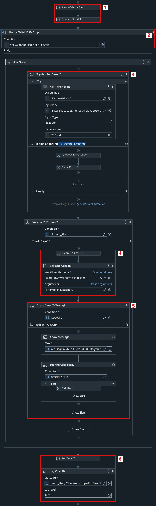

*Figure 22. `Workflows/AskCaseId.xaml` in the Studio designer.*

To test a wrong ID, `abc` was entered in the dialog (Figure 23, left). The assistant then showed a message and asked if the user wanted to try again (Figure 23, right). The ID is shown as "ABC", because it is written in capital letters before the check.

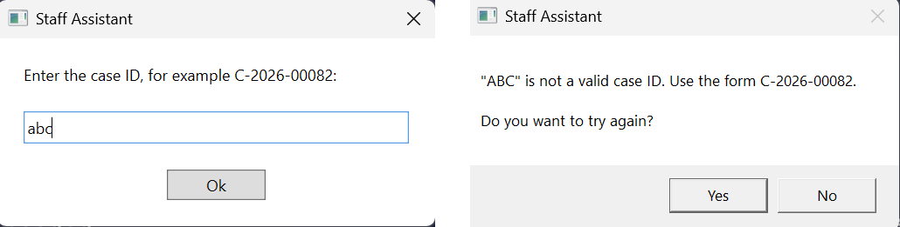

*Figure 23. The wrong case ID `abc` in the dialog, and the message for a case ID with the wrong form.*

With the valid ID C-2026-00082, the workflow ended and wrote the ID to the log (Figure 24).

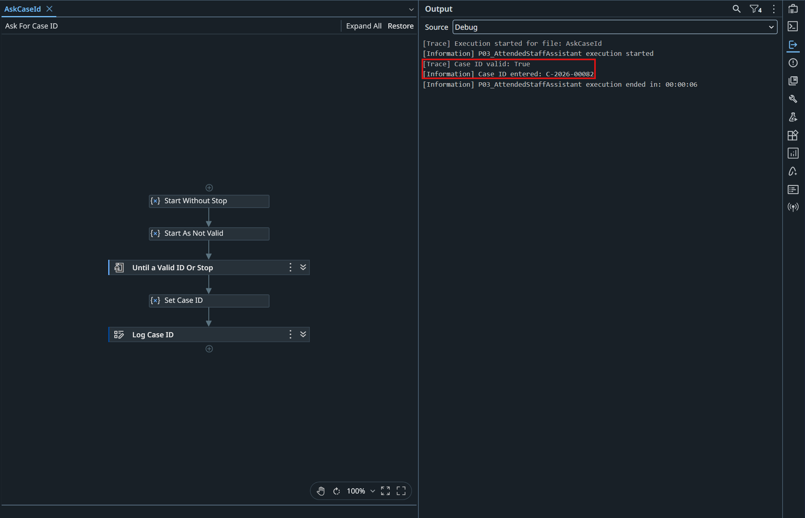

*Figure 24. `Workflows/AskCaseId.xaml` and its Output panel after a valid case ID.*

The workflow can also be started alone with Run File. For that, the argument `in_Pattern` got a default value, the same pattern as in the config file. Without it, the first test stopped with the error "Value cannot be null", because no pattern was given to the check.

### 4.2 The Pages in the Object Repository

All elements that the assistant reads or clicks were captured from the live pages and saved in the Object Repository. In this way, every activity uses the same tested element, and the designer shows a small picture of it (Figure 25):

1. The screen **Journalsamordning** with the elements of the case page and the case list, next to the login elements from Section 2.5.
2. The new screen **Personalportalen** with the login elements, the patient details and the referral details.

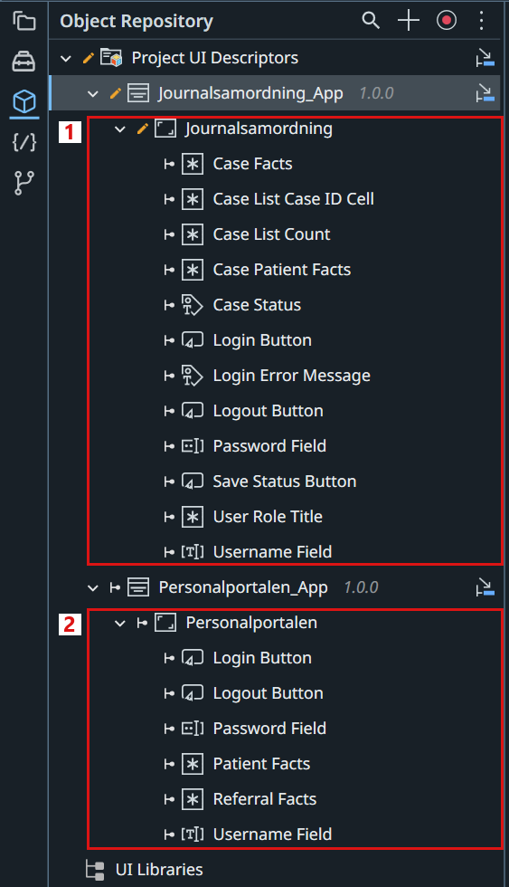

*Figure 25. The two screens and their elements in the Object Repository.*

The window of Personalportalen is found only by its address, `http://100.99.72.90:8080/*`. The page title was not used, because the login page has another title than the other pages.

### 4.3 Reading the Case in Journalsamordning

The workflow `Workflows/ReadCase.xaml` opens the case page and reads it (Figure 26):

1. **Use Application/Browser** works in the open Journalsamordning tab.
2. **Go To URL** opens the case page, for example `/arenden/C-2026-00082`.
3. **Check App State** looks for the list of patient details. If it is not shown, the case does not exist.
4. **Get Text** reads the whole list of patient details and the whole list of case details.
5. **Get Text** reads the status. The element is the status chip in the card "Status och ansvar", and the label "Status" next to it is used as an anchor.
6. **Check App State** looks for the button Spara status. It is only shown to a role that may change cases, so this tells if the logged-in user may register the case.
7. If the case was not found, only `out_Found` is set to False.

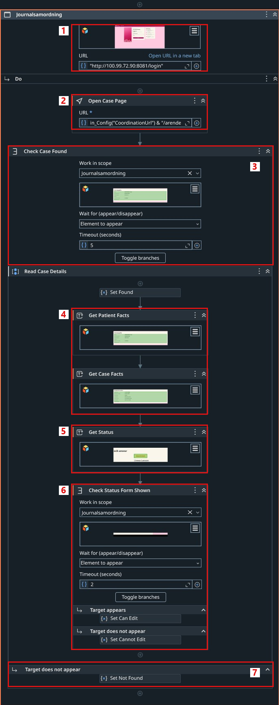

*Figure 26. The first part of `Workflows/ReadCase.xaml`.*

The second part takes the single values out of the two lists (Figure 27):

1. The small workflow `GetFactValue` is called once for each value: name, personal number, birth date, patient ID and referral ID.
2. **If** the page shows "Saknas" (missing) for the personal number, or "-" for the referral, the value is cleared, so the checks see an empty value.
3. **Log Message** writes the case, the status and the referral, but no personal data.

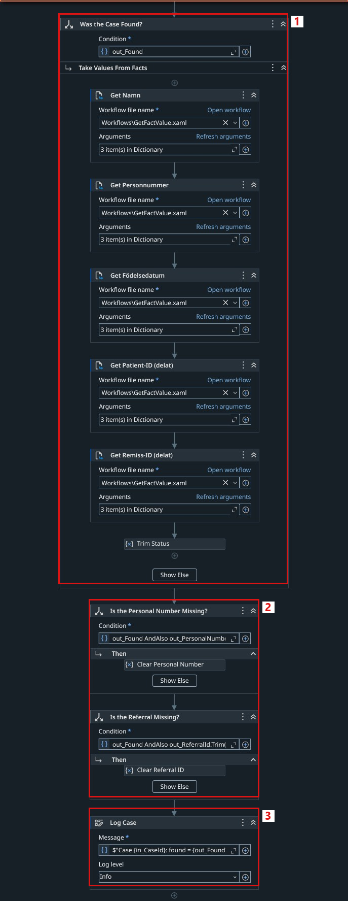

*Figure 27. The second part of `Workflows/ReadCase.xaml`.*

**Get Text** on a list gives one line for each row, with the label and the value together, for example `Personnummer198204044654`. The workflow `Workflows/GetFactValue.xaml` finds the right line by its label (Figure 28):

1. **Assign** starts with an empty value and splits the text into lines.
2. **For Each** goes through the lines.
3. **If** a line starts with the label, the rest of the line is the value.
4. **Log Message** writes on Trace level if the label was found.

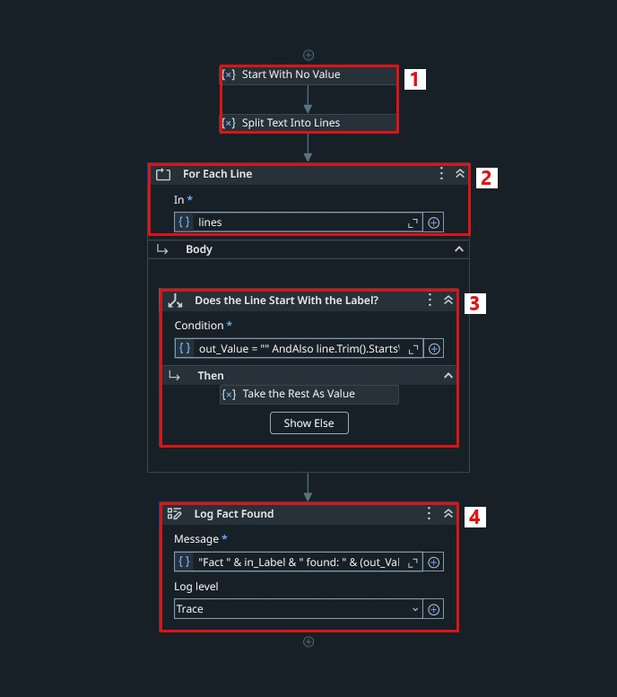

*Figure 28. `Workflows/GetFactValue.xaml` in the Studio designer.*

The first version read each value with its own **Get Text** and the position of the row in the list. The Workflow Analyzer of UiPath stopped the build, because positions above 2 are seen as unreliable. Reading the whole list and finding the value by its label solved this, and it also keeps working if a row is added to the page.

### 4.4 Finding Other Cases for the Referral

The workflow `Workflows/FindCasesForReferral.xaml` searches the case list for the referral ID and counts the cases (Figure 29):

1. **Use Application/Browser** works in the Journalsamordning tab.
2. **Go To URL** opens the case list with the referral ID as search text.
3. **Get Text** reads the heading above the table, for example "Ärenden (2)", and **Assign** takes the number out of it.
4. **Assign** prepares an empty list of case IDs and starts at the first row.
5. **While** reads one row at a time, at most 10 rows.
6. **Assign** calculates the table row below the header, and **Get Text** reads the case ID in that row. The row number is a variable in the selector of the element.
7. **If** this is the first case, the ID is saved, otherwise it is added after a comma.
8. **Assign** moves to the next row.
9. **Log Message** writes the number of cases and their IDs.

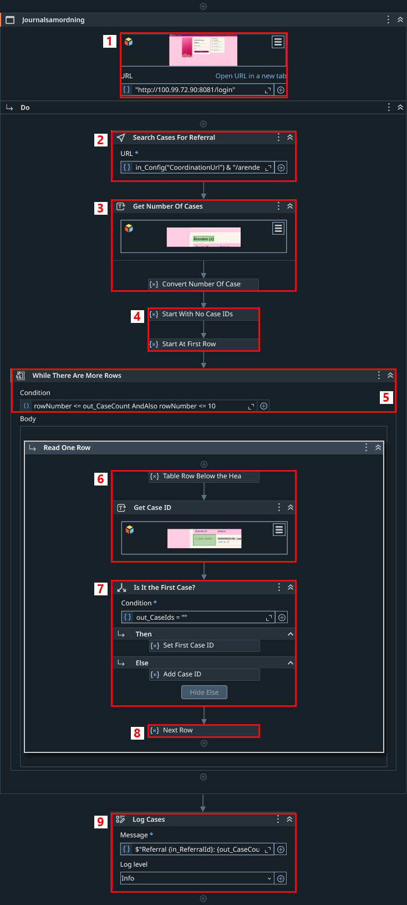

*Figure 29. `Workflows/FindCasesForReferral.xaml` in the Studio designer.*

### 4.5 Reading Personalportalen

Personalportalen is read in the same way as Journalsamordning:

| Workflow | What it does |
|---|---|
| `Workflows/Login_StaffPortal.xaml` | Logs in with the credential `P01_HospitalDemo`, but only if the login form is shown |
| `Workflows/ReadReferral.xaml` | Opens the referral page and reads the patient ID and the status of the referral |
| `Workflows/ReadPatient.xaml` | Opens the patient page and reads the personal number, the name and the birth date |

During the tests, a login once failed with "wrong user name or password", although the password was correct. The log of the lab showed that the login had been sent with an empty user name. The two systems were open in two Chrome windows on top of each other, and the normal input method sends real mouse clicks and keystrokes to the screen, so they reached the wrong window. The login activities of both systems were changed to the input method **Simulate**, which works directly on the element. After that, the logins worked every time.

### 4.6 Checking the Case

The workflow `Workflows/CheckAction.xaml` runs the checks from Section 3.1. Each check is one **If**, and it only runs when no earlier check has found a problem. In this way, the first problem decides the reason. The first part handles the case and the referral (Figure 30):

1. **Assign** starts with no reason.
2. The status: a case that is already Registrerad gives "already registered", and any other status than Inkommen gives "case is" and the status.
3. The role must be allowed to change cases.
4. The case must have a referral, and the referral must exist in Personalportalen.
5. Only one case may point to the referral.
6. The referral must not be Avvisad or Avslutad.

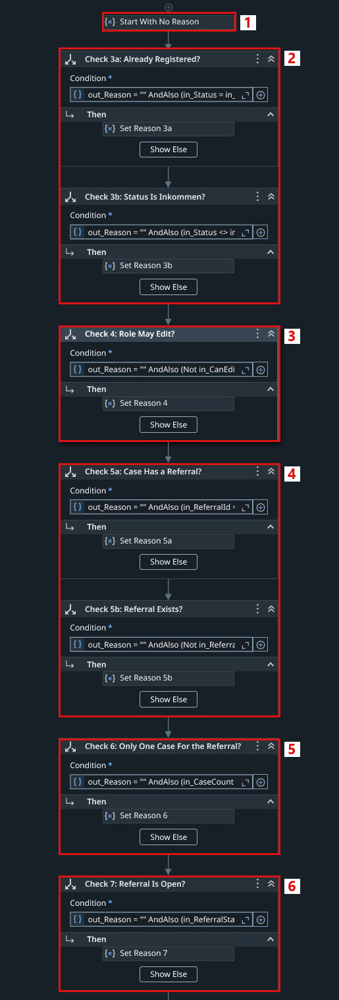

*Figure 30. The first part of `Workflows/CheckAction.xaml`.*

The second part compares the patient (Figure 31):

1. The personal number must exist in the case and be the same in both systems. The dash is removed before the comparison.
2. **Assign** writes the name in the case, for example "SJÖBERG, Annika", in the same order as in Personalportalen, "Annika Sjöberg".
3. The name and the birth date must be the same.
4. **If** no check found a problem, the proposal is "Register case". Otherwise it is "No action" with the reason.
5. **Log Message** writes the proposal.

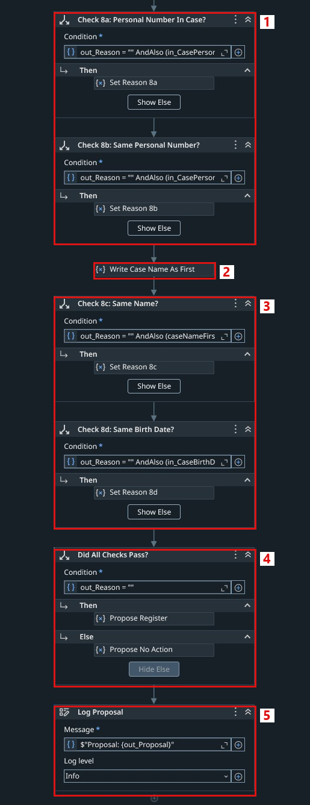

*Figure 31. The second part of `Workflows/CheckAction.xaml`.*

### 4.7 Putting the Lookup Together

The workflow `Workflows/LookupCase.xaml` calls the other workflows in the right order (Figure 32):

1. **Read Case** reads the case in Journalsamordning.
2. If the case was not found, there is no proposal, and the summary says that nothing was changed.
3. If the case has a referral, the other cases for the referral, the referral and the patient are read.
4. **Check Action** runs the checks.
5. **Assign** builds the summary for the staff member: the case and its status, the patient, the referral and its status, the cases for the referral, and the proposed action.
6. **Log Message** writes the result of the lookup.

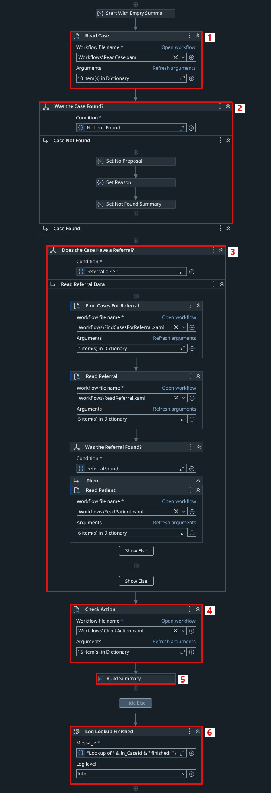

*Figure 32. `Workflows/LookupCase.xaml` in the Studio designer.*

### 4.8 Testing the Lookup

The test workflow `Tests/Test_CaseLookup.xaml` runs the test cases that do not change any data and compares each proposal with the column ExpectedProposal in `TestData/expected_results.csv` (Figure 33):

1. T04 checks four case IDs: an empty one, `abc` and `C-2026-123` must be refused, and `C-2026-00082` must be accepted.
2. The test logs in to Journalsamordning as coordinator and to Personalportalen.
3. T01 and T05-T10 look up one case each.
4. The test logs in as coder and runs T11.
5. Each test writes PASS or FAIL with the proposal.
6. The result: 12 passed, 0 failed.

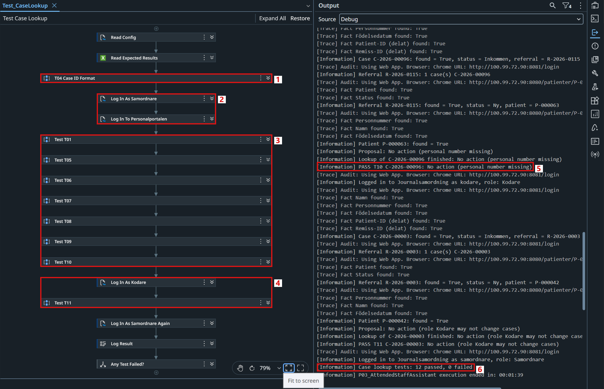

*Figure 33. `Tests/Test_CaseLookup.xaml` and its result in the Output panel.*

| Test | Case | Proposal |
|---|---|---|
| T01 | C-2026-00082 | Register case |
| T05 | C-2026-09999 | - (case not found) |
| T06 | C-2026-00101 | No action (two cases for R-2026-0055) |
| T07 | C-2026-00004 | No action (case is Klar) |
| T08 | C-2026-00020 | No action (personal number differs) |
| T09 | C-2026-00105 | No action (referral R-2026-9309 not found) |
| T10 | C-2026-00096 | No action (personal number missing) |
| T11 | C-2026-00003, as coder | No action (role Kodare may not change cases) |

Nothing was changed in either system during these tests, because the lookup only reads pages.

In this step, the assistant learned to find a case, read both systems and decide what to propose. All read-only test cases gave the expected proposal. The assistant can now say what it would do with a case, but it does not change anything yet.

## 5. Registering a Case After Confirmation

In this part, the assistant got its only action: it registers an incoming case, but only after the staff member has confirmed it. Before the change, the case is read again, and after the change, the real status is read back from Journalsamordning.

### 5.1 Asking for Confirmation

When the checks find no problem, the assistant shows the summary from the lookup and asks if the case should be registered (Figure 34). Yes registers the case, and No stops without any change.

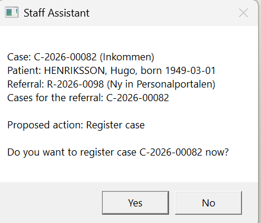

*Figure 34. The summary of case C-2026-00082 and the question to register it.*

The question is asked by the small workflow `Workflows/ConfirmAction.xaml` (Figure 35):

1. **Message Box** shows the summary and the question, with the buttons Yes and No.
2. **Assign** sets `out_Confirmed` to True only if the answer is Yes.
3. **Log Message** writes the answer to the log.

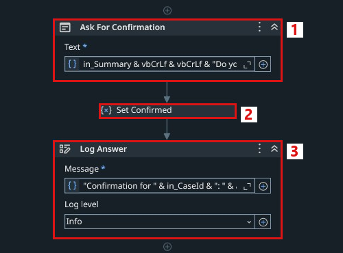

*Figure 35. `Workflows/ConfirmAction.xaml` in the Studio designer.*

When no action is proposed, there is no question. The summary is shown with the reason and the text "Nothing was changed." (Figure 36).

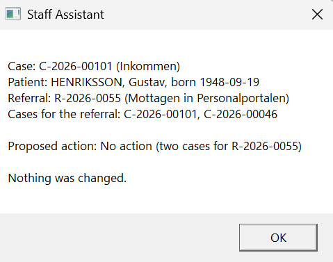

*Figure 36. The summary of case C-2026-00101, which shares its referral with another case.*

### 5.2 Registering the Case

For the change, one more element was captured from the live case page and saved in the Object Repository: the drop-down list **Ny status** (new status). The first selector contained the address of the form, `/arenden/C-2026-00082/status`, so it would only work for this one case. The case ID in the address was replaced with the wildcard `*`, and the element was found again on the page.

The workflow `Workflows/RegisterCase.xaml` makes the change (Figure 37):

1. **Go To URL** opens the case page.
2. **Get Text** reads the current status, and **Assign** removes extra spaces.
3. **If** the case is still Inkommen, the new status is saved. Otherwise nothing is saved.
4. **If** the setting `TestFault` is BeforeClick, an error is thrown here, as if the connection was lost before the click. This is only used in tests.
5. **Select Item** chooses Registrerad in the list Ny status. The value comes from the config file.
6. **Click** presses the button Spara status (save status).
7. **If** `TestFault` is AfterClick, an error is thrown after the click. This is also only used in tests.
8. **Assign** sets the result to "Saved".
9. If the status was not Inkommen, the result is "Blocked", together with the status that was found. This protects a case that someone else changed while the summary was open.
10. **Log Message** writes the result.

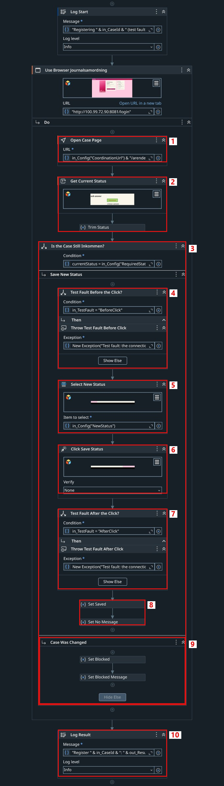

*Figure 37. `Workflows/RegisterCase.xaml` in the Studio designer.*

In normal use, `TestFault` in `Data/Config.xlsx` is None, and the two test errors never happen.

### 5.3 Reading the Result Back

A click on Spara status does not prove that the status was saved. Because of this, the workflow `Workflows/VerifyResult.xaml` opens the case again and reads the real status (Figure 38):

1. **Use Application/Browser** works in the Journalsamordning tab.
2. **Go To URL** opens the case page again.
3. **Get Text** reads the status, with the same element as in Section 4.3.
4. **Assign** removes extra spaces.
5. **Log Message** writes the real status.

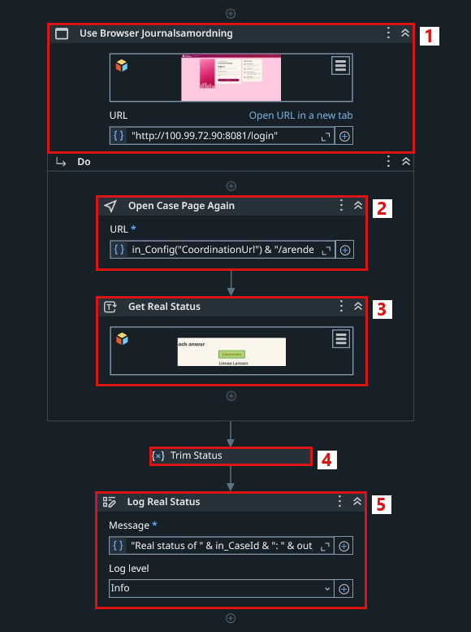

*Figure 38. `Workflows/VerifyResult.xaml` in the Studio designer.*

When the status Registrerad was read back, the staff member got this message (Figure 39).

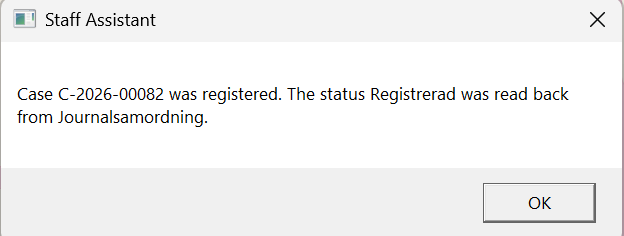

*Figure 39. The message after case C-2026-00082 was registered.*

The case page in Journalsamordning showed the same result (Figure 40):

1. The status at the top of the page is Registrerad.
2. The status in the card "Status och ansvar" is Registrerad.
3. The history has a new line, "Registrerad (från Inkommen)", by the coordinator account that the assistant logged in with.

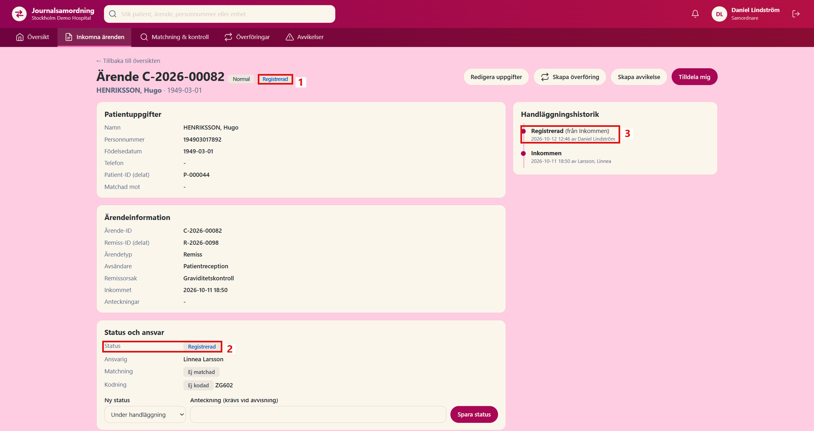

*Figure 40. Case C-2026-00082 in Journalsamordning after the registration.*

### 5.4 Handling One Case

The workflow `Workflows/HandleCase.xaml` puts the steps for one case together. The first version had an **If** inside an **If** inside another **If**, and the Workflow Analyzer warned that the nesting was too deep. It was rebuilt as numbered steps in a row. Each step is one **If**, and it only runs while the result is still empty, the same idea as the checks in Section 4.6. The first part looks up the case and asks for confirmation (Figure 41):

1. **Look Up Case** runs the lookup from Section 4.7.
2. Step 1: if no action is proposed, the summary is shown, and the result is "No action", or "Not found" for a case that does not exist.
3. Step 2: the summary is shown with the question from Section 5.1.
4. **Confirm Action** asks the question.
5. If the staff member clicks No, the result is "Cancelled".

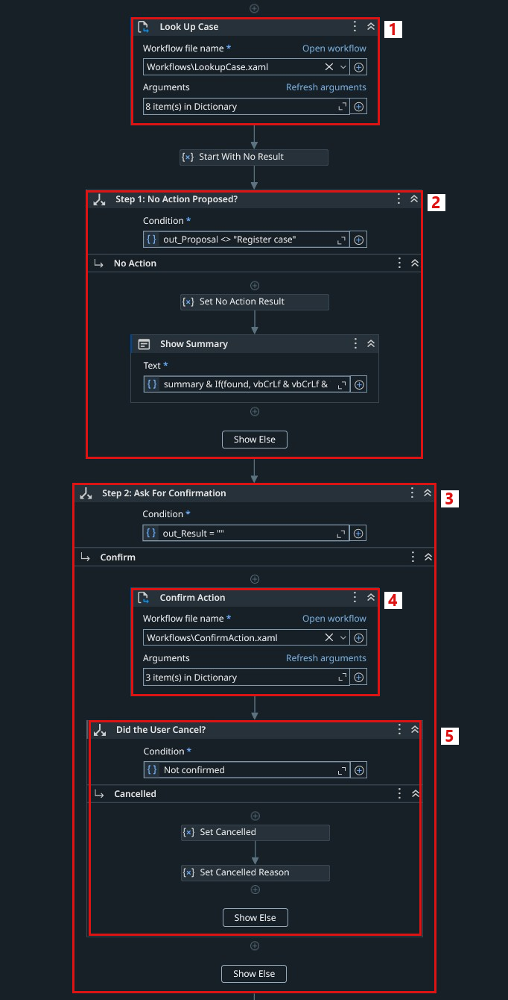

*Figure 41. The first part of `Workflows/HandleCase.xaml`.*

The second part saves the status and reads it back (Figure 42):

1. Step 3: **Try Catch** runs the registration, so a lost connection does not stop the assistant.
2. **Register Case** calls the workflow from Section 5.2 with the `TestFault` value from the config file.
3. If an error happens, the result of the save is "Error", and the message is kept and written to the log as a warning.
4. Step 4: if the save was blocked, the result is "Blocked".
5. Step 5: **Verify Result** reads the real status.

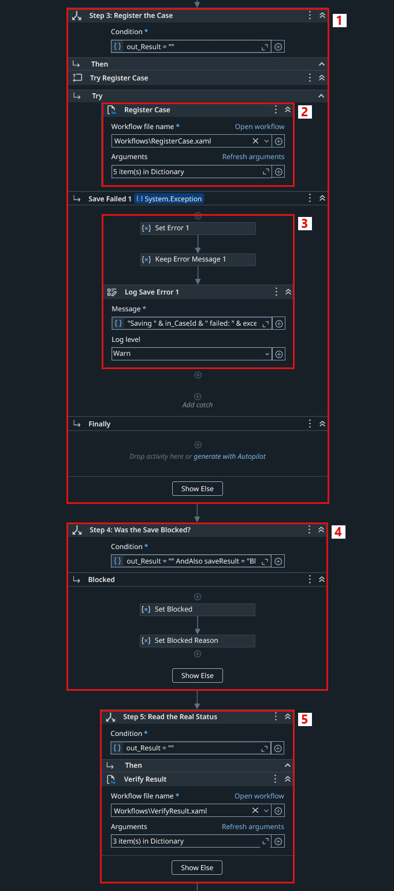

*Figure 42. The second part of `Workflows/HandleCase.xaml`.*

After an error, the real status decides what happens next. If the case is already Registrerad, the click worked, and it must not be repeated. If the case is still Inkommen, the save is tried once more (Figure 43):

1. Step 6 only runs after an error, when the case is still Inkommen.
2. **Log Message** writes a warning that the save is tried again.
3. **Assign** keeps the first error message and notes that a second try was made.
4. **Try Catch** runs **Register Case** once more. This time `TestFault` is always None. The workflow reads the status again before it saves, so the case is only saved if it is still Inkommen.
5. **Verify Result** reads the real status again.

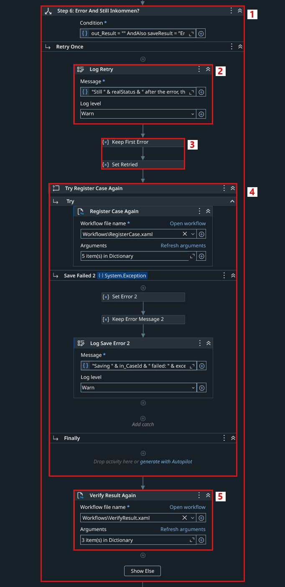

*Figure 43. The third part of `Workflows/HandleCase.xaml`.*

The last part decides the result and tells the staff member (Figure 44):

1. Step 7: if the real status is Registrerad, the result is "Registered". The reason tells if the status was read after an error or saved on the second try.
2. Step 8: if there is still no result, the result is "Failed", with the real status as reason.
3. Step 9: after a confirmation, a message shows the result. If the case was not registered, the staff member is asked to check the case by hand.
4. **Log Message** writes the result of the case.

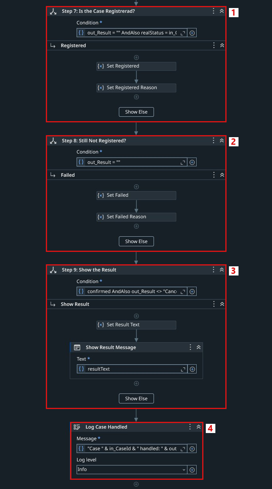

*Figure 44. The last part of `Workflows/HandleCase.xaml`.*

### 5.5 The Audit Log

Every handled case gets one line in the audit file `Output/audit_log.csv`. The line has the time, the Windows user, the role, the case ID, the proposal, the result and the reason. Names and personal numbers are not written. The workflow `Workflows/WriteAudit.xaml` writes the line (Figure 45):

1. **Assign** builds the folder from the setting `AuditFolder` and the file name.
2. **Create Folder** makes sure that the folder exists.
3. **If** the file is new, **Append Line** writes the header line first.
4. **Append Line** adds the line for the case. A semicolon in the text is replaced, so it cannot break the columns.
5. **Log Message** writes that the audit line was written.

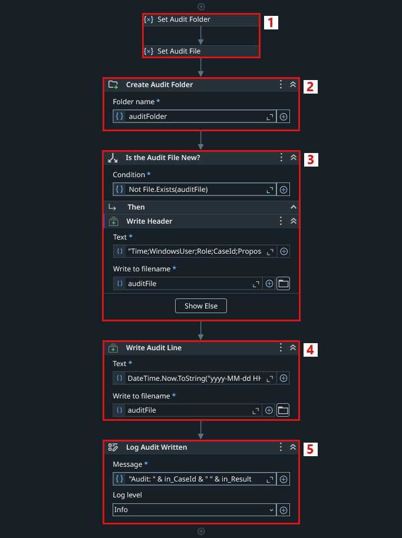

*Figure 45. `Workflows/WriteAudit.xaml` in the Studio designer.*

### 5.6 The Main Workflow

`Main.xaml` starts the assistant and handles one case after another (Figure 46):

1. **Read Config** reads the settings from Section 3.4.
2. The assistant logs in to Journalsamordning and to Personalportalen with the workflows from Sections 2.5 and 4.5.
3. **While** repeats the steps for one case until the staff member stops.
4. **Ask For Case ID** shows the dialog from Section 4.1.
5. **If** the staff member closed the dialog, the loop stops.
6. **Handle Case** runs the workflow from Section 5.4.
7. **Write Audit** writes the audit line.
8. **Message Box** asks "Do you want to check another case?". No ends the loop.
9. **Log Message** writes that the assistant has finished.

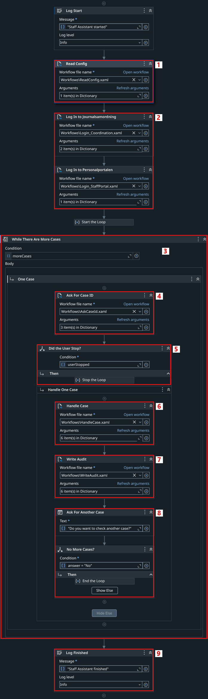

*Figure 46. `Main.xaml` in the Studio designer.*

The variable for the stop answer was first called `stop`. The check of the workflow failed with an expression error, because `Stop` is a keyword in Visual Basic, so the variable was renamed to `userStopped`.

### 5.7 Testing the Confirmed Action

These tests change data, so they were run with `Main.xaml`. The staff member answered the dialogs, as in real use. After each test, the case status and its history were checked in the lab database. A status change cannot be undone in Journalsamordning, so the lab data was restored to its starting state with the lab command `./lab restore baseline` before T14 and T15.

| Test | Case | What was done | Result |
|---|---|---|---|
| T01 | C-2026-00082 | No in the confirmation | Cancelled, the case stayed Inkommen |
| T02 | C-2026-00082 | Yes in the confirmation | Registered, Registrerad read back, one new history line |
| T03 | C-2026-00082 | The same case again | No action (already registered) |
| T12 | C-2026-00003 | The case was registered by hand in the browser while the summary was open, then Yes | Blocked, nothing was saved by the assistant |
| T14 | C-2026-00082 | Yes, with `TestFault` AfterClick | The real status Registrerad was read after the error, no second click |
| T15 | C-2026-00003 | Yes, with `TestFault` BeforeClick | The case was still Inkommen after the error, one more try, registered |

T11 was tested in Section 4.8. The role Kodare gets no proposal, so the question is never asked.

In T03, the lookup found the status Registrerad from T02 and proposed no action (Figure 47).

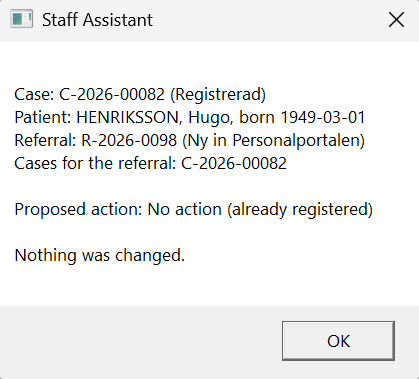

*Figure 47. Case C-2026-00082 checked again after the registration.*

In T12, the case was registered by hand while the summary was still open. When Yes was clicked, the assistant read the case again, found the status Registrerad, and did not save anything (Figure 48). The lab database showed only the change made by hand.

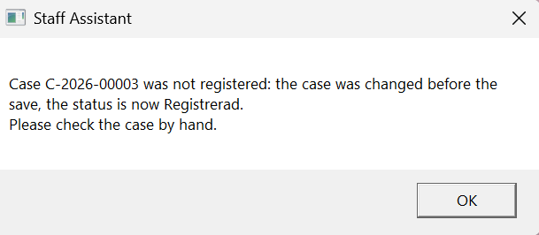

*Figure 48. The message when the case was changed before the save.*

In T14 and T15, the staff member saw the normal message from Figure 39, because the case was registered in the end. The difference is shown in the audit file (Figure 49). For each of the two cases, the lab database showed exactly one new history line, so no case was saved twice.

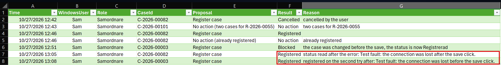

*Figure 49. The audit file after all tests. The box marks the results of T14 and T15.*

After the tests, `TestFault` was set back to None.

In this step, the assistant learned to register a case after a clear Yes from the staff member, to protect a case that was changed in the meantime, and to read the real status back instead of trusting the click. After a lost connection, it saved the case once more only when the case was still Inkommen. All tests of the confirmed action gave the expected result.

## 6. Handling an Unavailable System

An assistant that reads two systems must notice when one of them does not answer. In this part, T13 was tested, a wrong result was found, and the assistant was changed so that it stops with a clear message instead.

### 6.1 The Problem With the Maintenance Page

The lab has a scenario called `maintenance`. When it is on, Personalportalen shows the page "Systemet är inte tillgängligt" (the system is not available) with error code 503. The scenario was turned on with the lab command `./lab scenario on maintenance`, and `Main.xaml` was started.

The assistant did not notice the maintenance page. It found no login form, so it logged "Already logged in to Personalportalen", and it asked for a case as usual (Figure 50).

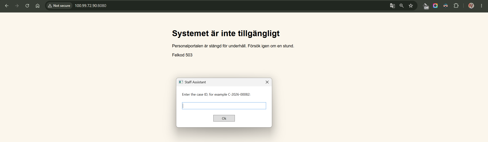

*Figure 50. The maintenance page in Personalportalen, and the assistant still asks for a case.*

For case C-2026-00020, the assistant could not find the referral details on the page, so it reported the referral as not found and proposed no action (Figure 51). The real problem with this case is a different personal number (Section 3.2), so the summary gave the staff member a wrong reason, and nothing showed that Personalportalen was down.

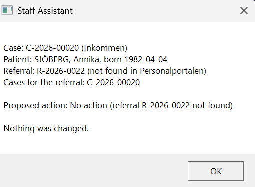

*Figure 51. The summary for C-2026-00020 during maintenance, with the wrong reason "referral not found".*

The cause was the same in two places. A missing element was taken as proof of something: no login form meant "already logged in", and no referral details meant "referral not found".

### 6.2 What a Real "Not Found" Page Looks Like

A referral that really does not exist gives a normal page in Personalportalen (Figure 52):

1. The heading says "Remissen hittades inte" (the referral was not found).
2. The page header with the logout button is still shown, because the user is logged in.

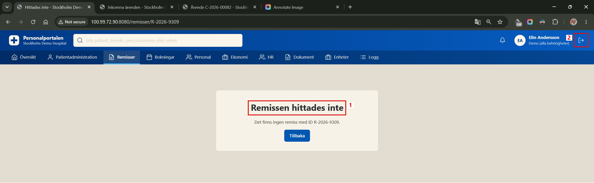

*Figure 52. The page for a referral that does not exist, with the logout button in the header.*

The maintenance page and the login page have no logout button. So the logout button shows if the page is a normal page of a logged-in user, and only then can a missing element be trusted as "not found".

### 6.3 Checking the Page

The logout button was already in the Object Repository from the login workflows. One new element was captured from the live maintenance page: **Page Heading**, the main heading of the page. Its selector is only `<webctrl tag='H1' />`. It has no text on purpose, so it reads the heading of any page, for example "Systemet är inte tillgängligt" or "Logga in".

The workflow `Workflows/CheckStaffPortalPage.xaml` checks the page in Personalportalen (Figure 53):

1. **Check App State** waits up to 3 seconds for the logout button. If it appears, the page is a normal page.
2. If it does not appear, the page is marked as not OK, and its heading is read.
3. **Check App State** looks for a heading, and **Get Text** reads it. If there is no heading, the text "(no heading)" is used.
4. **If** the page is not OK, **Throw** stops with the message "Personalportalen is not available or the login has expired. The page shows:" and the heading.
5. **Log Message** writes that the page was checked.

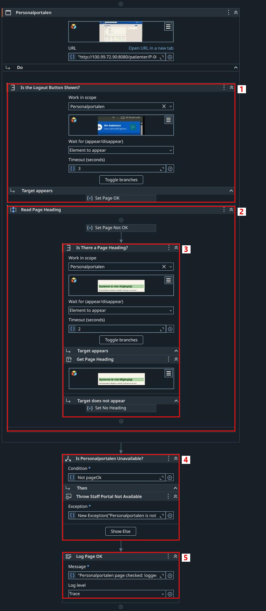

*Figure 53. `Workflows/CheckStaffPortalPage.xaml` in the Studio designer.*

A second workflow, `Workflows/CheckCoordinationPage.xaml`, does the same check in Journalsamordning with its logout button, but without the heading.

### 6.4 Using the Check

The check only runs when an element was missing, so a normal lookup is not slower. In `Workflows/ReadReferral.xaml` it was added after the referral page (Figure 54):

1. **Go To URL** opens the referral page.
2. **Check App State** looks for the referral details. If they are missing, the referral is marked as not found.
3. **If** the referral was not found, **Check Staff Portal Page** is called. On a normal page nothing happens, and the referral stays "not found". On any other page, the check stops with the message.

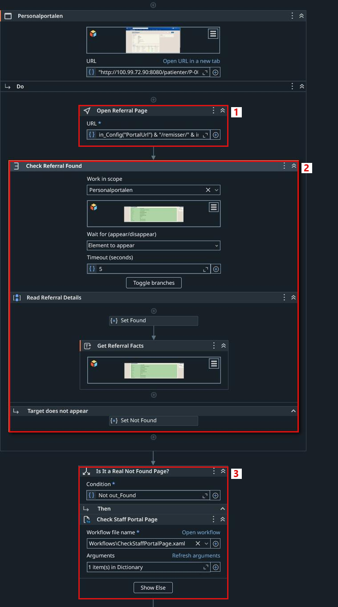

*Figure 54. The first part of `Workflows/ReadReferral.xaml` with the new check.*

The same **If** was added to `Workflows/ReadPatient.xaml`, and to `Workflows/ReadCase.xaml` with the check for Journalsamordning.

The login to Personalportalen was changed in the same way (Figure 55):

1. If the login form is not shown, the workflow only notes this.
2. **If** there was no login form, the page is checked before anything else.
3. **Check Staff Portal Page** stops with the message if the page is not a normal page.
4. Only after a successful check, "Already logged in to Personalportalen" is written to the log.

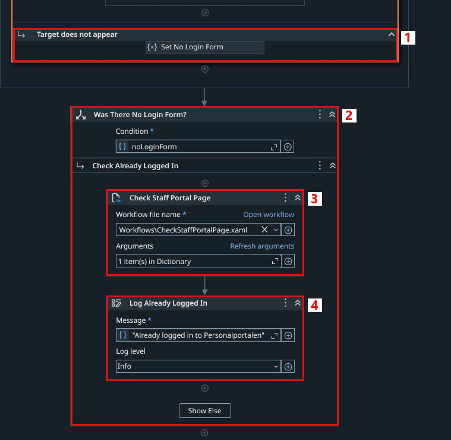

*Figure 55. The end of `Workflows/Login_StaffPortal.xaml` with the new check.*

### 6.5 Error Handling in the Main Workflow

The message from the check is an error, and `Main.xaml` decides what happens next. Two **Try Catch** activities were added. The first part of the workflow is shown in Figure 56:

1. **Log Message** writes that the assistant has started.
2. **Try Catch** "Try Session" contains the whole session, from reading the config file to the last case.
3. The config file is read, and the assistant logs in to both systems, as before.
4. **While** repeats the steps for one case.
5. Before each case, the proposal, the result and the reason are cleared, so a failed case cannot show the values of the case before it.

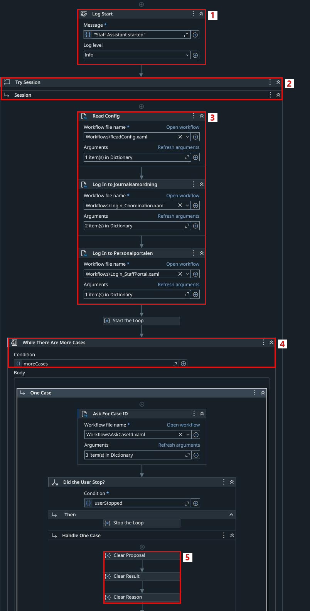

*Figure 56. The first part of `Main.xaml` with the Try Catch for the session.*

The second part handles errors (Figure 57):

1. **Try Catch** "Try Handle Case" runs the workflow for one case.
2. If the case fails, the result is "Error", the reason is the error message, the error is logged, and the staff member gets a message. The session then goes on.
3. The audit line is written for every case, also for a failed case, and the staff member is asked if another case should be checked.
4. If an error happens outside a case, for example at the login, the catch "Controlled Stop" logs it and shows a message, and the assistant stops.
5. **Log Message** writes that the assistant has finished.

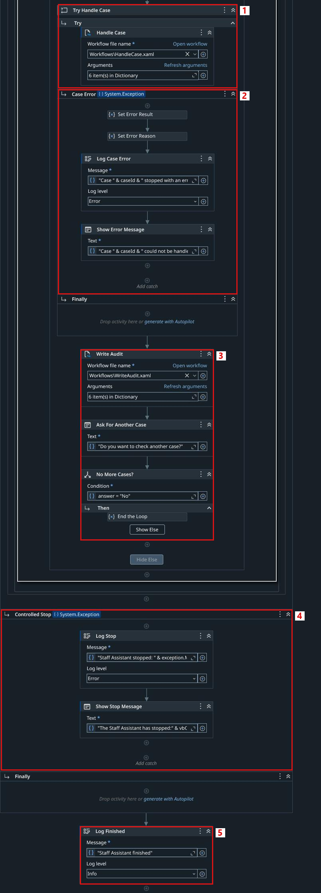

*Figure 57. The second part of `Main.xaml` with the error handling for one case and for the session.*

An error in a case does not end the session, because the system may be back a minute later. An error at the login ends the session, because the assistant cannot work without both systems.

### 6.6 Testing the Error Handling

The lab scenario was turned on and off with the lab commands shown in Figure 58. Before the last test run, the lab data was restored with `./lab restore baseline`, because the registration tests in Section 5.7 had already changed some cases. All scenarios were off at the end.

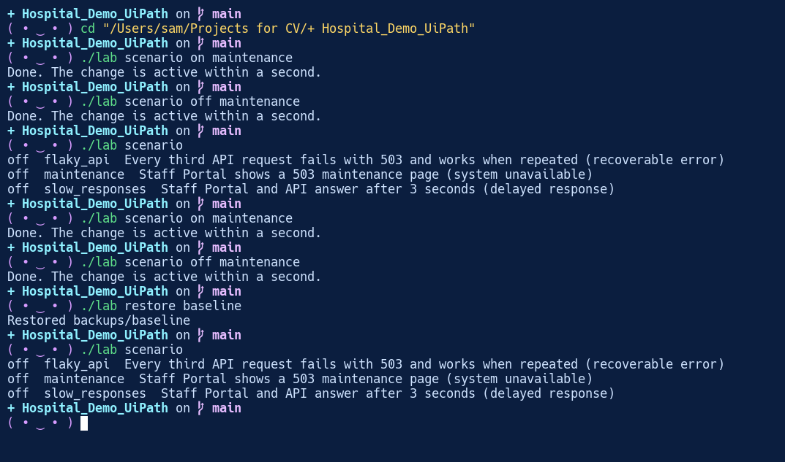

*Figure 58. The lab commands for the maintenance scenario and the restore.*

| Test | What was done | Result |
|---|---|---|
| T13 | Maintenance on before the start | The assistant stopped at the login with a clear message, and no case was asked for |
| T13b | Maintenance turned on while the case question was open, case C-2026-00020 | The case got the result "Error" with the message, and the session went on |
| T13c | Maintenance turned off, the same case again | The correct proposal "No action (personal number differs)" |
| T13d | Logged out of Personalportalen by hand while the case question was open | The case got the result "Error", and the message showed the heading "Logga in" |
| T01-T11 | The lookup tests from Section 4.8 after the restore | 12 of 12 passed, so a real "not found" is still reported as before |

In T13, the assistant stopped right after the login to Journalsamordning (Figure 59).

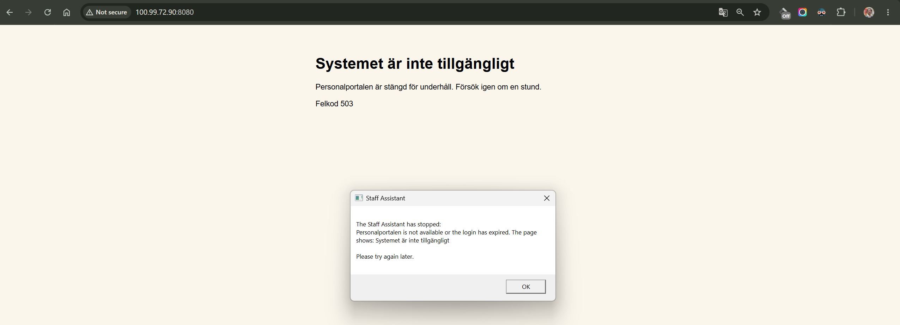

*Figure 59. The controlled stop when Personalportalen shows the maintenance page.*

In T13b, the session was already running when the maintenance started. The case could not be handled, and the staff member was told to check the case by hand (Figure 60). Answering Yes to the next question started a new case.

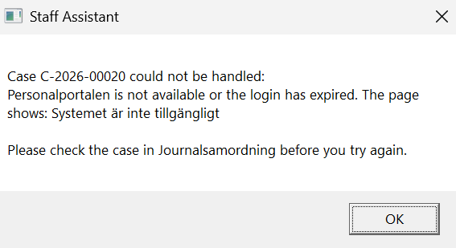

*Figure 60. The message when Personalportalen became unavailable during a case.*

T13d shows that the same check also finds an expired login. After the logout, Personalportalen showed the login page, and its heading was shown in the message (Figure 61).

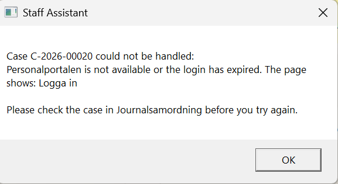

*Figure 61. The message when the login to Personalportalen had expired.*

The audit file shows the difference between the first run and the tests after the change (Figure 62). The line from 13:44 is the wrong result from Section 6.1. The box marks the lines from T13b, T13c and T13d: two lines with the result "Error" and the reason, and the correct proposal in between.

*Figure 62. The audit file after the tests. The box marks the lines from T13b, T13c and T13d.*

In this step, the assistant learned not to trust a missing element on its own. A page now counts as "not found" only when the logout button shows a normal page of a logged-in user. An unavailable system or an expired login now gives a clear message and an "Error" line in the audit file instead of a wrong proposal, and one failed case no longer ends the session.
