# P03 - Attended Hospital Staff Assistant

## 1. Project Goal

The goal of this project is to build an attended UiPath assistant for the administrative staff of a fictional Swedish hospital. The staff member enters a case ID, and the assistant looks up the case in Journalsamordning and the linked referral in Personalportalen. It shows a short summary and, when the records agree, proposes one simple administrative action: registering the incoming case. The action is only performed after the staff member clicks Confirm, and the case is read again afterwards to check the real result. Cancel always means that nothing is changed.

### 1.1 Scenario

The coordination office receives cases from other units, for example a referral from the patient reception. Each new case arrives in **Journalsamordning** with the status **Inkommen** (received). Before a coordinator starts working on it, the case is registered, which changes the status to **Registrerad**.

The referral behind the case is kept in **Personalportalen (Staff Portal)**. The two systems are separate, so the coordinator checks by hand that the case really belongs to an existing referral and to the right patient before the case is registered.

### 1.2 Before Automation - Manual Process

1. **Open the case:** The coordinator opens the case in Journalsamordning and reads the patient details and the referral ID.
2. **Find the referral:** The referral is looked up in Personalportalen, and its status is checked.
3. **Compare the patient:** The name, the birth date and the personal number in the case are compared with the patient in Personalportalen.
4. **Register the case:** If everything agrees, the coordinator selects the new status Registrerad and saves it.

The case page in Journalsamordning holds everything that is needed for the check and for the action. The numbers in Figure 1 match these parts:

1. The patient details: name, personal number, birth date and the shared patient ID.
2. The shared referral ID, which points to the referral in Personalportalen.
3. The current status of the case, Inkommen.
4. The status form. **Ny status** offers Registrerad, and **Spara status** saves it.
5. The buttons for changing the case, which are shown because the user may edit cases.
6. The logged-in user and the role, Samordnare (coordinator).

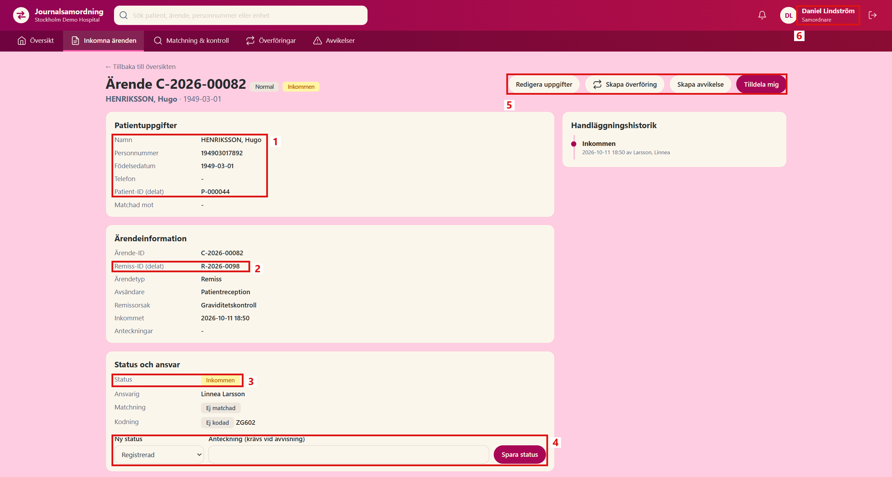

*Figure 1. Case C-2026-00082 in Journalsamordning, opened by a coordinator.*

The referral is found under Remisser in Personalportalen (Figure 2):

1. **Remiss-ID**, the same ID as in the case.
2. **Patient**, with the name and the birth date.
3. **Status**. The referral is still **Ny** (new), so it is open.

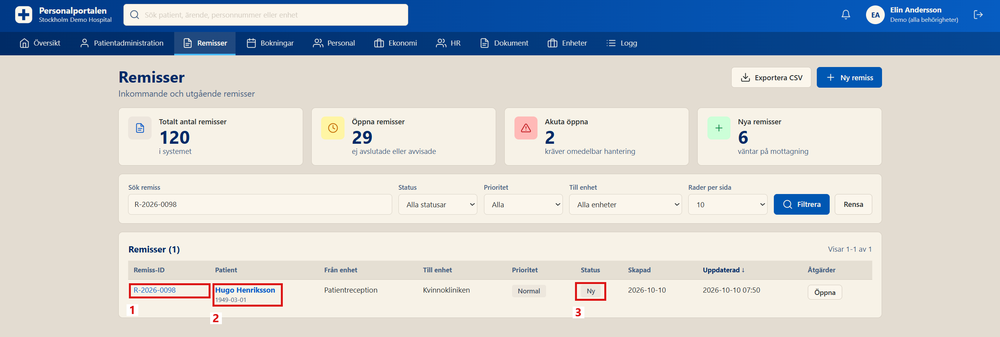

*Figure 2. Referral R-2026-0098 in the Remisser list of Personalportalen.*

The personal number of the patient is shown in Patientadministration (Figure 3):

1. **Personnummer**, written with a dash in this system, but without a dash in Journalsamordning.
2. **Födelsedatum**, the birth date.

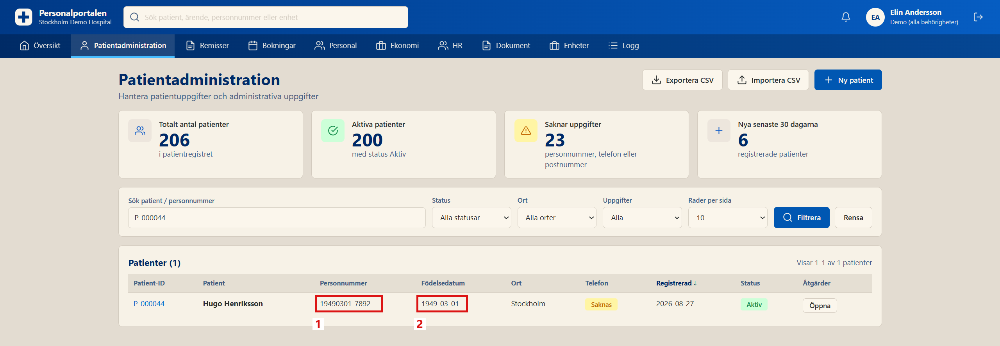

*Figure 3. Patient P-000044 in Patientadministration.*

The work is not difficult, but it needs two systems and careful reading. A small difference, like one wrong digit in a personal number or a second case for the same referral, is easy to miss.

### 1.3 After Automation - UiPath Process

1. **Ask for the case:** The assistant asks the staff member for a case ID.
2. **Read both systems:** The case is read in Journalsamordning, and the referral and the patient are read in Personalportalen.
3. **Show a summary:** The assistant shows the case, the differences it found, and the proposed action, or the reason why no action is proposed.
4. **Ask for confirmation:** Nothing is changed until the staff member clicks Confirm. Cancel stops without any change.
5. **Register the case:** The case is read again to make sure it has not changed, and then the status is set to Registrerad.
6. **Check the result:** The case is read once more, the real status is shown to the staff member, and an audit line is written.

The staff member stays in control the whole time, and the assistant only removes the slow looking up and comparing.

### 1.4 Project Scope

All data in this project is fictional. The assistant only performs one action, registering an incoming case, which is a simple administrative step and not a medical decision. It works with the rights of the logged-in role and never tries to get around them.

## 2. Checking the Working Environment

Before building the assistant, the tools, the hospital systems and the user roles were checked.

### 2.1 UiPath Tools

A new Windows project named `P03_AttendedStaffAssistant` was created in UiPath Studio, with VB as the expression language. Two packages were added under Manage Packages (Figure 4):

1. `UiPath.Credentials.Activities` reads the logins from Windows Credential Manager, so no password is stored in the workflows.
2. `UiPath.UIAutomation.Activities` works with the web pages in Chrome. Version 26.10.2 is the same version as in the earlier projects.

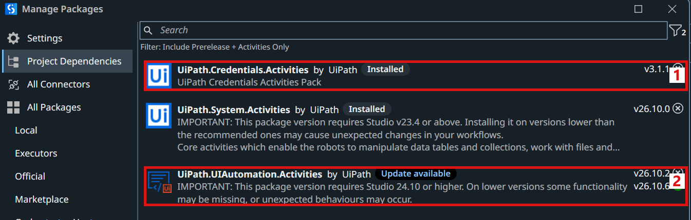

*Figure 4. Project Dependencies in Manage Packages.*

### 2.2 Hospital Systems

The hospital applications run on a separate computer and are reached through a private network (Tailscale). Both are working:

| System | Address |
|---|---|
| Journalsamordning (case coordination) | `http://100.99.72.90:8081` |
| Personalportalen (Staff Portal) | `http://100.99.72.90:8080` |

The status of a case can only be changed on the case page in Journalsamordning (see Figure 1). There is no other supported way to change it, so the assistant works with the same page as a person.

### 2.3 User Roles in Journalsamordning

Journalsamordning gives each user a role, and the role decides what the user may do. Two roles are used in this project:

| Role | User | Rights |
|---|---|---|
| Samordnare (coordinator) | `samordnare` | Can see and change cases |
| Kodare (coder) | `kodare` | Can see cases, but not change them |

The same case was opened with the coder account (Figure 5):

1. The menu is shorter, because the coder has no access to matching and transfers.
2. The logged-in role is Kodare.
3. The status is shown, but the status form and the buttons from Figure 1 are missing.

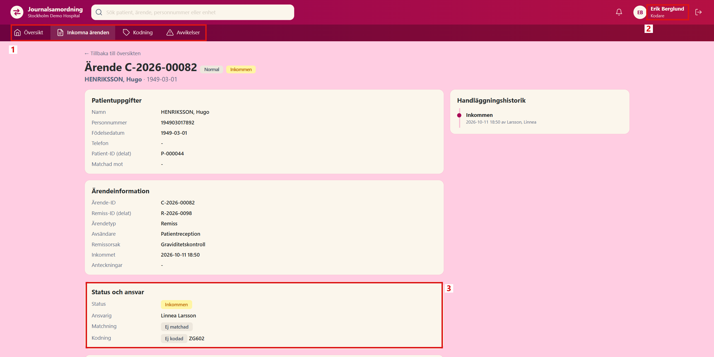

*Figure 5. The same case opened by a coder. The status cannot be changed.*

The coder account is useful for testing. It shows what the assistant does when the logged-in role is not allowed to make the change.

### 2.4 Logins in Windows Credential Manager

The logins of both roles were saved in Windows Credential Manager as generic credentials (Figure 6):

1. **Internet or network address** is the name the workflow uses to find the login, here `P03_Samordnare`.
2. **User name** is the account in Journalsamordning.
3. **Password** is stored only here, never in the project.

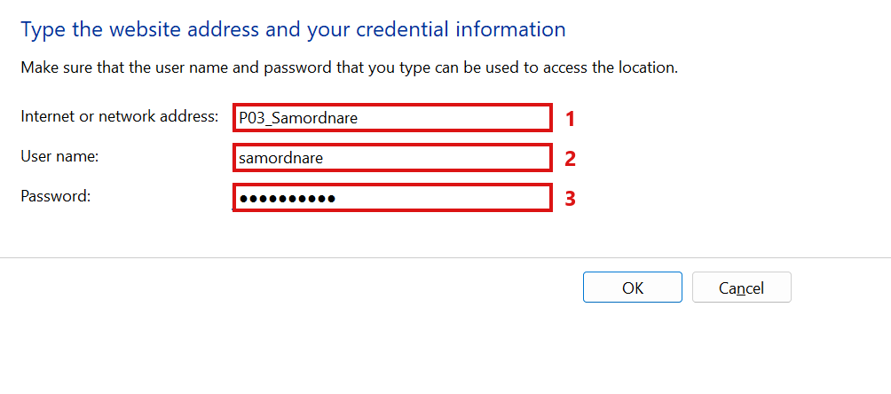

*Figure 6. Adding the login of the coordinator.*

After both logins were added, they are listed next to the logins of the earlier projects (Figure 7, number 1).

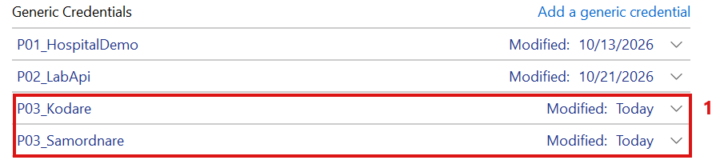

*Figure 7. The generic credentials, with the two new P03 logins.*

### 2.5 The Login Workflow

The login is done in one reusable workflow, `Workflows/Login_Coordination.xaml`. It gets the name of a credential and gives back the role of the user who logged in. In this way, the same workflow is used for both accounts.

The first part opens the page and gets the login (Figure 8):

1. **Use Application/Browser** opens Journalsamordning in Chrome, or uses the tab that is already open.
2. **Check App State** looks for the logout button. If someone is still logged in, **Click Log Out** logs that user out first, so the right account is used.
3. **Get Secure Credential** reads the user name and the password from Credential Manager. The password is kept as a secure text and never written to the log.

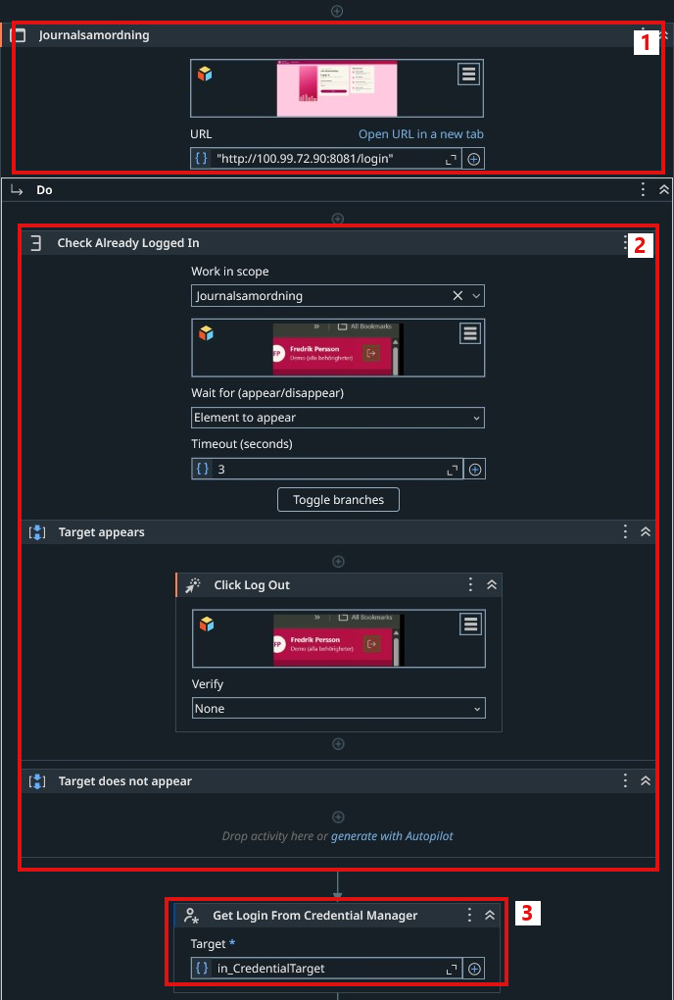

*Figure 8. The first part of `Workflows/Login_Coordination.xaml`.*

The second part logs in and checks the result (Figure 9):

4. **If** the credential is missing in Credential Manager, the workflow stops with a clear message.
5. **Type Into** types the user name.
6. **Type Into** types the password from the secure text.
7. **Click** presses Logga in.
8. **Check App State** waits up to 10 seconds for the logout button, which is only shown to a logged-in user. If it appears, **Get Text** reads the role under the user name. If it does not appear, the login failed, and the workflow stops with the message that the user name or the password is wrong.
9. **Log Message** writes the user and the role to the log.

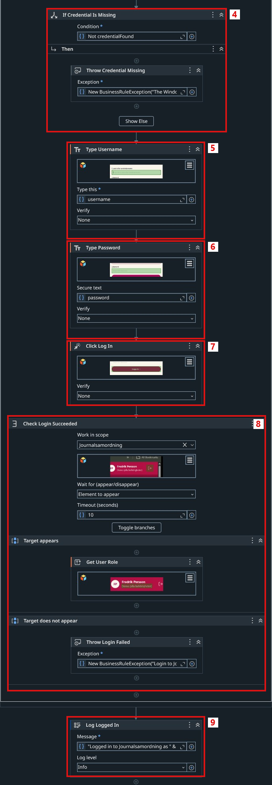

*Figure 9. The second part of `Workflows/Login_Coordination.xaml`.*

The arguments were created in the Data Manager (Figure 10):

1. `in_CredentialTarget` is the name of the credential, for example `P03_Samordnare`.
2. `out_UserRole` is the role that was read after the login.

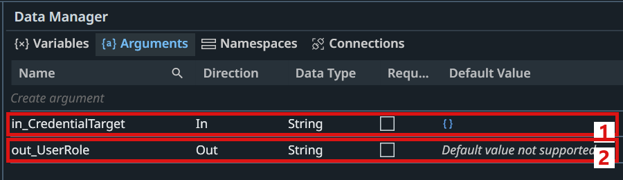

*Figure 10. The arguments of `Workflows/Login_Coordination.xaml`.*

### 2.6 Testing the Two Logins

The test workflow `Tests/Test_Logins.xaml` calls the login workflow once for each account and checks the role that comes back (Figure 11):

1. The test: log in as coordinator, check the role, then the same for the coder.
2. The coordinator login worked, and the role is Samordnare.
3. The coder login worked, and the role is Kodare.

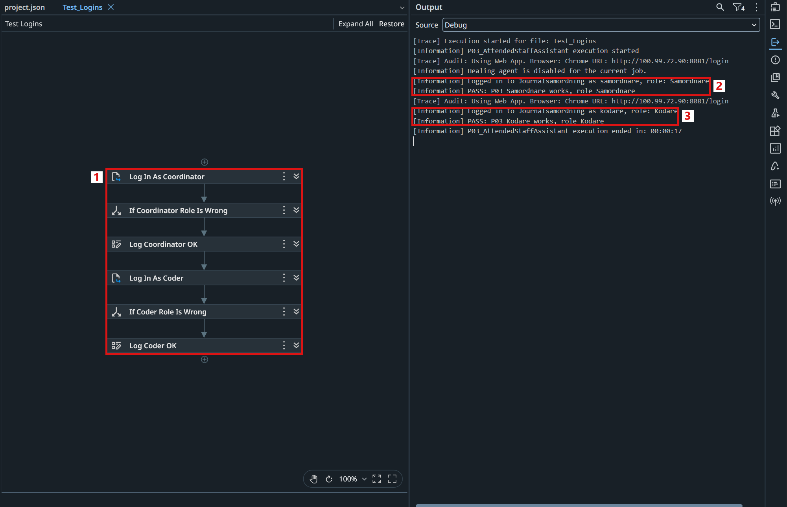

*Figure 11. `Tests/Test_Logins.xaml` and its result in the Output panel.*

The first run of the test failed with the message that the user name or the password was wrong, for both accounts. The new login check found the problem at once: the passwords that had been saved were not the passwords of the lab accounts. After the two credentials were corrected in Credential Manager, both logins worked, as shown in Figure 11.
