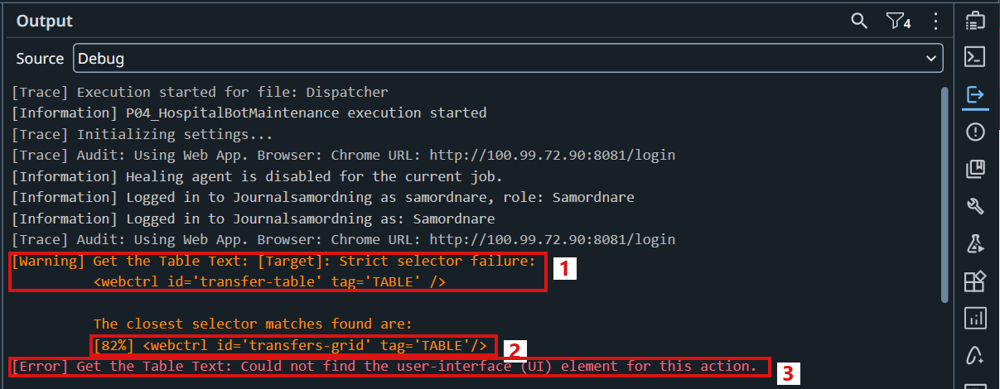
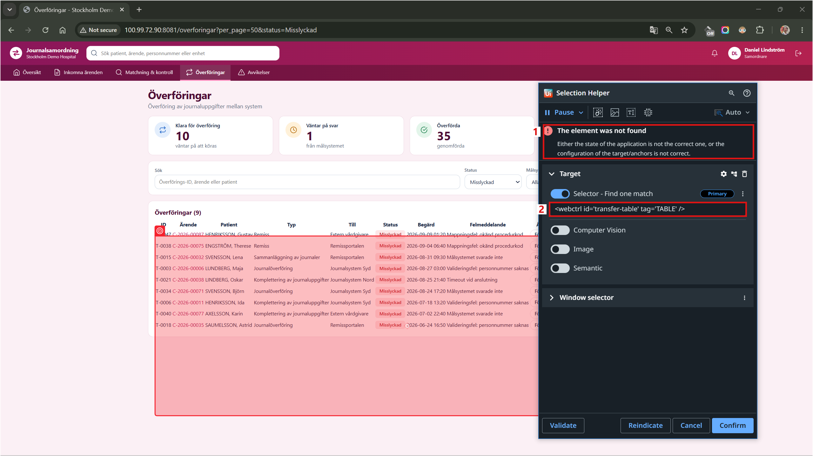
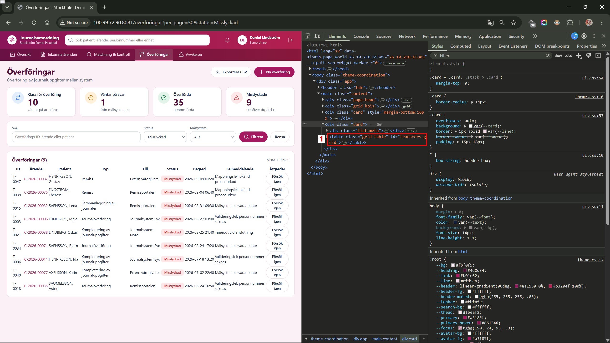
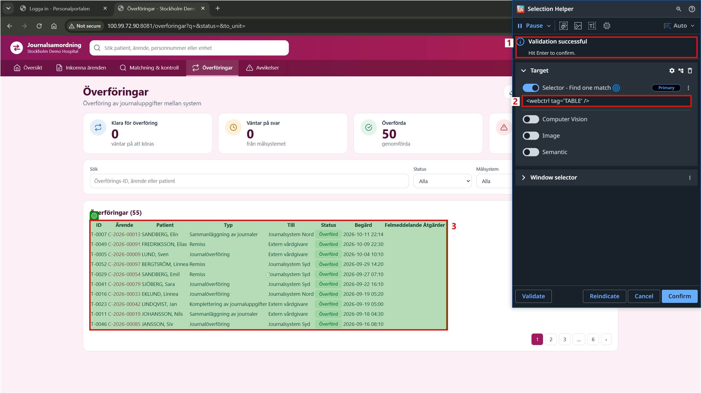
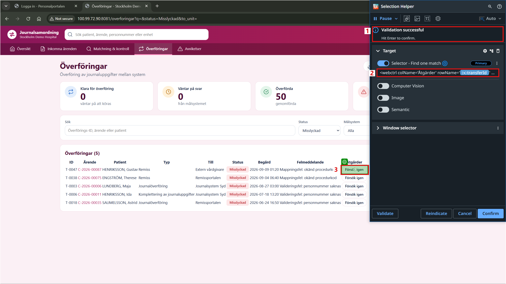
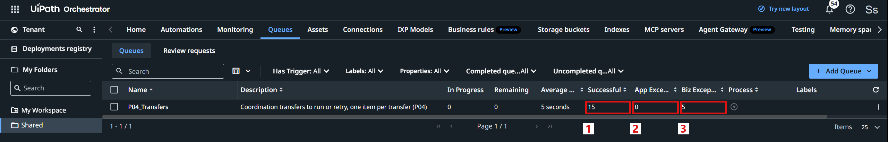
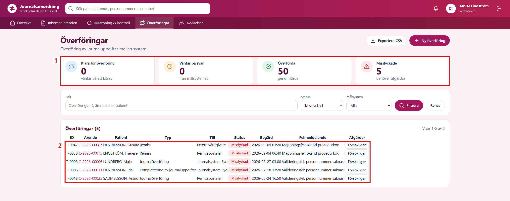

# INC-01 - A Page Update Breaks the Transfer Robot

This record is one of the support scenarios of the [P04 Project Record](Project%20Record.md).

## 1. The Ticket

| | |
|---|---|
| Reported by | The coordination team in Journalsamordning |
| Symptom | The transfer robot stops right after the login. No transfers are queued or handled, although the Överföringar page looks exactly as before. |
| Robot | Transfer robot ([INC-02](INC-02%20-%20A%20Backlog%20of%20Transfers%20and%20an%20Unreliable%20Target%20System.md)) |
| Impact | All transfers must be started by hand again until the robot is fixed. |
| Priority | High |

## 2. The Robot Stops After the Update

The ticket came the day after a new version of Journalsamordning was installed. For a person, the Överföringar page looks exactly as before: the same columns, the same buttons and the same data. But since the update, the robot has not handled a single transfer.

For the coordinators, this means:

- **Back to manual work.** About 20 transfers a day are clicked one by one again, as in Section 2 of [INC-02](INC-02%20-%20A%20Backlog%20of%20Transfers%20and%20an%20Unreliable%20Target%20System.md).
- **New tries without a rule.** A failed transfer is tried again by guess, because nobody sorts the data errors from the technical errors any more.
- **No list of the result.** There is no report at the end of the day.

For the support team, this means:

- **Nothing looks broken.** The page is the same, so there is no visible reason why the robot stopped.
- **The queue is empty.** The robot stops right after the login, before it adds any transfer to the queue, so the queue gives no hint either.

The dispatcher was run in UiPath Studio to see what the robot sees on the new page (Figure 1):

1. The robot could not find the transfer table with its selector `<webctrl id='transfer-table' tag='TABLE' />`.
2. UiPath shows the closest element it found: a table with the id `transfers-grid`, an 82 % match.
3. The run stopped with the error "Could not find the user-interface (UI) element for this action".

*Figure 1. The Output panel in Studio when the dispatcher runs against the new page.*

The robot stopped before any transfer was added to the queue. The performer uses the same table, so it would fail in the same way on every transfer.

## 3. Finding the Cause

The target of the table was opened in the Selection Helper in Studio, with the new page open in Chrome (Figure 2):

1. The Selection Helper says that the element was not found.
2. The selector looks for a table with the id `transfer-table`.

*Figure 2. The old selector of the transfer table in the Selection Helper.*

The page itself was then inspected with the developer tools in Chrome (Figure 3):

1. The table now has the id `transfers-grid` and the class `grid-table`. Before the update, it was `id="transfer-table"` and `class="data"`.

*Figure 3. The transfer table of the new page in the developer tools of Chrome.*

An id like this is a technical name that the developers of the page choose. A person never sees it, and it can change in any release. Four elements of the robot depended on it: the table itself, and the status, the error text and the button of a transfer row, which all used the table id as their parent (`parentid='transfer-table'`). So one renamed id stopped the whole robot.

## 4. What the Fix Should Change

Re-indicating the elements on the new page would fix the robot today, but it would break again at the next release that renames something. The fix is only worth the work if the robot depends on what the page shows, not on how it is built inside. After the fix, the following goals are expected to be met:

| Goal | Today (manual) | Expected after the fix |
|---|---|---|
| **The robot works again** | The coordinators click about 20 transfers by hand | The robot handles the transfers again on the new page, with the same outcomes as in [INC-02](INC-02%20-%20A%20Backlog%20of%20Transfers%20and%20an%20Unreliable%20Target%20System.md) |
| **Stable selectors** | All four transfer elements depend on the technical id of the table | The elements are found by what a person sees: the column header and the transfer ID |
| **Both versions** | The robot only works on the old page | The same robot works on the old and the new page, so a release of Journalsamordning and a release of the robot do not have to happen on the same day |
| **One place to change** | The same four elements are used in three workflows | The selectors are kept in the Object Repository, so one change reaches every workflow that uses them |
| **No side effects** | - | Every transfer gets the same result as before the page update |

In short, a change that a person cannot see on the page should not stop the robot.

## 5. The Fix

Each problem found in Sections 2 and 3 is solved by one part of the fix.

**Problem 1: the table is found by its id.** The selector `<webctrl id='transfer-table' tag='TABLE' />` only works as long as the developers keep the same id.

*Solution: find the table by its tag.* The Överföringar page has only one table, so `<webctrl tag='TABLE' />` is enough to find it, with any id or class. In the Object Repository, the new selector of **Transfer Table** was checked with **Validate** against the new page (Figure 4):

1. Validation successful.
2. The new selector, without the id.
3. The whole transfer table is found.

*Figure 4. The new selector of the transfer table in the Selection Helper.*

**Problem 2: the cells of a row are found through the table id.** The status, the error text and the button were found with `parentid='transfer-table'`, together with the column and the row.

*Solution: find a cell by its column header and its transfer ID.* `colName` is the header of the column, for example `Åtgärder`, and `rowName` is the transfer ID in the first column of the row. A person uses exactly the same two things to find a button on the page. The parent id was removed, and the new selectors were validated on the new page (Figure 5):

1. Validation successful.
2. The new selector of the button: `<webctrl colName='Åtgärder' rowName='{transferId}' tag='BUTTON' />`, where the transfer ID comes from the queue item.
3. The button of transfer T-0047 is found.

*Figure 5. The new selector of the transfer button in the Selection Helper.*

| Element | Old selector | New selector |
|---|---|---|
| Transfer Table | `<webctrl id='transfer-table' tag='TABLE' />` | `<webctrl tag='TABLE' />` |
| Transfer Row Status | `colName='Status' parentid='transfer-table' rowName='{id}'` | `colName='Status' rowName='{id}'` |
| Transfer Row Error Message | `colName='Felmeddelande' parentid='transfer-table' rowName='{id}'` | `colName='Felmeddelande' rowName='{id}'` |
| Transfer Row Action Button | `colName='Åtgärder' parentid='transfer-table' rowName='{id}'` | `colName='Åtgärder' rowName='{id}'` |

**Problem 3: the same elements are used in three workflows.** `ReadTransferList.xaml`, `ReadTransfer.xaml` and `RunTransfer.xaml` all use them.

*Solution: change them once in the Object Repository.* The four elements were updated in the Object Repository, and the activities in the three workflows are linked to them, so they all use the new selectors. No other part of the robot was changed. The fix was saved in Git as one commit, so it can be rolled back by reverting that single commit.

## 6. Testing the Fix

The fixed robot was run against the new page, with the same 20 open transfers as in [INC-02](INC-02%20-%20A%20Backlog%20of%20Transfers%20and%20an%20Unreliable%20Target%20System.md). This time the target systems answered normally, so the test only shows the effect of the new selectors. The dispatcher found all 20 open transfers, and the performer handled them (Figure 6):

1. **Successful 15**: every transfer without a data error was done on the first try.
2. **App Exceptions 0**: no element was missing, and no other technical error happened.
3. **Biz Exceptions 5**: the same 5 transfers with data errors as in [INC-02](INC-02%20-%20A%20Backlog%20of%20Transfers%20and%20an%20Unreliable%20Target%20System.md).

*Figure 6. The queue `P04_Transfers` after the run on the new page.*

In Journalsamordning, only the transfers with data errors were left (Figure 7):

1. No transfer is ready or waiting any more, 50 are done and 5 have failed.
2. The 5 failed transfers all have a data error, so they need a person.

*Figure 7. The failed transfers after the run on the new page, signed in as the coordinator.*

The same robot was also run against the old version of the page, with the same open transfers. The result was exactly the same: 20 transfers queued, 15 done and the same 5 data errors. The fixed robot works on both versions of the page.

Before the fix, a small technical change that nobody could see on the page stopped the whole robot. Now the robot finds the transfer table and its rows by the column headers and the transfer IDs, the same way a person does, and it works on both the old and the new version of the page.
