# INC-02 - A Backlog of Transfers and an Unreliable Target System

This record is one of the support scenarios of the [P04 Project Record](Project%20Record.md).

## 1. The Ticket

| | |
|---|---|
| Reported by | The coordination team in Journalsamordning |
| Symptom | Every day, about 20 record transfers must be started by hand, one at a time. Some fail again and again, and nobody knows which ones need a person and which ones only need a new try. |
| Robot | None yet. A new transfer robot is built. |
| Impact | Patient records reach the next care provider late, and failed transfers with wrong data stay unnoticed. |
| Priority | Medium |

## 2. The Manual Work Today

In Journalsamordning, a record transfer sends the journal data of a case to another system, for example Journalsystem Syd or an external care provider. The coordinator signs in as Daniel Lindström and opens the page **Överföringar** (Figure 1):

1. The four counters: 10 transfers are ready to send, 1 waits for an answer, 35 are done and 9 have failed.
2. Each open transfer has its own button, **Utför** (run) or **Försök igen** (try again). One click starts one transfer. There is no button for several transfers at once.

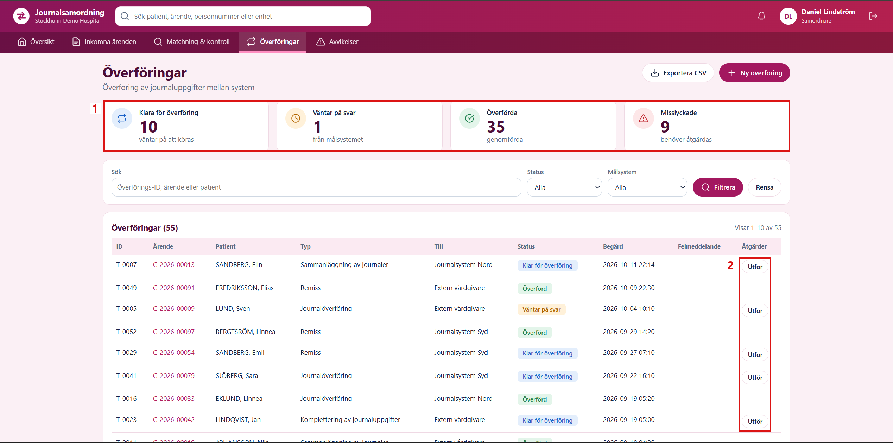

*Figure 1. The transfers in Journalsamordning before the robot, signed in as the coordinator.*

A transfer can fail for two very different reasons. A **data error**, for example `Valideringsfel: personnummer saknas` (the personal identity number is missing), fails again on every try, because the case data must first be corrected by a person. A **technical error**, for example `Timeout vid anslutning` (connection timeout), comes from the target system and often goes away by itself.

During the week of the ticket, the target systems answered unreliably: some transfers timed out once and worked on the next try, and the external care provider did not answer at all.

The coordinator pressed **Försök igen** on transfer T-0021 (Figure 2):

1. The counters still show 9 failed transfers.
2. T-0021 failed again with `Timeout vid anslutning`. The page looks exactly as before, so it is easy to miss that the try was made at all.

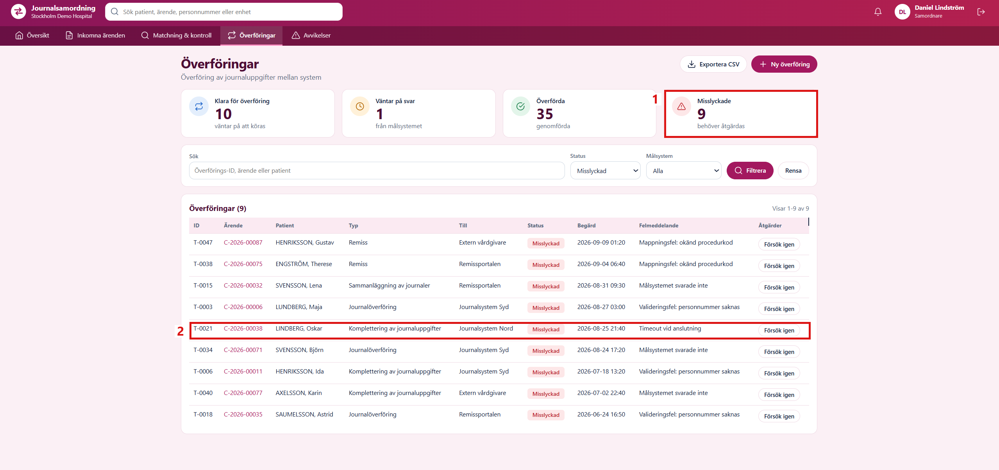

*Figure 2. The failed transfers after the first new try of T-0021.*

A second click on the same transfer worked (Figure 3):

1. The counters changed to 36 done and 8 failed.
2. T-0021 is no longer in the list of failed transfers.

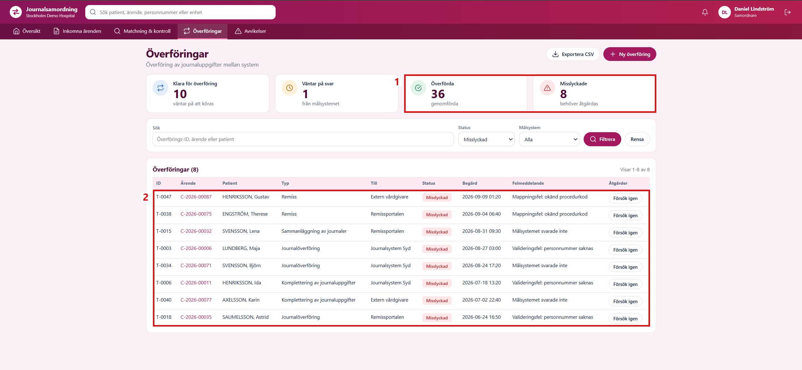

*Figure 3. The failed transfers after the second try of T-0021.*

Transfer T-0040 to the external care provider failed again with `Målsystemet svarade inte` (the target system did not answer).

For the coordinators, this means:

- **Many clicks.** About 20 transfers a day are started one by one, plus new clicks on the failed ones.
- **Guessing.** The coordinator has to decide alone how often to try a failed transfer again.
- **No overview.** At the end of the day, there is no list of which transfers were finished, which ones need a data correction, and which target could not be reached.

For the support team, this means:

- **Problems are noticed late.** A target system that does not answer is only reported when a coordinator happens to notice it.

## 3. Finding the Cause

The work is manual because Journalsamordning only offers it in this way:

1. **One button per transfer.** The Överföringar page has no button that starts several transfers at once.
2. **No other way in.** The hospital API can read the transfers, but it cannot start or retry them. A transfer can only be started from the web page.
3. **No rule for errors.** The page shows the error text of a failed transfer, but it does not say whether a new try can help. So every coordinator decides alone, transfer by transfer.

A robot can do exactly what the coordinator does on the page, but with a fixed rule for every error and a list of every result.

## 4. What the Robot Should Change

The robot is only worth building if it improves the daily work of the coordination team. After the automation is in place, the following goals are expected to be met:

| Goal | Today (manual) | Expected after the automation |
|---|---|---|
| **Work** | About 20 clicks a day, one transfer at a time, plus new clicks on the failed ones | No clicks. The robot runs all open transfers. |
| **Decision** | The coordinator guesses whether a failed transfer needs a new try or a data correction | The robot decides by a fixed rule: a technical error gets 2 new tries, a data error goes straight to a person |
| **Safety** | Easy to click a data error again and again, or to miss a try, because the page looks the same | A transfer that is already done is never started again, and a data error is never tried again |
| **Overview** | No list at the end of the day | One report and the Orchestrator queue show what is done, what needs a data correction and what must be escalated |
| **Follow-up** | Problems with an external care provider are noticed late | "Still unavailable - escalate" lists exactly which transfers and target systems to report to IT |

In short, the coordinator should only work on the transfers that really need a person, with a clear list of them.

## 5. The Design of the Robot

Each problem from the manual work in Section 2 is solved by one part of the design. Together, these parts give the shape of the robot.

**Problem 1: one click per transfer.** The coordinator starts every transfer alone, and the list of open transfers changes from day to day.

*Solution: a queue in Orchestrator.* An Orchestrator queue is a list of work items that a robot handles one by one. Each item is one transfer. The robot is split into two parts:

- The **dispatcher** (`Dispatcher.xaml`) does what the coordinator does first: it opens the Överföringar page, finds all open transfers and puts one item for each of them into the queue `P04_Transfers`.
- The **performer** (`Main.xaml`) does what the coordinator does next: it takes one item from the queue, opens that transfer and presses its button. Then it takes the next item, until the queue is empty.

The performer is built with the REFramework, a UiPath template made for exactly this kind of work: take one item, handle it, set its result, and go on with the next one. If one transfer goes wrong, the others are still handled.

**Problem 2: guessing whether to try again.** The coordinator cannot see at once whether a failed transfer will work on the next try.

*Solution: two types of errors, with a fixed rule for each.* The robot reads the error text of the transfer and sorts it into one of two groups:

- A **data error**, such as a missing personal identity number, becomes a **business exception**. The robot worked correctly, but the case data is wrong. A new try would only give the same error, so the transfer is never tried again. It goes straight to a person.
- A **technical error**, such as a timeout, becomes a **system exception**. The problem is in the target system, so a new try may work. The queue was created with **Max # retries = 2**, which means that Orchestrator puts the same transfer back into the queue at most two more times. If the third try also fails, the transfer is marked to be escalated. The retry setting inside the REFramework, `MaxRetryNumber`, stays 0, so every retry is done by the queue and can be seen in Orchestrator.

**Problem 3: the page looks the same after a try.** It is easy to miss a try, or to start a transfer that is already done.

*Solution: read before and after every click.* The robot reads the status of the transfer before it presses any button. A transfer that is already done is never started again. After the click, the robot reads the status once more, so the result of every try is known.

**Problem 4: no list at the end of the day.** Nothing shows which transfers were finished and which ones still need work.

*Solution: a report and the queue history.* Every try is written as one line in a daily report file, and Orchestrator keeps the history of every queue item.

When the four parts are combined, every transfer ends in one of four clear outcomes:

| What happens | Type of error | Tried again? | Outcome in the report |
|---|---|---|---|
| The transfer is done at once | None | No | Completed |
| A technical error, and a later try works | System exception | Yes, by the queue | Recovered after technical retry |
| A technical error on every try | System exception | Yes, at most 2 times | Still unavailable - escalate |
| A data error | Business exception | Never | Needs manual data correction |

## 6. Building the Robot

The robot was built in the REFramework project `P04_HospitalBotMaintenance`. The login workflow and the Object Repository for Journalsamordning were taken from the P03 project, and the password is read from Windows Credential Manager, as in P03. New elements were captured for the transfer table: the status, the error text and the button of one row, found by the transfer ID.

The new workflow `Dispatcher.xaml` fills the queue (Figure 4):

1. **Log In to Journalsamordning** signs in as the coordinator.
2. **For Each Open Status** goes through the three open statuses: Misslyckad (failed), Klar för överföring (ready) and Väntar på svar (waiting).
3. **Read the Transfer List** opens the Överföringar page filtered on one status and reads all rows of the table.
4. **Add Transfer to the Queue** adds one queue item for each row. The reference is the transfer ID, and the item also keeps the case, the target system, the status and the error text.

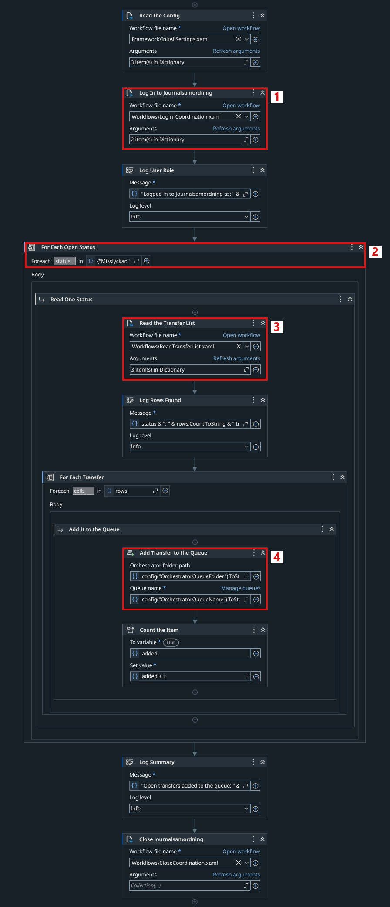

*Figure 4. The dispatcher `Dispatcher.xaml`.*

The queue name and its Orchestrator folder are kept in `Data/Config.json`, together with the address of Journalsamordning and the name of the saved login.

The work for one transfer is done in `Framework/Process.xaml` (Figure 5):

1. **Read the Transfer** opens the transfer by its ID and reads its status and error text.
2. **Is the Transfer Already Done?** A transfer with the status Överförd is not touched again.
3. **Is It a Known Data Error?** A failed transfer with a data error becomes a business exception before any button is pressed.
4. **Press the Transfer Button** clicks Utför or Försök igen and waits until Journalsamordning answers. **Read the Transfer Again** reads the new status.
5. If the transfer still failed, a data error becomes a business exception, and any other error becomes a system exception with the text from the target system.
6. **Report Success** adds a line to the daily report.
7. Both exception types also add a line to the report before the exception is passed on to the framework, which sets the status of the queue item.

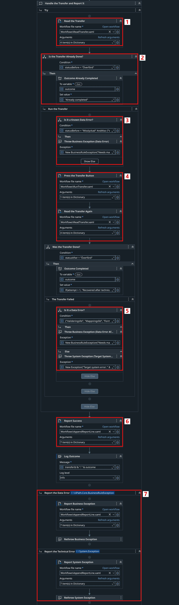

*Figure 5. The handling of one transfer in `Process.xaml`.*

The report is the file `Data/Output/transfer_report_<date>.csv`. It has one line for every try, with the transfer, the try number, the status before, the result and the outcome.

## 7. Testing the Robot

The robot was tested with the same open transfers and the same unreliable target systems as in Section 2. The dispatcher added the 20 open transfers to the queue (9 failed, 10 ready and 1 waiting), and then `Main.xaml` was run from Studio. All 20 transfers were handled in about five minutes, without any click by a person.

The queue in Orchestrator shows the result (Figure 6):

1. **Successful 12**: 8 transfers worked at once, and 4 worked on the second try.
2. **App Exceptions 13**: every try that ended in a system exception, including the tries that were followed by a successful one.
3. **Biz Exceptions 5**: the 5 transfers with data errors.

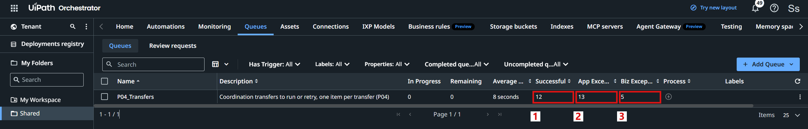

*Figure 6. The queue `P04_Transfers` after the run.*

Each try is its own row in the list of transactions (Figure 7):

1. T-0005, T-0023 and T-0040 failed on their last try. All three go to the external care provider, which never answered.
2. T-0051 worked on its second try.
3. Its first try, which ended in a timeout, has the status Retried.

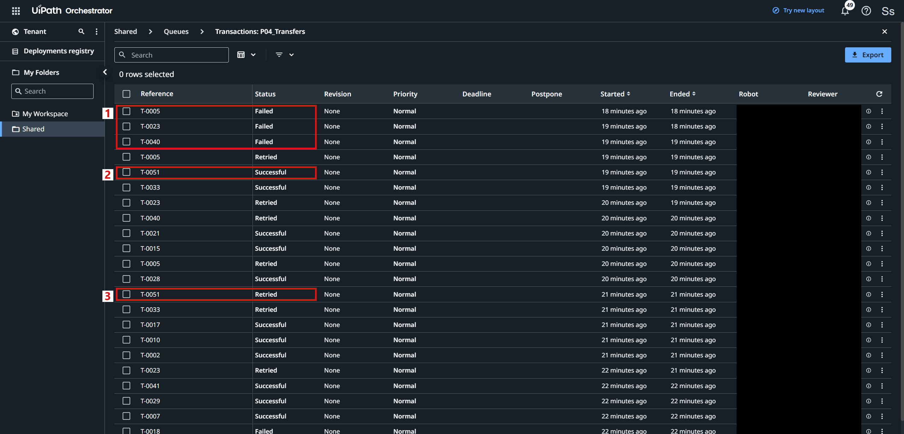

*Figure 7. The transactions of the queue in Orchestrator.*

The details of T-0040 show the whole history of one transfer (Figure 8):

1. The data that the dispatcher saved with the item.
2. The reason of the last system exception: `Målsystemet svarade inte`.
3. Three tries: the first two ended as Retried and the last one as Failed, all with the exception type Application.

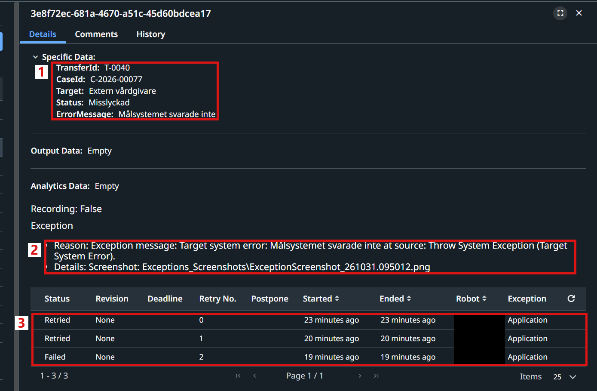

*Figure 8. Transaction T-0040 after three tries.*

A transfer with a data error looks different (Figure 9):

1. The reason: `Needs manual data correction: Mappningsfel: okänd procedurkod` (unknown procedure code).
2. Only one try, with the exception type Business. The transfer was never tried again.

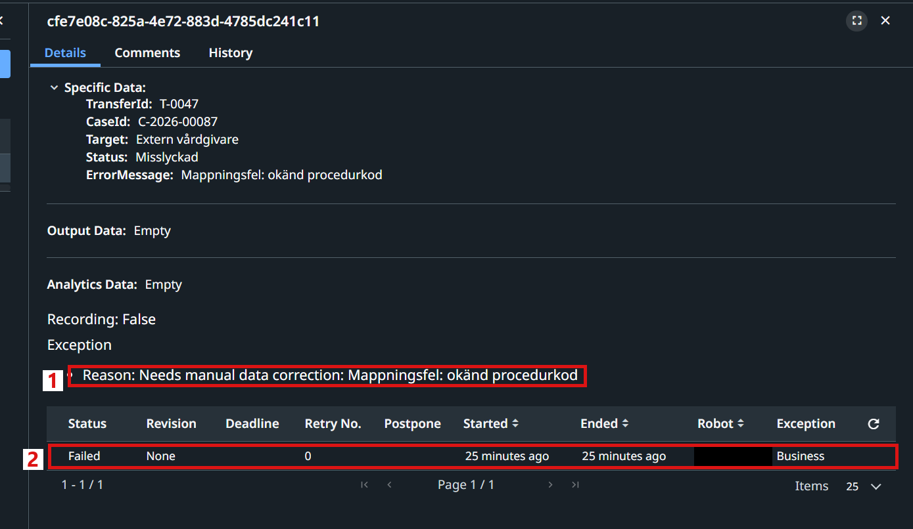

*Figure 9. Transaction T-0047 with a data error.*

The report gives the same picture in one file (Figure 10):

1. T-0047 needs a manual data correction.
2. The first try of T-0015 ended in a timeout and was marked to be tried again.
3. The second try of T-0015 worked: **Recovered after technical retry**.
4. After the third try, T-0040, T-0023 and T-0005 were marked **Still unavailable - escalate**.

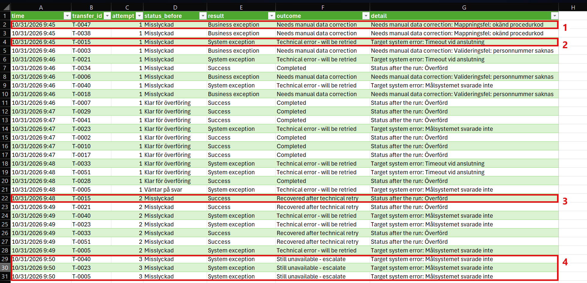

*Figure 10. The report `transfer_report_2026-10-31.csv`, opened in Excel.*

In Journalsamordning, only the transfers that need a person are left (Figure 11):

1. No transfer is ready or waiting any more, 47 are done and 8 have failed.
2. The 8 failed transfers are the 5 with data errors and the 3 for the external care provider that did not answer.

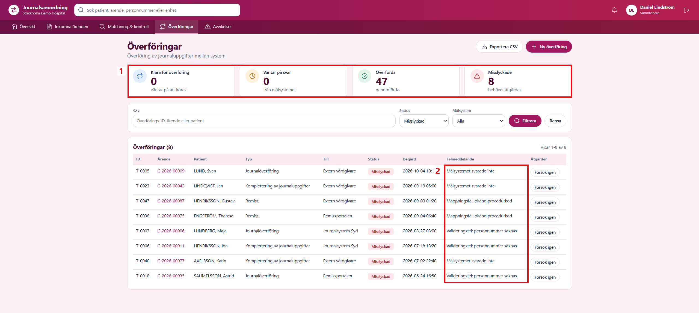

*Figure 11. The failed transfers after the robot run, signed in as the coordinator.*

The result was exactly as expected for every transfer:

| Outcome | Transfers |
|---|---|
| Completed | T-0002, T-0007, T-0010, T-0017, T-0028, T-0029, T-0034, T-0041 |
| Recovered after technical retry | T-0015, T-0021, T-0033, T-0051 |
| Needs manual data correction | T-0003, T-0006, T-0018, T-0038, T-0047 |
| Still unavailable - escalate | T-0005, T-0023, T-0040 |

Before the robot, the coordinator clicked each transfer by hand, tried the failed ones again without a rule, and had no list of the result. The test showed every row of the table in Section 4: 8 transfers were done at once, 4 recovered after a new try, 5 were sent to a person for a data correction, and 3 were listed to escalate. No click was needed, and the coordinator now only has to look at those 8 transfers.
