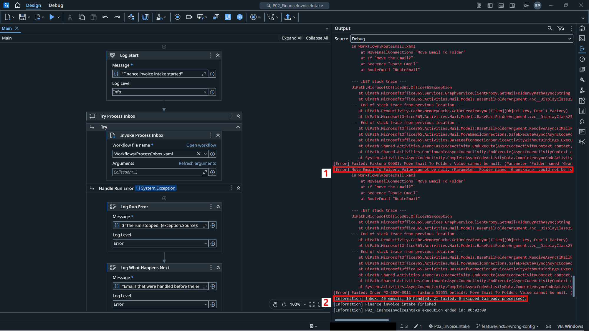
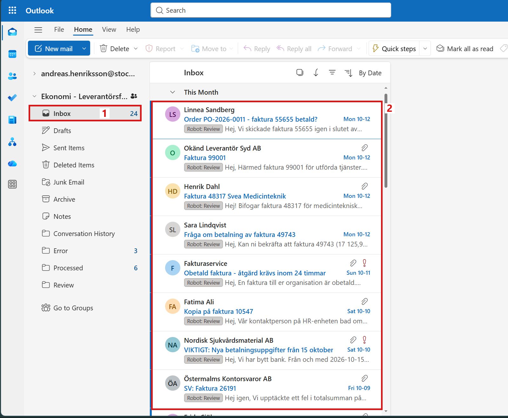
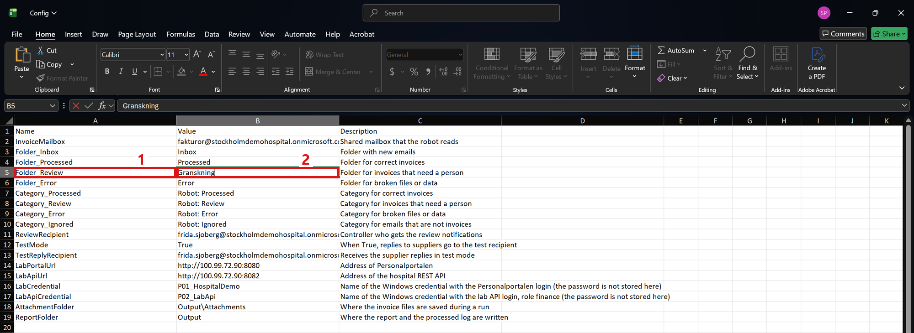
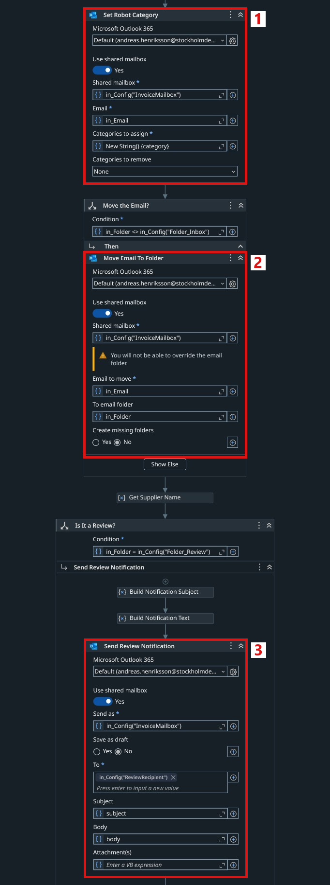
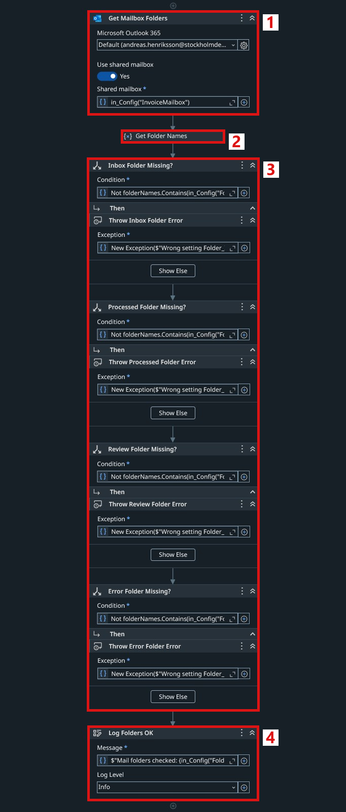
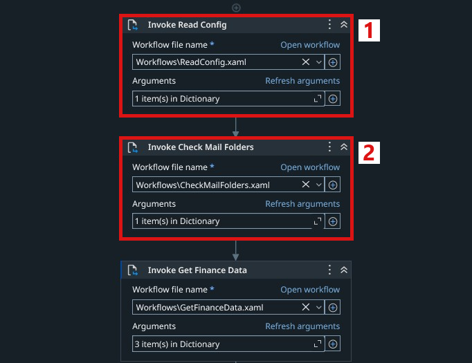
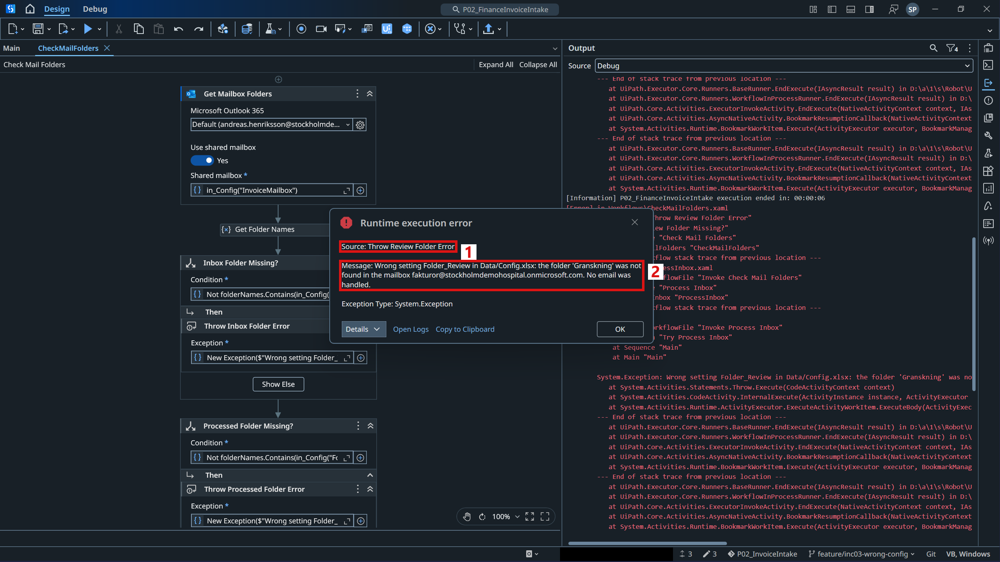
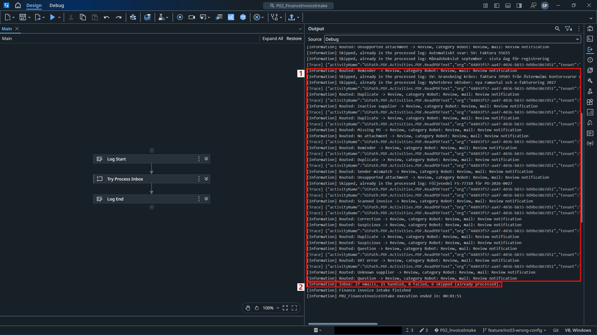
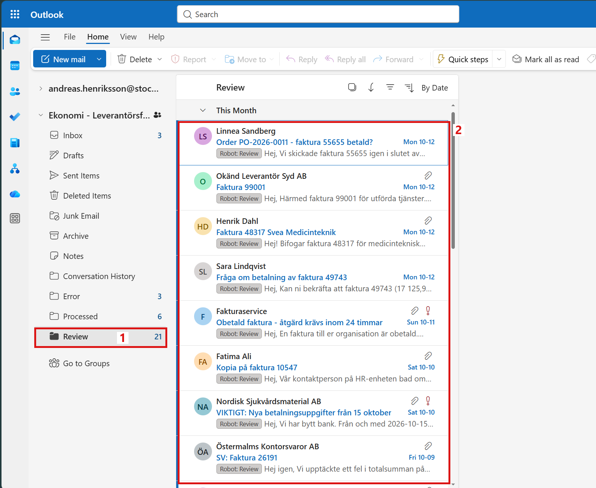

# INC-03 - A Wrong Folder Name in the Config

This record is one of the support scenarios of the [P04 Project Record](Project%20Record.md).

## 1. The Ticket

| | |
|---|---|
| Reported by | Frida Sjöberg, controller in Finance |
| Symptom | Invoices that need a review stay in the Inbox, and no review notifications arrive. |
| Robot | P02 Invoice Intake |
| Impact | Invoices with a problem are not checked by a person, so payments can be late. |
| Priority | High |

## 2. Invoices Left in the Inbox

After a small change in the config file of P02, the next run looked normal at first: it finished as usual. But Frida received no review notifications, and many invoices were still in the Inbox.

For Finance, this means:

- **Invoices wait without anyone knowing.** The invoices that need a person stay in the Inbox, and nobody is told about them.
- **Late payments.** An invoice that is never reviewed is not paid on time.

For the support team, this means:

- **No clear stop.** The run did not stop, so the problem is only seen in the mailbox or in the log.
- **A half-done mailbox.** The support person has to find out by hand which emails are affected, and why.

The run was repeated in UiPath Studio on the 40 emails in the Inbox, to see what the robot does (Figure 1):

1. Each failed email gives an error from **Move Email To Folder**: the folder "Granskning" could not be found.
2. The run did not stop. 19 emails were handled, and 21 emails failed.

*Figure 1. The Output panel in Studio after the run with the wrong folder name.*

The 9 correct invoices still reached Processed, and the 4 broken ones reached Error, because their folder names were right. Only the 21 emails for Review failed. They stayed in the Inbox, but they already had the category **Robot: Review** (Figure 2):

1. The Inbox of the shared mailbox.
2. The emails that should have been moved to Review, with the category Robot: Review.

*Figure 2. The Inbox after the run, opened as Andreas.*

No review notification was sent to Frida for any of these 21 emails.

## 3. Finding the Cause

The error message names the folder, but not the setting it comes from. The value "Granskning" was searched in the config file and found in `Folder_Review` (Figure 3). This is an easy mistake to make: `Granskning` is the Swedish word for review, but the real folder in the mailbox is called `Review`.

1. The setting `Folder_Review`.
2. The wrong value `Granskning`.

*Figure 3. The setting `Folder_Review` with the wrong value.*

The mailbox has no folder with that name.

The workflow `RouteEmail.xaml` explains why the emails ended in this state. It does three things in this order (Figure 4):

1. **Set Robot Category** gives the email its category.
2. **Move Email To Folder** moves the email. This step failed.
3. **Send Review Notification** sends the notification to Finance. Because the step before failed, this step was never reached.

*Figure 4. `RouteEmail.xaml` in UiPath Studio.*

So the real cause is a wrong value in the config file, but the robot only finds out when it tries to move the first email for Review. By then, many other emails are already handled, and every email for Review is left half done.

## 4. What the Fix Should Change

Correcting the value alone would solve this ticket, but the same mistake could happen again with the next change of the config file. The fix is only worth the work if it also protects Finance and the support team the next time. After the fix, the following goals are expected to be met:

| Goal | Today (manual) | Expected after the fix |
|---|---|---|
| **Early detection** | The wrong folder name is only found when the first email for Review is moved, and 21 emails fail | A wrong folder name is found at the start of the run, before any email is read or moved |
| **Clear message** | The error names the folder "Granskning", but not the setting, so the config file is searched by hand | The message names the setting, the wrong value and the mailbox |
| **Safe mailbox** | Emails are left half done in the Inbox, with a category but without a notification to Finance | No email is touched, so nothing has to be cleaned up in the mailbox |
| **Easy recovery** | The support person checks the mailbox by hand before a new run | After the value is corrected, a normal new run handles the waiting emails |

In short, a wrong folder name should stop the robot at once, with a message that the support person can act on directly.

## 5. The Fix

Each problem found in Sections 2 and 3 is solved by one part of the fix.

**Problem 1: the wrong value in the config.** `Folder_Review` points to a folder that does not exist in the mailbox.

*Solution: correct the value.* `Folder_Review` was set back to `Review`, the name of the real folder in the mailbox.

**Problem 2: the mistake is found too late.** The robot only notices the wrong folder when it moves the first email for Review. By then, many other emails are already handled, and every email for Review is left half done.

*Solution: check all folders at the start.* A new check compares the four folder settings with the real mailbox before any email is read or moved.

**Problem 3: the error does not name the setting.** The message only says that the folder "Granskning" was not found, so the support person has to search the config file.

*Solution: a clear stop message.* If a folder is missing, the check stops the run with a message that names the setting, the wrong value and the mailbox.

The check for problems 2 and 3 is the new workflow `Workflows/CheckMailFolders.xaml`. It reads the list of folders in the shared mailbox once, and compares it with the four folder settings (Figure 5):

1. **Get Mailbox Folders** reads all folders of the shared mailbox.
2. **Get Folder Names** keeps only the names of the folders.
3. One **If** for each setting: Inbox, Processed, Review and Error. If the folder is missing, **Throw** stops the run with a message that names the setting, the wrong value and the mailbox.
4. When all four folders exist, a log message says so.

*Figure 5. The new workflow `CheckMailFolders.xaml`.*

The check is called in `ProcessInbox.xaml` right after the config is read, before any email is read or moved (Figure 6):

1. **Invoke Read Config** reads the settings.
2. **Invoke Check Mail Folders** is the new step.

*Figure 6. The new step in `ProcessInbox.xaml`.*

The robot never creates a missing folder by itself, because that would hide the wrong setting. The fix was saved in Git as one commit. Compared with the original robot, it adds the new workflow and five lines in `ProcessInbox.xaml`.

## 6. Testing the Fix

First, the fix was tested with the wrong value `Granskning` still in the config. The run stopped after 6 seconds with a clear message (Figure 7):

1. The activity that stopped the run, **Throw Review Folder Error**.
2. The message: the setting `Folder_Review` in `Data/Config.xlsx` is wrong, the folder 'Granskning' was not found, and no email was handled.

*Figure 7. The run stops at the start because of the wrong folder name.*

The mailbox was not changed by this run. All 27 emails were still in the Inbox, and no message was sent.

Then `Folder_Review` was set back to `Review`, and the robot was run again on the same mailbox (Figure 8):

1. The 21 emails that failed before were moved to Review, and a review notification was sent for each of them.
2. The summary: 27 emails, 21 handled, 0 failed, and 6 skipped because they were already in the processed log.

*Figure 8. The Output panel after the run with the correct folder name.*

The emails that failed before did not need any manual work. The robot only skips an email that has the category Robot: Processed or that is in the processed log, so the emails with Robot: Review were handled again in the normal way. They are now in the Review folder (Figure 9):

1. The Review folder.
2. The emails with the category Robot: Review.

*Figure 9. The Review folder after the run with the correct folder name.*

After this run, the mailbox had 6 emails in Inbox, 11 in Processed, 22 in Review and 5 in Error. This is the same state as before the config change, and every email is in the folder that `TestData/expected_results.csv` expects for it. So the robot works as before when the config is correct.

The wrong folder name was found in the config file, and the value was corrected. P02 now checks its mail folders at the start, and a wrong folder name stops the run before any email is touched, with a message that names the setting.
