# INC-04 - A Run That Stops Halfway

This record is one of the support scenarios of the [P04 Project Record](Project%20Record.md).

## 1. The Ticket

| | |
|---|---|
| Reported by | Hospital Automation Operations |
| Symptom | The invoice robot stopped in the middle of a run. Nobody can tell which emails were already handled. |
| Robot | P02 Invoice Intake |
| Impact | An invoice can be left without a review, and Finance is not told about it. |
| Priority | High |

## 2. An Invoice Lost After a Stop

A robot run can stop at any moment, for example when a job is killed or the computer restarts. After a stop, the robot is normally just started again. But this time an invoice was lost on the way.

For Finance, this means:

- **An invoice waits without a notification.** It is in the Review folder, but Frida is never told to check it.
- **A late payment.** An invoice that nobody reviews is not paid on time.

For the support team, this means:

- **Nobody knows what was finished.** Nothing shows which emails were handled before the stop.
- **A normal-looking second run.** The new run reports no error, so the lost invoice is not noticed.

In this run, P02 stopped in the middle of the Inbox (Figure 1):

1. The first three emails were handled in the normal way.
2. The job stopped with an unexpected exit code, right after the next email, `Faktura 70870 - delleverans`, was moved to Review.

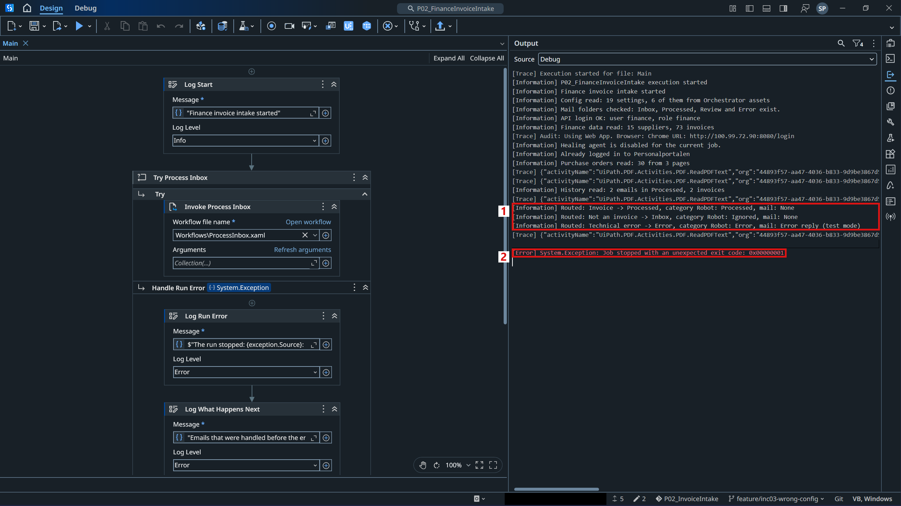

*Figure 1. The Output panel in Studio when the run stops.*

The invoice was already in the Review folder (Figure 2):

1. Invoice 70870 with the category **Robot: Review**.

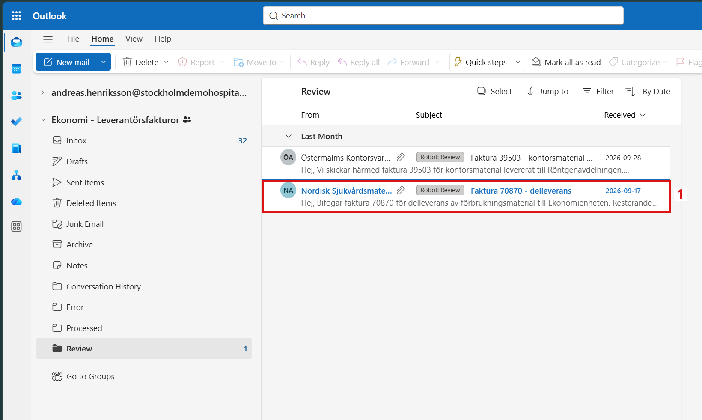

*Figure 2. The Review folder after the stop, opened as Andreas.*

Then the robot was simply started again on the same mailbox, as a support person would do after a stop (Figure 3):

1. The summary: 37 emails, 36 handled, 0 failed, 1 skipped. The run looks normal.

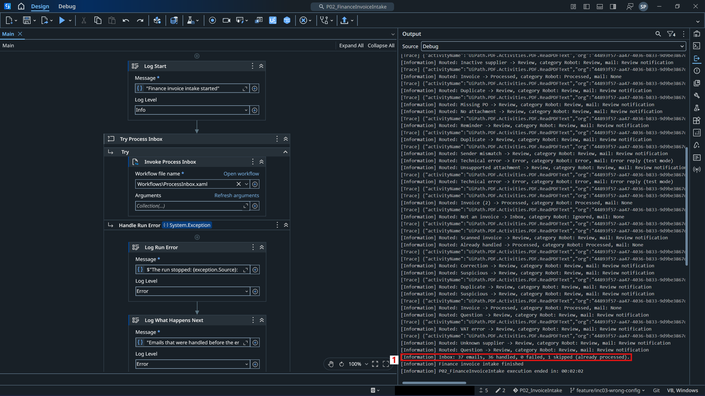

*Figure 3. The Output panel after the second run.*

Invoice 70870 is not in the list at all, because it is no longer in the Inbox. Frida's mailbox was searched for the invoice number (Figure 4):

1. The search for `70870`.
2. No message was found. Frida was never told that this invoice needs a review.

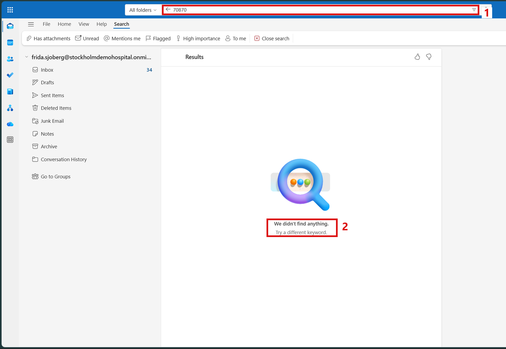

*Figure 4. The search for 70870 in Frida's mailbox.*

## 3. Finding the Cause

The processed log, `Output/processed_log.csv`, had rows for the three emails before the stop, but no row for invoice 70870. The order of the steps in `ProcessInbox.xaml` explains this (Figure 5):

1. **Invoke Classify Email** decides the folder of the email.
2. **Invoke Route Email** sets the category, moves the email and sends the notification.
3. **Add Log Row** adds the email to the processed log.
4. **Save Processed Log** writes the log to the file.

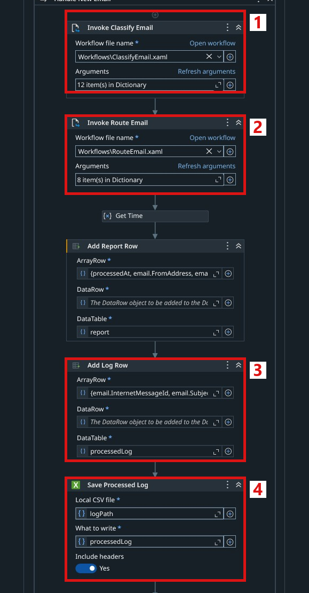

*Figure 5. The original steps for one email in `ProcessInbox.xaml`.*

The log is only written after the email has been moved and the notification has been sent. When the run stops between the move and the notification, the email is in Review, but nothing shows that it was not finished. The next run only reads the Inbox, so it never sees the email again.

## 4. What the Fix Should Change

A run can always stop because of something outside the robot, so the goal is not to prevent every stop. The fix is only worth the work if a stop no longer leaves Finance without information. After the fix, the following goals are expected to be met:

| Goal | Today (manual) | Expected after the fix |
|---|---|---|
| **Known progress** | Nothing shows which email was moved but not finished | The robot writes down every email before it routes it |
| **No lost invoices** | An invoice can stay in Review without a notification, and nobody knows | The next run finds the unfinished email and tells Finance which one to check |
| **No manual search** | The support person compares every folder with the report and the log by hand | The robot is simply started again |
| **No double messages** | A new run could answer or report the same email twice | Finance gets one notice for each unfinished email, and never the same notice twice |

In short, after a stop the robot should be started again without any manual check, and Finance should know about every unfinished invoice.

## 5. The Fix

Each problem found in Sections 2 and 3 is solved by one part of the fix.

**Problem 1: nothing shows that an email was started.** The row in the processed log is only written after the email is moved and the notification is sent.

*Solution: write a Started row first.* The robot now writes a "Started" row in the processed log before it routes an email (Figure 6):

1. **Add Started Row** adds a row with the folder, for example `Started: Review`.
2. **Save Started Row** writes it to the file at once.
3. **Add Log Row** adds the normal row when the email is finished, as before.

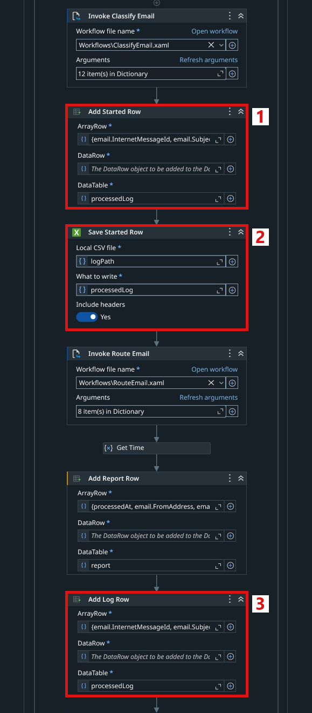

*Figure 6. The new Started row in `ProcessInbox.xaml`.*

**Problem 2: the next run never sees the email again.** The robot only reads the Inbox, and the unfinished email is already in another folder.

*Solution: look for unfinished emails at the start.* An email that was finished has two rows in the log, and an email that was stopped in the middle has only the Started row. A new step looks for these emails at the start of every run, right after the Inbox is read (Figure 7):

1. **Invoke Check Interrupted Run** is the new step.

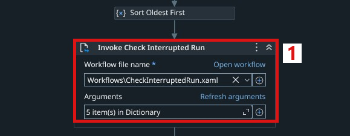

*Figure 7. The new step after Sort Oldest First in `ProcessInbox.xaml`.*

**Problem 3: Finance is never told.** The invoice waits in Review, but no notification was sent.

*Solution: one notice for each unfinished email.* The new workflow `Workflows/CheckInterruptedRun.xaml` does the check and tells Finance (Figure 8):

1. **Find Interrupted Emails** finds the emails that have only a Started row and are no longer in the Inbox.
2. **Send Interrupted Run Notice** sends one message to Finance with the list of these emails and their folders.
3. **Add Log Row** marks each email as `Interrupted` in the log, so the same email is never reported twice.
4. **Save Processed Log** writes the log to the file.

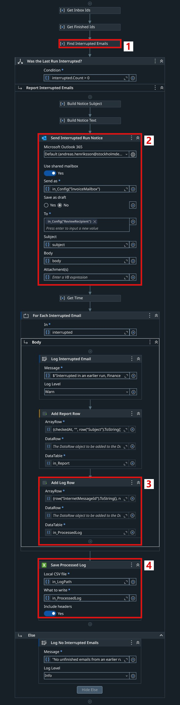

*Figure 8. The new workflow `CheckInterruptedRun.xaml`.*

An email that is stopped before it is moved is still in the Inbox. The robot does not skip it, because a Started row alone does not count as handled, so it is handled again in the normal way. The robot does not try to send the missing notification by itself, because it cannot know whether the notification was sent just before the stop. A person checks the email instead.

The fix was saved in Git as one commit, so it can be rolled back by reverting that commit.

## 6. Testing the Fix

The same situation was tested again: one run that stops right after invoice 70870 is moved, and then two normal runs.

In the first run, the robot stopped after invoice 70870 again. This time the processed log had the row `Started: Review` for the invoice.

In the second run, the robot found the unfinished email at the start (Figure 9):

1. The warning: invoice 70870 was interrupted in an earlier run, and Finance was asked to check it.

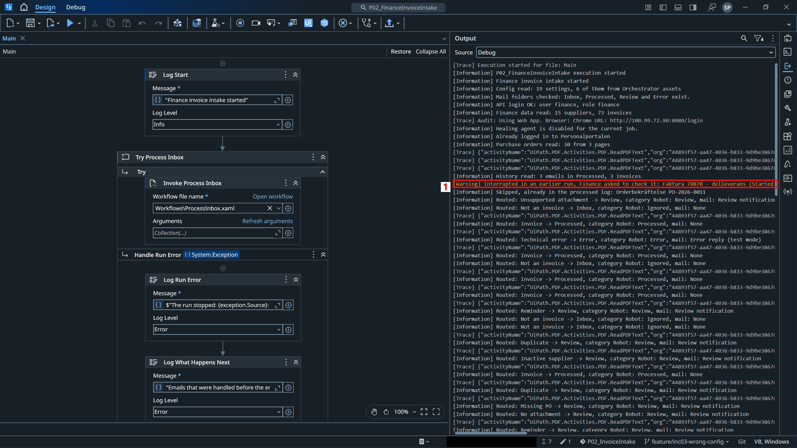

*Figure 9. The Output panel at the start of the second run.*

Frida received one notice (Figure 10):

1. The subject: one email needs to be checked after an interrupted run.
2. The email to check: `Faktura 70870 - delleverans`, in the Review folder.

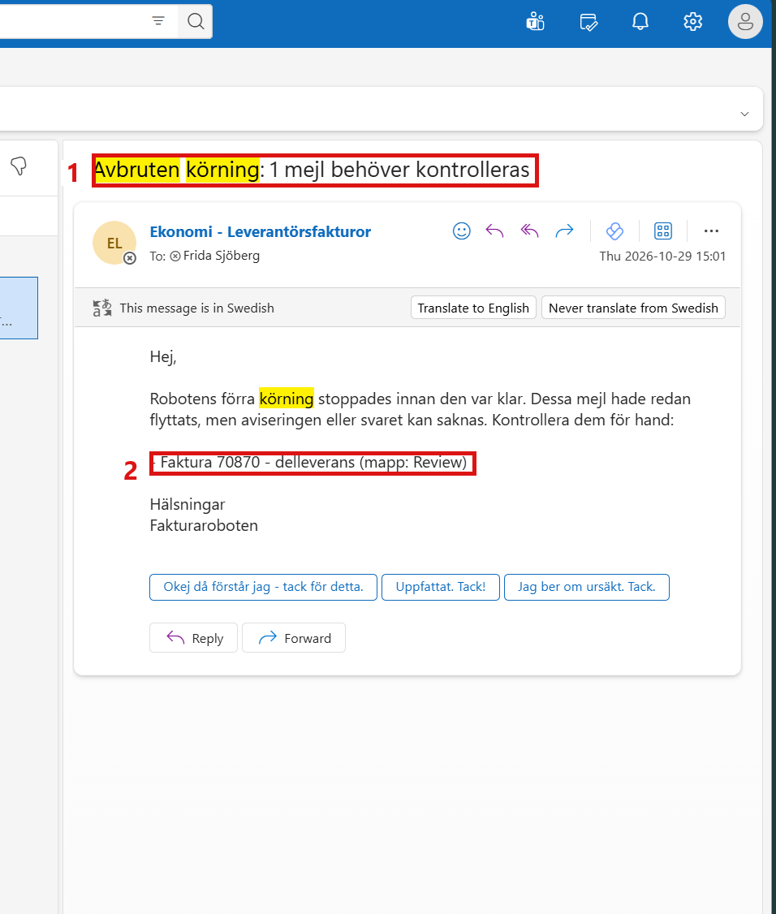

*Figure 10. The notice about the interrupted run, opened as Frida.*

The rest of the run was normal, with 37 emails, 36 handled and 0 failed. A third run was made to check that the notice is not sent again (Figure 11):

1. The robot found no unfinished emails from an earlier run.
2. The summary: 6 emails, 0 handled, 6 skipped. These are the emails that stay in the Inbox.

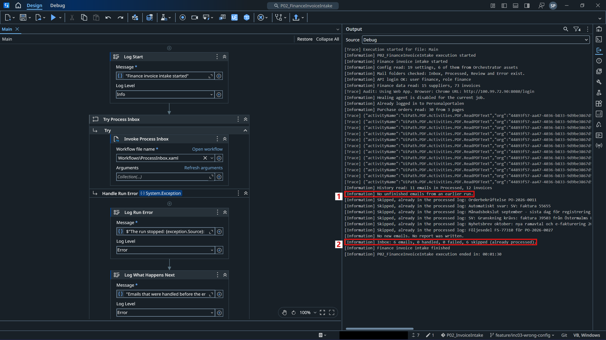

*Figure 11. The Output panel after the third run.*

Frida's mailbox still has only one notice (Figure 12):

1. One result for the search `Avbruten körning`.

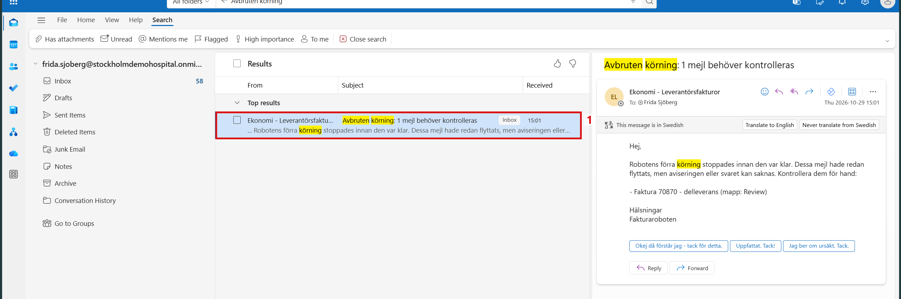

*Figure 12. The search for the notice after the third run.*

P02 was also run once more on all 43 emails. All emails got the same folders as in `TestData/expected_results.csv` and [INC-05](INC-05%20-%20A%20Supplier%20Changes%20Its%20Invoice%20Layout.md), so the fixes did not change the result for any other email.

Before the fix, a stop in the middle of a run could leave an invoice in Review without a notification, and nobody would know. Now the robot remembers which email it started, finds the unfinished one in the next run, and tells Finance once which email to check.
