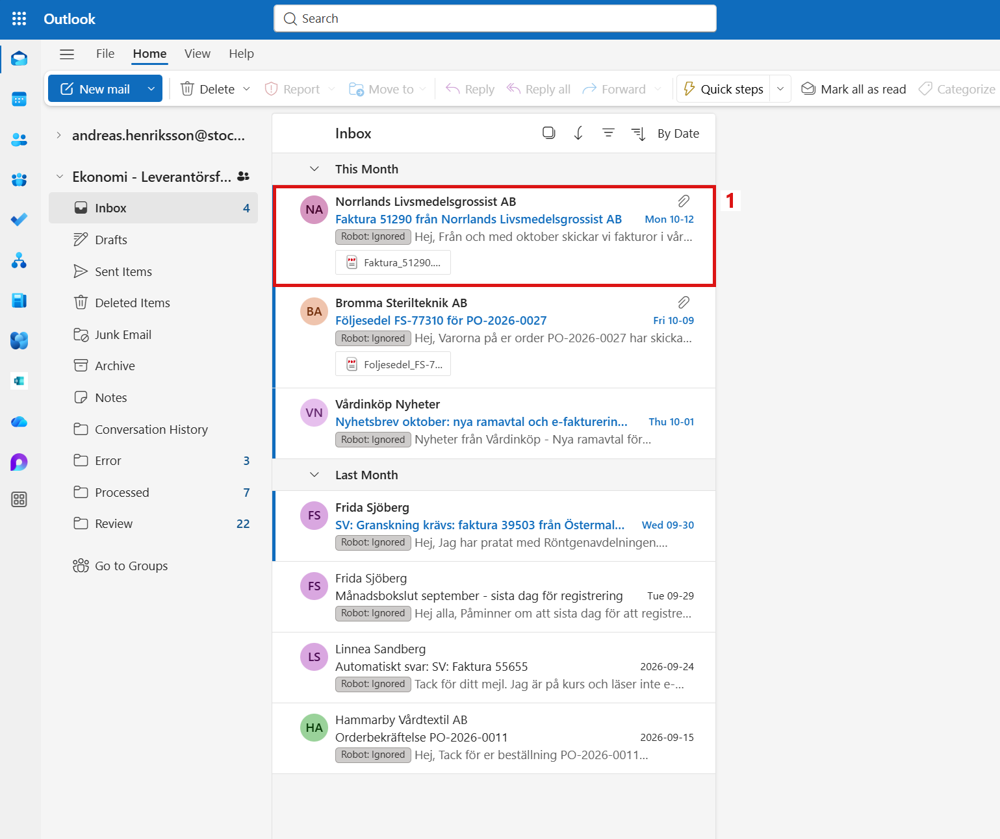
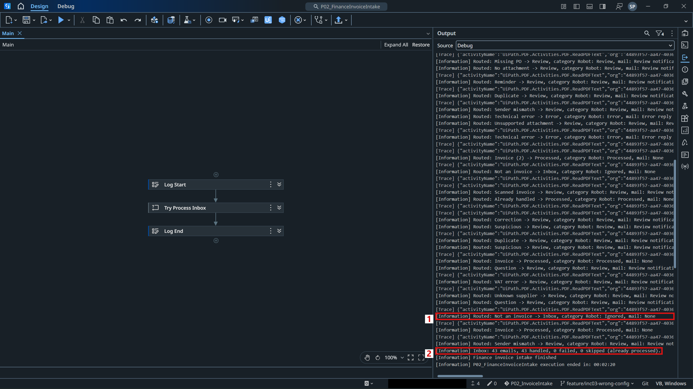
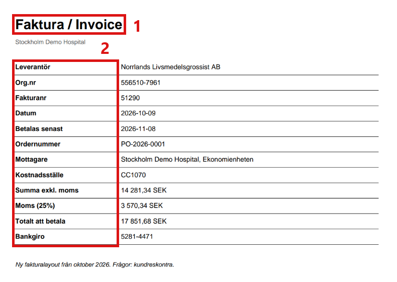
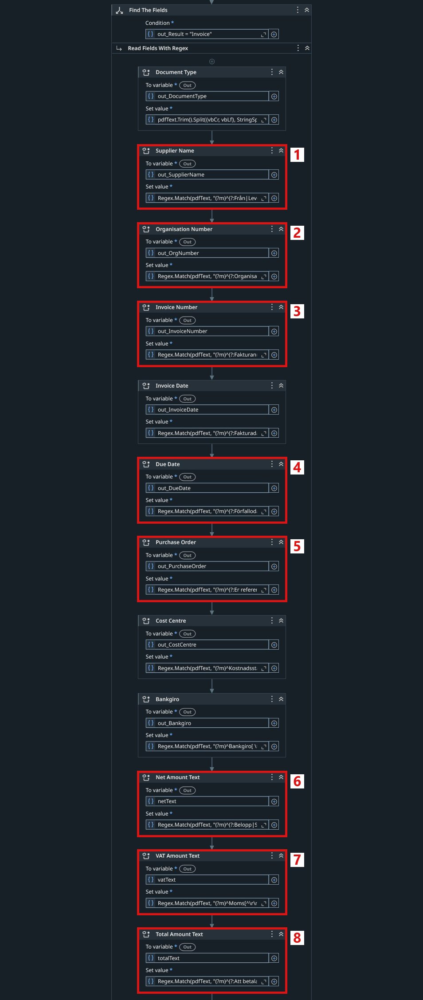
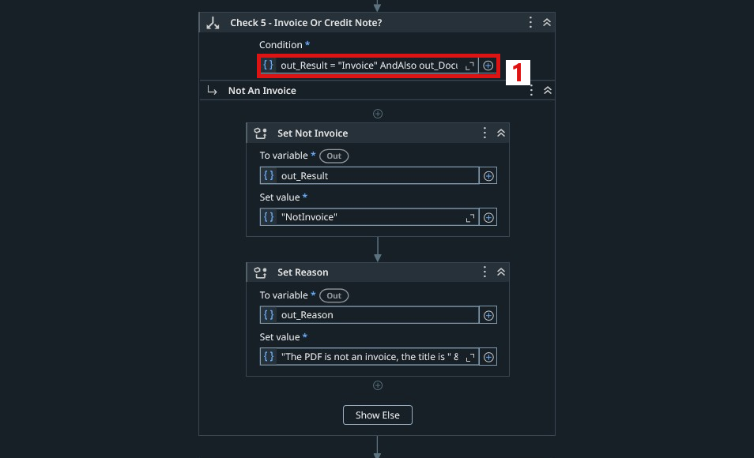
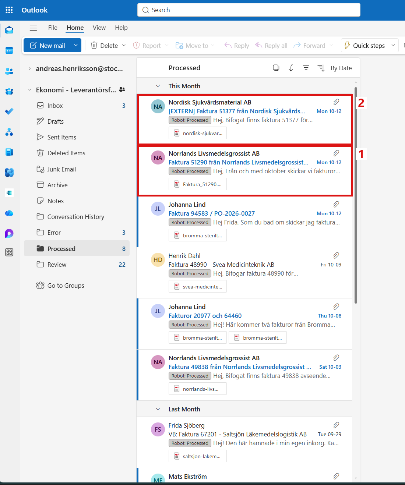

# INC-05 - A Supplier Changes Its Invoice Layout

This record is one of the support scenarios of the [P04 Project Record](Project%20Record.md).

## 1. The Ticket

| | |
|---|---|
| Reported by | Frida Sjöberg, controller in Finance |
| Symptom | A correct invoice from Norrlands Livsmedelsgrossist AB is not handled. It is not in Processed, and no review notification arrives. |
| Robot | P02 Invoice Intake |
| Impact | The invoice is not registered, so it can be paid late. |
| Priority | Medium |

## 2. A Correct Invoice Left Behind

Norrlands Livsmedelsgrossist AB told Finance that its invoices now use a new layout. Its next invoice, 51290 for the purchase order PO-2026-0001, arrived in the shared mailbox as usual, together with two other new emails. After the next run of P02, the invoice was not in Processed, and no review notification arrived.

For Finance, this means:

- **The invoice never arrives.** It is not registered, and nobody is asked to review it.
- **A late payment.** The supplier may not be paid on time.

For the support team, this means:

- **No warning.** The run looks normal, with no failed email.
- **A search by hand.** The support person has to find the invoice in the mailbox and work out why the robot did not handle it.

The invoice was still in the Inbox (Figure 1):

1. Invoice 51290 with the category **Robot: Ignored**, the same category as a newsletter.

*Figure 1. The Inbox after the run, opened as Andreas.*

The Output panel shows what the robot decided (Figure 2):

1. The invoice was classified as **Not an invoice** and stayed in the Inbox.
2. The summary: 43 emails, 43 handled, 0 failed. The run looks normal, so nobody is warned.

*Figure 2. The Output panel in Studio after the run.*

## 3. Finding the Cause

The attached PDF was compared with the invoices that P02 reads without problems (Figure 3):

1. The title is **Faktura / Invoice**. P02 only accepts a PDF whose first line is `Faktura` or `Kreditfaktura`. Every other PDF is treated as "not an invoice".
2. The field names are new. For example, the invoice number is now called `Fakturanr` instead of `Fakturanummer`, and the purchase order is called `Ordernummer` instead of `Er referens`.

*Figure 3. Invoice 51290 in the new layout.*

The invoice content itself is correct. The amounts now end with `SEK` instead of `kr`, but this is not a problem, because P02 only reads the number in front of the currency. So the cause is that the reading rules in `Workflows/ReadInvoice.xaml` only know the old layout.

## 4. What the Fix Should Change

Suppliers change their invoice layouts from time to time, and the robot must not hide this. The fix is only worth the work if it handles the new layout without changing the result for any other supplier. After the fix, the following goals are expected to be met:

| Goal | Today (manual) | Expected after the fix |
|---|---|---|
| **Correct reading** | A correct invoice in the new layout is treated as "not an invoice" | Invoices in both the old and the new layout are read as invoices |
| **No hidden invoices** | The invoice stays in the Inbox, and the run looks normal, so nobody is warned | The invoice goes through the same checks as every other invoice and reaches Processed or Review |
| **No side effects** | - | All invoices in the old layout give exactly the same result as before |
| **Easy rollback** | A change to the reading rules affects every supplier at once | The change is small and saved as one commit, so it can be undone quickly |

In short, Finance should get every correct invoice registered, whatever layout the supplier uses.

## 5. The Fix

Each problem found in Section 3 is solved by one change in `Workflows/ReadInvoice.xaml`, the workflow that reads the PDF.

**Problem 1: the new field names are unknown.** The robot looks for labels such as `Fakturanummer`, but the new layout uses `Fakturanr`.

*Solution: accept both labels.* Each field is read with a regular expression, a text pattern that finds the label and the value after it. The new labels were added next to the old ones, so both layouts can be read (Figure 4):

| Box | Field | Old label | New label, also accepted |
|---|---|---|---|
| 1 | Supplier name | Från | Leverantör |
| 2 | Organisation number | Organisationsnummer | Org.nr |
| 3 | Invoice number | Fakturanummer | Fakturanr |
| 4 | Due date | Förfallodatum | Betalas senast |
| 5 | Purchase order | Er referens | Ordernummer |
| 6 | Net amount | Belopp exkl. moms | Summa exkl. moms |
| 7 | VAT amount | Moms 25 % | Moms (25%) |
| 8 | Total amount | Att betala | Totalt att betala |

*Figure 4. The fields in `ReadInvoice.xaml` that also accept the new labels.*

**Problem 2: the new title is not accepted.** The robot only treats a PDF as an invoice when its first line is `Faktura` or `Kreditfaktura`.

*Solution: accept the new title.* The check of the title was changed, so that `Faktura / Invoice` is also accepted as an invoice (Figure 5):

1. The condition of **Check 5 - Invoice Or Credit Note?**.

*Figure 5. The title check in `ReadInvoice.xaml`.*

**Problem 3: other suppliers must not be affected.** A change in the reading rules could break the invoices that worked before.

*Solution: keep the old rules and compare the results.* The old labels were kept, so invoices in the old layout are read in the same way as before. Before the robot was run, all 93 PDF files that P02 had saved in earlier runs were read with the old and the new rules. Only invoice 51290 gave a different result. The fix was saved in Git as one commit with nine changed lines, so it can be rolled back by reverting that single commit.

## 6. Testing the Fix

The fixed robot was run on the same emails as in Section 2 (Figure 6):

1. Invoice 51290 was routed as an **Invoice** to Processed.
2. The summary: 43 emails, 43 handled, 0 failed.

*Figure 6. The Output panel in Studio after the run with the fix.*

The invoice passed all checks: the supplier is known, the purchase order PO-2026-0001 exists, the net amount 14 281,34 SEK equals the order, and the VAT is 25 %. It is now in the Processed folder (Figure 7):

1. Invoice 51290 with the category **Robot: Processed**.
2. Invoice 51377, one of the two other new emails. Its subject starts with `[EXTERN]`, a tag that some mail systems add to external mail. P02 handled it correctly already before the fix.

*Figure 7. The Processed folder after the run with the fix, opened as Andreas.*

The other 40 emails gave their expected result from `TestData/expected_results.csv`: 9 Processed, 21 Review, 4 Error and 6 left in the Inbox. The last new email, invoice 41208, came from a new sender address and went to Review as a sender mismatch. This is the correct result, because only Finance can decide whether a new sender address should be trusted.

The robot did not report an error for the new layout. It treated a real invoice as an unknown document and left it in the Inbox without a warning. The reading rules now accept both the old and the new layout, and the invoices that worked before still give the same result.
