# INC-06 - The Transfer Robot Only Runs When a Developer Starts It

This record is one of the support scenarios of the [P04 Project Record](Project%20Record.md).

## 1. The Ticket

| | |
|---|---|
| Reported by | The coordination team in Journalsamordning |
| Symptom | On days when the developer is away, the transfer robot does not run, and the transfers wait. Nobody can say which version of the robot is in use, or how to go back if a new version fails. |
| Robot | Transfer robot ([INC-02](INC-02%20-%20A%20Backlog%20of%20Transfers%20and%20an%20Unreliable%20Target%20System.md) and [INC-01](INC-01%20-%20A%20Page%20Update%20Breaks%20the%20Transfer%20Robot.md)) |
| Impact | On these days, the coordinators are back to the manual work from Section 2 of [INC-02](INC-02%20-%20A%20Backlog%20of%20Transfers%20and%20an%20Unreliable%20Target%20System.md). |
| Priority | Medium |

## 2. The Robot Depends on One Developer

The transfer robot works, but only in one way: a developer opens the project in UiPath Studio on their own computer, runs `Dispatcher.xaml`, waits, and then runs `Main.xaml`. The result is only shown in the Output panel of Studio, and the daily report is written to the folder `Data\Output` inside the project.

For the coordinators, this means:

- **No fixed time.** The transfers are handled when the developer has time, not at a time the coordinators can plan for.
- **No robot without the developer.** When the developer is ill or busy, the robot does not run at all, and the coordinators click about 20 transfers by hand again, as in Section 2 of [INC-02](INC-02%20-%20A%20Backlog%20of%20Transfers%20and%20an%20Unreliable%20Target%20System.md).
- **The report is on the developer's computer.** The coordinators have to ask for it.

For the support team, this means:

- **No job history.** The runs are not in Orchestrator, so there is no list of jobs, no job log and no way to see when the robot last ran.
- **No version.** A change, like the fix in [INC-01](INC-01%20-%20A%20Page%20Update%20Breaks%20the%20Transfer%20Robot.md), goes straight into the project that the robot is started from. If a change is wrong, the only way back is to undo it in Git and start the robot again from Studio.

## 3. Finding the Cause

The robot was never released. It exists only as a project folder on one computer. In Orchestrator, the folder Shared already has the queue `P04_Transfers`, but no process of the transfer robot, and no robot that can run a job there: the folder had 0 unattended runtimes. So Orchestrator could not start the robot even if someone asked it to.

Three things are missing:

1. A **robot** that Orchestrator can send jobs to, without a person at the computer. This is an unattended robot.
2. A **package** with a version number, and a **process** in Orchestrator that uses it.
3. A **trigger** that starts the process at the right time.

## 4. What the Release Should Change

A shared computer where anyone can press Run in Studio would not solve the problem, because the robot would still need a person, and there would still be no version and no history. After the release, the following goals are expected to be met:

| Goal | Today (manual) | Expected after the release |
|---|---|---|
| **Runs on its own** | A developer starts the dispatcher and the performer in Studio | The dispatcher starts every weekday morning, and the performer starts as soon as there are transfers in the queue |
| **Not tied to one person** | No run when the developer is away | The robot runs from Orchestrator, on a computer that is set up for it |
| **Job history** | The result is only in the Output panel of Studio | Every run is a job in Orchestrator, with its state and its log |
| **A known version** | The robot is whatever is in the project folder | The robot runs a package with a version number, and Orchestrator shows which version each process uses |
| **A way back** | Undo the change in Git and start again from Studio | The earlier version is brought back in Orchestrator in one step |
| **The report where people look** | In `Data\Output` on the developer's computer | In one fixed folder that the coordinators know, and the job log names the file |
| **No side effects** | - | Every transfer gets the same outcome as before |

In short, the robot should run on its own, every run should be visible in Orchestrator, and a new version should be easy to take back.

## 5. The Release

Each problem found in Sections 2 and 3 is solved by one part of the release.

**Problem 1: no robot that Orchestrator can use.**

*Solution: an unattended robot.* In Orchestrator, a machine called `P04-Transfer-Robot` was added for the computer that runs the robot, and it was added to the folder Shared (Figure 1):

1. The machine `P04-Transfer-Robot`.

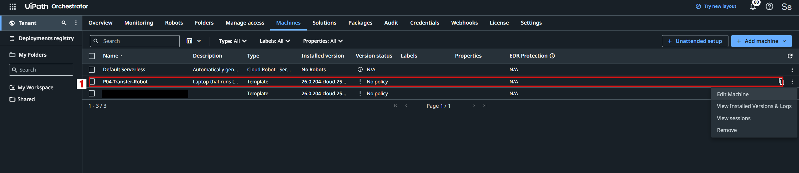

*Figure 1. The machines in Orchestrator. The machine of a personal account is hidden.*

The machine was given one unattended runtime, which is the license that lets one unattended job run at a time (Figure 2):

1. **Production (Unattended)** is 1.
2. The client ID of the machine. It is hidden here, because the robot uses it, together with a secret, to sign in to Orchestrator.

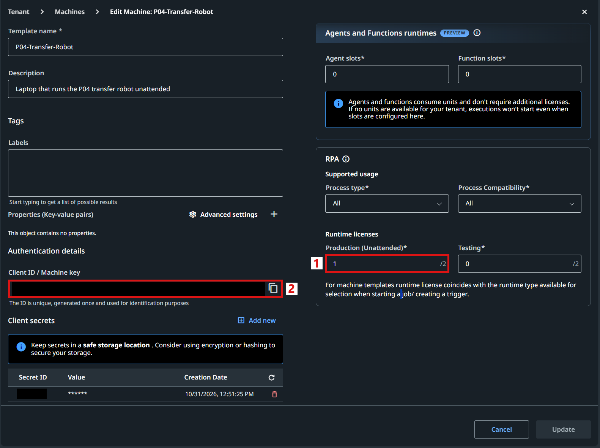

*Figure 2. The settings of the machine `P04-Transfer-Robot`.*

On the computer, UiPath Assistant was then connected to Orchestrator with the client ID of the machine (Figure 3):

1. The connection type is **Client ID**, the type that unattended robots use.
2. The status is "Connected, Licensed", so Orchestrator can now send jobs to this computer.

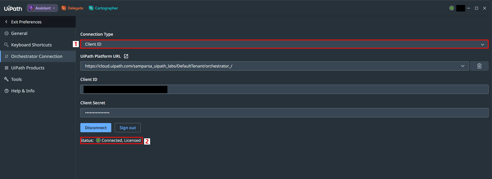

*Figure 3. The Orchestrator connection in UiPath Assistant.*

**Problem 2: no version and no process.**

*Solution: a package and two processes.* The robot was packed as version 1.0.0 and uploaded to Orchestrator. The package has two entry points, so two processes were created from it in the folder Shared (Figure 4):

1. `P04_Transfer_Dispatcher` runs `Dispatcher.xaml`, and `P04_Transfer_Performer` runs `Main.xaml`.
2. Both processes use the package version 1.0.0.

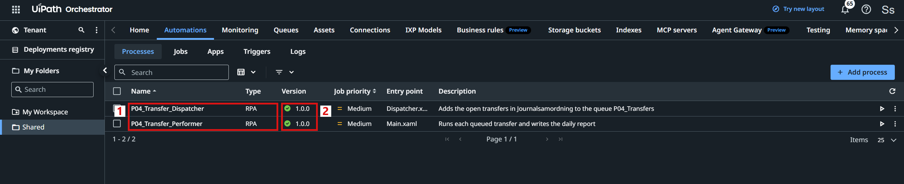

*Figure 4. The processes of the transfer robot in the folder Shared.*

Automatic update is turned off for both processes, so a process only changes its version when a person chooses it. Both processes were started once from Orchestrator, and both jobs ended without an error (Figure 5):

1. Both jobs are **Successful**.
2. Both were started by hand (**Manual**).
3. Both ran on the computer of the transfer robot.

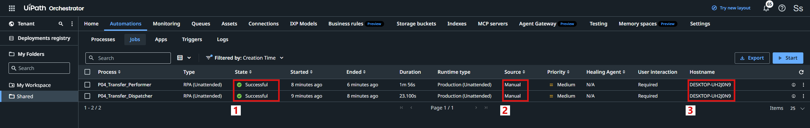

*Figure 5. The first two jobs of the transfer robot in Orchestrator.*

**Problem 3: the report disappears in a job from Orchestrator.** After these first jobs, the transfers were done, but the daily report was not in `Data\Output`. The report folder is a setting in `Data/Config.json`, and its value `Data\Output` is a relative path: it only says where the folder is compared with the current folder of the robot. In Studio, that is the project folder. In a job from Orchestrator, the robot installs the package in its own package folder, one folder for each version, and runs the job from there. The report was found in that folder (Figure 6):

1. The path: the package folder of version 1.0.0, inside the user profile of the robot. The user name is hidden.
2. The report of the day.

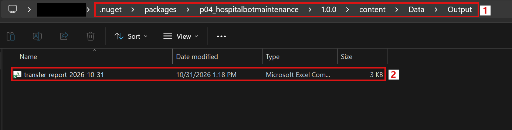

*Figure 6. The daily report in the package folder of version 1.0.0.*

Nobody looks for a report in this place, and the next version would write it to yet another folder.

*Solution: a fixed report folder, and the path in the log.* The setting was changed to a full path, and the robot expands it with `Environment.ExpandEnvironmentVariables` before it uses it:

| Setting | Before | After |
|---|---|---|
| `ReportFolder` | `Data\Output` | `%PUBLIC%\Documents\P04 Transfer Reports` |

`%PUBLIC%` is the public user folder of Windows, `C:\Users\Public`, which every user of the computer can open. In a real hospital, this would be a shared network folder of the coordination team. When the robot starts a new report for the day, it also writes the full path of the file to the job log. The change was saved in Git as one commit, the robot was packed as version 1.0.1, and both processes were updated to it (Figure 7):

1. Both processes use version 1.0.1. Version 1.0.0 is still kept in Orchestrator.

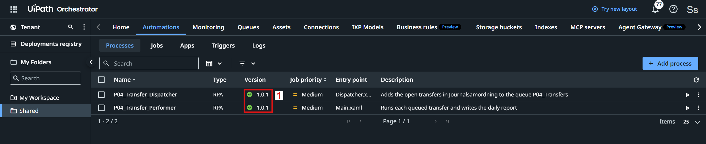

*Figure 7. The processes of the transfer robot after the update.*

**Problem 4: the robot only runs when someone starts it.**

*Solution: two triggers.* A trigger starts a process by itself. A time trigger starts the dispatcher at 07:00 every weekday, Stockholm time (Figure 8):

1. The trigger "P04 Dispatcher - weekdays 07:00" for the process `P04_Transfer_Dispatcher`.

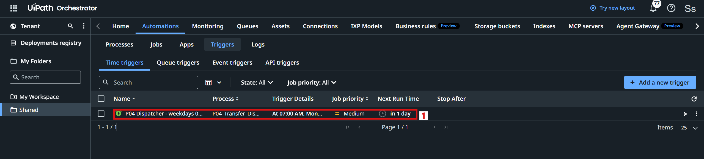

*Figure 8. The time trigger of the dispatcher.*

A queue trigger starts the performer as soon as there is at least one new transfer in the queue `P04_Transfers`. Only one performer job runs at a time, because the robot has one unattended runtime (Figure 9):

1. The trigger "P04 Performer - new transfers in the queue" for the queue `P04_Transfers`.

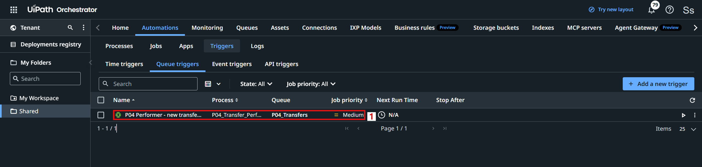

*Figure 9. The queue trigger of the performer.*

So the dispatcher fills the queue every morning, and the queue starts the performer. Nobody has to start the robot.

**Problem 5: no way back.**

*Solution: rollback in Orchestrator.* Every uploaded version stays in Orchestrator, and a process can be rolled back to its previous version in one step. This was tested in Section 6.

## 6. Testing the Release

Version 1.0.1 was tested with the same 20 open transfers as before. The dispatcher was started, and the queue trigger started the performer by itself, right after the dispatcher had added the transfers to the queue (Figure 10):

1. The dispatcher and the performer, both **Successful**.
2. The source of the performer job is the queue trigger, not a person.

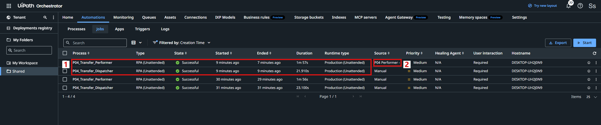

*Figure 10. The jobs of version 1.0.1. The performer was started by the queue trigger.*

The job log of the performer shows where the report was written (Figure 11):

1. "New daily report: C:\Users\Public\Documents\P04 Transfer Reports\transfer_report_2026-10-31.csv".

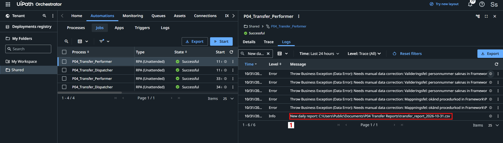

*Figure 11. The log of the performer job, filtered on "New daily report".*

The report was in the fixed folder (Figure 12):

1. The folder `C:\Users\Public\Documents\P04 Transfer Reports`.
2. The report of the day.

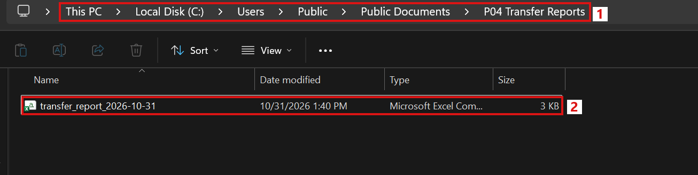

*Figure 12. The daily report in the fixed report folder.*

The report had the same outcomes as before: 15 transfers Completed and 5 transfers Needs manual data correction, with the reason for each one.

Then the way back was tested. Both processes were rolled back to version 1.0.0 in Orchestrator, and the robot was run again. Only the 5 transfers with data errors were still open, and the robot does not press the button of a transfer with a known data error, so the run changed nothing in Journalsamordning (Figure 13):

1. The two newest jobs ran on version 1.0.0, and both were successful.
2. The dispatcher was started by hand, and the performer by the queue trigger.

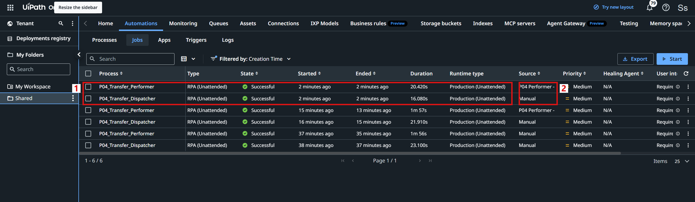

*Figure 13. All jobs of the transfer robot. The two newest jobs ran on version 1.0.0 after the rollback.*

The 5 report lines of this run were written to the package folder of version 1.0.0 again, and the report in the fixed folder was not changed. This shows that the rollback really brought back the old version, with its old report folder. Both processes were then updated to version 1.0.1 again. The version history of the performer shows the four steps: 1.0.0, 1.0.1, 1.0.0 and 1.0.1.

Before the release, the transfer robot only ran when a developer started it in Studio, and its result stayed on the developer's computer. Now it runs from Orchestrator on its own robot, starts by itself every weekday morning, and writes its report to one fixed folder. Every run is a job with a log, every version is kept, and the earlier version can be brought back in one step.
