# P04 - Hospital RPA Maintenance and Production Support

## 1. Project Goal

The goal of this project is to work as a junior UiPath developer in the support team of a fictional Swedish hospital. Two robots from earlier projects are already in use: P01 checks patient referrals across two hospital systems, and P02 handles supplier invoices that arrive in a shared Outlook mailbox. The robots are not rebuilt. Instead, a short series of simulated support tickets is handled: a broken selector, a hospital system that does not answer reliably, a wrong configuration value, a run that stopped halfway, and a supplier that changed its invoice layout. For each ticket, the problem is reproduced, the real cause is found, a small fix is made and tested, and the change is versioned so that it can be rolled back. A new robot is also built with the UiPath Robotic Enterprise Framework (REFramework) and an Orchestrator queue. It takes over a manual task in Journalsamordning and shows how a robot handles business exceptions and system errors, and how it retries safely. All data in this project is fictional.

### 1.1 Scenario

The hospital has a small automation team. Two robots were built by other developers, tested, published to Orchestrator and handed over to the staff, who start them from UiPath Assistant. Now the team receives tickets from **Hospital Automation Operations** when a robot fails or behaves differently than before.

The support team did not build these robots. So the first job is always to understand the robot: its workflows, its config file and its logs. Only after that is anything changed. Each change must be small, the cases that worked before must still work, and the earlier version must be easy to bring back.

### 1.2 The Two Robots in Use

| Robot | Used by | What it does |
|---|---|---|
| P01 Patient Administration Reconciliation | Patient Administration Officer | Reads a file with referrals, compares each referral in Personalportalen with its case in Journalsamordning, and writes a report of missing, duplicate and conflicting records. |
| P02 Finance Invoice Intake | Finance office | Reads the supplier emails and PDF invoices in the shared mailbox Ekonomi - Leverantörsfakturor, checks them against the finance data, and moves each email to Processed, Review or Error. |

How the robots were built and tested is described in their own records ([P01 Project Record](../../P01-Patient-Admin-Reconciliation/Project%20Record/Project%20Record.md), [P02 Project Record](../../P02-Finance-Invoice-Intake/Project%20Record/Project%20Record.md)) in the same repository. This record only covers the support work on them.

Both robots are started by the staff from UiPath Assistant and send their log messages to Orchestrator. Both also write a report, so the staff can see the result of every referral or email.

### 1.3 Before This Project - Manual Support Work

When one of the robots fails today, the robot gives the support team very little help. The support person has to find the cause, the state of the data and the result of a new run by hand, in several places.

**1. Find the job.** First, it helps to know where a job comes from. A staff member starts a robot in UiPath Assistant. The numbers in Figure 1 match these parts:

1. The robot `P02_FinanceInvoiceIntake` in the list of automations.
2. The version of the robot and the time of its last run.
3. **Run** starts the robot on this computer.

*Figure 1. The P02 robot in UiPath Assistant.*

Every run that is started in this way is saved as a job in Orchestrator, under Automations > Jobs. When something goes wrong, the support person starts here (Figure 2):

1. Each job, with its process, its state, and the time it started and ended.
2. The source **Assistant**, which means that a staff member started the job with Run.

*Figure 2. The Jobs page in My Workspace.*

**2. Read the log.** Every robot writes short log messages while it runs. They are found under its process in Orchestrator. Figure 3 shows a normal P02 run on 25 October, with the newest lines at the top:

1. The process `P02_FinanceInvoiceIntake`.
2. The **Logs** tab of the process.
3. The run starts: 18 settings were read, 6 of them from Orchestrator assets.
4. The robot read its history: 11 emails were already in the Processed folder.
5. One line for each email in the Inbox. Here all 6 emails were skipped, because the robot had already handled them in an earlier run.
6. The summary of the run.

*Figure 3. The log messages of a P02 run in Orchestrator.*

The history in line 4 comes from the Processed folder of the shared mailbox. When the robot moves a correct invoice there, it also gives the email the category **Robot: Processed** (Figure 4):

1. The Processed folder.
2. The emails that the robot moved there.
3. The category that the robot added to each email.

*Figure 4. The Processed folder of the shared mailbox, opened as Andreas.*

The skipped emails in line 5 come from the processed log. This is a small CSV file where the robot writes one line after every email it has handled. In the next run, the robot reads the file and skips these emails (Figure 5):

1. The message ID of the email. It never changes, even when the email is moved, so it is used to recognise the email.
2. The subject of the email.
3. The folder the email ended in, and the time it was handled.

*Figure 5. The processed log of P02 after the run in Figure 3.*

The log tells what the robot did, but when something fails, it often does not tell why. In the P02 project, a test was run with the wrong folder name `Errors` instead of `Error` in the config file (P02 Project Record, Section 8.5). The Output panel showed this (Figure 6):

1. The error comes from the activity that moves the email: the folder "Errors" could not be found. Nothing says that the real cause is a wrong value in the config file.
2. The run did not stop. 36 emails were handled, and 4 emails failed and stayed in the Inbox.

*Figure 6. A P02 run with a wrong folder name in the config file.*

**3. Check the settings.** The support person then has to find the wrong setting by hand. P02 reads its settings from the file `Data/Config.xlsx` (Figure 7):

1. The names of the four mailbox folders.
2. The addresses of Personalportalen and of the hospital API.
3. The names of the two logins in Windows Credential Manager. The passwords are not in this file.

*Figure 7. The Settings sheet in `Data/Config.xlsx` of P02.*

The logins themselves are saved in Windows Credential Manager, under Windows Credentials (Figure 8, number 1). If a login is missing or has a wrong name, the robot cannot log in.

*Figure 8. The logins of P01 and P02 in Windows Credential Manager.*

Six of the settings also exist as Orchestrator assets, and the robot uses the asset value instead of the value in the file (Figure 9, number 1). So one setting can be in two places, and both must be checked.

*Figure 9. The six P02 assets in My Workspace.*

**4. Check the business data by hand.** The log does not show the real state of the emails or the referrals, so they are checked in the systems themselves.

For P02, the shared mailbox is opened in Outlook on the web as the robot user Andreas (Figure 10):

1. The shared mailbox Ekonomi - Leverantörsfakturor.
2. **Inbox**, where new supplier emails wait for the robot.
3. **Error**, **Processed** and **Review**, the folders that P02 moves the emails to.

*Figure 10. The folders of the shared mailbox.*

Every folder is compared with the report of the last run (Figure 11):

1. The columns of the report, from the time and the sender to the message ID of the email.
2. The folder of each email, and the message that was sent, for example a review notification to the controller.

*Figure 11. A P02 report after a full run over the 40 test emails.*

Only then is it clear which invoices were already moved, which messages were already sent, and which emails are still waiting. After a run that stopped halfway, the report is not even complete.

For P01, each failed referral is searched by hand. In Personalportalen, it is searched under Remisser (Figure 12):

1. The page **Remisser** (referrals).
2. The referral ID is typed in **Sök remiss**, and **Filtrera** starts the search.
3. The referral is found, with its patient and its status.

*Figure 12. Searching for referral R-2026-0098 in Personalportalen, signed in as Demo.*

The case of the same referral is searched in Journalsamordning (Figure 13).

*Figure 13. Searching for referral R-2026-0098 in Journalsamordning.*

The search shows if a record is really missing, or if the robot only met a page that did not load. During maintenance, for example, Personalportalen shows the page "Systemet är inte tillgängligt" (the system is not available) instead of the data (Figure 14).

*Figure 14. The maintenance page of Personalportalen.*

**5. Start the robot again.** The robot is started again with Run in UiPath Assistant (Figure 1). The Jobs tab in Assistant shows when the run has ended and if it was successful (Figure 15):

1. The three robots in the list of automations.
2. The jobs of the selected robot and their result.

*Figure 15. The jobs of a robot in UiPath Assistant.*

**6. Check the new result by hand.** The new report is compared with the expected results. For P01, the report has one result and one reason for each referral (Figure 16).

*Figure 16. A P01 report.*

The expected results are kept in a separate file (Figure 17):

1. The referral ID.
2. The expected result, outcome and reason for this referral.

*Figure 17. The expected results of the P01 test file.*

Each row in the report is compared with the row for the same referral in this file. With 10 referrals this is quick, but with a real daily file it takes a long time.

**7. Tell the staff.** An email explains what happened and which referrals or invoices the staff must check themselves.

This work is slow, and it depends on one person who knows the robot well. It is also risky. If P02 stopped right after it moved an email, a new run cannot know that the email was already handled, so the same supplier can get the same answer twice. If a slow system makes a referral look missing, the staff get a wrong result, and nobody notices.

Two examples show what this means in practice:

- **A wrong folder name (INC-03).** Someone changes the Review folder in the config file of P02 to `Granskning`, the Swedish word, but the folder in the mailbox is still called Review. The next run handles the other emails as normal, but every invoice that needs a review fails when it is moved, and it stays in the Inbox. The job does not stop, so the problem is only seen in the log, as one "Failed" line for each of these emails with an error from the activity that moves the email (the same behaviour is tested in the P02 record, Section 8.5). The support person reads these lines, opens `Config.xlsx` and the Orchestrator assets, compares every folder name with the mailbox, corrects the setting, and starts the robot again for the emails that are still waiting.
- **A run that stopped halfway (INC-04).** P02 stops in the middle of the Inbox, for example because the computer restarts. Some emails are already in Processed or Review, some are still in the Inbox, and a review notification may already have been sent for one of them. Before the robot can be started again, the support person has to open every folder, compare it with the report and the processed log, and decide by hand which emails are finished.

### 1.4 After This Project - What the Robots Do Themselves

In this project, each manual step that caused a ticket is moved into the robot. The robot checks, retries and reports by itself, and the support team only acts on a clear message:

| Manual work before | What the robot does after this project | Ticket |
|---|---|---|
| Comparing every folder name in the config with the real mailbox | P02 checks its target folders once at the start and stops at once with a message that names the wrong setting | INC-03 |
| Going through the mailbox to find which invoices were handled before a stop | P02 checks the mailbox and its processed log before it goes on, so a second run never moves, registers or answers the same email twice | INC-04 |
| Finance staff handling correct invoices that ended in Review after a supplier changed its invoice layout | P02 reads the new layout as well as the old one, and the invoice reaches Processed | INC-05 |
| Running about 20 transfers one by one in Journalsamordning, trying the failed ones again by hand, and keeping no list of the result | A new REFramework robot runs each transfer as an item in an Orchestrator queue. A technical error is tried again up to two times, a data error goes straight to a person, and a report shows the outcome of every transfer | INC-02 |
| Finding out why the transfer robot stops after an update of Journalsamordning, although the page looks the same | The transfer robot finds its table and rows by what a person sees, the column headers and the transfer IDs, so a renamed technical id does not stop it | INC-01 |
| A developer starting the transfer robot in Studio every day, and undoing a wrong change by hand | The transfer robot is released to Orchestrator and starts by itself every weekday morning. Every run is a job with a log, the report is in one fixed folder, and the earlier version can be brought back in one step | INC-06 |
| Comparing the new report with the expected results by hand | The expected results are kept in files, and every fix is tested against them before it is released | All |

For the two examples above, this means:

- **The wrong folder name** is found before the first email is touched. P02 checks all its folders at the start and stops with a message that names the setting and the folder that does not exist. No email is moved, so nothing has to be checked in the mailbox.
- **After a stop**, the robot is simply started again. It recognises the emails that were already moved or answered, finishes only the rest, and never sends the same message twice.

The difference is shown in Figure 18. Before, the support person goes from one system to the next to collect the facts. After, the robot collects them and stops with one clear message.

*Figure 18. Manual support work before this project, and what the robots do themselves after it.*

### 1.5 The Support Cycle

The changes to the robots are made in the same order for every ticket:

1. **Receive the ticket:** Who reported it, what was seen, which robot is affected, and how serious it is.
2. **Reproduce:** The problem is made to happen again in a support copy of the robot, never in the published one.
3. **Investigate:** The job log, the Output panel in Studio, the workflow, the config file and the selectors are read until the real cause is found.
4. **Set the goals:** What the fix is expected to change for the people who depend on the robot, compared with today.
5. **Fix:** The smallest change that removes the cause. Git shows exactly which lines were changed.
6. **Test:** The case that failed, and the cases that worked before.
7. **Version and roll back:** The fix gets its own Git tag and package version, and the way back to the earlier version is shown.
8. **Close the ticket:** A short note in plain language.

### 1.6 The Support Tickets

The tickets in this project are simulated. They are not real hospital incidents, but each one is a typical problem of a robot in daily use:

| Ticket | Robot | Reported problem |
|---|---|---|
| INC-01 | Transfer robot | After an update of the transfer page, the robot cannot find the transfer table any more, although the page looks the same. |
| INC-02 | New transfer robot | Record transfers in Journalsamordning are started by hand, and some fail again and again because the target system does not answer reliably. |
| INC-03 | P02 | Invoice routing fails although the email and the invoice are valid. |
| INC-04 | P02 | The robot stopped halfway, and nobody knows which invoices were already handled. |
| INC-05 | P02 | A correct invoice is rejected after the supplier changed its invoice layout. |
| INC-06 | Transfer robot | The robot only runs when a developer starts it, and there is no version to go back to. |

### 1.7 Project Scope

The project covers the support work on the robots: understanding each ticket, finding its cause, fixing the robot, testing the fix and releasing the new version. The hospital systems and the shared mailbox belong to other teams, so every fix is made in the robots themselves. P01, P02 and P03 are finished projects and are not changed. The tickets for P02 are handled in a support copy of it in this repository.

## 2. Checking the Working Environment

The records of the earlier projects describe old runs, not the state of today. Before any ticket was handled, the published robots, the hospital systems and the mailbox were checked, and the two projects for the support work were set up.

### 2.1 UiPath Orchestrator

All three earlier robots are published in the personal Orchestrator folder (Figure 19):

1. **My Workspace**, the personal folder where attended robots are published.
2. P01, P02 and P03, all with the package version 1.0.0. These are the versions the support team starts from.

*Figure 19. The published processes in Orchestrator.*

### 2.2 Hospital Systems

The hospital applications run on a separate computer and are reached through a private network (Tailscale):

| System | Address |
|---|---|
| Personalportalen (Staff Portal) | `http://100.99.72.90:8080` |
| Journalsamordning (case coordination) | `http://100.99.72.90:8081` |
| Hospital API | `http://100.99.72.90:8082` |

All three answered. Personalportalen showed its normal login page (Figure 20).

*Figure 20. The login page of Personalportalen.*

### 2.3 The Shared Invoice Mailbox

P02 reads the shared mailbox **Ekonomi - Leverantörsfakturor** (`fakturor@`) as the robot user Andreas Henriksson. The Outlook 365 connection of Andreas in UiPath Integration Service is the same one that P02 uses, and it was still active.

The mailbox was opened in Outlook on the web, signed in as Andreas, and showed the four folders from Figure 10. The numbers next to the folders in Outlook count only the unread emails. The total number of emails, read through the Outlook connection, was 6 in Inbox, 11 in Processed, 22 in Review and 5 in Error. This is exactly the state after the last full run of P02, so nothing had changed in the mailbox since that project.

### 2.4 The Projects in This Repository

The support work uses two UiPath projects in one Git repository:

| Folder | Content |
|---|---|
| `P02_InvoiceIntake` | A support copy of the finished P02 robot |
| `P04_HospitalBotMaintenance` | The new transfer robot, built with REFramework |
| `Project Record` | This document and its screenshots |

The P02 source was copied into `P02_InvoiceIntake` without any change: the workflows, the Object Repository, the config file, the tests and the test data, but not the old documentation. The copy was saved in Git as one commit of its own.

The P02 tickets are fixed in this copy. Because the first version in Git is the original robot, every later fix shows up as a small difference against it, and the original P02 project stays exactly as it was published.

### 2.5 The REFramework Project

A new Windows project named `P04_HospitalBotMaintenance` was created in UiPath Studio from the template **Robotic Enterprise Framework**, with VB as the expression language. The template is a state machine, and each state has a clear job (Figure 21):

1. The `Framework` folder has one workflow for each part of the state machine, for example `InitAllSettings.xaml`, `GetTransactionData.xaml`, `Process.xaml` and `SetTransactionStatus.xaml`.
2. **Initialization** reads the settings and opens the applications.
3. **Get Transaction Data** takes the next work item. When there are no more items, the robot goes to End Process.
4. **Process Transaction** handles one item. The result is Success, a business exception or a system exception. After a system exception, the robot goes back to Initialization and can try the same item again.
5. **End Process** closes all applications.

*Figure 21. `Main.xaml` of the new project in UiPath Studio.*

In this version of the template, the settings are kept in `Data/Config.json`, not in an Excel file as in older versions (Figure 22):

1. `Config.json` in the `Data` folder.
2. `MaxRetryNumber` and `MaxConsecutiveSystemExceptions`. Both are 0 in the template, which means that a failed item is not tried again.

*Figure 22. The constants in `Data/Config.json`.*

The template reads its work items from an Orchestrator queue. In this project, the queue holds the record transfers of Journalsamordning (Section 7).

The new project was saved in Git exactly as the template created it. In this way, every change to the template can be seen later in the history.

In this step, Orchestrator, the three hospital systems, the shared mailbox and the Outlook connection were checked, and all of them worked. A support copy of P02 and a new REFramework project were added to the repository, both without changes.

## 3. Expected Results Before Any Change

A fix is only safe if the robot still gives the same results as before in all other cases. For this reason, the expected results of both robots were collected before anything was changed.

### 3.1 P01 Referral Check

P01 has the test file `TestData/patient_admin_input.csv` with 10 rows, and the expected result of each row in `TestData/expected_results.csv`:

| Result | Rows | Meaning |
|---|---|---|
| OK (processed) | 1 | The referral and the case agree. |
| Needs review | 6 | A missing case (2 rows), a duplicate case, a status conflict, a duplicate patient, and a case without a referral |
| Rejected | 3 | An empty referral ID, a wrong ID format, and a repeated row |

### 3.2 P02 Invoice Intake

The support copy of P02 has the expected folder of every email in `TestData/expected_results.csv`. For the 40 emails that start in the Inbox, one full run should give this result:

| Folder after the run | Emails |
|---|---|
| Processed | 9 |
| Review | 21 |
| Error | 4 |
| Stays in Inbox, with the category Robot: Ignored | 6 |

The mailbox in Section 2.3 matches these numbers, together with the emails that were already in Processed, Review and Error before the run.

In this step, the expected results of P01 and P02 were collected. After every fix, the real results can be compared with them, so it is clear that the cases that worked before still work.

## 4. INC-03 - A Wrong Folder Name in the Config

### 4.1 The Ticket

| | |
|---|---|
| Reported by | Frida Sjöberg, controller in Finance |
| Symptom | Invoices that need a review stay in the Inbox, and no review notifications arrive. |
| Robot | P02 Invoice Intake |
| Impact | Invoices with a problem are not checked by a person, so payments can be late. |
| Priority | High |

### 4.2 Invoices Left in the Inbox

After a small change in the config file of P02, the next run looked normal at first: it finished as usual. But Frida received no review notifications, and many invoices were still in the Inbox.

For Finance, this means:

- **Invoices wait without anyone knowing.** The invoices that need a person stay in the Inbox, and nobody is told about them.
- **Late payments.** An invoice that is never reviewed is not paid on time.

For the support team, this means:

- **No clear stop.** The run did not stop, so the problem is only seen in the mailbox or in the log.
- **A half-done mailbox.** The support person has to find out by hand which emails are affected, and why.

The run was repeated in UiPath Studio on the 40 emails in the Inbox, to see what the robot does (Figure 23):

1. Each failed email gives an error from **Move Email To Folder**: the folder "Granskning" could not be found.
2. The run did not stop. 19 emails were handled, and 21 emails failed.

*Figure 23. The Output panel in Studio after the run with the wrong folder name.*

The 9 correct invoices still reached Processed, and the 4 broken ones reached Error, because their folder names were right. Only the 21 emails for Review failed. They stayed in the Inbox, but they already had the category **Robot: Review** (Figure 24):

1. The Inbox of the shared mailbox.
2. The emails that should have been moved to Review, with the category Robot: Review.

*Figure 24. The Inbox after the run, opened as Andreas.*

No review notification was sent to Frida for any of these 21 emails.

### 4.3 Finding the Cause

The error message names the folder, but not the setting it comes from. The value "Granskning" was searched in the config file and found in `Folder_Review` (Figure 25). This is an easy mistake to make: `Granskning` is the Swedish word for review, but the real folder in the mailbox is called `Review`.

1. The setting `Folder_Review`.
2. The wrong value `Granskning`.

*Figure 25. The setting `Folder_Review` with the wrong value.*

The mailbox has no folder with that name.

The workflow `RouteEmail.xaml` explains why the emails ended in this state. It does three things in this order (Figure 26):

1. **Set Robot Category** gives the email its category.
2. **Move Email To Folder** moves the email. This step failed.
3. **Send Review Notification** sends the notification to Finance. Because the step before failed, this step was never reached.

*Figure 26. `RouteEmail.xaml` in UiPath Studio.*

So the real cause is a wrong value in the config file, but the robot only finds out when it tries to move the first email for Review. By then, many other emails are already handled, and every email for Review is left half done.

### 4.4 What the Fix Should Change

Correcting the value alone would solve this ticket, but the same mistake could happen again with the next change of the config file. The fix is only worth the work if it also protects Finance and the support team the next time. After the fix, the following goals are expected to be met:

| Goal | Today (manual) | Expected after the fix |
|---|---|---|
| **Early detection** | The wrong folder name is only found when the first email for Review is moved, and 21 emails fail | A wrong folder name is found at the start of the run, before any email is read or moved |
| **Clear message** | The error names the folder "Granskning", but not the setting, so the config file is searched by hand | The message names the setting, the wrong value and the mailbox |
| **Safe mailbox** | Emails are left half done in the Inbox, with a category but without a notification to Finance | No email is touched, so nothing has to be cleaned up in the mailbox |
| **Easy recovery** | The support person checks the mailbox by hand before a new run | After the value is corrected, a normal new run handles the waiting emails |

In short, a wrong folder name should stop the robot at once, with a message that the support person can act on directly.

### 4.5 The Fix

Each problem found in Sections 4.2 and 4.3 is solved by one part of the fix.

**Problem 1: the wrong value in the config.** `Folder_Review` points to a folder that does not exist in the mailbox.

*Solution: correct the value.* `Folder_Review` was set back to `Review`, as in Figure 7.

**Problem 2: the mistake is found too late.** The robot only notices the wrong folder when it moves the first email for Review. By then, many other emails are already handled, and every email for Review is left half done.

*Solution: check all folders at the start.* A new check compares the four folder settings with the real mailbox before any email is read or moved.

**Problem 3: the error does not name the setting.** The message only says that the folder "Granskning" was not found, so the support person has to search the config file.

*Solution: a clear stop message.* If a folder is missing, the check stops the run with a message that names the setting, the wrong value and the mailbox.

The check for problems 2 and 3 is the new workflow `Workflows/CheckMailFolders.xaml`. It reads the list of folders in the shared mailbox once, and compares it with the four folder settings (Figure 27):

1. **Get Mailbox Folders** reads all folders of the shared mailbox.
2. **Get Folder Names** keeps only the names of the folders.
3. One **If** for each setting: Inbox, Processed, Review and Error. If the folder is missing, **Throw** stops the run with a message that names the setting, the wrong value and the mailbox.
4. When all four folders exist, a log message says so.

*Figure 27. The new workflow `CheckMailFolders.xaml`.*

The check is called in `ProcessInbox.xaml` right after the config is read, before any email is read or moved (Figure 28):

1. **Invoke Read Config** reads the settings.
2. **Invoke Check Mail Folders** is the new step.

*Figure 28. The new step in `ProcessInbox.xaml`.*

The robot never creates a missing folder by itself, because that would hide the wrong setting. The fix was saved in Git as one commit. Compared with the original robot, it adds the new workflow and five lines in `ProcessInbox.xaml`.

### 4.6 Testing the Fix

First, the fix was tested with the wrong value `Granskning` still in the config. The run stopped after 6 seconds with a clear message (Figure 29):

1. The activity that stopped the run, **Throw Review Folder Error**.
2. The message: the setting `Folder_Review` in `Data/Config.xlsx` is wrong, the folder 'Granskning' was not found, and no email was handled.

*Figure 29. The run stops at the start because of the wrong folder name.*

The mailbox was not changed by this run. All 27 emails were still in the Inbox, and no message was sent.

Then `Folder_Review` was set back to `Review`, and the robot was run again on the same mailbox (Figure 30):

1. The 21 emails that failed before were moved to Review, and a review notification was sent for each of them.
2. The summary: 27 emails, 21 handled, 0 failed, and 6 skipped because they were already in the processed log.

*Figure 30. The Output panel after the run with the correct folder name.*

The emails that failed before did not need any manual work. The robot only skips an email that has the category Robot: Processed or that is in the processed log, so the emails with Robot: Review were handled again in the normal way. They are now in the Review folder (Figure 31):

1. The Review folder.
2. The emails with the category Robot: Review.

*Figure 31. The Review folder after the run with the correct folder name.*

After this run, the mailbox had 6 emails in Inbox, 11 in Processed, 22 in Review and 5 in Error. This is the same result as in Section 2.3, so the robot works as before when the config is correct.

The wrong folder name was found in the config file, and the value was corrected. P02 now checks its mail folders at the start, and a wrong folder name stops the run before any email is touched, with a message that names the setting.

## 5. INC-05 - A Supplier Changes Its Invoice Layout

### 5.1 The Ticket

| | |
|---|---|
| Reported by | Frida Sjöberg, controller in Finance |
| Symptom | A correct invoice from Norrlands Livsmedelsgrossist AB is not handled. It is not in Processed, and no review notification arrives. |
| Robot | P02 Invoice Intake |
| Impact | The invoice is not registered, so it can be paid late. |
| Priority | Medium |

### 5.2 A Correct Invoice Left Behind

Norrlands Livsmedelsgrossist AB told Finance that its invoices now use a new layout. Its next invoice, 51290 for the purchase order PO-2026-0001, arrived in the shared mailbox as usual, together with two other new emails. After the next run of P02, the invoice was not in Processed, and no review notification arrived.

For Finance, this means:

- **The invoice never arrives.** It is not registered, and nobody is asked to review it.
- **A late payment.** The supplier may not be paid on time.

For the support team, this means:

- **No warning.** The run looks normal, with no failed email.
- **A search by hand.** The support person has to find the invoice in the mailbox and work out why the robot did not handle it.

The invoice was still in the Inbox (Figure 32):

1. Invoice 51290 with the category **Robot: Ignored**, the same category as a newsletter.

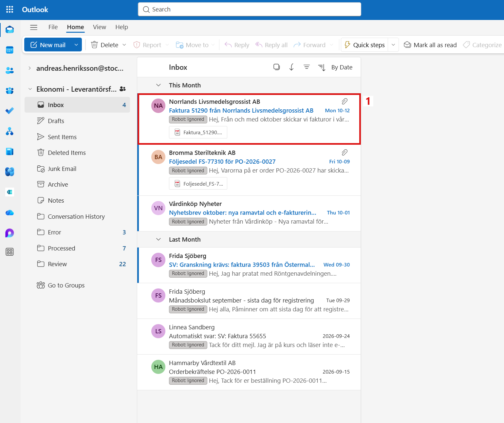

*Figure 32. The Inbox after the run, opened as Andreas.*

The Output panel shows what the robot decided (Figure 33):

1. The invoice was classified as **Not an invoice** and stayed in the Inbox.
2. The summary: 43 emails, 43 handled, 0 failed. The run looks normal, so nobody is warned.

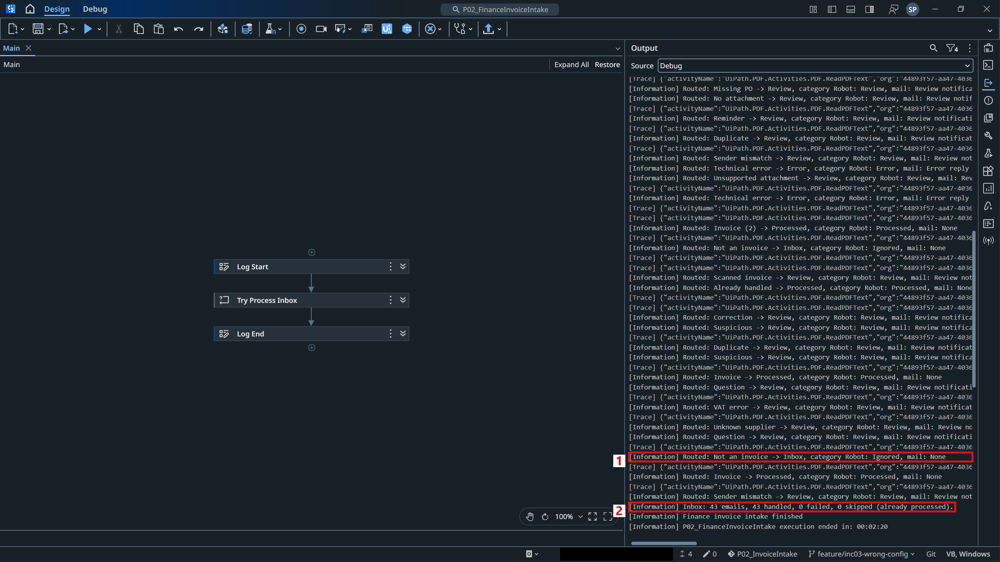

*Figure 33. The Output panel in Studio after the run.*

### 5.3 Finding the Cause

The attached PDF was compared with the invoices that P02 reads without problems (Figure 34):

1. The title is **Faktura / Invoice**. P02 only accepts a PDF whose first line is `Faktura` or `Kreditfaktura`. Every other PDF is treated as "not an invoice".
2. The field names are new. For example, the invoice number is now called `Fakturanr` instead of `Fakturanummer`, and the purchase order is called `Ordernummer` instead of `Er referens`.

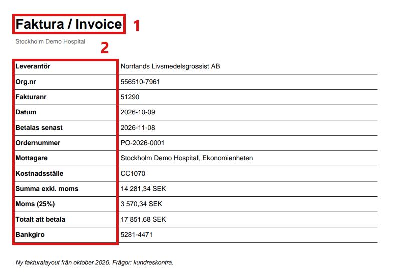

*Figure 34. Invoice 51290 in the new layout.*

The invoice content itself is correct. The amounts now end with `SEK` instead of `kr`, but this is not a problem, because P02 only reads the number in front of the currency. So the cause is that the reading rules in `Workflows/ReadInvoice.xaml` only know the old layout.

### 5.4 What the Fix Should Change

Suppliers change their invoice layouts from time to time, and the robot must not hide this. The fix is only worth the work if it handles the new layout without changing the result for any other supplier. After the fix, the following goals are expected to be met:

| Goal | Today (manual) | Expected after the fix |
|---|---|---|
| **Correct reading** | A correct invoice in the new layout is treated as "not an invoice" | Invoices in both the old and the new layout are read as invoices |
| **No hidden invoices** | The invoice stays in the Inbox, and the run looks normal, so nobody is warned | The invoice goes through the same checks as every other invoice and reaches Processed or Review |
| **No side effects** | - | All invoices in the old layout give exactly the same result as before |
| **Easy rollback** | - | The change is small and saved as one commit, so it can be undone quickly |

In short, Finance should get every correct invoice registered, whatever layout the supplier uses.

### 5.5 The Fix

Each problem found in Section 5.3 is solved by one change in `Workflows/ReadInvoice.xaml`, the workflow that reads the PDF.

**Problem 1: the new field names are unknown.** The robot looks for labels such as `Fakturanummer`, but the new layout uses `Fakturanr`.

*Solution: accept both labels.* Each field is read with a regular expression, a text pattern that finds the label and the value after it. The new labels were added next to the old ones, so both layouts can be read (Figure 35):

| Box | Field | Old label | New label, also accepted |
|---|---|---|---|
| 1 | Supplier name | Från | Leverantör |
| 2 | Organisation number | Organisationsnummer | Org.nr |
| 3 | Invoice number | Fakturanummer | Fakturanr |
| 4 | Due date | Förfallodatum | Betalas senast |
| 5 | Purchase order | Er referens | Ordernummer |
| 6 | Net amount | Belopp exkl. moms | Summa exkl. moms |
| 7 | VAT amount | Moms 25 % | Moms (25%) |
| 8 | Total amount | Att betala | Totalt att betala |

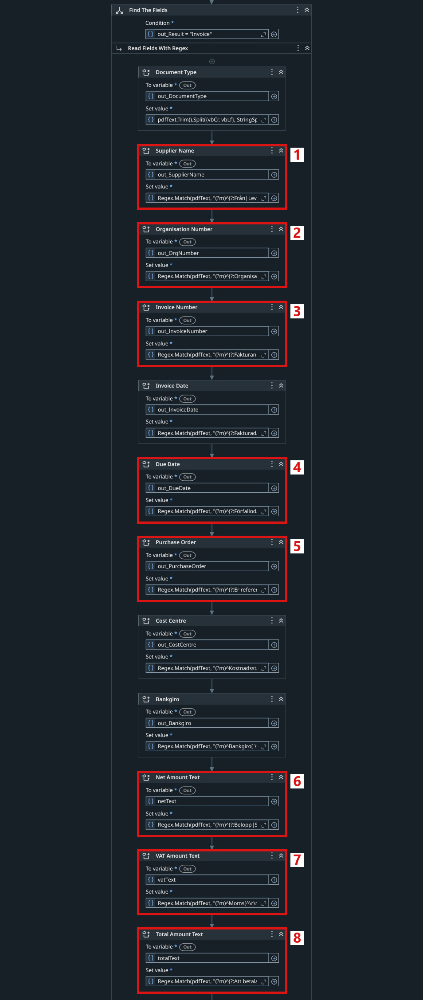

*Figure 35. The fields in `ReadInvoice.xaml` that also accept the new labels.*

**Problem 2: the new title is not accepted.** The robot only treats a PDF as an invoice when its first line is `Faktura` or `Kreditfaktura`.

*Solution: accept the new title.* The check of the title was changed, so that `Faktura / Invoice` is also accepted as an invoice (Figure 36):

1. The condition of **Check 5 - Invoice Or Credit Note?**.

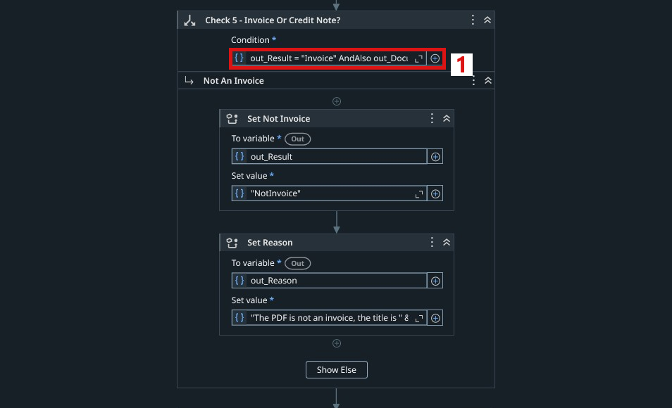

*Figure 36. The title check in `ReadInvoice.xaml`.*

**Problem 3: other suppliers must not be affected.** A change in the reading rules could break the invoices that worked before.

*Solution: keep the old rules and compare the results.* The old labels were kept, so invoices in the old layout are read in the same way as before. Before the robot was run, all 93 PDF files that P02 had saved in earlier runs were read with the old and the new rules. Only invoice 51290 gave a different result. The fix was saved in Git as one commit with nine changed lines, so it can be rolled back by reverting that single commit.

### 5.6 Testing the Fix

The fixed robot was run on the same emails as in Section 5.2 (Figure 37):

1. Invoice 51290 was routed as an **Invoice** to Processed.
2. The summary: 43 emails, 43 handled, 0 failed.

*Figure 37. The Output panel in Studio after the run with the fix.*

The invoice passed all checks: the supplier is known, the purchase order PO-2026-0001 exists, the net amount 14 281,34 SEK equals the order, and the VAT is 25 %. It is now in the Processed folder (Figure 38):

1. Invoice 51290 with the category **Robot: Processed**.
2. Invoice 51377, one of the two other new emails. Its subject starts with `[EXTERN]`, a tag that some mail systems add to external mail. P02 handled it correctly already before the fix.

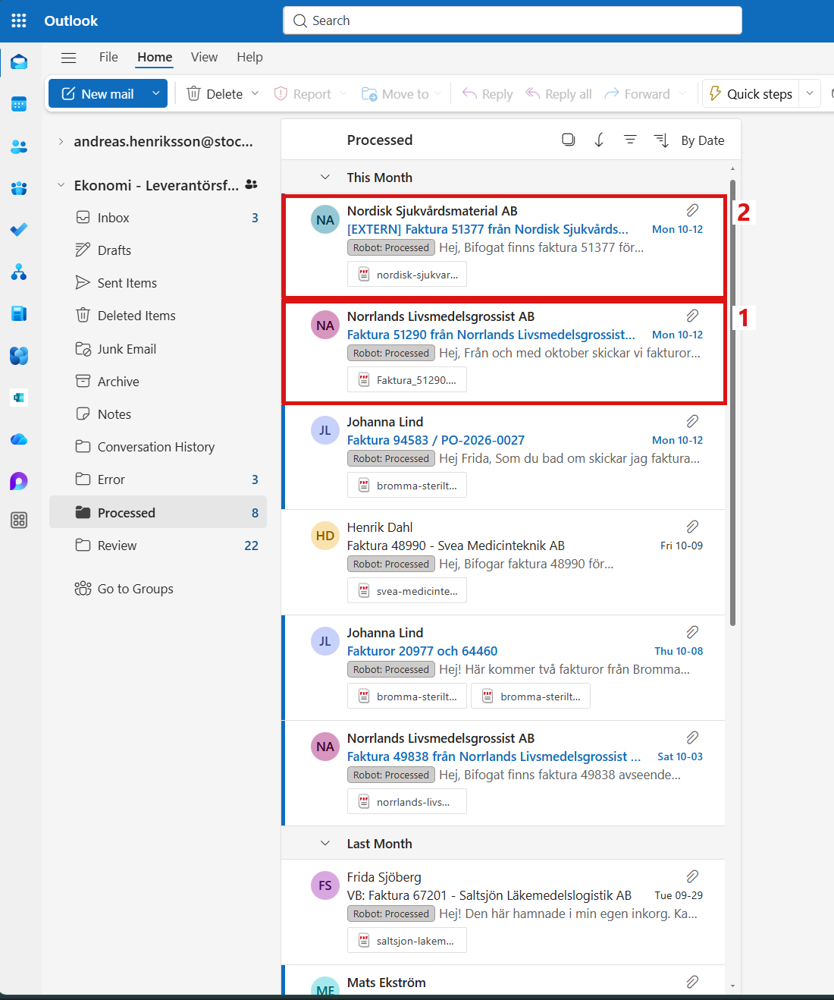

*Figure 38. The Processed folder after the run with the fix, opened as Andreas.*

The other 40 emails gave the same result as in Section 3.2: 9 Processed, 21 Review, 4 Error and 6 left in the Inbox. The last new email, invoice 41208, came from a new sender address and went to Review as a sender mismatch. This is the correct result, because only Finance can decide whether a new sender address should be trusted.

The robot did not report an error for the new layout. It treated a real invoice as an unknown document and left it in the Inbox without a warning. The reading rules now accept both the old and the new layout, and the invoices that worked before still give the same result.

## 6. INC-04 - A Run That Stops Halfway

### 6.1 The Ticket

| | |
|---|---|
| Reported by | Hospital Automation Operations |
| Symptom | The invoice robot stopped in the middle of a run. Nobody can tell which emails were already handled. |
| Robot | P02 Invoice Intake |
| Impact | An invoice can be left without a review, and Finance is not told about it. |
| Priority | High |

### 6.2 An Invoice Lost After a Stop

A robot run can stop at any moment, for example when a job is killed or the computer restarts. After a stop, the robot is normally just started again. But this time an invoice was lost on the way.

For Finance, this means:

- **An invoice waits without a notification.** It is in the Review folder, but Frida is never told to check it.
- **A late payment.** An invoice that nobody reviews is not paid on time.

For the support team, this means:

- **Nobody knows what was finished.** Nothing shows which emails were handled before the stop.
- **A normal-looking second run.** The new run reports no error, so the lost invoice is not noticed.

In this run, P02 stopped in the middle of the Inbox (Figure 39):

1. The first three emails were handled in the normal way.
2. The run stopped right after `Faktura 70870 - delleverans` was moved to Review.

*Figure 39. The Output panel in Studio when the run stops.*

The invoice was already in the Review folder (Figure 40):

1. Invoice 70870 with the category **Robot: Review**.

*Figure 40. The Review folder after the stop, opened as Andreas.*

Then the robot was simply started again on the same mailbox, as a support person would do after a stop (Figure 41):

1. The summary: 37 emails, 36 handled, 0 failed, 1 skipped. The run looks normal.

*Figure 41. The Output panel after the second run.*

Invoice 70870 is not in the list at all, because it is no longer in the Inbox. Frida's mailbox was searched for the invoice number (Figure 42):

1. The search for `70870`.
2. No message was found. Frida was never told that this invoice needs a review.

*Figure 42. The search for 70870 in Frida's mailbox.*

### 6.3 Finding the Cause

The processed log, `Output/processed_log.csv`, had rows for the three emails before the stop, but no row for invoice 70870. The order of the steps in `ProcessInbox.xaml` explains this (Figure 43):

1. **Invoke Classify Email** decides the folder of the email.
2. **Invoke Route Email** sets the category, moves the email and sends the notification.
3. **Add Log Row** adds the email to the processed log.
4. **Save Processed Log** writes the log to the file.

*Figure 43. The original steps for one email in `ProcessInbox.xaml`.*

The log is only written after the email has been moved and the notification has been sent. When the run stops between the move and the notification, the email is in Review, but nothing shows that it was not finished. The next run only reads the Inbox, so it never sees the email again.

### 6.4 What the Fix Should Change

A run can always stop because of something outside the robot, so the goal is not to prevent every stop. The fix is only worth the work if a stop no longer leaves Finance without information. After the fix, the following goals are expected to be met:

| Goal | Today (manual) | Expected after the fix |
|---|---|---|
| **Known progress** | Nothing shows which email was moved but not finished | The robot writes down every email before it routes it |
| **No lost invoices** | An invoice can stay in Review without a notification, and nobody knows | The next run finds the unfinished email and tells Finance which one to check |
| **No manual search** | The support person compares every folder with the report and the log by hand | The robot is simply started again |
| **No double messages** | A new run could answer or report the same email twice | Finance gets one notice for each unfinished email, and never the same notice twice |

In short, after a stop the robot should be started again without any manual check, and Finance should know about every unfinished invoice.

### 6.5 The Fix

Each problem found in Sections 6.2 and 6.3 is solved by one part of the fix.

**Problem 1: nothing shows that an email was started.** The row in the processed log is only written after the email is moved and the notification is sent.

*Solution: write a Started row first.* The robot now writes a "Started" row in the processed log before it routes an email (Figure 44):

1. **Add Started Row** adds a row with the folder, for example `Started: Review`.
2. **Save Started Row** writes it to the file at once.
3. **Add Log Row** adds the normal row when the email is finished, as before.

*Figure 44. The new Started row in `ProcessInbox.xaml`.*

**Problem 2: the next run never sees the email again.** The robot only reads the Inbox, and the unfinished email is already in another folder.

*Solution: look for unfinished emails at the start.* An email that was finished has two rows in the log, and an email that was stopped in the middle has only the Started row. A new step looks for these emails at the start of every run, right after the Inbox is read (Figure 45):

1. **Invoke Check Interrupted Run** is the new step.

*Figure 45. The new step after Sort Oldest First in `ProcessInbox.xaml`.*

**Problem 3: Finance is never told.** The invoice waits in Review, but no notification was sent.

*Solution: one notice for each unfinished email.* The new workflow `Workflows/CheckInterruptedRun.xaml` does the check and tells Finance (Figure 46):

1. **Find Interrupted Emails** finds the emails that have only a Started row and are no longer in the Inbox.
2. **Send Interrupted Run Notice** sends one message to Finance with the list of these emails and their folders.
3. **Add Log Row** marks each email as `Interrupted` in the log, so the same email is never reported twice.
4. **Save Processed Log** writes the log to the file.

*Figure 46. The new workflow `CheckInterruptedRun.xaml`.*

An email that is stopped before it is moved is still in the Inbox. The robot does not skip it, because a Started row alone does not count as handled, so it is handled again in the normal way. The robot does not try to send the missing notification by itself, because it cannot know whether the notification was sent just before the stop. A person checks the email instead.

The fix was saved in Git as one commit, so it can be rolled back by reverting that commit.

### 6.6 Testing the Fix

The same situation was tested again: one run that stops right after invoice 70870 is moved, and then two normal runs.

In the first run, the robot stopped after invoice 70870 again. This time the processed log had the row `Started: Review` for the invoice.

In the second run, the robot found the unfinished email at the start (Figure 47):

1. The warning: invoice 70870 was interrupted in an earlier run, and Finance was asked to check it.

*Figure 47. The Output panel at the start of the second run.*

Frida received one notice (Figure 48):

1. The subject: one email needs to be checked after an interrupted run.
2. The email to check: `Faktura 70870 - delleverans`, in the Review folder.

*Figure 48. The notice about the interrupted run, opened as Frida.*

The rest of the run was normal, with 37 emails, 36 handled and 0 failed. A third run was made to check that the notice is not sent again (Figure 49):

1. The robot found no unfinished emails from an earlier run.
2. The summary: 6 emails, 0 handled, 6 skipped. These are the emails that stay in the Inbox.

*Figure 49. The Output panel after the third run.*

Frida's mailbox still has only one notice (Figure 50):

1. One result for the search `Avbruten körning`.

*Figure 50. The search for the notice after the third run.*

P02 was also run once more on all 43 test emails. All emails got the same folders as in `TestData/expected_results.csv` and Section 5, so the fixes did not change the result for any other email.

For these tests, the stop was made with a test setting, `TestFault` in `Data/Config.xlsx`, which is `None` in normal use, and the mailbox was reset before each test.

Before the fix, a stop in the middle of a run could leave an invoice in Review without a notification, and nobody would know. Now the robot remembers which email it started, finds the unfinished one in the next run, and tells Finance once which email to check.

## 7. INC-02 - A Backlog of Transfers and an Unreliable Target System

### 7.1 The Ticket

| | |
|---|---|
| Reported by | The coordination team in Journalsamordning |
| Symptom | Every day, about 20 record transfers must be started by hand, one at a time. Some fail again and again, and nobody knows which ones need a person and which ones only need a new try. |
| Robot | None yet. A new transfer robot is built. |
| Impact | Patient records reach the next care provider late, and failed transfers with wrong data stay unnoticed. |
| Priority | Medium |

### 7.2 The Manual Work Today

In Journalsamordning, a record transfer sends the journal data of a case to another system, for example Journalsystem Syd or an external care provider. The coordinator signs in as Daniel Lindström and opens the page **Överföringar** (Figure 51):

1. The four counters: 10 transfers are ready to send, 1 waits for an answer, 35 are done and 9 have failed.
2. Each open transfer has its own button, **Utför** (run) or **Försök igen** (try again). One click starts one transfer. There is no button for several transfers at once.

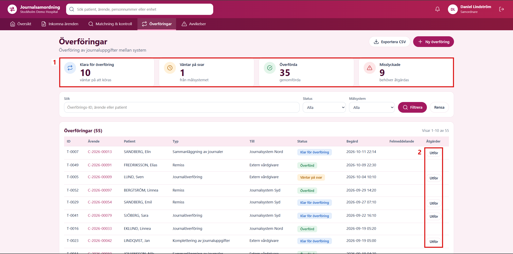

*Figure 51. The transfers in Journalsamordning before the robot, signed in as the coordinator.*

A transfer can fail for two very different reasons. A **data error**, for example `Valideringsfel: personnummer saknas` (the personal identity number is missing), fails again on every try, because the case data must first be corrected by a person. A **technical error**, for example `Timeout vid anslutning` (connection timeout), comes from the target system and often goes away by itself.

During the week of the ticket, the target systems answered unreliably: some transfers timed out once and worked on the next try, and the external care provider did not answer at all.

The coordinator pressed **Försök igen** on transfer T-0021 (Figure 52):

1. The counters still show 9 failed transfers.
2. T-0021 failed again with `Timeout vid anslutning`. The page looks exactly as before, so it is easy to miss that the try was made at all.

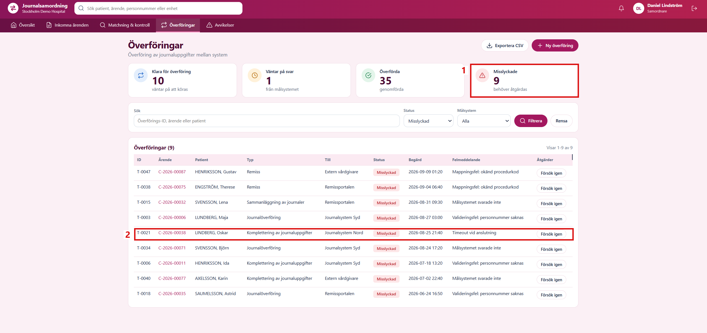

*Figure 52. The failed transfers after the first new try of T-0021.*

A second click on the same transfer worked (Figure 53):

1. The counters changed to 36 done and 8 failed.
2. T-0021 is no longer in the list of failed transfers.

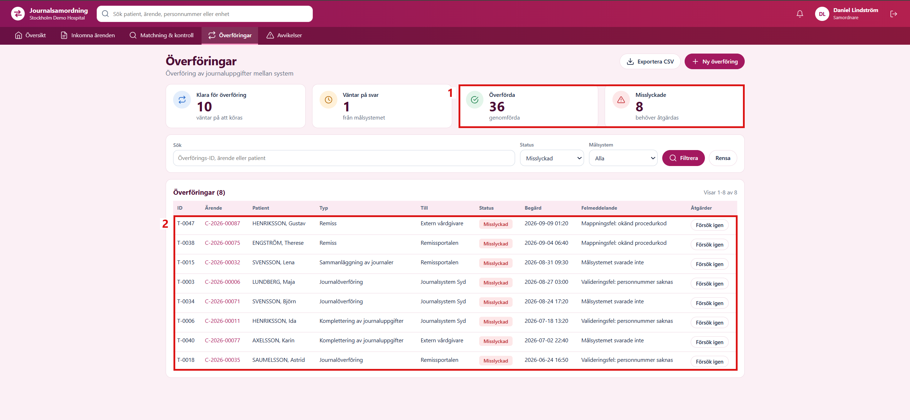

*Figure 53. The failed transfers after the second try of T-0021.*

Transfer T-0040 to the external care provider failed again with `Målsystemet svarade inte` (the target system did not answer).

For the coordinators, this means:

- **Many clicks.** About 20 transfers a day are started one by one, plus new clicks on the failed ones.
- **Guessing.** The coordinator has to decide alone how often to try a failed transfer again.
- **No overview.** At the end of the day, there is no list of which transfers were finished, which ones need a data correction, and which target could not be reached.

For the support team, this means:

- **Problems are noticed late.** A target system that does not answer is only reported when a coordinator happens to notice it.

### 7.3 What the Robot Should Change

The robot is only worth building if it improves the daily work of the coordination team. After the automation is in place, the following goals are expected to be met:

| Goal | Today (manual) | Expected after the automation |
|---|---|---|
| **Work** | About 20 clicks a day, one transfer at a time, plus new clicks on the failed ones | No clicks. The robot runs all open transfers. |
| **Decision** | The coordinator guesses whether a failed transfer needs a new try or a data correction | The robot decides by a fixed rule: a technical error gets 2 new tries, a data error goes straight to a person |
| **Safety** | Easy to click a data error again and again, or to miss a try, because the page looks the same | A transfer that is already done is never started again, and a data error is never tried again |
| **Overview** | No list at the end of the day | One report and the Orchestrator queue show what is done, what needs a data correction and what must be escalated |
| **Follow-up** | Problems with an external care provider are noticed late | "Still unavailable - escalate" lists exactly which transfers and target systems to report to IT |

In short, the coordinator should only work on the transfers that really need a person, with a clear list of them.

### 7.4 The Design of the Robot

Each problem from the manual work in Section 7.2 is solved by one part of the design. Together, these parts give the shape of the robot.

**Problem 1: one click per transfer.** The coordinator starts every transfer alone, and the list of open transfers changes from day to day.

*Solution: a queue in Orchestrator.* An Orchestrator queue is a list of work items that a robot handles one by one. Each item is one transfer. The robot is split into two parts:

- The **dispatcher** (`Dispatcher.xaml`) does what the coordinator does first: it opens the Överföringar page, finds all open transfers and puts one item for each of them into the queue `P04_Transfers`.
- The **performer** (`Main.xaml`) does what the coordinator does next: it takes one item from the queue, opens that transfer and presses its button. Then it takes the next item, until the queue is empty.

The performer is built with the REFramework, a UiPath template made for exactly this kind of work: take one item, handle it, set its result, and go on with the next one. If one transfer goes wrong, the others are still handled.

**Problem 2: guessing whether to try again.** The coordinator cannot see at once whether a failed transfer will work on the next try.

*Solution: two types of errors, with a fixed rule for each.* The robot reads the error text of the transfer and sorts it into one of two groups:

- A **data error**, such as a missing personal identity number, becomes a **business exception**. The robot worked correctly, but the case data is wrong. A new try would only give the same error, so the transfer is never tried again. It goes straight to a person.
- A **technical error**, such as a timeout, becomes a **system exception**. The problem is in the target system, so a new try may work. The queue was created with **Max # retries = 2**, which means that Orchestrator puts the same transfer back into the queue at most two more times. If the third try also fails, the transfer is marked to be escalated. The retry setting inside the REFramework, `MaxRetryNumber`, stays 0, so every retry is done by the queue and can be seen in Orchestrator.

**Problem 3: the page looks the same after a try.** It is easy to miss a try, or to start a transfer that is already done.

*Solution: read before and after every click.* The robot reads the status of the transfer before it presses any button. A transfer that is already done is never started again. After the click, the robot reads the status once more, so the result of every try is known.

**Problem 4: no list at the end of the day.** Nothing shows which transfers were finished and which ones still need work.

*Solution: a report and the queue history.* Every try is written as one line in a daily report file, and Orchestrator keeps the history of every queue item.

When the four parts are combined, every transfer ends in one of four clear outcomes:

| What happens | Type of error | Tried again? | Outcome in the report |
|---|---|---|---|
| The transfer is done at once | None | No | Completed |
| A technical error, and a later try works | System exception | Yes, by the queue | Recovered after technical retry |
| A technical error on every try | System exception | Yes, at most 2 times | Still unavailable - escalate |
| A data error | Business exception | Never | Needs manual data correction |

### 7.5 Building the Robot

The robot was built in the REFramework project `P04_HospitalBotMaintenance`. The login workflow and the Object Repository for Journalsamordning were taken from the P03 project, and the password is read from Windows Credential Manager, as in P03. New elements were captured for the transfer table: the status, the error text and the button of one row, found by the transfer ID.

The new workflow `Dispatcher.xaml` fills the queue (Figure 54):

1. **Log In to Journalsamordning** signs in as the coordinator.
2. **For Each Open Status** goes through the three open statuses: Misslyckad (failed), Klar för överföring (ready) and Väntar på svar (waiting).
3. **Read the Transfer List** opens the Överföringar page filtered on one status and reads all rows of the table.
4. **Add Transfer to the Queue** adds one queue item for each row. The reference is the transfer ID, and the item also keeps the case, the target system, the status and the error text.

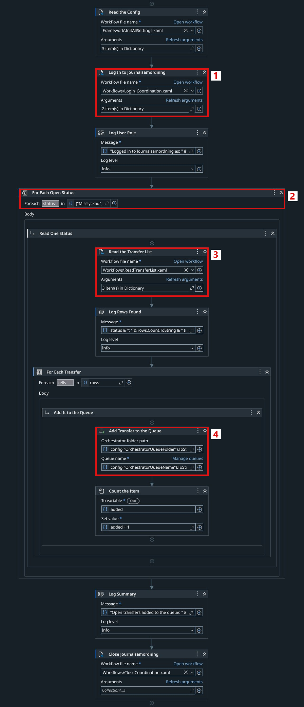

*Figure 54. The dispatcher `Dispatcher.xaml`.*

The queue name and its Orchestrator folder are kept in `Data/Config.json`, together with the address of Journalsamordning and the name of the saved login.

The work for one transfer is done in `Framework/Process.xaml` (Figure 55):

1. **Read the Transfer** opens the transfer by its ID and reads its status and error text.
2. **Is the Transfer Already Done?** A transfer with the status Överförd is not touched again.
3. **Is It a Known Data Error?** A failed transfer with a data error becomes a business exception before any button is pressed.
4. **Press the Transfer Button** clicks Utför or Försök igen and waits until Journalsamordning answers. **Read the Transfer Again** reads the new status.
5. If the transfer still failed, a data error becomes a business exception, and any other error becomes a system exception with the text from the target system.
6. **Report Success** adds a line to the daily report.
7. Both exception types also add a line to the report before the exception is passed on to the framework, which sets the status of the queue item.

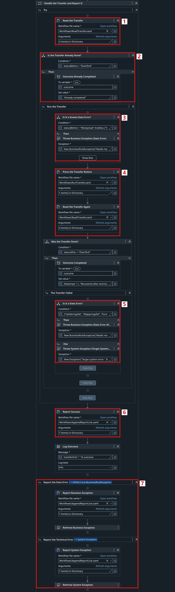

*Figure 55. The handling of one transfer in `Process.xaml`.*

The report is the file `Data/Output/transfer_report_<date>.csv`. It has one line for every try, with the transfer, the try number, the status before, the result and the outcome.

### 7.6 Testing the Robot

The robot was tested with the same open transfers and the same unreliable target systems as in Section 7.2. The dispatcher added the 20 open transfers to the queue (9 failed, 10 ready and 1 waiting), and then `Main.xaml` was run from Studio. All 20 transfers were handled in about five minutes, without any click by a person.

The queue in Orchestrator shows the result (Figure 56):

1. **Successful 12**: 8 transfers worked at once, and 4 worked on the second try.
2. **App Exceptions 13**: every try that ended in a system exception, including the tries that were followed by a successful one.
3. **Biz Exceptions 5**: the 5 transfers with data errors.

*Figure 56. The queue `P04_Transfers` after the run.*

Each try is its own row in the list of transactions (Figure 57):

1. T-0005, T-0023 and T-0040 failed on their last try. All three go to the external care provider, which never answered.
2. T-0051 worked on its second try.
3. Its first try, which ended in a timeout, has the status Retried.

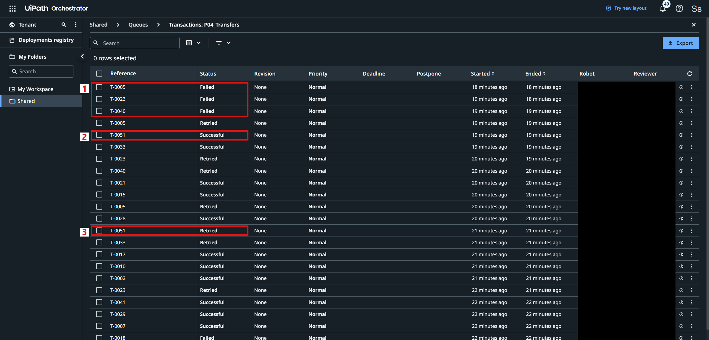

*Figure 57. The transactions of the queue in Orchestrator.*

The details of T-0040 show the whole history of one transfer (Figure 58):

1. The data that the dispatcher saved with the item.
2. The reason of the last system exception: `Målsystemet svarade inte`.
3. Three tries: the first two ended as Retried and the last one as Failed, all with the exception type Application.

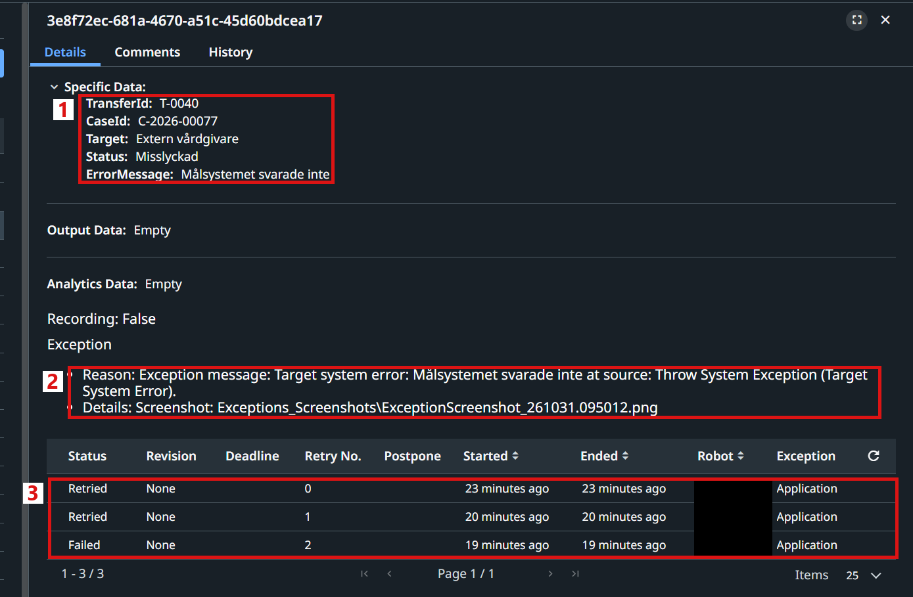

*Figure 58. Transaction T-0040 after three tries.*

A transfer with a data error looks different (Figure 59):

1. The reason: `Needs manual data correction: Mappningsfel: okänd procedurkod` (unknown procedure code).
2. Only one try, with the exception type Business. The transfer was never tried again.

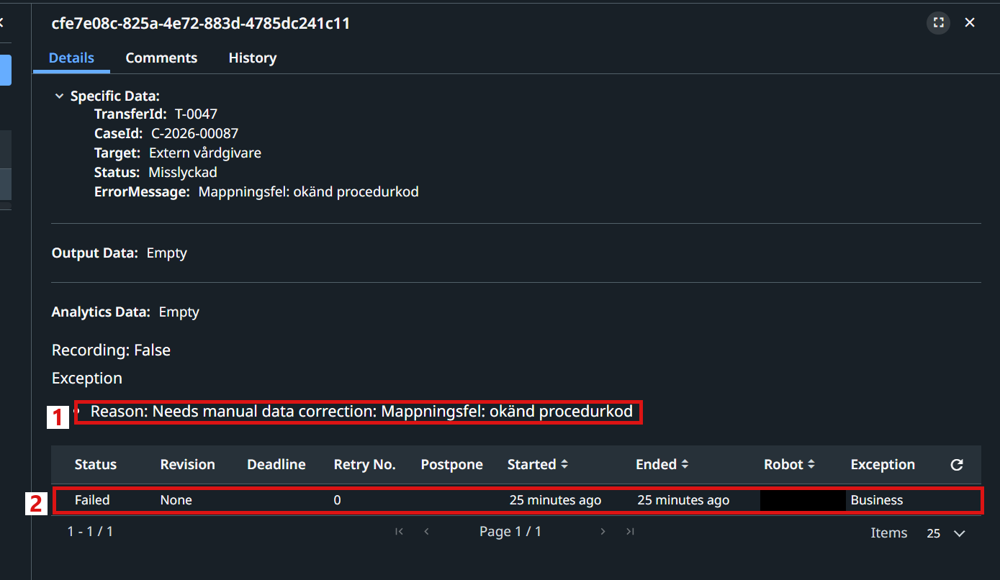

*Figure 59. Transaction T-0047 with a data error.*

The report gives the same picture in one file (Figure 60):

1. T-0047 needs a manual data correction.
2. The first try of T-0015 ended in a timeout and was marked to be tried again.
3. The second try of T-0015 worked: **Recovered after technical retry**.
4. After the third try, T-0040, T-0023 and T-0005 were marked **Still unavailable - escalate**.

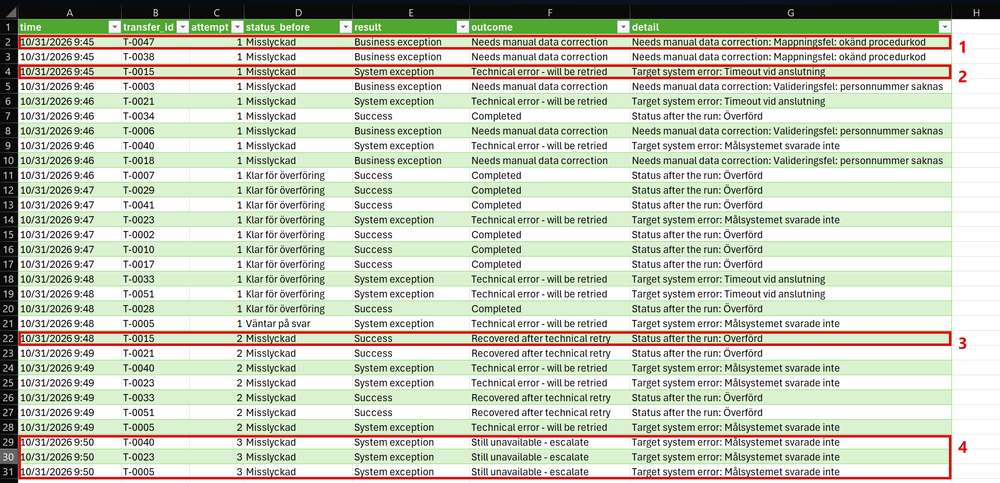

*Figure 60. The report `transfer_report_2026-10-31.csv`, opened in Excel.*

In Journalsamordning, only the transfers that need a person are left (Figure 61):

1. No transfer is ready or waiting any more, 47 are done and 8 have failed.
2. The 8 failed transfers are the 5 with data errors and the 3 for the external care provider that did not answer.

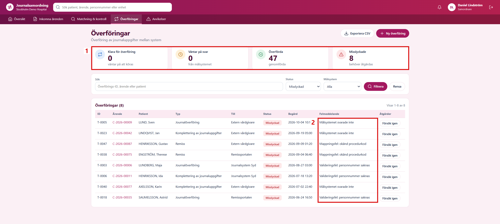

*Figure 61. The failed transfers after the robot run, signed in as the coordinator.*

The result was exactly as expected for every transfer:

| Outcome | Transfers |
|---|---|
| Completed | T-0002, T-0007, T-0010, T-0017, T-0028, T-0029, T-0034, T-0041 |
| Recovered after technical retry | T-0015, T-0021, T-0033, T-0051 |
| Needs manual data correction | T-0003, T-0006, T-0018, T-0038, T-0047 |
| Still unavailable - escalate | T-0005, T-0023, T-0040 |

The unreliable target systems and the transfer data for this test were prepared in the test environment and reset afterwards.

Before the robot, the coordinator clicked each transfer by hand, tried the failed ones again without a rule, and had no list of the result. The test showed every row of the table in Section 7.3: 8 transfers were done at once, 4 recovered after a new try, 5 were sent to a person for a data correction, and 3 were listed to escalate. No click was needed, and the coordinator now only has to look at those 8 transfers.

## 8. INC-01 - A Page Update Breaks the Transfer Robot

### 8.1 The Ticket

| | |
|---|---|
| Reported by | The coordination team in Journalsamordning |
| Symptom | The transfer robot stops right after the login. No transfers are queued or handled, although the Överföringar page looks exactly as before. |
| Robot | Transfer robot (Section 7) |
| Impact | All transfers must be started by hand again until the robot is fixed. |
| Priority | High |

### 8.2 The Robot Stops After the Update

The ticket came the day after a new version of Journalsamordning was installed. For a person, the Överföringar page looks exactly as before: the same columns, the same buttons and the same data. But since the update, the robot has not handled a single transfer.

For the coordinators, this means:

- **Back to manual work.** About 20 transfers a day are clicked one by one again, as in Section 7.2.
- **New tries without a rule.** A failed transfer is tried again by guess, because nobody sorts the data errors from the technical errors any more.
- **No list of the result.** There is no report at the end of the day.

For the support team, this means:

- **Nothing looks broken.** The page is the same, so there is no visible reason why the robot stopped.
- **The queue is empty.** The robot stops right after the login, before it adds any transfer to the queue, so the queue gives no hint either.

The dispatcher was run in UiPath Studio to see what the robot sees on the new page (Figure 62):

1. The robot could not find the transfer table with its selector `<webctrl id='transfer-table' tag='TABLE' />`.
2. UiPath shows the closest element it found: a table with the id `transfers-grid`, an 82 % match.
3. The run stopped with the error "Could not find the user-interface (UI) element for this action".

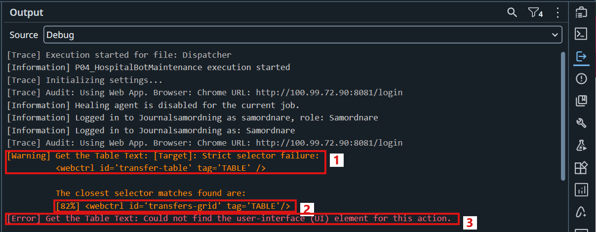

*Figure 62. The Output panel in Studio when the dispatcher runs against the new page.*

The robot stopped before any transfer was added to the queue. The performer uses the same table, so it would fail in the same way on every transfer.

### 8.3 Finding the Cause

The target of the table was opened in the Selection Helper in Studio, with the new page open in Chrome (Figure 63):

1. The Selection Helper says that the element was not found.
2. The selector looks for a table with the id `transfer-table`.

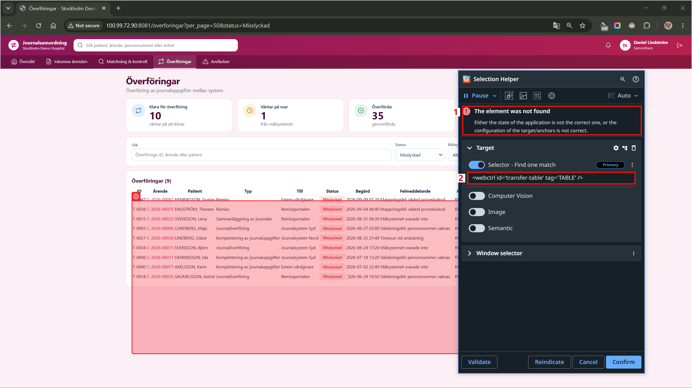

*Figure 63. The old selector of the transfer table in the Selection Helper.*

The page itself was then inspected with the developer tools in Chrome (Figure 64):

1. The table now has the id `transfers-grid` and the class `grid-table`. Before the update, it was `id="transfer-table"` and `class="data"`.

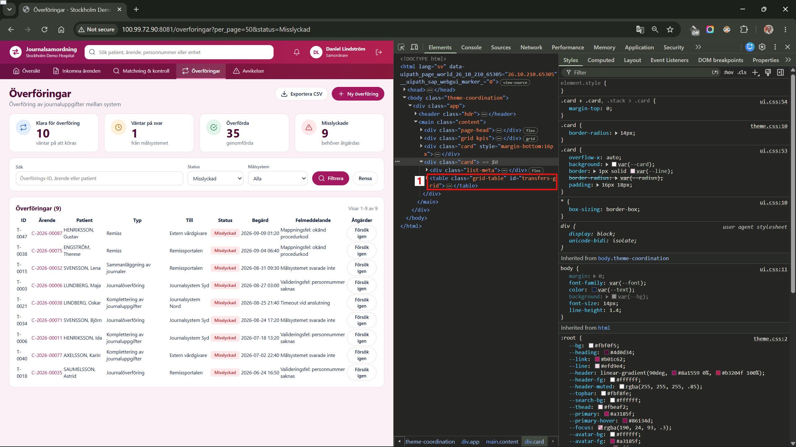

*Figure 64. The transfer table of the new page in the developer tools of Chrome.*

An id like this is a technical name that the developers of the page choose. A person never sees it, and it can change in any release. Four elements of the robot depended on it: the table itself, and the status, the error text and the button of a transfer row, which all used the table id as their parent (`parentid='transfer-table'`). So one renamed id stopped the whole robot.

### 8.4 What the Fix Should Change

Re-indicating the elements on the new page would fix the robot today, but it would break again at the next release that renames something. The fix is only worth the work if the robot depends on what the page shows, not on how it is built inside. After the fix, the following goals are expected to be met:

| Goal | Today (manual) | Expected after the fix |
|---|---|---|
| **The robot works again** | The coordinators click about 20 transfers by hand | The robot handles the transfers again on the new page, with the same outcomes as in Section 7 |
| **Stable selectors** | All four transfer elements depend on the technical id of the table | The elements are found by what a person sees: the column header and the transfer ID |
| **Both versions** | The robot only works on the old page | The same robot works on the old and the new page, so a release of Journalsamordning and a release of the robot do not have to happen on the same day |
| **One place to change** | The same four elements are used in three workflows | The selectors are kept in the Object Repository, so one change reaches every workflow that uses them |
| **No side effects** | - | Every transfer gets the same result as before the page update |

In short, a change that a person cannot see on the page should not stop the robot.

### 8.5 The Fix

Each problem found in Sections 8.2 and 8.3 is solved by one part of the fix.

**Problem 1: the table is found by its id.** The selector `<webctrl id='transfer-table' tag='TABLE' />` only works as long as the developers keep the same id.

*Solution: find the table by its tag.* The Överföringar page has only one table, so `<webctrl tag='TABLE' />` is enough to find it, with any id or class. In the Object Repository, the new selector of **Transfer Table** was checked with **Validate** against the new page (Figure 65):

1. Validation successful.
2. The new selector, without the id.
3. The whole transfer table is found.

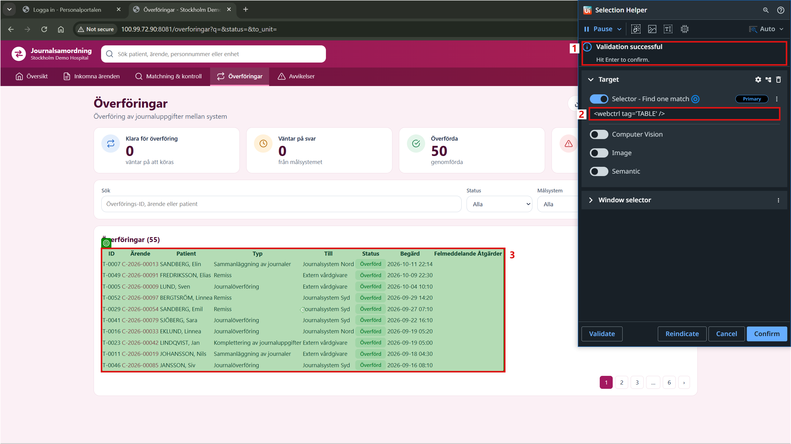

*Figure 65. The new selector of the transfer table in the Selection Helper.*

**Problem 2: the cells of a row are found through the table id.** The status, the error text and the button were found with `parentid='transfer-table'`, together with the column and the row.

*Solution: find a cell by its column header and its transfer ID.* `colName` is the header of the column, for example `Åtgärder`, and `rowName` is the transfer ID in the first column of the row. A person uses exactly the same two things to find a button on the page. The parent id was removed, and the new selectors were validated on the new page (Figure 66):

1. Validation successful.
2. The new selector of the button: `<webctrl colName='Åtgärder' rowName='{transferId}' tag='BUTTON' />`, where the transfer ID comes from the queue item.
3. The button of transfer T-0047 is found.

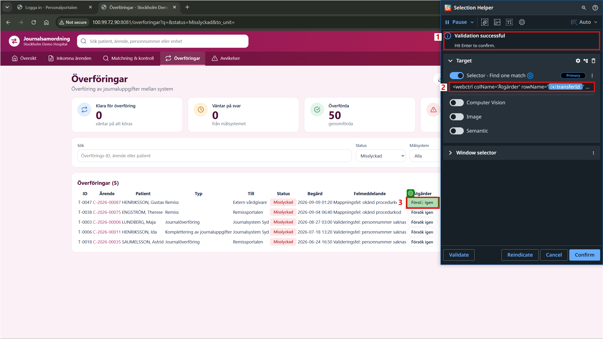

*Figure 66. The new selector of the transfer button in the Selection Helper.*

| Element | Old selector | New selector |
|---|---|---|
| Transfer Table | `<webctrl id='transfer-table' tag='TABLE' />` | `<webctrl tag='TABLE' />` |
| Transfer Row Status | `colName='Status' parentid='transfer-table' rowName='{id}'` | `colName='Status' rowName='{id}'` |
| Transfer Row Error Message | `colName='Felmeddelande' parentid='transfer-table' rowName='{id}'` | `colName='Felmeddelande' rowName='{id}'` |
| Transfer Row Action Button | `colName='Åtgärder' parentid='transfer-table' rowName='{id}'` | `colName='Åtgärder' rowName='{id}'` |

**Problem 3: the same elements are used in three workflows.** `ReadTransferList.xaml`, `ReadTransfer.xaml` and `RunTransfer.xaml` all use them.

*Solution: change them once in the Object Repository.* The four elements were updated in the Object Repository, and the activities in the three workflows are linked to them, so they all use the new selectors. No other part of the robot was changed. The fix was saved in Git as one commit, so it can be rolled back by reverting that single commit.

### 8.6 Testing the Fix

The fixed robot was run against the new page, with the same 20 open transfers as in Section 7. This time the target systems answered normally, so the test only shows the effect of the new selectors. The dispatcher found all 20 open transfers, and the performer handled them (Figure 67):

1. **Successful 15**: every transfer without a data error was done on the first try.
2. **App Exceptions 0**: no element was missing, and no other technical error happened.
3. **Biz Exceptions 5**: the same 5 transfers with data errors as in Section 7.

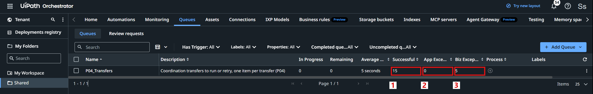

*Figure 67. The queue `P04_Transfers` after the run on the new page.*

In Journalsamordning, only the transfers with data errors were left (Figure 68):

1. No transfer is ready or waiting any more, 50 are done and 5 have failed.
2. The 5 failed transfers all have a data error, so they need a person.

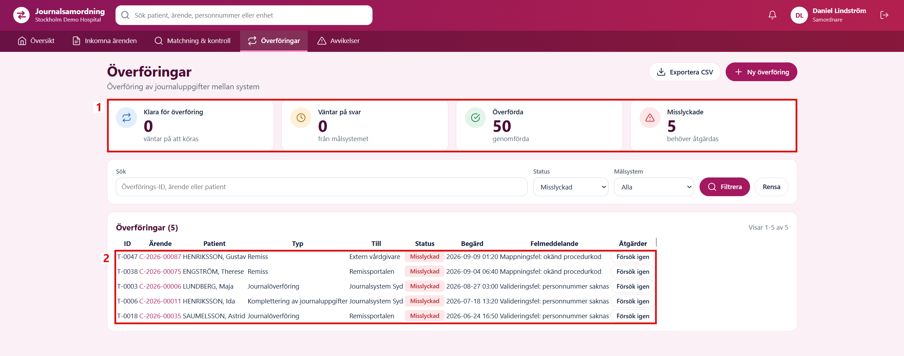

*Figure 68. The failed transfers after the run on the new page, signed in as the coordinator.*

The same robot was also run against the old version of the page, with the same open transfers. The result was exactly the same: 20 transfers queued, 15 done and the same 5 data errors. The fixed robot works on both versions of the page.

Both page versions and the transfer data for these tests were prepared in the test environment and reset after each test.

Before the fix, a small technical change that nobody could see on the page stopped the whole robot. Now the robot finds the transfer table and its rows by the column headers and the transfer IDs, the same way a person does, and it works on both the old and the new version of the page.

## 9. INC-06 - The Transfer Robot Only Runs When a Developer Starts It

### 9.1 The Ticket

| | |
|---|---|
| Reported by | The coordination team in Journalsamordning |
| Symptom | On days when the developer is away, the transfer robot does not run, and the transfers wait. Nobody can say which version of the robot is in use, or how to go back if a new version fails. |
| Robot | Transfer robot (Sections 7 and 8) |
| Impact | On these days, the coordinators are back to the manual work from Section 7.2. |
| Priority | Medium |

### 9.2 The Robot Depends on One Developer

The transfer robot works, but only in one way: a developer opens the project in UiPath Studio on their own computer, runs `Dispatcher.xaml`, waits, and then runs `Main.xaml`. The result is only shown in the Output panel of Studio, and the daily report is written to the folder `Data\Output` inside the project.

For the coordinators, this means:

- **No fixed time.** The transfers are handled when the developer has time, not at a time the coordinators can plan for.
- **No robot without the developer.** When the developer is ill or busy, the robot does not run at all, and the coordinators click about 20 transfers by hand again, as in Section 7.2.
- **The report is on the developer's computer.** The coordinators have to ask for it.

For the support team, this means:

- **No job history.** The runs are not in Orchestrator, so there is no list of jobs, no job log and no way to see when the robot last ran.
- **No version.** A change, like the fix in Section 8, goes straight into the project that the robot is started from. If a change is wrong, the only way back is to undo it in Git and start the robot again from Studio.

### 9.3 Finding the Cause

The robot was never released. It exists only as a project folder on one computer. In Orchestrator, the folder Shared already has the queue `P04_Transfers`, but no process of the transfer robot, and no robot that can run a job there: the folder had 0 unattended runtimes. So Orchestrator could not start the robot even if someone asked it to.

Three things are missing:

1. A **robot** that Orchestrator can send jobs to, without a person at the computer. This is an unattended robot.
2. A **package** with a version number, and a **process** in Orchestrator that uses it.
3. A **trigger** that starts the process at the right time.

### 9.4 What the Release Should Change

A shared computer where anyone can press Run in Studio would not solve the problem, because the robot would still need a person, and there would still be no version and no history. After the release, the following goals are expected to be met:

| Goal | Today (manual) | Expected after the release |
|---|---|---|
| **Runs on its own** | A developer starts the dispatcher and the performer in Studio | The dispatcher starts every weekday morning, and the performer starts as soon as there are transfers in the queue |
| **Not tied to one person** | No run when the developer is away | The robot runs from Orchestrator, on a computer that is set up for it |
| **Job history** | The result is only in the Output panel of Studio | Every run is a job in Orchestrator, with its state and its log |
| **A known version** | The robot is whatever is in the project folder | The robot runs a package with a version number, and Orchestrator shows which version each process uses |
| **A way back** | Undo the change in Git and start again from Studio | The earlier version is brought back in Orchestrator in one step |
| **The report where people look** | In `Data\Output` on the developer's computer | In one fixed folder that the coordinators know, and the job log names the file |
| **No side effects** | - | Every transfer gets the same outcome as before |

In short, the robot should run on its own, every run should be visible in Orchestrator, and a new version should be easy to take back.

### 9.5 The Release

Each problem found in Sections 9.2 and 9.3 is solved by one part of the release.

**Problem 1: no robot that Orchestrator can use.**

*Solution: an unattended robot.* In Orchestrator, a machine called `P04-Transfer-Robot` was added for the computer that runs the robot, and it was added to the folder Shared (Figure 69):

1. The machine `P04-Transfer-Robot`.

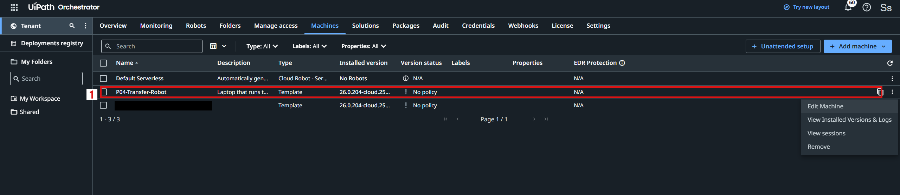

*Figure 69. The machines in Orchestrator. The machine of a personal account is hidden.*

The machine was given one unattended runtime, which is the license that lets one unattended job run at a time (Figure 70):

1. **Production (Unattended)** is 1.
2. The client ID of the machine. It is hidden here, because the robot uses it, together with a secret, to sign in to Orchestrator.

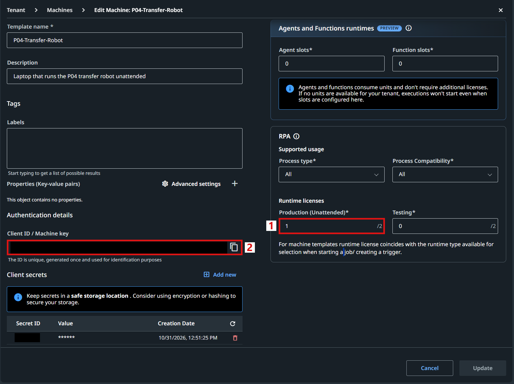

*Figure 70. The settings of the machine `P04-Transfer-Robot`.*

On the computer, UiPath Assistant was then connected to Orchestrator with the client ID of the machine (Figure 71):

1. The connection type is **Client ID**, the type that unattended robots use.
2. The status is "Connected, Licensed", so Orchestrator can now send jobs to this computer.

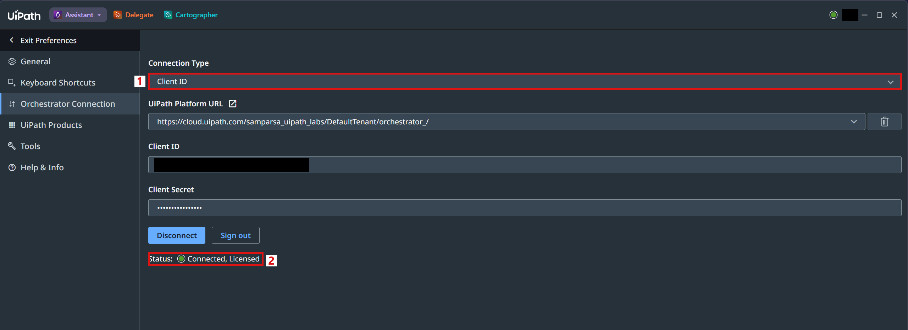

*Figure 71. The Orchestrator connection in UiPath Assistant.*

**Problem 2: no version and no process.**

*Solution: a package and two processes.* The robot was packed as version 1.0.0 and uploaded to Orchestrator. The package has two entry points, so two processes were created from it in the folder Shared (Figure 72):

1. `P04_Transfer_Dispatcher` runs `Dispatcher.xaml`, and `P04_Transfer_Performer` runs `Main.xaml`.
2. Both processes use the package version 1.0.0.

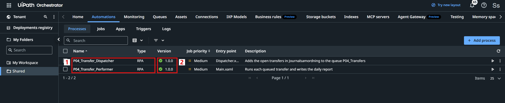

*Figure 72. The processes of the transfer robot in the folder Shared.*

Automatic update is turned off for both processes, so a process only changes its version when a person chooses it. Both processes were started once from Orchestrator, and both jobs ended without an error (Figure 73):

1. Both jobs are **Successful**.
2. Both were started by hand (**Manual**).
3. Both ran on the computer of the transfer robot.

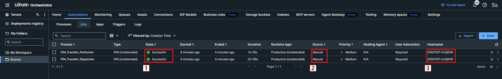

*Figure 73. The first two jobs of the transfer robot in Orchestrator.*

**Problem 3: the report disappears in a job from Orchestrator.** After these first jobs, the transfers were done, but the daily report was not in `Data\Output`. The report folder is a setting in `Data/Config.json`, and its value `Data\Output` is a relative path: it only says where the folder is compared with the current folder of the robot. In Studio, that is the project folder. In a job from Orchestrator, the robot installs the package in its own package folder, one folder for each version, and runs the job from there. The report was found in that folder (Figure 74):

1. The path: the package folder of version 1.0.0, inside the user profile of the robot. The user name is hidden.
2. The report of the day.

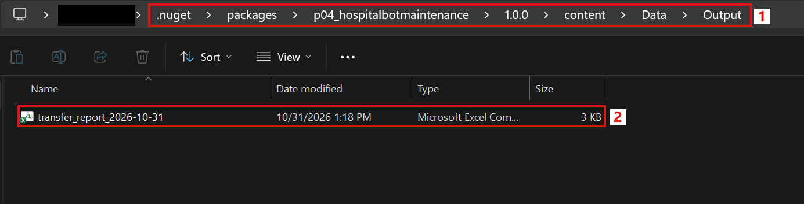

*Figure 74. The daily report in the package folder of version 1.0.0.*

Nobody looks for a report in this place, and the next version would write it to yet another folder.

*Solution: a fixed report folder, and the path in the log.* The setting was changed to a full path, and the robot expands it with `Environment.ExpandEnvironmentVariables` before it uses it:

| Setting | Before | After |
|---|---|---|
| `ReportFolder` | `Data\Output` | `%PUBLIC%\Documents\P04 Transfer Reports` |

`%PUBLIC%` is the public user folder of Windows, `C:\Users\Public`, which every user of the computer can open. In a real hospital, this would be a shared network folder of the coordination team. When the robot starts a new report for the day, it also writes the full path of the file to the job log. The change was saved in Git as one commit, the robot was packed as version 1.0.1, and both processes were updated to it (Figure 75):

1. Both processes use version 1.0.1. Version 1.0.0 is still kept in Orchestrator.

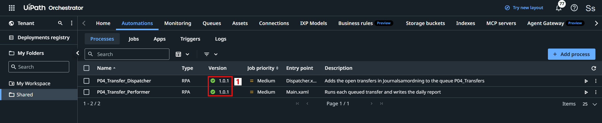

*Figure 75. The processes of the transfer robot after the update.*

**Problem 4: the robot only runs when someone starts it.**

*Solution: two triggers.* A trigger starts a process by itself. A time trigger starts the dispatcher at 07:00 every weekday, Stockholm time (Figure 76):

1. The trigger "P04 Dispatcher - weekdays 07:00" for the process `P04_Transfer_Dispatcher`.

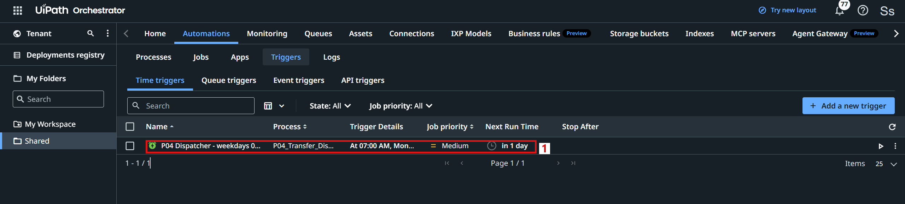

*Figure 76. The time trigger of the dispatcher.*

A queue trigger starts the performer as soon as there is at least one new transfer in the queue `P04_Transfers`. Only one performer job runs at a time, because the robot has one unattended runtime (Figure 77):

1. The trigger "P04 Performer - new transfers in the queue" for the queue `P04_Transfers`.

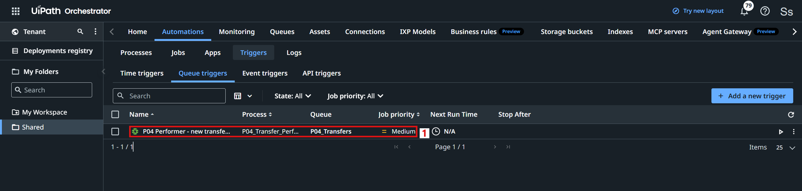

*Figure 77. The queue trigger of the performer.*

So the dispatcher fills the queue every morning, and the queue starts the performer. Nobody has to start the robot.

**Problem 5: no way back.**

*Solution: rollback in Orchestrator.* Every uploaded version stays in Orchestrator, and a process can be rolled back to its previous version in one step. This was tested in Section 9.6.

### 9.6 Testing the Release

Version 1.0.1 was tested with the same 20 open transfers as before. The dispatcher was started, and the queue trigger started the performer by itself, right after the dispatcher had added the transfers to the queue (Figure 78):

1. The dispatcher and the performer, both **Successful**.
2. The source of the performer job is the queue trigger, not a person.

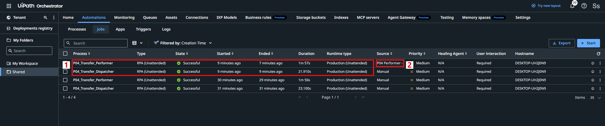

*Figure 78. The jobs of version 1.0.1. The performer was started by the queue trigger.*

The job log of the performer shows where the report was written (Figure 79):

1. "New daily report: C:\Users\Public\Documents\P04 Transfer Reports\transfer_report_2026-10-31.csv".

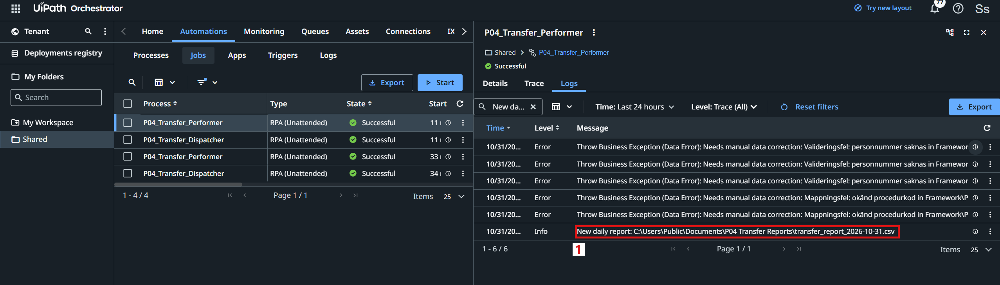

*Figure 79. The log of the performer job, filtered on "New daily report".*

The report was in the fixed folder (Figure 80):

1. The folder `C:\Users\Public\Documents\P04 Transfer Reports`.
2. The report of the day.

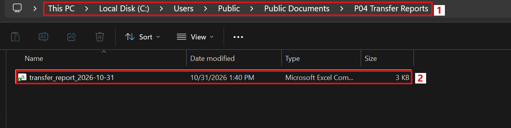

*Figure 80. The daily report in the fixed report folder.*

The report had the same outcomes as before: 15 transfers Completed and 5 transfers Needs manual data correction, with the reason for each one.

Then the way back was tested. Both processes were rolled back to version 1.0.0 in Orchestrator, and the robot was run again. Only the 5 transfers with data errors were still open, and the robot does not press the button of a transfer with a known data error, so the run changed nothing in Journalsamordning (Figure 81):

1. The two newest jobs ran on version 1.0.0, and both were successful.
2. The dispatcher was started by hand, and the performer by the queue trigger.

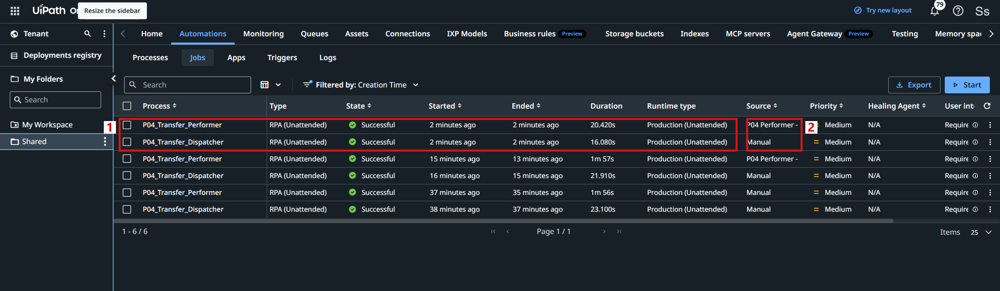

*Figure 81. All jobs of the transfer robot. The two newest jobs ran on version 1.0.0 after the rollback.*

The 5 report lines of this run were written to the package folder of version 1.0.0 again, and the report in the fixed folder was not changed. This shows that the rollback really brought back the old version, with its old report folder. Both processes were then updated to version 1.0.1 again. The version history of the performer shows the four steps: 1.0.0, 1.0.1, 1.0.0 and 1.0.1.

The transfer data was reset after the tests, and the two triggers were turned off until the robot is taken into daily use.

Before the release, the transfer robot only ran when a developer started it in Studio, and its result stayed on the developer's computer. Now it runs from Orchestrator on its own robot, starts by itself every weekday morning, and writes its report to one fixed folder. Every run is a job with a log, every version is kept, and the earlier version can be brought back in one step.
