# P04 - Hospital RPA Maintenance and Production Support

## 1. Project Goal

The goal of this project is to work as a junior UiPath developer in the support team of a fictional Swedish hospital. Two robots from earlier projects are already in use: P01 checks patient referrals across two hospital systems, and P02 handles supplier invoices that arrive in a shared Outlook mailbox. The robots are not rebuilt. Instead, a short series of simulated support tickets is handled: a broken selector, a slow hospital system, a wrong configuration value, a run that stopped halfway, and a supplier that changed its invoice layout. For each ticket, the problem is reproduced, the real cause is found, a small fix is made and tested, and the change is versioned so that it can be rolled back. A new support process is also built with the UiPath Robotic Enterprise Framework (REFramework) to show how a robot handles business exceptions and system errors, and how it retries safely. All data in this project is fictional.

### 1.1 Scenario

The hospital has a small automation team. Two robots were built by other developers, tested, published to Orchestrator and handed over to the staff, who start them from UiPath Assistant. Now the team receives tickets from **Hospital Automation Operations** when a robot fails or behaves differently than before.

The support team did not build these robots. So the first job is always to understand the robot: its workflows, its config file and its logs. Only after that is anything changed. Each change must be small, the cases that worked before must still work, and the earlier version must be easy to bring back.

### 1.2 The Two Robots in Use

| Robot | Used by | What it does |
|---|---|---|
| P01 Patient Administration Reconciliation | Patient Administration Officer | Reads a file with referrals, compares each referral in Personalportalen with its case in Journalsamordning, and writes a report of missing, duplicate and conflicting records. |
| P02 Finance Invoice Intake | Finance office | Reads the supplier emails and PDF invoices in the shared mailbox Ekonomi - Leverantörsfakturor, checks them against the finance data, and moves each email to Processed, Review or Error. |

How the robots were built and tested is described in their own records ([P01 Project Record](../../P01-Patient-Admin-Reconciliation/Project%20Record/Project%20Record.md), [P02 Project Record](../../P02-Finance-Invoice-Intake/Project%20Record/Project%20Record.md)) in the same repository. This record only covers the support work on them.

Both robots are started by the staff from UiPath Assistant and send their log messages to Orchestrator. Both also write a report, so the staff can see the result of every referral or email.

### 1.3 Before This Project - Manual Support Work

When one of the robots fails today, the robot gives the support team very little help. The support person has to find the cause, the state of the data and the result of a new run by hand, in several places.

**1. Find the job.** First, it helps to know where a job comes from. A staff member starts a robot in UiPath Assistant. The numbers in Figure 1 match these parts:

1. The robot `P02_FinanceInvoiceIntake` in the list of automations.
2. The version of the robot and the time of its last run.
3. **Run** starts the robot on this computer.

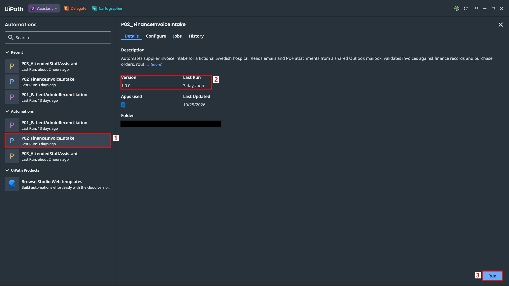

*Figure 1. The P02 robot in UiPath Assistant.*

Every run that is started in this way is saved as a job in Orchestrator, under Automations > Jobs. When something goes wrong, the support person starts here (Figure 2):

1. Each job, with its process, its state, and the time it started and ended.
2. The source **Assistant**, which means that a staff member started the job with Run.

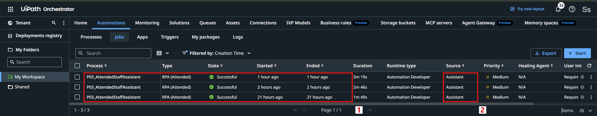

*Figure 2. The Jobs page in My Workspace.*

**2. Read the log.** Every robot writes short log messages while it runs. They are found under its process in Orchestrator. Figure 3 shows a normal P02 run on 25 October, with the newest lines at the top:

1. The process `P02_FinanceInvoiceIntake`.
2. The **Logs** tab of the process.
3. The run starts: 18 settings were read, 6 of them from Orchestrator assets.
4. The robot read its history: 11 emails were already in the Processed folder.
5. One line for each email in the Inbox. Here all 6 emails were skipped, because the robot had already handled them in an earlier run.
6. The summary of the run.

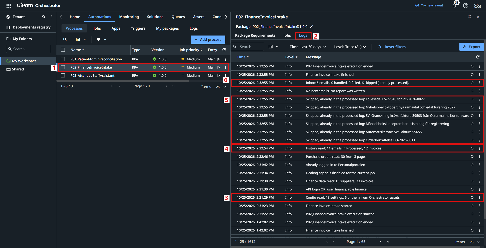

*Figure 3. The log messages of a P02 run in Orchestrator.*

The history in line 4 comes from the Processed folder of the shared mailbox. When the robot moves a correct invoice there, it also gives the email the category **Robot: Processed** (Figure 4):

1. The Processed folder.
2. The emails that the robot moved there.
3. The category that the robot added to each email.

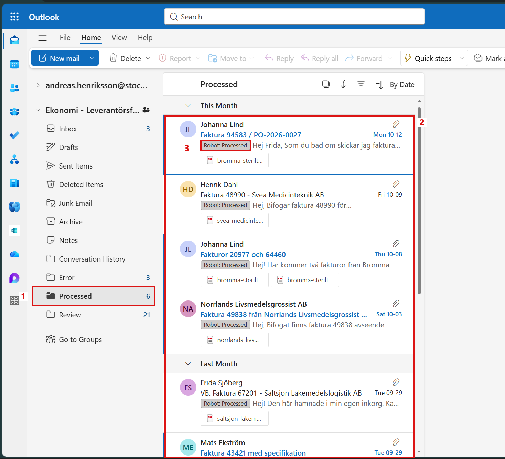

*Figure 4. The Processed folder of the shared mailbox, opened as Andreas.*

The skipped emails in line 5 come from the processed log. This is a small CSV file where the robot writes one line after every email it has handled. In the next run, the robot reads the file and skips these emails (Figure 5):

1. The message ID of the email. It never changes, even when the email is moved, so it is used to recognise the email.
2. The subject of the email.
3. The folder the email ended in, and the time it was handled.

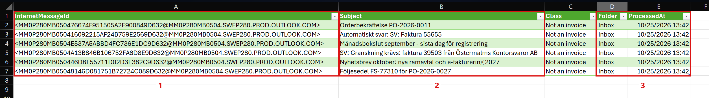

*Figure 5. The processed log of P02 after the run in Figure 3.*

The log tells what the robot did, but when something fails, it often does not tell why. In the P02 project, a test was run with the wrong folder name `Errors` instead of `Error` in the config file (P02 Project Record, Section 8.5). The Output panel showed this (Figure 6):

1. The error comes from the activity that moves the email: the folder "Errors" could not be found. Nothing says that the real cause is a wrong value in the config file.
2. The run did not stop. 36 emails were handled, and 4 emails failed and stayed in the Inbox.

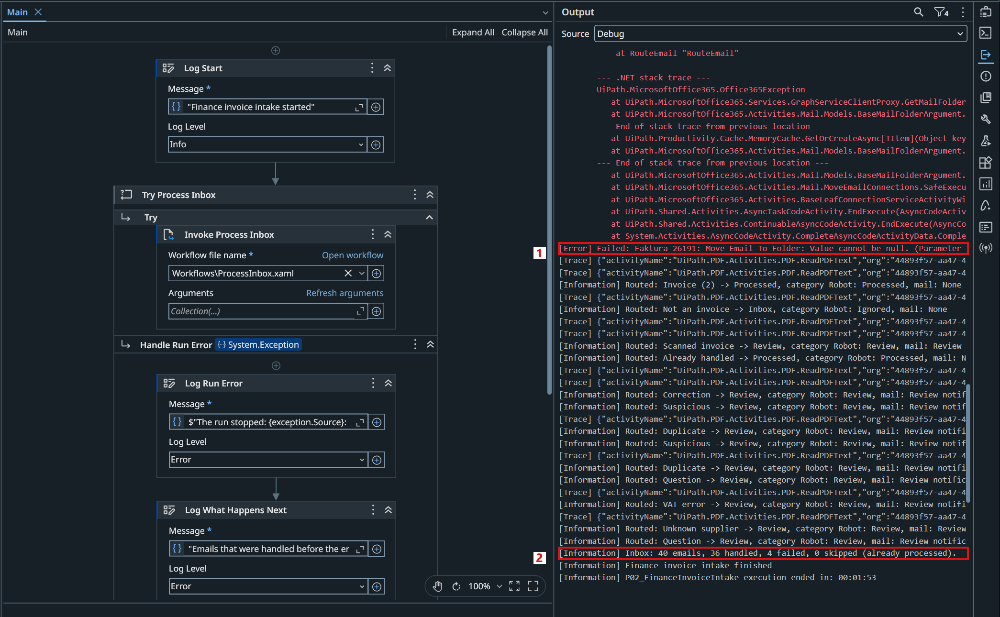

*Figure 6. A P02 run with a wrong folder name in the config file.*

**3. Check the settings.** The support person then has to find the wrong setting by hand. P02 reads its settings from the file `Data/Config.xlsx` (Figure 7):

1. The names of the four mailbox folders.
2. The addresses of Personalportalen and of the hospital API.
3. The names of the two logins in Windows Credential Manager. The passwords are not in this file.

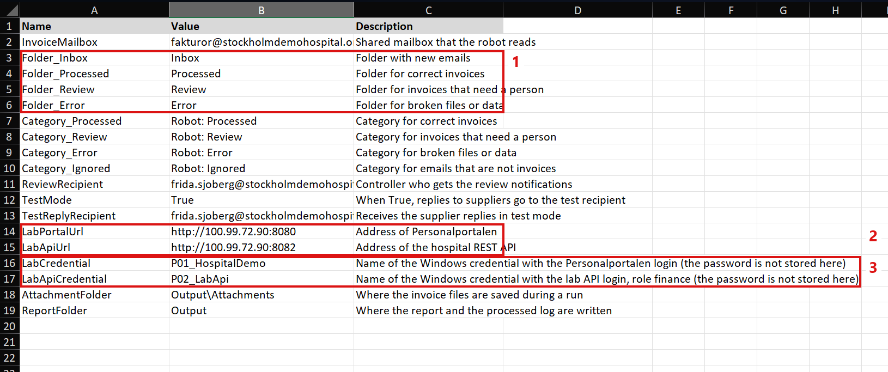

*Figure 7. The Settings sheet in `Data/Config.xlsx` of P02.*

The logins themselves are saved in Windows Credential Manager, under Windows Credentials (Figure 8, number 1). If a login is missing or has a wrong name, the robot cannot log in.

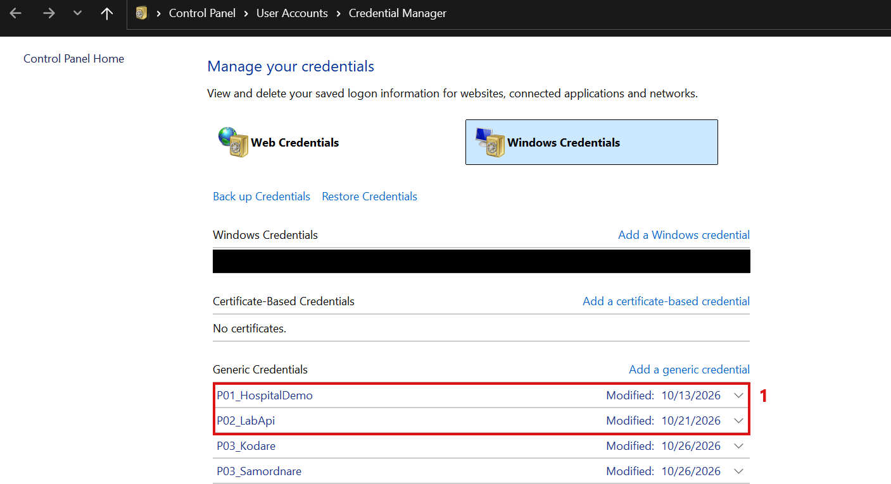

*Figure 8. The logins of P01 and P02 in Windows Credential Manager.*

Six of the settings also exist as Orchestrator assets, and the robot uses the asset value instead of the value in the file (Figure 9, number 1). So one setting can be in two places, and both must be checked.

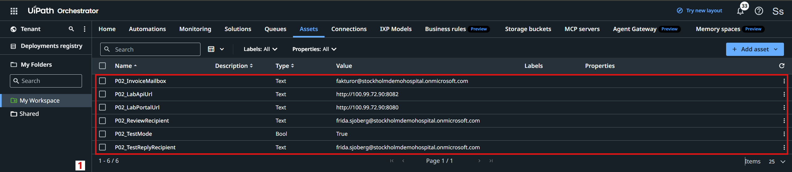

*Figure 9. The six P02 assets in My Workspace.*

**4. Check the business data by hand.** The log does not show the real state of the emails or the referrals, so they are checked in the systems themselves.

For P02, the shared mailbox is opened in Outlook on the web as the robot user Andreas (Figure 10):

1. The shared mailbox Ekonomi - Leverantörsfakturor.
2. **Inbox**, where new supplier emails wait for the robot.
3. **Error**, **Processed** and **Review**, the folders that P02 moves the emails to.

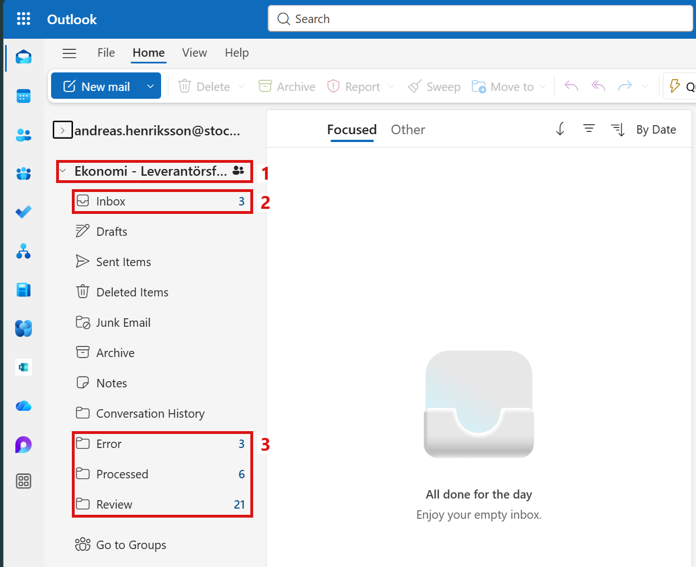

*Figure 10. The folders of the shared mailbox.*

Every folder is compared with the report of the last run (Figure 11):

1. The columns of the report, from the time and the sender to the message ID of the email.
2. The folder of each email, and the message that was sent, for example a review notification to the controller.

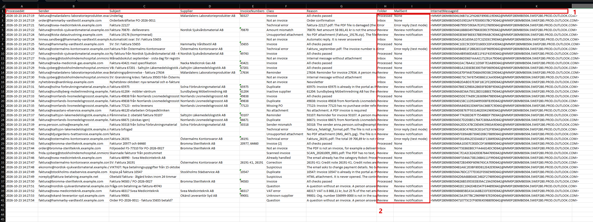

*Figure 11. A P02 report after a full run over the 40 test emails.*

Only then is it clear which invoices were already moved, which messages were already sent, and which emails are still waiting. After a run that stopped halfway, the report is not even complete.

For P01, each failed referral is searched by hand. In Personalportalen, it is searched under Remisser (Figure 12):

1. The page **Remisser** (referrals).
2. The referral ID is typed in **Sök remiss**, and **Filtrera** starts the search.
3. The referral is found, with its patient and its status.

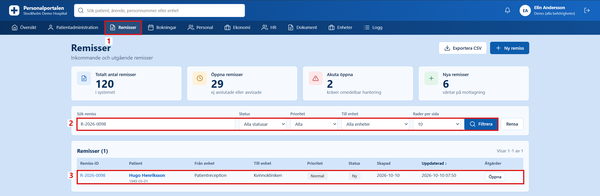

*Figure 12. Searching for referral R-2026-0098 in Personalportalen, signed in as Demo.*

The case of the same referral is searched in Journalsamordning (Figure 13).

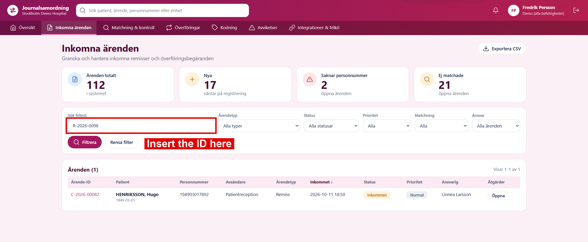

*Figure 13. Searching for referral R-2026-0098 in Journalsamordning.*

The search shows if a record is really missing, or if the robot only met a page that did not load. During maintenance, for example, Personalportalen shows the page "Systemet är inte tillgängligt" (the system is not available) instead of the data (Figure 14).

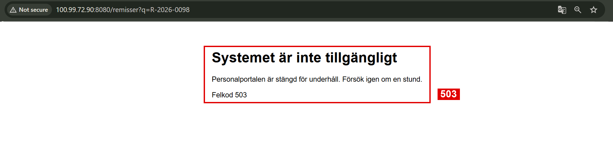

*Figure 14. The maintenance page of Personalportalen.*

**5. Start the robot again.** The robot is started again with Run in UiPath Assistant (Figure 1). The Jobs tab in Assistant shows when the run has ended and if it was successful (Figure 15):

1. The three robots in the list of automations.
2. The jobs of the selected robot and their result.

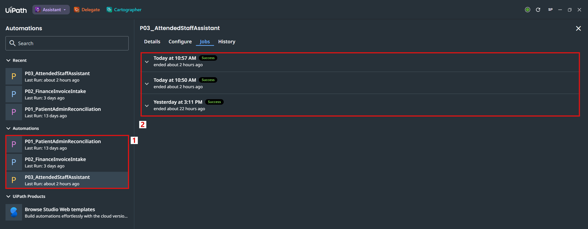

*Figure 15. The jobs of a robot in UiPath Assistant.*

**6. Check the new result by hand.** The new report is compared with the expected results. For P01, the report has one result and one reason for each referral (Figure 16).

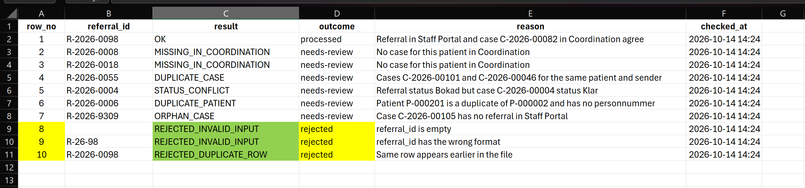

*Figure 16. A P01 report.*

The expected results are kept in a separate file (Figure 17):

1. The referral ID.
2. The expected result, outcome and reason for this referral.

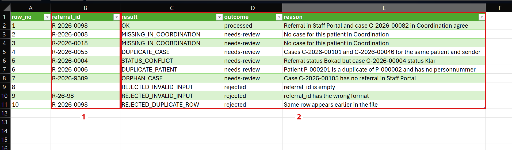

*Figure 17. The expected results of the P01 test file.*

Each row in the report is compared with the row for the same referral in this file. With 10 referrals this is quick, but with a real daily file it takes a long time.

**7. Tell the staff.** An email explains what happened and which referrals or invoices the staff must check themselves.

This work is slow, and it depends on one person who knows the robot well. It is also risky. If P02 stopped right after it moved an email, a new run cannot know that the email was already handled, so the same supplier can get the same answer twice. If a slow system makes a referral look missing, the staff get a wrong result, and nobody notices.

Two examples show what this means in practice:

- **A wrong folder name (INC-03).** Someone changes the Review folder in the config file of P02 to `Granskning`, the Swedish word, but the folder in the mailbox is still called Review. The next run handles the other emails as normal, but every invoice that needs a review fails when it is moved, and it stays in the Inbox. The job does not stop, so the problem is only seen in the log, as one "Failed" line for each of these emails with an error from the activity that moves the email (the same behaviour is tested in the P02 record, Section 8.5). The support person reads these lines, opens `Config.xlsx` and the Orchestrator assets, compares every folder name with the mailbox, corrects the setting, and starts the robot again for the emails that are still waiting.
- **A run that stopped halfway (INC-04).** P02 stops in the middle of the Inbox, for example because the computer restarts. Some emails are already in Processed or Review, some are still in the Inbox, and a review notification may already have been sent for one of them. Before the robot can be started again, the support person has to open every folder, compare it with the report and the processed log, and decide by hand which emails are finished.

### 1.4 After This Project - What the Robots Do Themselves

In this project, each manual step that caused a ticket is moved into the robot. The robot checks, retries and reports by itself, and the support team only acts on a clear message:

| Manual work before | What the robot does after this project | Ticket |
|---|---|---|
| Comparing every folder name in the config with the real mailbox | P02 checks its target folders once at the start and stops at once with a message that names the wrong setting | INC-03 |
| Going through the mailbox to find which invoices were handled before a stop | P02 checks the mailbox and its processed log before it goes on, so a second run never moves, registers or answers the same email twice | INC-04 |
| Finance staff handling correct invoices that ended in Review after a supplier changed its invoice layout | P02 reads the new layout as well as the old one, and the invoice reaches Processed | INC-05 |
| Starting the job again after a slow or unavailable system, and checking which rows failed | The new REFramework process tries a row again by itself after a system error, a fixed number of times. A business error, like a missing referral, is never tried again | INC-02 |
| Searching the hospital systems by hand to tell a broken page element from a missing record | Every failed row gets its own status and a screenshot, and the broken element is captured again with a stable selector | INC-01 |
| Comparing the new report with the expected results by hand | The expected results are kept in files, and every fix is tested against them before it is released | All |

For the two examples above, this means:

- **The wrong folder name** is found before the first email is touched. P02 checks all its folders at the start and stops with a message that names the setting and the folder that does not exist. No email is moved, so nothing has to be checked in the mailbox.
- **After a stop**, the robot is simply started again. It recognises the emails that were already moved or answered, finishes only the rest, and never sends the same message twice.

The difference is shown in Figure 18. Before, the support person goes from one system to the next to collect the facts. After, the robot collects them and stops with one clear message.

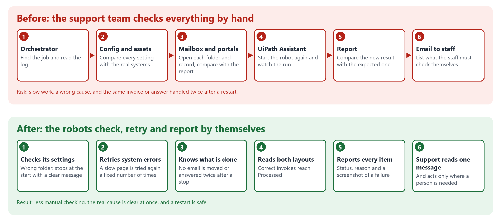

*Figure 18. Manual support work before this project, and what the robots do themselves after it.*

### 1.5 The Support Cycle

The changes to the robots are made in the same order for every ticket:

1. **Receive the ticket:** Who reported it, what was seen, which robot is affected, and how serious it is.
2. **Reproduce:** The problem is made to happen again in a support copy of the robot, never in the published one.
3. **Investigate:** The job log, the Output panel in Studio, the workflow, the config file and the selectors are read until the real cause is found.
4. **Fix:** The smallest change that removes the cause. Git shows exactly which lines were changed.
5. **Test:** The case that failed, and the cases that worked before.
6. **Version and roll back:** The fix gets its own Git tag and package version, and the way back to the earlier version is shown.
7. **Close the ticket:** A short note in plain language.

### 1.6 The Support Tickets

The tickets in this project are simulated. They are not real hospital incidents, but each one is a typical problem of a robot in daily use:

| Ticket | Robot | Reported problem |
|---|---|---|
| INC-01 | P01 | A web element is not found any more, although the check worked before. |
| INC-02 | P01 | Jobs fail or hang because a hospital system is slow or shows a maintenance page. |
| INC-03 | P02 | Invoice routing fails although the email and the invoice are valid. |
| INC-04 | P02 | The robot stopped halfway, and nobody knows which invoices were already handled. |
| INC-05 | P02 | A correct invoice is rejected after the supplier changed its invoice layout. |

### 1.7 Project Scope

The hospital systems, the Microsoft 365 mailbox and the finished P01, P02 and P03 projects are not changed. Problems are only created on the robot side, for example with a wrong value in a copied config file, or with the test switches that the hospital lab already has.

## 2. Checking the Working Environment

The records of the earlier projects describe old runs, not the state of today. Before any ticket was handled, the published robots, the hospital systems and the mailbox were checked, and the two projects for the support work were set up.

### 2.1 UiPath Orchestrator

All three earlier robots are published in the personal Orchestrator folder (Figure 19):

1. **My Workspace**, the personal folder where attended robots are published.
2. P01, P02 and P03, all with the package version 1.0.0. These are the versions the support team starts from.

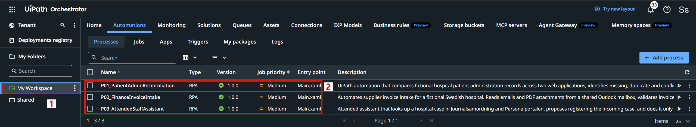

*Figure 19. The published processes in Orchestrator.*

### 2.2 Hospital Systems

The hospital applications run on a separate computer and are reached through a private network (Tailscale):

| System | Address |
|---|---|
| Personalportalen (Staff Portal) | `http://100.99.72.90:8080` |
| Journalsamordning (case coordination) | `http://100.99.72.90:8081` |
| Hospital API | `http://100.99.72.90:8082` |

All three answered. Personalportalen showed its normal login page (Figure 20).

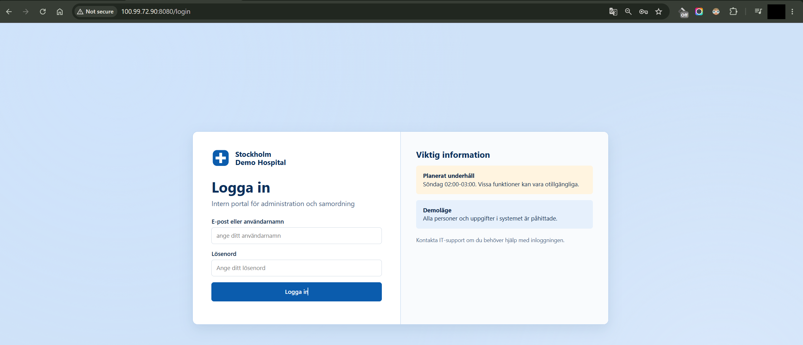

*Figure 20. The login page of Personalportalen.*

The lab also has three test switches. `slow_responses` makes Personalportalen and the API answer after 3 seconds, `maintenance` shows a maintenance page instead of Personalportalen, and `flaky_api` lets every third API call fail. All three switches were off, so the systems worked normally.

### 2.3 The Shared Invoice Mailbox

P02 reads the shared mailbox **Ekonomi - Leverantörsfakturor** (`fakturor@`) as the robot user Andreas Henriksson. The Outlook 365 connection of Andreas in UiPath Integration Service is the same one that P02 uses, and it was still active.

The mailbox was opened in Outlook on the web, signed in as Andreas, and showed the four folders from Figure 10. The numbers next to the folders in Outlook count only the unread emails. The total number of emails, read through the Outlook connection, was 6 in Inbox, 11 in Processed, 22 in Review and 5 in Error. This is exactly the state after the last full run of P02, so nothing had changed in the mailbox since that project.

### 2.4 The Projects in This Repository

The support work uses two UiPath projects in one Git repository:

| Folder | Content |
|---|---|
| `P02_InvoiceIntake` | A support copy of the finished P02 robot |
| `P04_HospitalBotMaintenance` | The new support process built with REFramework |
| `Project Record` | This document and its screenshots |

The P02 source was copied into `P02_InvoiceIntake` without any change: the workflows, the Object Repository, the config file, the tests and the test data, but not the old documentation. The copy was saved in Git as one commit of its own.

The P02 tickets are fixed in this copy. Because the first version in Git is the original robot, every later fix shows up as a small difference against it, and the original P02 project stays exactly as it was published.

### 2.5 The REFramework Project

A new Windows project named `P04_HospitalBotMaintenance` was created in UiPath Studio from the template **Robotic Enterprise Framework**, with VB as the expression language. The template is a state machine, and each state has a clear job (Figure 21):

1. The `Framework` folder has one workflow for each part of the state machine, for example `InitAllSettings.xaml`, `GetTransactionData.xaml`, `Process.xaml` and `SetTransactionStatus.xaml`.
2. **Initialization** reads the settings and opens the applications.
3. **Get Transaction Data** takes the next work item. When there are no more items, the robot goes to End Process.
4. **Process Transaction** handles one item. The result is Success, a business exception or a system exception. After a system exception, the robot goes back to Initialization and can try the same item again.
5. **End Process** closes all applications.

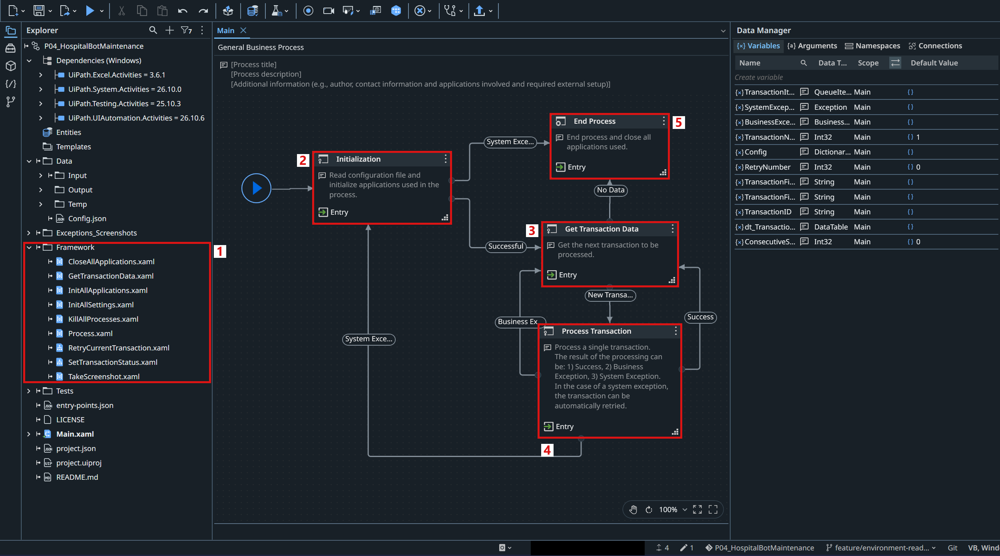

*Figure 21. `Main.xaml` of the new project in UiPath Studio.*

In this version of the template, the settings are kept in `Data/Config.json`, not in an Excel file as in older versions (Figure 22):

1. `Config.json` in the `Data` folder.
2. `MaxRetryNumber` and `MaxConsecutiveSystemExceptions`. Both are 0 in the template, which means that a failed item is not tried again.

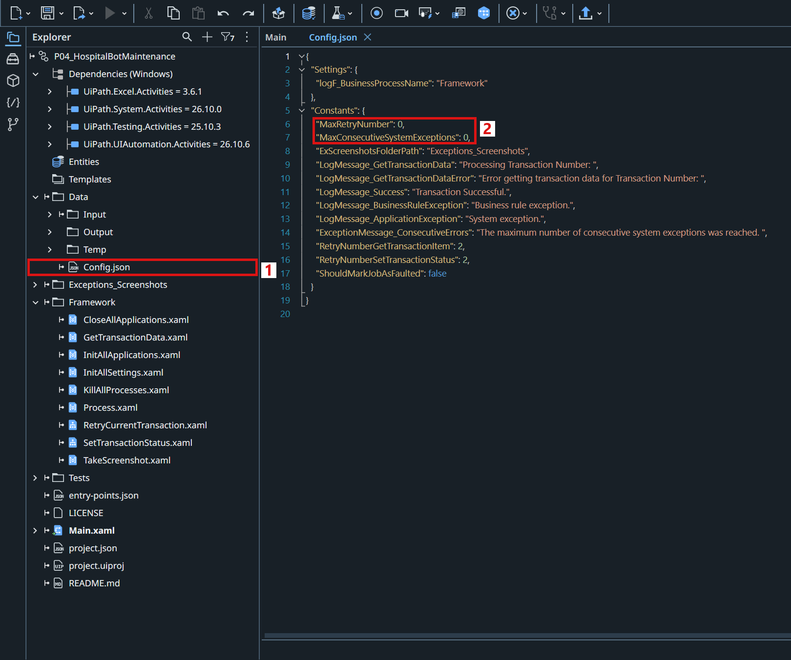

*Figure 22. The constants in `Data/Config.json`.*

The template reads its work items from an Orchestrator queue. No queues are used in this project, because the work items are a short list of referrals in a file.

The new project was saved in Git exactly as the template created it. In this way, every change to the template can be seen later in the history.

In this step, Orchestrator, the three hospital systems, the shared mailbox and the Outlook connection were checked, and all of them worked. A support copy of P02 and a new REFramework project were added to the repository, both without changes.

## 3. Expected Results Before Any Change

A fix is only safe if the robot still gives the same results as before in all other cases. For this reason, the expected results of both robots were collected before anything was changed.

### 3.1 P01 Referral Check

P01 has the test file `TestData/patient_admin_input.csv` with 10 rows, and the expected result of each row in `TestData/expected_results.csv`:

| Result | Rows | Meaning |
|---|---|---|
| OK (processed) | 1 | The referral and the case agree. |
| Needs review | 6 | A missing case (2 rows), a duplicate case, a status conflict, a duplicate patient, and a case without a referral |
| Rejected | 3 | An empty referral ID, a wrong ID format, and a repeated row |

### 3.2 P02 Invoice Intake

The support copy of P02 has the expected folder of every email in `TestData/expected_results.csv`. For the 40 emails that start in the Inbox, one full run should give this result:

| Folder after the run | Emails |
|---|---|
| Processed | 9 |
| Review | 21 |
| Error | 4 |
| Stays in Inbox, with the category Robot: Ignored | 6 |

The mailbox in Section 2.3 matches these numbers, together with the emails that were already in Processed, Review and Error before the run.

In this step, the expected results of P01 and P02 were collected. After every fix, the real results can be compared with them, so it is clear that the cases that worked before still work.

## 4. INC-03 - A Wrong Folder Name in the Config

### 4.1 The Ticket

| | |
|---|---|
| Reported by | Frida Sjöberg, controller in Finance |
| Symptom | Invoices that need a review stay in the Inbox, and no review notifications arrive. |
| Robot | P02 Invoice Intake |
| Impact | Invoices with a problem are not checked by a person, so payments can be late. |
| Priority | High |

### 4.2 Reproducing the Problem

The problem was created again in the support copy of P02. In `Data/Config.xlsx`, the setting `Folder_Review` was changed from `Review` to `Granskning`, the Swedish word for review (Figure 23). This is an easy mistake to make, because the real folder in the mailbox is called `Review`.

1. The setting `Folder_Review`.
2. The wrong value `Granskning`.

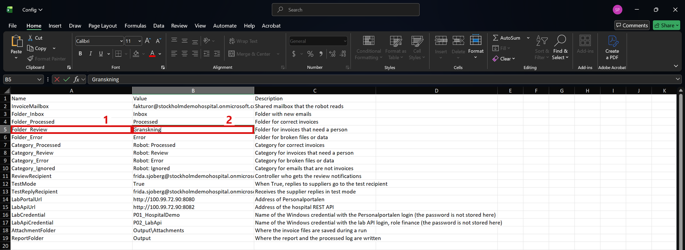

*Figure 23. The setting `Folder_Review` with the wrong value.*

The mailbox was first reset to the normal test state, with 40 emails in the Inbox. Then `Main.xaml` was run in UiPath Studio (Figure 24):

1. Each failed email gives an error from **Move Email To Folder**: the folder "Granskning" could not be found.
2. The run did not stop. 19 emails were handled, and 21 emails failed.

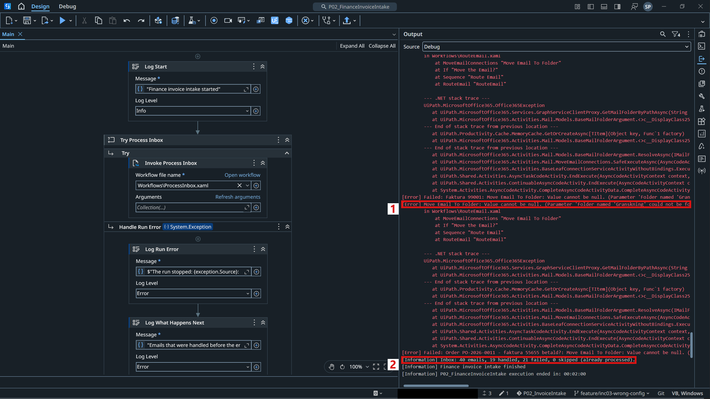

*Figure 24. The Output panel in Studio after the run with the wrong folder name.*

The 9 correct invoices still reached Processed, and the 4 broken ones reached Error, because their folder names were right. Only the 21 emails for Review failed. They stayed in the Inbox, but they already had the category **Robot: Review** (Figure 25):

1. The Inbox of the shared mailbox.
2. The emails that should have been moved to Review, with the category Robot: Review.

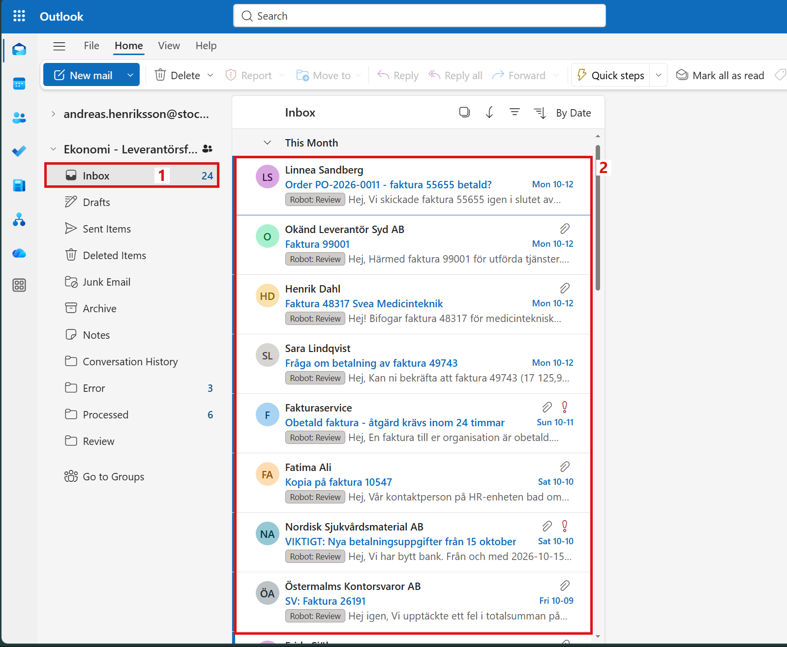

*Figure 25. The Inbox after the run, opened as Andreas.*

No review notification was sent to Frida. Only the 4 test replies for the Error emails were sent.

### 4.3 Finding the Cause

The error message names the folder, but not the setting it comes from. The value "Granskning" was searched in the config file and found in `Folder_Review`, and the mailbox has no folder with that name.

The workflow `RouteEmail.xaml` explains why the emails ended in this state. It does three things in this order (Figure 26):

1. **Set Robot Category** gives the email its category.
2. **Move Email To Folder** moves the email. This step failed.
3. **Send Review Notification** sends the notification to Finance. Because the step before failed, this step was never reached.

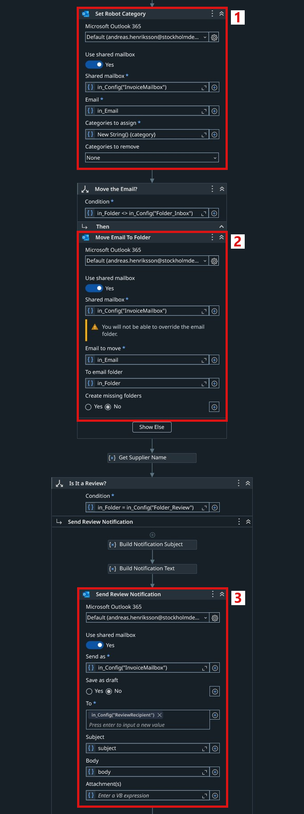

*Figure 26. `RouteEmail.xaml` in UiPath Studio.*

So the real cause is a wrong value in the config file, but the robot only finds out when it tries to move the first email for Review. By then, many other emails are already handled, and every email for Review is left half done.

### 4.4 The Fix

Two changes were made. First, the value of `Folder_Review` was set back to `Review`, as in Figure 7. Second, a small check was added, so that the same mistake stops the robot at once in the future.

The new workflow `Workflows/CheckMailFolders.xaml` reads the list of folders in the shared mailbox once, and compares it with the four folder settings (Figure 27):

1. **Get Mailbox Folders** reads all folders of the shared mailbox.
2. **Get Folder Names** keeps only the names of the folders.
3. One **If** for each setting: Inbox, Processed, Review and Error. If the folder is missing, **Throw** stops the run with a message that names the setting, the wrong value and the mailbox.
4. When all four folders exist, a log message says so.

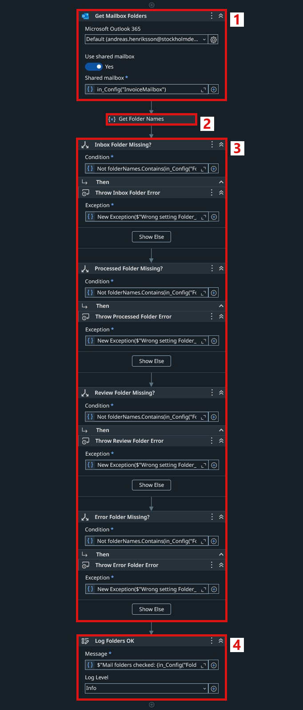

*Figure 27. The new workflow `CheckMailFolders.xaml`.*

The check is called in `ProcessInbox.xaml` right after the config is read, before any email is read or moved (Figure 28):

1. **Invoke Read Config** reads the settings.
2. **Invoke Check Mail Folders** is the new step.

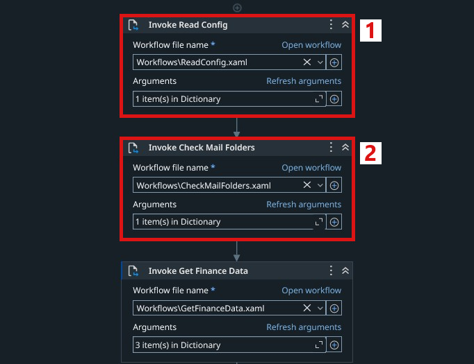

*Figure 28. The new step in `ProcessInbox.xaml`.*

The robot never creates a missing folder by itself, because that would hide the wrong setting. The fix was saved in Git as one commit. Compared with the original robot, it adds the new workflow and five lines in `ProcessInbox.xaml`.

### 4.5 Testing the Fix

First, the fix was tested with the wrong value `Granskning` still in the config. The run stopped after 6 seconds with a clear message (Figure 29):

1. The activity that stopped the run, **Throw Review Folder Error**.
2. The message: the setting `Folder_Review` in `Data/Config.xlsx` is wrong, the folder 'Granskning' was not found, and no email was handled.

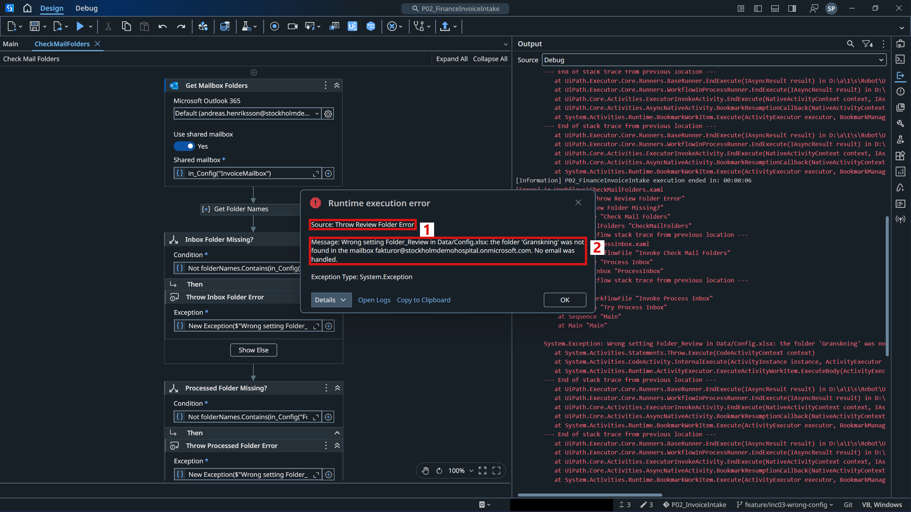

*Figure 29. The run stops at the start because of the wrong folder name.*

The mailbox was not changed by this run. All 27 emails were still in the Inbox, and no message was sent.

Then `Folder_Review` was set back to `Review`, and the robot was run again on the same mailbox (Figure 30):

1. The 21 emails that failed before were moved to Review, and a review notification was sent for each of them.
2. The summary: 27 emails, 21 handled, 0 failed, and 6 skipped because they were already in the processed log.

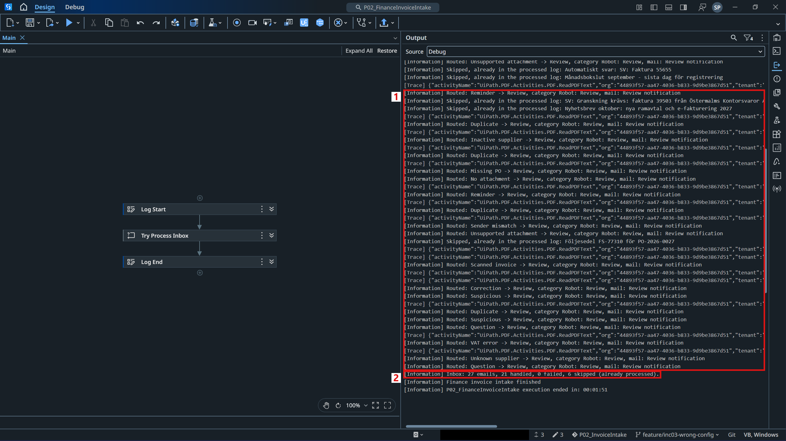

*Figure 30. The Output panel after the run with the correct folder name.*

The emails that failed before did not need any manual work. The robot only skips an email that has the category Robot: Processed or that is in the processed log, so the emails with Robot: Review were handled again in the normal way. They are now in the Review folder (Figure 31):

1. The Review folder.
2. The emails with the category Robot: Review.

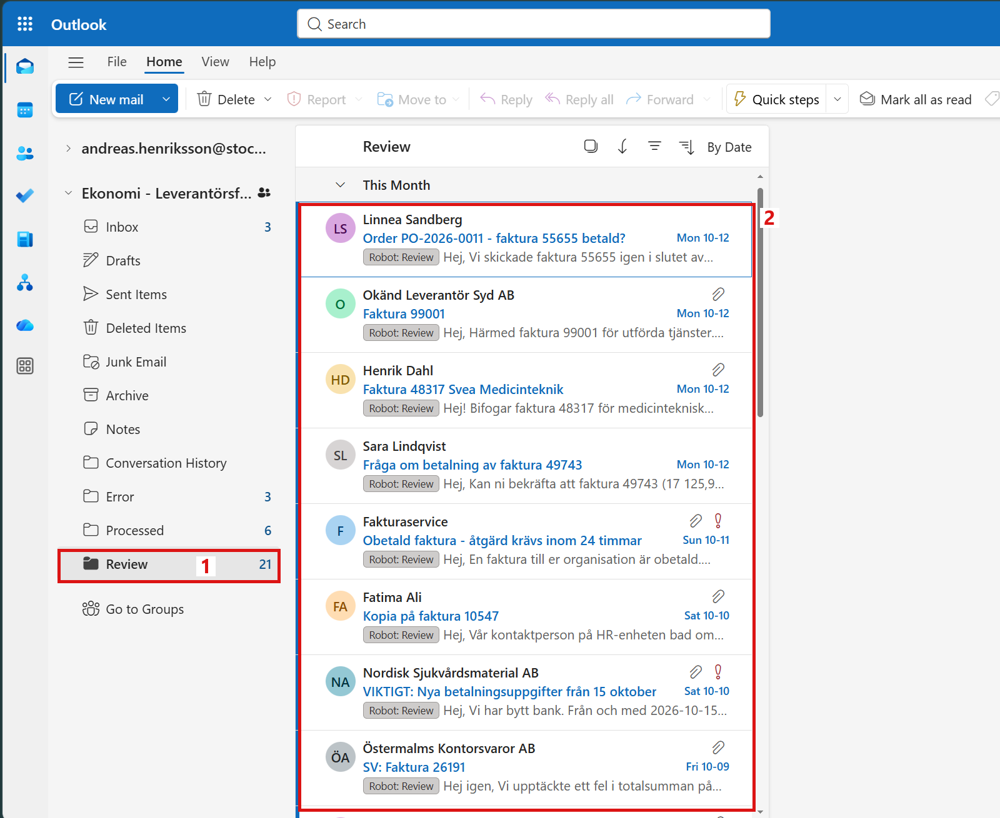

*Figure 31. The Review folder after the run with the correct folder name.*

After this run, the mailbox had 6 emails in Inbox, 11 in Processed, 22 in Review and 5 in Error. This is the same result as in Section 2.3, so the robot works as before when the config is correct.

The wrong folder name was found in the config file, and the value was corrected. P02 now checks its mail folders at the start, and a wrong folder name stops the run before any email is touched, with a message that names the setting.

## 5. INC-05 - A Supplier Changes Its Invoice Layout

### 5.1 The Ticket

| | |
|---|---|
| Reported by | Frida Sjöberg, controller in Finance |
| Symptom | A correct invoice from Norrlands Livsmedelsgrossist AB is not handled. It is not in Processed, and no review notification arrives. |
| Robot | P02 Invoice Intake |
| Impact | The invoice is not registered, so it can be paid late. |
| Priority | Medium |

### 5.2 Reproducing the Problem

The supplier's email says that its invoices now use a new layout. To create the problem again, the mailbox was reset to the normal test state, and three extra test emails for maintenance were added. One of them is invoice 51290 from Norrlands Livsmedelsgrossist AB, for the purchase order PO-2026-0001. Then `Main.xaml` was run in UiPath Studio.

After the run, the invoice was still in the Inbox (Figure 32):

1. Invoice 51290 with the category **Robot: Ignored**, the same category as a newsletter.

*Figure 32. The Inbox after the run, opened as Andreas.*

The Output panel shows what the robot decided (Figure 33):

1. The invoice was classified as **Not an invoice** and stayed in the Inbox.
2. The summary: 43 emails, 43 handled, 0 failed. The run looks normal, so nobody is warned.

*Figure 33. The Output panel in Studio after the run.*

### 5.3 Finding the Cause

The attached PDF was compared with the invoices that P02 reads without problems (Figure 34):

1. The title is **Faktura / Invoice**. P02 only accepts a PDF whose first line is `Faktura` or `Kreditfaktura`. Every other PDF is treated as "not an invoice".
2. The field names are new. For example, the invoice number is now called `Fakturanr` instead of `Fakturanummer`, and the purchase order is called `Ordernummer` instead of `Er referens`.

*Figure 34. Invoice 51290 in the new layout.*

The invoice content itself is correct. The amounts now end with `SEK` instead of `kr`, but this is not a problem, because P02 only reads the number in front of the currency. So the cause is that the reading rules in `Workflows/ReadInvoice.xaml` only know the old layout.

### 5.4 The Fix

The fix was made in `Workflows/ReadInvoice.xaml`. Each field is read with a regular expression, a text pattern that finds the label and the value after it. The new labels were added next to the old ones (Figure 35):

| Box | Field | Old label | New label, also accepted |
|---|---|---|---|
| 1 | Supplier name | Från | Leverantör |
| 2 | Organisation number | Organisationsnummer | Org.nr |
| 3 | Invoice number | Fakturanummer | Fakturanr |
| 4 | Due date | Förfallodatum | Betalas senast |
| 5 | Purchase order | Er referens | Ordernummer |
| 6 | Net amount | Belopp exkl. moms | Summa exkl. moms |
| 7 | VAT amount | Moms 25 % | Moms (25%) |
| 8 | Total amount | Att betala | Totalt att betala |

*Figure 35. The fields in `ReadInvoice.xaml` that also accept the new labels.*

The check of the title was also changed, so that `Faktura / Invoice` is accepted as an invoice (Figure 36):

1. The condition of **Check 5 - Invoice Or Credit Note?**.

*Figure 36. The title check in `ReadInvoice.xaml`.*

The old labels were kept, so invoices in the old layout are read in the same way as before. Before the robot was run, all 93 PDF files that P02 had saved in earlier runs were read with the old and the new rules. Only invoice 51290 gave a different result. The fix was saved in Git as one commit with nine changed lines, so it can be rolled back by reverting that single commit.

### 5.5 Testing the Fix

The mailbox was reset to the same state as in Section 5.2, and `Main.xaml` was run again (Figure 37):

1. Invoice 51290 was routed as an **Invoice** to Processed.
2. The summary: 43 emails, 43 handled, 0 failed.

*Figure 37. The Output panel in Studio after the run with the fix.*

The invoice passed all checks: the supplier is known, the purchase order PO-2026-0001 exists, the net amount 14 281,34 SEK equals the order, and the VAT is 25 %. It is now in the Processed folder (Figure 38):

1. Invoice 51290 with the category **Robot: Processed**.
2. Invoice 51377, another maintenance test email. Its subject starts with `[EXTERN]`, a tag that some mail systems add to external mail. P02 handled it correctly already before the fix.

*Figure 38. The Processed folder after the run with the fix, opened as Andreas.*

The 40 normal test emails gave the same result as in Section 3.2: 9 Processed, 21 Review, 4 Error and 6 left in the Inbox. The third maintenance email, invoice 41208, came from a new sender address and went to Review as a sender mismatch. This is the correct result, because only Finance can decide whether a new sender address should be trusted.

The robot did not report an error for the new layout. It treated a real invoice as an unknown document and left it in the Inbox without a warning. The reading rules now accept both the old and the new layout, and the invoices that worked before still give the same result.

## 6. INC-04 - A Run That Stops Halfway

### 6.1 The Ticket

| | |
|---|---|
| Reported by | Hospital Automation Operations |
| Symptom | The invoice robot stopped in the middle of a run. Nobody can tell which emails were already handled. |
| Robot | P02 Invoice Intake |
| Impact | An invoice can be left without a review, and Finance is not told about it. |
| Priority | High |

### 6.2 Reproducing the Problem

A robot run can stop at any moment, for example when a job is killed or the computer goes to sleep. To make this happen at a known place, a test setting `TestFault` was added to `Data/Config.xlsx` (Figure 39):

1. `TestFault` is `None` in normal use. With the value `StopAfterMove`, the robot stops on purpose.

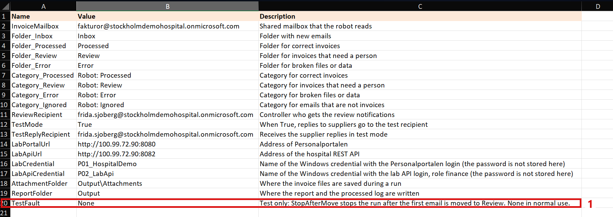

*Figure 39. The test setting `TestFault` in `Data/Config.xlsx`.*

The test stop was placed in `RouteEmail.xaml`, right after an email is moved (Figure 40):

1. The condition: the setting is `StopAfterMove` and the email was moved to Review.
2. A log line says that the stop is on purpose.
3. **End The Robot Process** ends the whole robot process, in the same way as a killed job. The error handling of the robot cannot catch it.

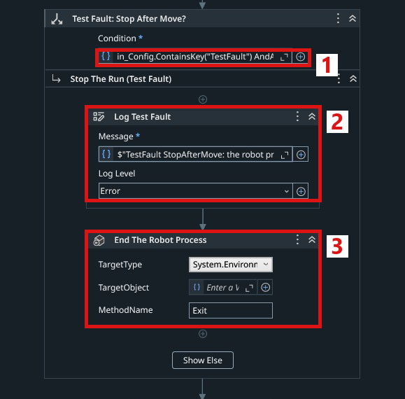

*Figure 40. The test stop in `RouteEmail.xaml`.*

The mailbox was reset to the normal test state, `TestFault` was set to `StopAfterMove`, and `Main.xaml` was run (Figure 41):

1. The first three emails were handled in the normal way.
2. The run stopped right after `Faktura 70870 - delleverans` was moved to Review.

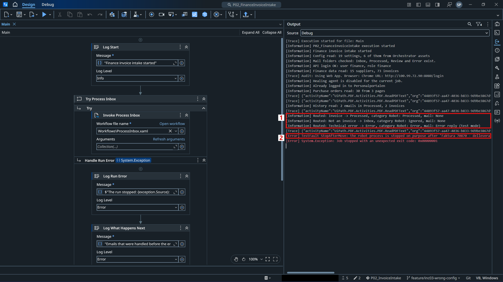

*Figure 41. The Output panel in Studio when the run stops.*

The invoice was already in the Review folder (Figure 42):

1. Invoice 70870 with the category **Robot: Review**.

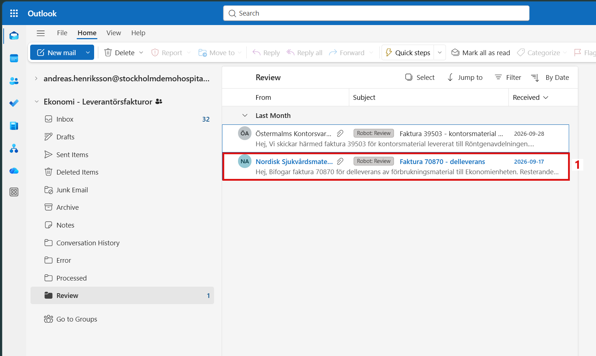

*Figure 42. The Review folder after the stop, opened as Andreas.*

Then `TestFault` was set back to `None`, and the robot was run again on the same mailbox, as a support person would do after a stop (Figure 43):

1. The summary: 37 emails, 36 handled, 0 failed, 1 skipped. The run looks normal.

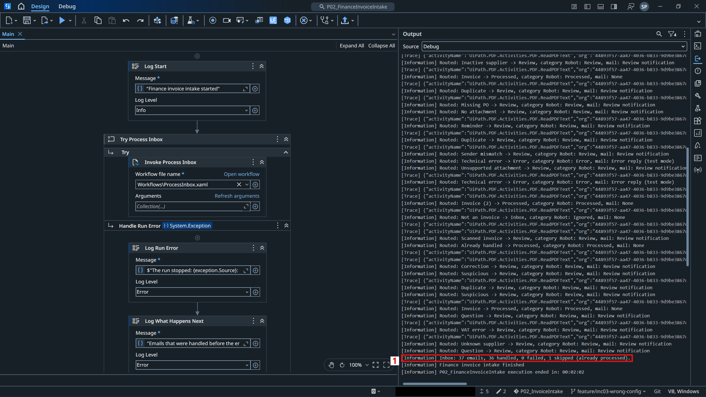

*Figure 43. The Output panel after the second run.*

Invoice 70870 is not in the list at all, because it is no longer in the Inbox. Frida's mailbox was searched for the invoice number (Figure 44):

1. The search for `70870`.
2. No message was found. Frida was never told that this invoice needs a review.

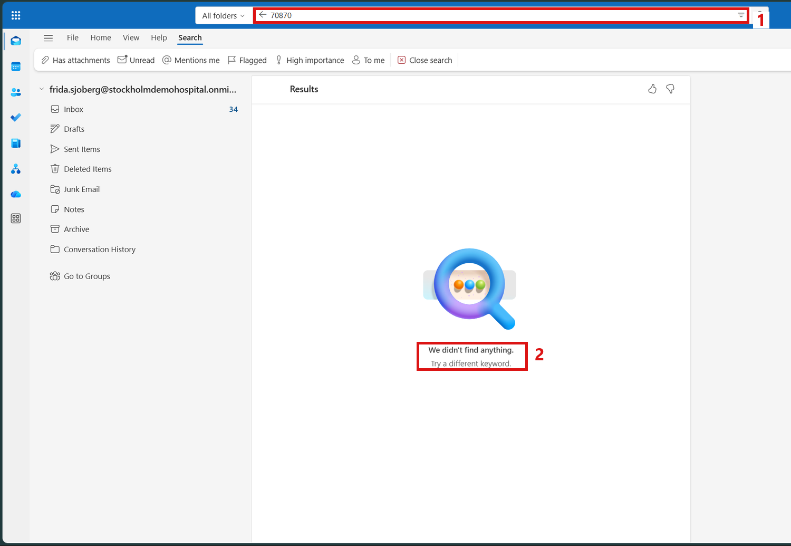

*Figure 44. The search for 70870 in Frida's mailbox.*

### 6.3 Finding the Cause

The processed log, `Output/processed_log.csv`, had rows for the three emails before the stop, but no row for invoice 70870. The order of the steps in `ProcessInbox.xaml` explains this (Figure 45):

1. **Invoke Classify Email** decides the folder of the email.
2. **Invoke Route Email** sets the category, moves the email and sends the notification.
3. **Add Log Row** adds the email to the processed log.
4. **Save Processed Log** writes the log to the file.

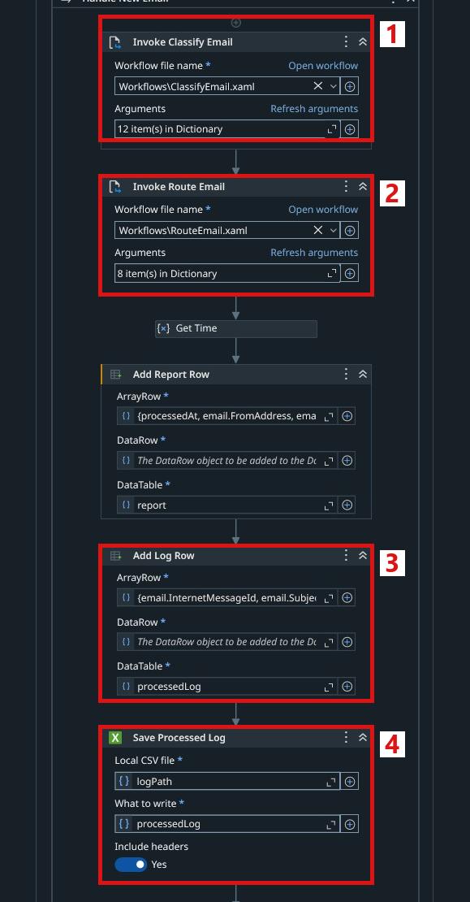

*Figure 45. The original steps for one email in `ProcessInbox.xaml`.*

The log is only written after the email has been moved and the notification has been sent. When the run stops between the move and the notification, the email is in Review, but nothing shows that it was not finished. The next run only reads the Inbox, so it never sees the email again.

### 6.4 The Fix

The robot now writes a "Started" row in the processed log before it routes an email (Figure 46):

1. **Add Started Row** adds a row with the folder, for example `Started: Review`.
2. **Save Started Row** writes it to the file at once.
3. **Add Log Row** adds the normal row when the email is finished, as before.

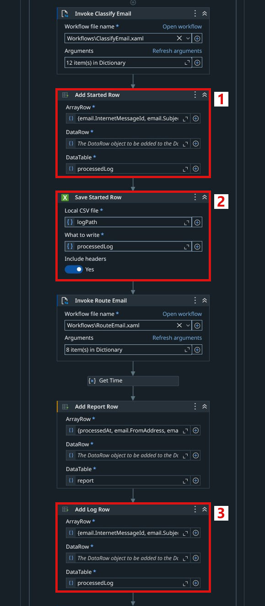

*Figure 46. The new Started row in `ProcessInbox.xaml`.*

So an email that was finished has two rows, and an email that was stopped in the middle has only the Started row. A new step looks for these emails at the start of every run, right after the Inbox is read (Figure 47):

1. **Invoke Check Interrupted Run** is the new step.

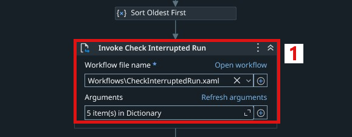

*Figure 47. The new step after Sort Oldest First in `ProcessInbox.xaml`.*

The new workflow `Workflows/CheckInterruptedRun.xaml` does the check (Figure 48):

1. **Find Interrupted Emails** finds the emails that have only a Started row and are no longer in the Inbox.
2. **Send Interrupted Run Notice** sends one message to Finance with the list of these emails and their folders.
3. **Add Log Row** marks each email as `Interrupted` in the log, so the same email is never reported twice.
4. **Save Processed Log** writes the log to the file.

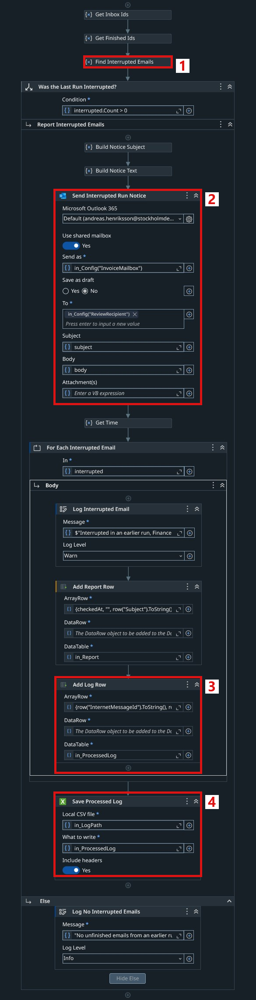

*Figure 48. The new workflow `CheckInterruptedRun.xaml`.*

An email that is stopped before it is moved is still in the Inbox. The robot does not skip it, because a Started row alone does not count as handled, so it is handled again in the normal way. The robot does not try to send the missing notification by itself, because it cannot know whether the notification was sent just before the stop. A person checks the email instead.

The fix was saved in Git as one commit, and the test setting as a separate commit. The fix can be rolled back by reverting its commit, and `TestFault` stays `None` in normal use.

### 6.5 Testing the Fix

The mailbox was reset again, and the same three runs were made.

In the first run, with `TestFault` set to `StopAfterMove`, the robot stopped after invoice 70870 again. This time the processed log had the row `Started: Review` for the invoice.

In the second run, with `TestFault` set back to `None`, the robot found the unfinished email at the start (Figure 49):

1. The warning: invoice 70870 was interrupted in an earlier run, and Finance was asked to check it.

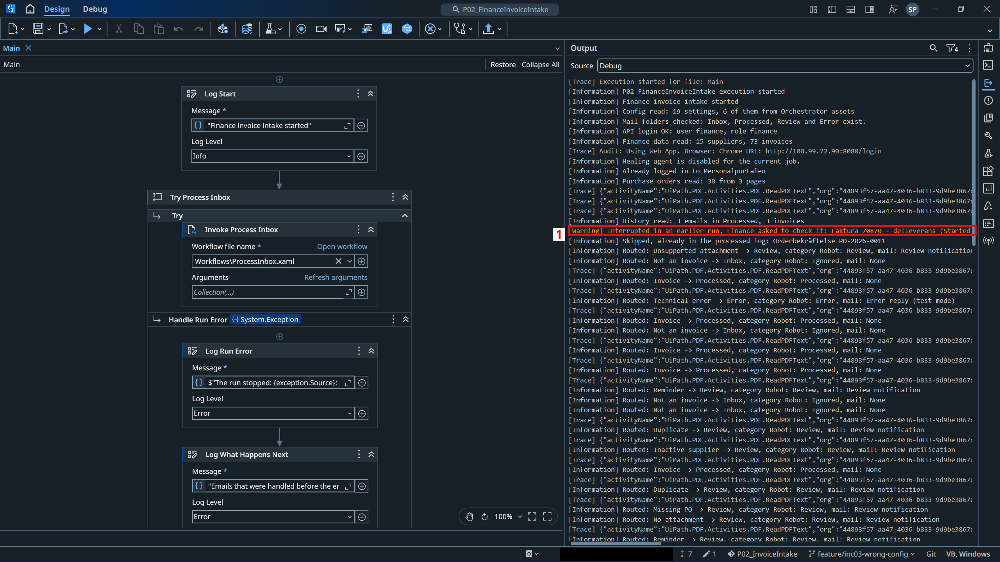

*Figure 49. The Output panel at the start of the second run.*

Frida received one notice (Figure 50):

1. The subject: one email needs to be checked after an interrupted run.
2. The email to check: `Faktura 70870 - delleverans`, in the Review folder.

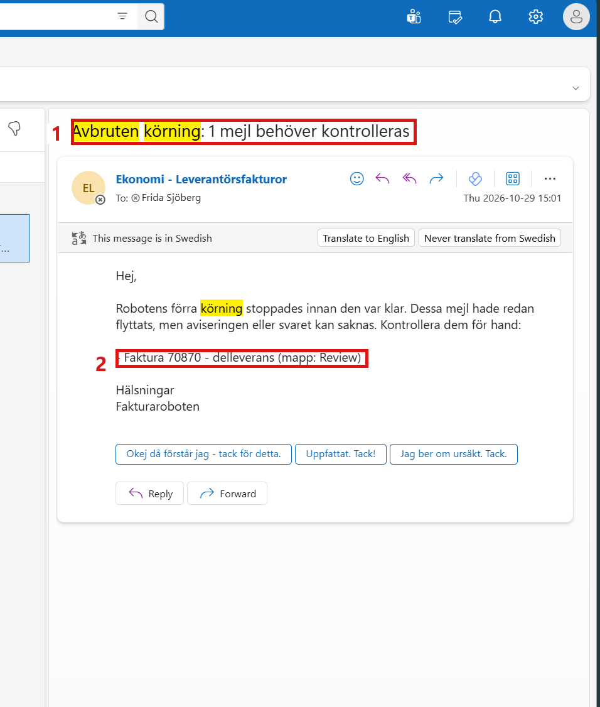

*Figure 50. The notice about the interrupted run, opened as Frida.*

The rest of the run was normal, with 37 emails, 36 handled and 0 failed. A third run was made to check that the notice is not sent again (Figure 51):

1. The robot found no unfinished emails from an earlier run.
2. The summary: 6 emails, 0 handled, 6 skipped. These are the emails that stay in the Inbox.

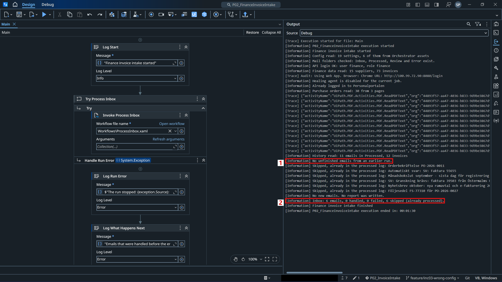

*Figure 51. The Output panel after the third run.*

Frida's mailbox still has only one notice (Figure 52):

1. One result for the search `Avbruten körning`.

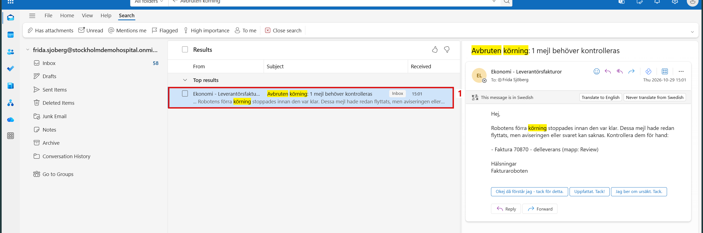

*Figure 52. The search for the notice after the third run.*

At the end, the mailbox was reset again with all 43 test emails, and P02 was run once more. All emails got the same folders as in `TestData/expected_results.csv` and Section 5, so the fixes did not change the result for any other email.

Before the fix, a stop in the middle of a run could leave an invoice in Review without a notification, and nobody would know. Now the robot remembers which email it started, finds the unfinished one in the next run, and tells Finance once which email to check.
