# P05 - Outlook Rules Keep the Robot's Inbox Clean

## 1. Project Goal

The goal of this project is to keep the mailbox of a hospital robot free from automatic replies. The finance robot of the hospital reads supplier invoices from a shared mailbox and answers suppliers when an invoice cannot be used. Many of the answers that come back are not written by a person: out-of-office replies and messages about addresses that no longer exist.

The project shows how an Outlook rule on the mailbox sorts these messages out before the robot reads the Inbox, so that the robot only sees real supplier mail. All data in this project is fictional.

## 2. The Invoice Robot and Its Mailbox

The Finance department of the hospital receives supplier invoices in the shared mailbox **Ekonomi - Leverantörsfakturor**. An invoice robot, built in UiPath Studio, reads every email in the Inbox, checks the invoice, and moves the email to one of three folders:

- **Processed:** the invoice is correct and can be paid.
- **Review:** a person must look at the email. The robot sends a review notification to the controller, Frida Sjöberg.
- **Error:** the invoice file is broken. The robot answers the supplier and asks for a new invoice.

Emails that are clearly not invoices, such as newsletters, stay in the Inbox with the category **Robot: Ignored**.

The robot writes to many suppliers, and many of these emails are answered again, but not by a person. When a supplier contact is on holiday, an out-of-office reply comes back. When an old supplier address no longer exists, the mail server of the supplier sends back a bounce message. Between 25 September and 12 October, 35 such automatic emails came back to the Inbox, next to the real invoices.

The numbers in Figure 1 match these parts of the Inbox:

1. The shared mailbox **Ekonomi - Leverantörsfakturor** and its **Inbox**, with 68 unread emails.
2. A real supplier invoice, with the PDF attached.
3. An English out-of-office reply, "Automatic reply: SV: Faktura 93107".
4. A Swedish out-of-office reply, "Autosvar: SV: Faktura 85230".

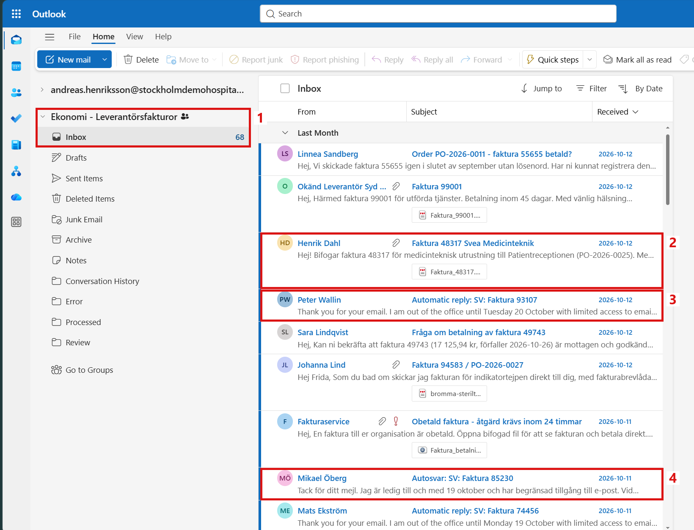

*Figure 1. The Inbox of Ekonomi - Leverantörsfakturor, with real invoices and automatic replies in the same list.*

The 35 automatic emails were 20 English out-of-office replies ("Automatic reply:"), 6 Swedish ones starting with "Autosvar:", 4 starting with "Frånvaro:" and 5 bounce messages ("Undeliverable:") from senders like MAILER-DAEMON and postmaster. None of them has an attachment, and none of them needs any work from Finance.

The robot works well for real invoices. The problem is only the automatic emails that land in the same Inbox.

## 3. Automatic Replies Become Work for Finance

The robot was run as usual on the Inbox with its 75 emails. It finished without any error. But afterwards, the folder Review held 50 emails, and Frida had 50 new review notifications. 29 of them were about out-of-office replies and bounce messages.

For Finance, this means:

- **False review work.** Frida opens a notification, opens the email in Review, and sees that it is only an out-of-office reply. This is repeated for every one of the 29 emails.
- **Real reviews are hidden.** The invoices that really need a person are mixed with the automatic replies, in the folder and in the notifications.
- **An Inbox that is never clean.** The automatic replies that the robot knows stay in the Inbox, and someone must delete them by hand.

For the support team, this means:

- **Complaints that look like a robot fault.** The robot did what it was built to do, but Finance sees a robot that sends wrong notifications.
- **A code change for every new reply format.** Every new subject text, language or mail system would need a change in the robot and a new release.

The run in UiPath Studio shows what the robot did with each email (Figure 2):

1. An email without an attachment is routed to **Review**, and a review notification is sent. This line is written for each of the 29 automatic emails.
2. A known out-of-office reply is **Not an invoice**. It stays in the Inbox with the category Robot: Ignored.
3. The summary: 75 emails, 75 handled, 0 failed. The run took 2 minutes and 44 seconds.

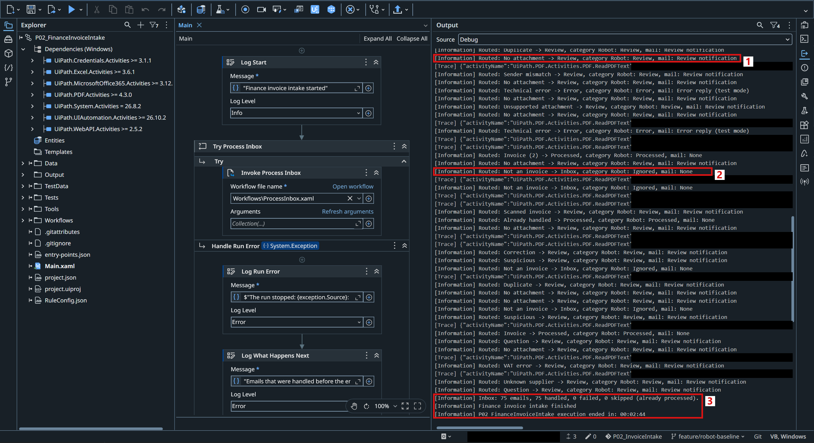

*Figure 2. The Output panel in UiPath Studio after the run.*

The result in the mailbox:

| Folder | Emails | Automatic emails among them | Message sent |
|---|---|---|---|
| Processed | 9 | 0 | None |
| Review | 50 | 29 | 50 review notifications to Frida Sjöberg |
| Error | 4 | 0 | 4 replies |
| Inbox | 12 | 7 | None |

The folder Review after the run (Figure 3):

1. **Review** holds 50 emails.
2. English out-of-office replies with the category Robot: Review.
3. A Swedish out-of-office reply ("Frånvaro:") with the category Robot: Review.

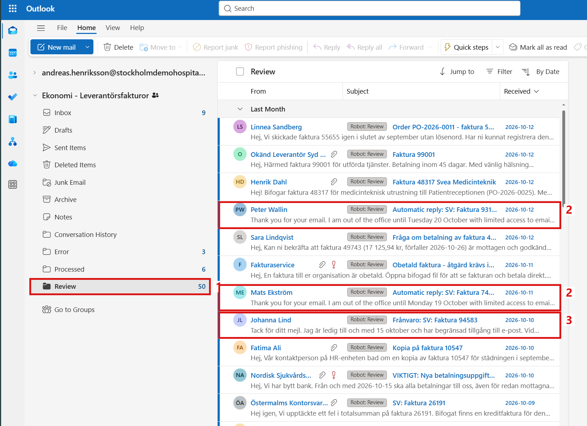

*Figure 3. The folder Review, where out-of-office replies are mixed with invoices that need a person.*

Frida receives one notification for each email in Review (Figure 4):

1. Her Inbox, with the new notifications.
2. Notifications for English out-of-office replies, "Granskning krävs: Automatic reply: ...".
3. A notification for a Swedish out-of-office reply, "Granskning krävs: Frånvaro: ...".

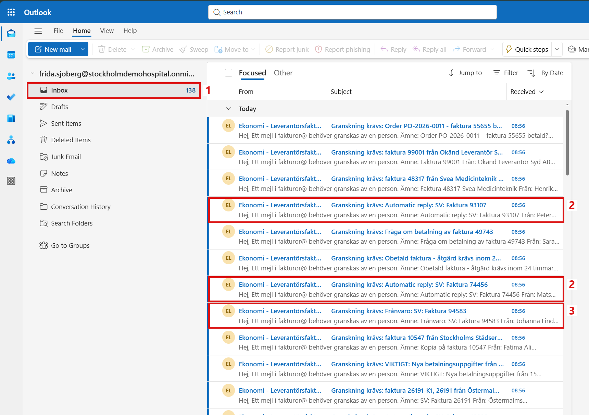

*Figure 4. Review notifications in Frida's Inbox. Three of the eleven notifications shown here are about out-of-office replies.*

The Inbox of the shared mailbox is not clean either (Figure 5):

1. The Inbox after the run.
2. The "Autosvar:" replies stay with the category Robot: Ignored.
3. More of them further down, between other emails.

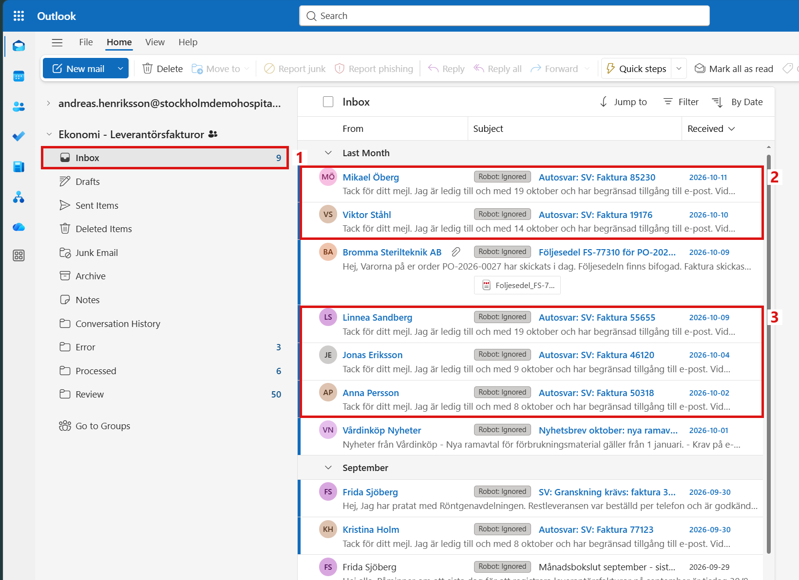

*Figure 5. The Inbox after the run. The Swedish "Autosvar:" replies stay and must be removed by hand.*

The robot finished without errors, but 29 of the 50 review notifications were about emails that never needed a person. Finance must sort them out by hand after every run.

## 4. Finding the Cause

The robot decides what an email is in the workflow `Workflows/ClassifyEmail.xaml`. The rules are checked one after the other, and the first rule that matches decides the result.

The rule for automatic replies is shown in Figure 6:

1. **Rule 2: Automatic Reply?** If it matches, the email is "Not an invoice" and stays in the Inbox.
2. Its condition only knows three subject beginnings: "automatiskt svar", "autosvar" and "out of office". The 6 "Autosvar:" replies match it. "Automatic reply:", "Frånvaro:" and "Undeliverable:" do not.

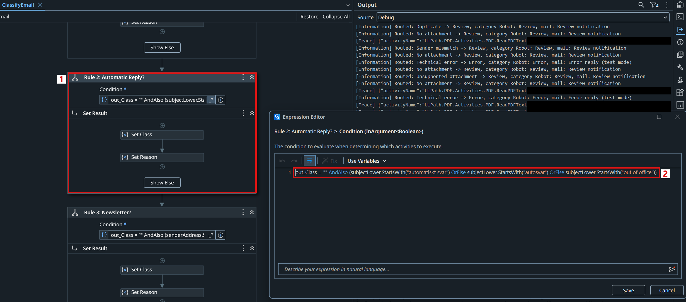

*Figure 6. Rule 2: Automatic Reply? in `Workflows/ClassifyEmail.xaml`, with its condition in the Expression Editor.*

The other automatic emails go further down the list of rules. They have no attachment, so a later rule matches (Figure 7):

1. **Rule 7b: No Attachment?** An email without an attachment goes to Review, because a person must ask the supplier for a PDF.
2. Its condition only checks that the email has no attachment.

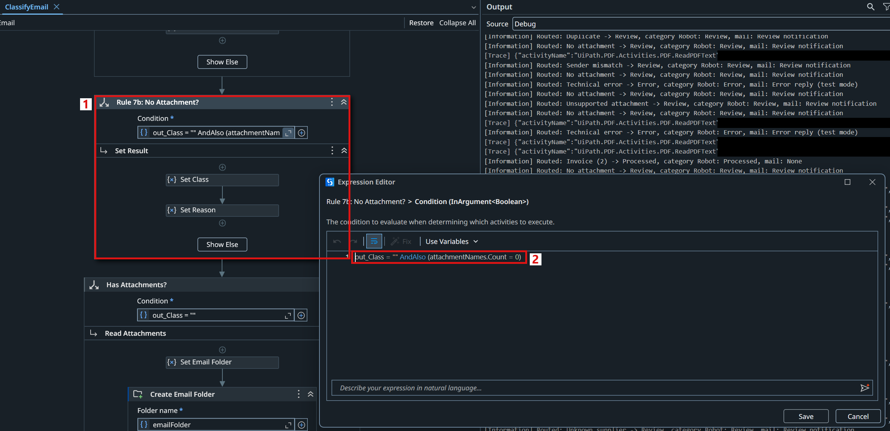

*Figure 7. Rule 7b: No Attachment? in `Workflows/ClassifyEmail.xaml`.*

So the robot treats an English out-of-office reply as a supplier email that forgot its invoice.

The rule could be made longer inside the robot, with more subject words. But out-of-office texts change with the language and the mail system of each supplier, and bounce messages come from many different servers. Every new text would need a change in the robot, a test and a new release. Sorting mail is the job of the mailbox, not of the robot. Outlook has rules for exactly this, and a rule can be changed in a few minutes without touching the robot.

## 5. What Should Change

A longer list of subject words inside the robot would only move the problem to the next unknown reply format. After the change, the following goals are expected to be met:

| Goal | Today (manual) | Expected after the fix |
|---|---|---|
| **No false review work** | 29 of 50 review notifications are about automatic emails, and Frida checks each one by hand | Review notifications only for emails that really need a person |
| **A clean Inbox** | Automatic replies stay in the Inbox and are deleted by hand | Automatic replies and bounces are moved to their own folder before the robot runs |
| **Same result for real invoices** | 9 Processed, 21 real emails in Review, 4 Error | The same, unchanged |
| **No robot change** | A new reply format needs a robot change and a new release | A new reply format is one more condition in the Outlook rule |

In short, the automatic emails should leave the Inbox before the robot reads it, and the robot itself should stay exactly as it is.

How it should look after the change:

1. **The rule sorts the mail:** an Outlook rule on the shared mailbox moves out-of-office replies and bounce messages to a folder **Auto-replies**.
2. **The robot reads the Inbox:** only real supplier emails are left, so the robot handles only them.
3. **Frida gets only real notifications:** every notification is about an email that needs her.
4. **Finance checks Auto-replies when needed:** for example to see that a supplier contact is away, without the robot.

The robot itself is not the problem. The mailbox should only give it the emails that are meant for it.

## 6. The Outlook Rule

Each problem found in Sections 3 and 4 is solved by one part of the fix.

**Problem 1: automatic emails land in the Inbox that the robot reads.** The robot reads every email in the Inbox, so every out-of-office reply and bounce message becomes work.

*Solution: a folder and a rule on the shared mailbox.* A new folder **Auto-replies** was created in Ekonomi - Leverantörsfakturor, and an Outlook rule moves the automatic emails there as soon as they arrive.

A rule for a shared mailbox must be created in the shared mailbox itself. In Outlook on the web, the rules page of a person's own window only shows the rules of their own mailbox. So the shared mailbox was opened on its own, at `outlook.cloud.microsoft/mail/fakturor@stockholmdemohospital.onmicrosoft.com/`, and the rule was added there under **Settings**, **Mail**, **Rules** (Figure 8):

1. The name of the rule, **Automatic replies and bounces**.
2. The condition **Subject includes**, with six words: Automatic reply, Automatiskt svar, Autosvar, Frånvaro, Out of office and Undeliverable.
3. The action **Move to** the folder **Auto-replies**.
4. **Stop processing more rules**, so no other rule handles these emails afterwards.

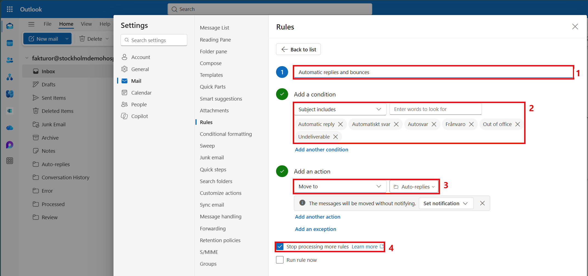

*Figure 8. The rule Automatic replies and bounces in the shared mailbox.*

Each word is added as its own entry, by pressing Enter after each one. The rule then matches a subject that contains any one of the words.

**Problem 2: the automatic emails already in the Inbox.** A rule normally acts on new emails when they arrive. The 36 automatic emails that were already waiting would still be read by the robot.

*Solution: run the rule once on the Inbox.* The saved rule is shown in the list of rules (Figure 9):

1. The rule **Automatic replies and bounces**, switched on.
2. **Run rule now** in the menu of the rule.

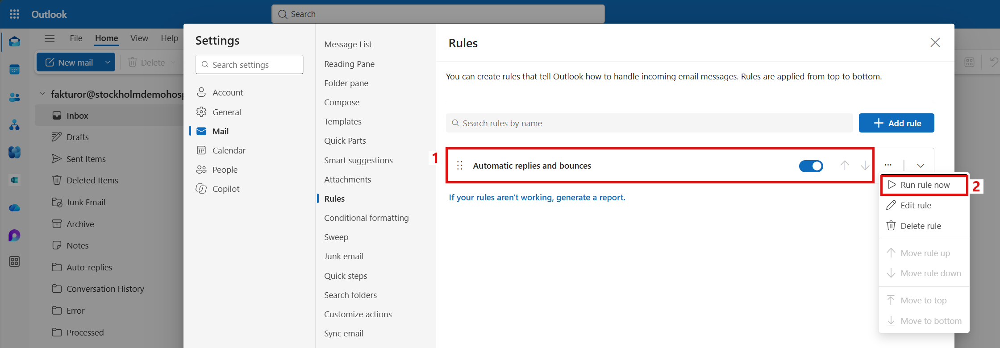

*Figure 9. The list of rules of the shared mailbox, with the menu of the rule.*

**Run rule now** asks for the folder to run the rule on (Figure 10):

1. The **Inbox** of the shared mailbox.
2. **Run rule** starts it.

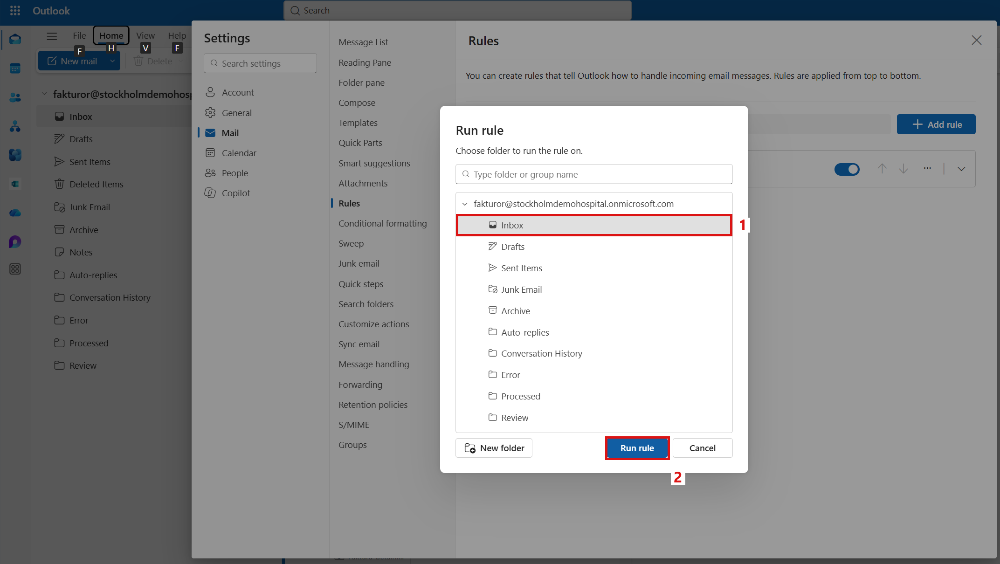

*Figure 10. The rule is run once on the emails that are already in the Inbox.*

The rule moved 36 emails to Auto-replies: the 35 automatic emails from Section 2 and one older Swedish out-of-office reply, "Automatiskt svar: SV: Faktura 55655", that the robot had always left in the Inbox.

**Problem 3: every new reply format would need a robot change.** Handling more subject texts inside the robot would mean a code change, a test and a new release each time.

*Solution: no change in the robot.* The robot was not changed at all. A new reply format, for example "Abwesenheitsnotiz" from a German supplier, is one more word in the rule, and it works from the next email on.

The Outlook rule now sorts out the automatic emails before the robot reads the Inbox. The rule lives in the mailbox, so it works whenever an email arrives, also when the robot does not run.

## 7. Testing the Fix

The robot was run again in UiPath Studio, in the same way as in Section 3 and with the same version of the robot (Figure 11):

1. Only one email is routed to Review because it has no attachment. It is a real supplier email that was also there before the fix.
2. The summary: 39 emails, 39 handled, 0 failed. The run took 2 minutes and 8 seconds.

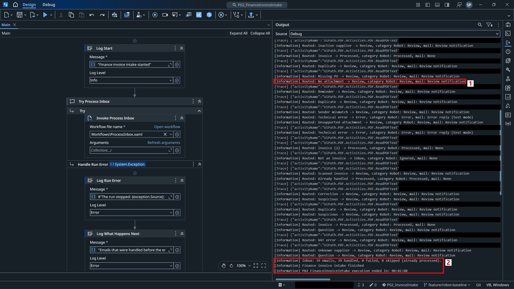

*Figure 11. The Output panel in UiPath Studio after the fix.*

The result of the run, compared with the run before the fix:

| | Before the fix | After the fix |
|---|---|---|
| Emails read by the robot | 75 | 39 |
| Processed | 9 | 9 |
| Review | 50 (29 automatic emails) | 21 (0 automatic emails) |
| Error | 4 | 4 |
| Review notifications to Frida Sjöberg | 50 | 21 |
| Automatic emails left in the Inbox | 7 | 0 |
| Run time | 2 min 44 s | 2 min 8 s |

The real invoices got exactly the same result as before: 9 Processed, 21 Review and 4 Error. Only the automatic emails are gone from the robot's work.

The folder Review now only holds emails that need a person (Figure 12):

1. **Review** after the run.
2. Real supplier emails with the category Robot: Review, such as invoices, questions and a suspicious payment request.

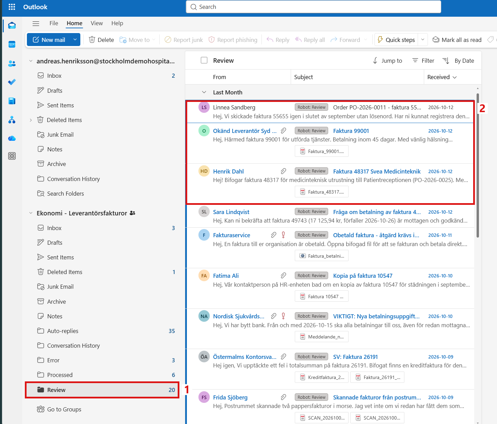

*Figure 12. The folder Review after the fix, without any out-of-office replies.*

Frida's notifications are all about real emails (Figure 13):

1. Her Inbox.
2. The new notifications of the run, each one about an invoice or a question from a supplier.

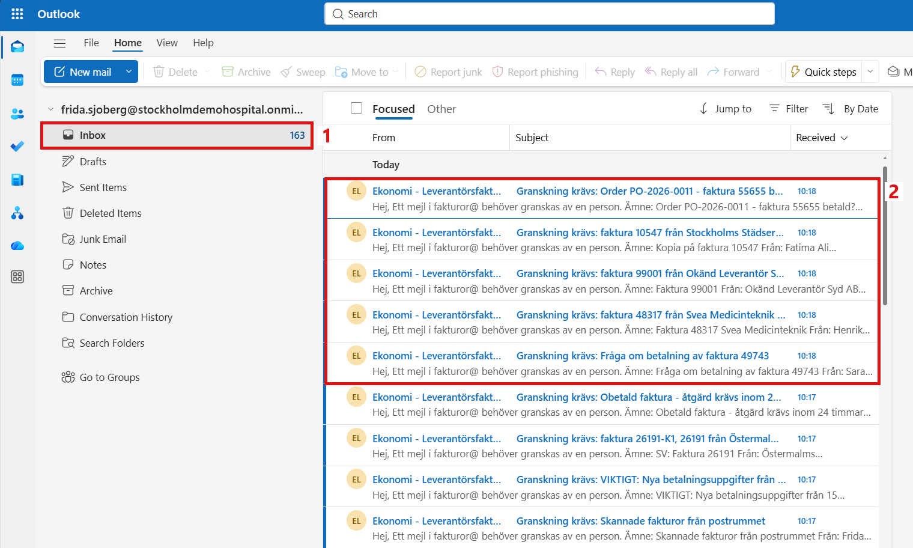

*Figure 13. The review notifications after the fix.*

The automatic emails are kept in their own folder (Figure 14):

1. **Auto-replies** in the shared mailbox.
2. Out-of-office replies in English and Swedish.
3. Bounce messages from Mail Delivery Subsystem and Postmaster.

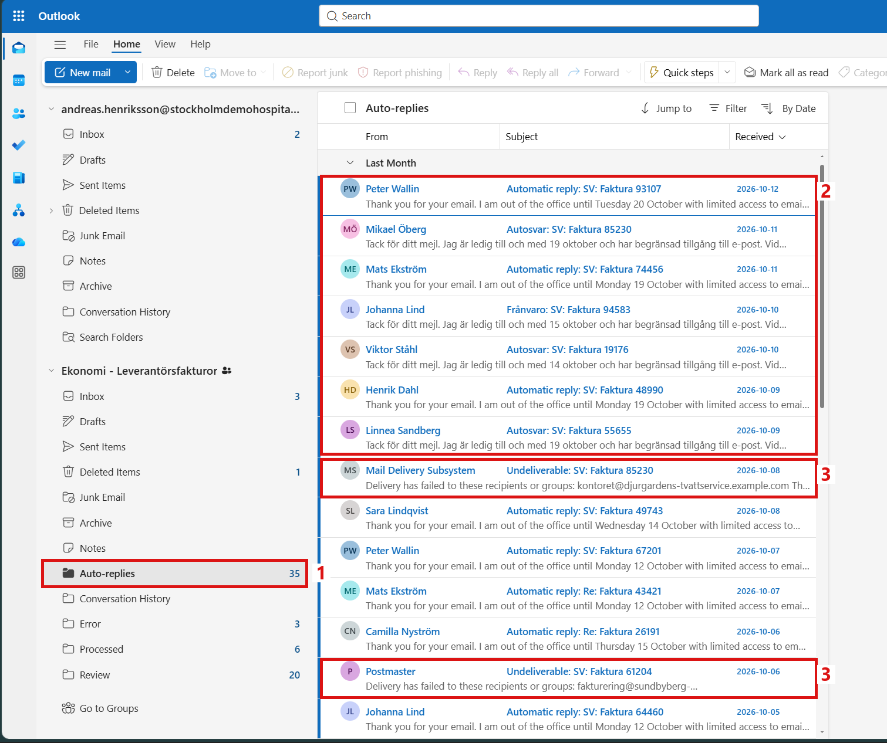

*Figure 14. The folder Auto-replies with the automatic emails.*

The Inbox of the shared mailbox is clean as well (Figure 15):

1. The Inbox after the run.
2. The 5 emails that stay there are a delivery note, a newsletter, an order confirmation and two internal messages. The robot leaves them with the category Robot: Ignored, as it always did.

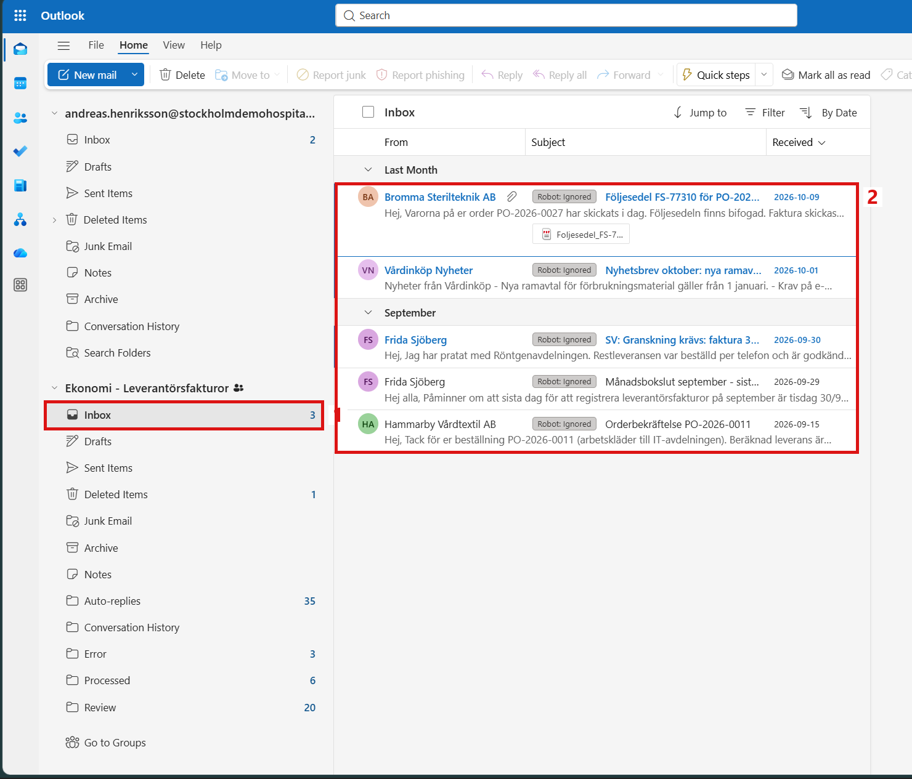

*Figure 15. The Inbox after the fix, without automatic replies.*

The goals from Section 5 are met:

| Goal | Result |
|---|---|
| **No false review work** | 21 review notifications, all about emails that need a person |
| **A clean Inbox** | 36 automatic emails in Auto-replies, none left in the Inbox |
| **Same result for real invoices** | 9 Processed, 21 Review, 4 Error, as before |
| **No robot change** | The robot was not changed. A new reply format is one more word in the rule |

The same robot read the same mailbox, but this time Frida only got notifications that needed her. One Outlook rule did the sorting, and the robot stayed exactly as it was.
