# P06 - PowerShell Creates Accounts for New Staff

## 1. Project Goal

The goal of this project is to create the Microsoft 365 accounts for new hospital staff from the request that HR sends by email. Today, every account is created by hand in the admin portal.

The project shows how the work is split between UiPath and PowerShell: UiPath reads and checks the request from HR and answers it, and one PowerShell step with Microsoft Graph creates the account. All data in this project is fictional.

## 2. How a New Account Is Created Today

When a new nurse or doctor starts at the hospital, HR sends an email to IT with the subject "Ny medarbetare:" and the name of the person. The body is a short form with six fields: first name, last name, title, department, start date and manager. On a normal Friday morning, six such requests arrived in the mailbox that IT reads for new accounts.

The numbers in Figure 1 match these parts of the mailbox:

1. The six requests from HR - Personalavdelningen.
2. The form in the email: Förnamn, Efternamn, Titel, Avdelning, Startdatum and Chef.
3. The newest email is a second request for Elsa Lindqvist. HR sent it again because no answer came after the first one.

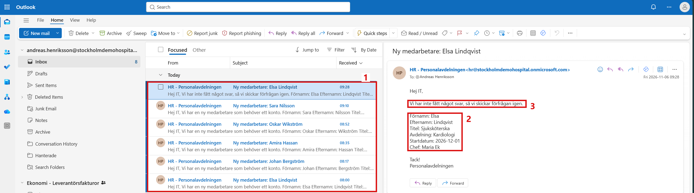

*Figure 1. Requests for new accounts from HR, with the form of one request open.*

### 2.1 The User in the Admin Center

The first request, for Elsa Lindqvist, was handled by hand in the Microsoft 365 admin center, in the same way as IT does it today. Under **Users**, **Active users**, the button **Add a user** opens a wizard (Figure 2):

1. The wizard has four pages: Basics, Product licenses, Optional settings and Finish.
2. The first name and the last name are typed from the email.
3. The username is typed by hand as well. The display name is filled in from the two names.

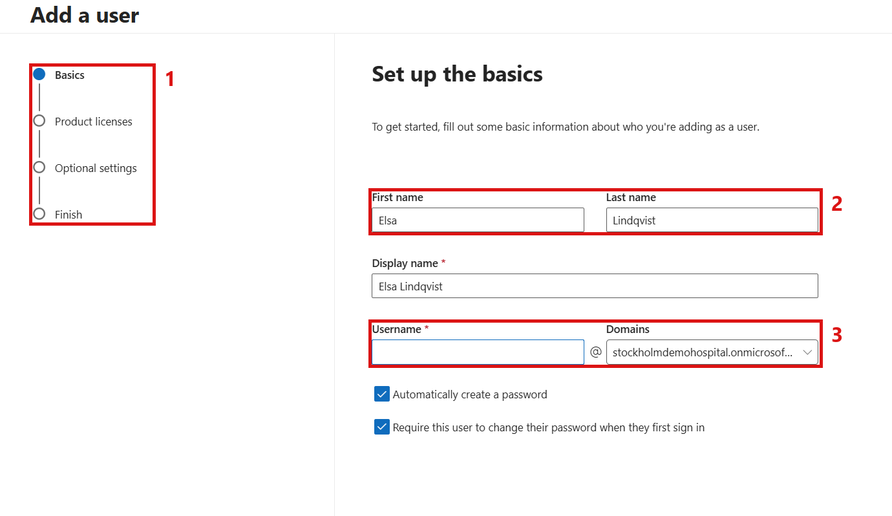

*Figure 2. Add a user, the page Set up the basics.*

On the next page, a license is chosen for the new user (Figure 3):

1. The location, Sweden.
2. The license Microsoft 365 Business Standard. Without a license, the user has no mailbox and no Office apps.

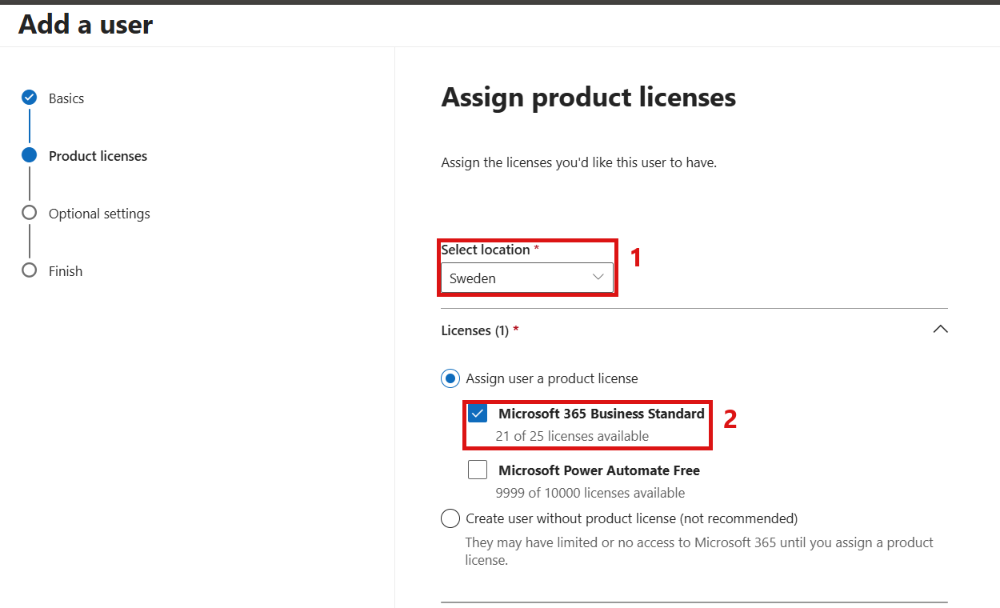

*Figure 3. Add a user, the page Assign product licenses.*

The title and the department from the email are typed under **Profile info** (Figure 4):

1. **Job title**, here Sjuksköterska.
2. **Department**, here Kardiologi.

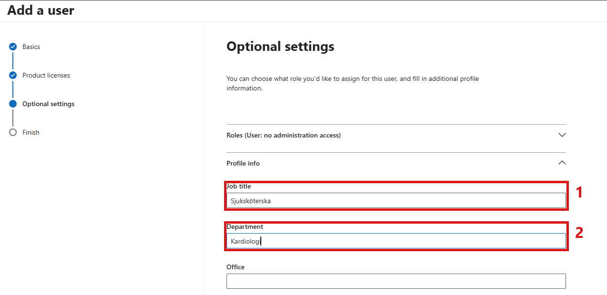

*Figure 4. Add a user, Optional settings with the profile information.*

The last page shows everything before the user is created (Figure 5):

1. The display name and the username.
2. The location and the license.
3. The job title and the department.

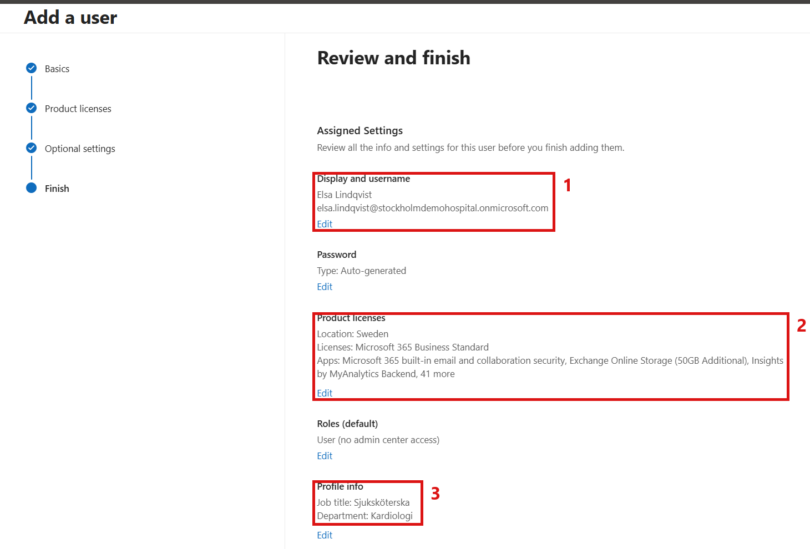

*Figure 5. Add a user, Review and finish.*

After **Finish adding**, the user exists (Figure 6). The page shows the username and also the new password in plain text (blacked out here). The IT person must pass this password to the new employee in a safe way.

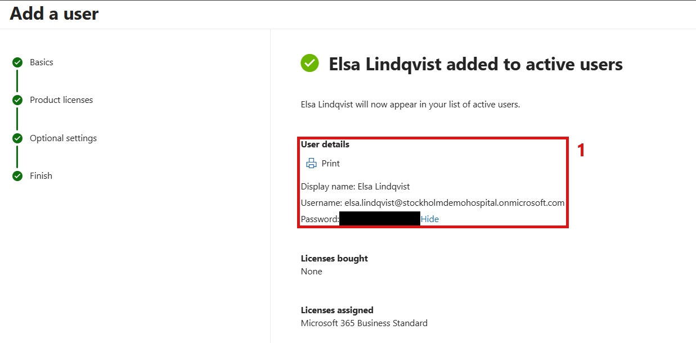

*Figure 6. Elsa Lindqvist was added. The first password is shown on the screen.*

### 2.2 The Department Group

The wizard does not add the user to the group of the department. This is a separate step on the page of the user, under **Groups**, **Manage groups** and **Assign memberships** (Figure 7):

1. The list of groups can be searched by name.
2. **Kardiologi - Personal** is chosen by hand, because Elsa Lindqvist will work at the cardiology department.

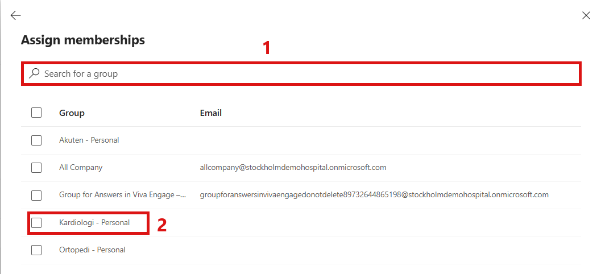

*Figure 7. Assign memberships, with the three department groups of the hospital.*

After that, the account of Elsa Lindqvist is complete (Figure 8):

1. Her username and email address.
2. Her groups, now with Kardiologi - Personal.

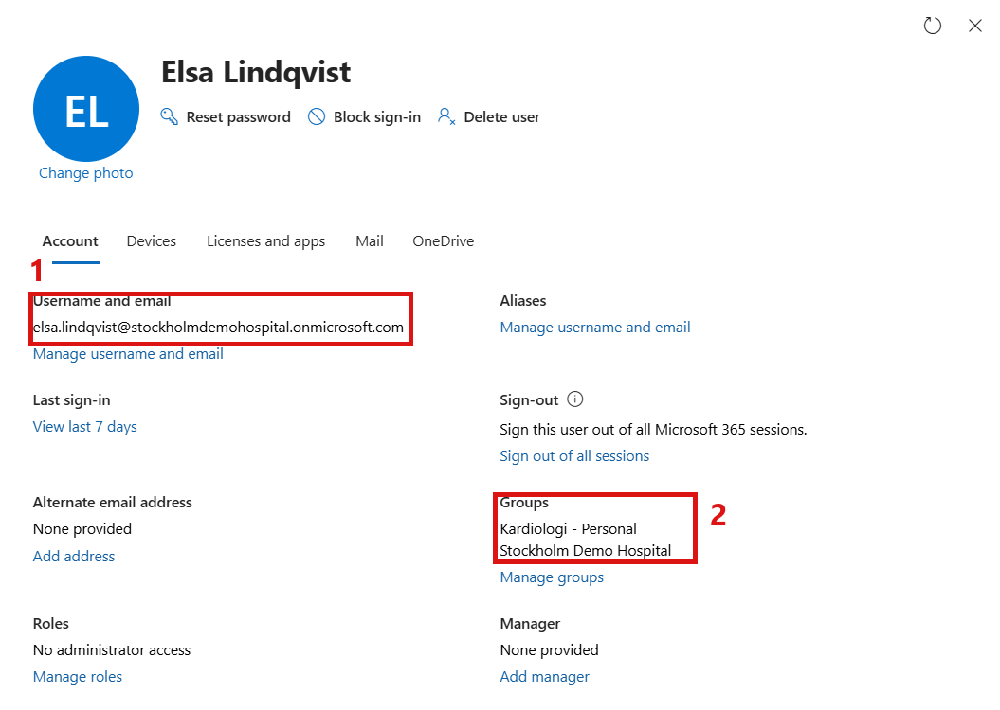

*Figure 8. The account page of Elsa Lindqvist.*

One account took a few minutes of typing and clicking in two different places in the admin center. The same work is repeated for every new employee, and HR gets no answer unless IT writes one.

## 3. Manual Work for Every New Employee

The steps in Section 2 work, but every value is copied by hand from an email to a web page, and nothing connects the request to the result. The other requests of the same morning show where this goes wrong.

For HR and the new staff, this means:

- **No answer to HR.** HR does not know if the account was created. After about an hour and a half without an answer, the request for Elsa Lindqvist was sent again (Figure 1).
- **Access depends on a separate step.** The department is typed on one page, and the group is chosen on another one. If the group is forgotten, the new employee has an account but no access to the resources of the department.
- **Waiting on the first day.** The account is only ready when someone in IT has time to do the steps.

For the support team, this means:

- **The same typing for every person.** Names, username, title and department are typed for each request, and a typing mistake is only found when the new employee complains.
- **Incomplete requests need a manual reply.** IT must notice what is missing and write back to HR.
- **Repeated requests.** A request that is sent twice must be recognised by the IT person.

The request for Sara Nilsson is an example of an incomplete form (Figure 9):

1. The request in the Inbox.
2. The field **Avdelning** is empty. Without the department, neither the profile nor the group can be filled in, so IT has to ask HR first.

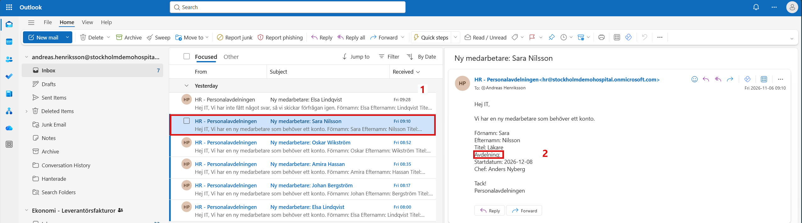

*Figure 9. The request for Sara Nilsson, with no department.*

The second request for Elsa Lindqvist shows what happens with a repeated request. When it was handled in the same way, the admin center stopped on the first page (Figure 10):

1. The username elsa.lindqvist is already used by an active user, so a second account cannot be created.

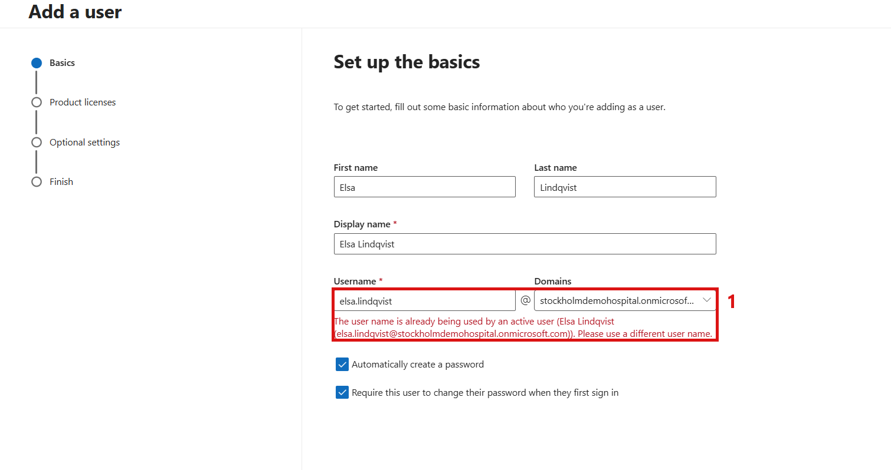

*Figure 10. Add a user for the second request: the username already exists.*

The admin center protects against a second account with the same username, but only after the IT person has started the work again. HR still does not know that the account was already created.

Six requests in one morning mean six times the same steps, one reply that must be written by hand, and one request that only needed an answer.

## 4. Finding the Cause

The admin center itself works correctly. The problem is that it is made for one person who creates one user at a time. Every request is read, copied and checked by a person:

- The values from the email are typed again in the wizard, and the group is chosen in another place. Nothing checks that the department in the email matches a group.
- Nothing checks the form before the work starts, so a missing field is found in the middle of the work.
- Nothing answers HR, so HR cannot see if a request was handled.

A UiPath robot could read the email and then click through the same wizard in the browser. This is possible, but it is the wrong tool for this part. The admin center is a web page that Microsoft changes from time to time, and every change of a page can break the robot. The robot would also need an open browser session of an administrator, with multi-factor sign-in.

Microsoft offers an official interface for this job: Microsoft Graph. With the Microsoft Graph module for PowerShell, one short script can create the user with the same values, add the user to a group, and return a clear error, for example when the username already exists. The script does not depend on how the web page looks.

So the work should be split. UiPath is good at the business part: reading the email from HR, checking the form, and answering HR. PowerShell with Microsoft Graph is good at the technical part: creating the account and adding the group.

The cause is not a mistake by IT. It is a process where a person copies the same values by hand, and where the account is created through a web page that was made for people, not for a robot.

## 5. What Should Change

A faster way of clicking through the admin center would still leave the typing, the missing answers and the repeated requests. After the change, the following goals are expected to be met:

| Goal | Today (manual) | Expected after the fix |
|---|---|---|
| **No typing** | Every value is typed by hand from the email, in two places of the admin center | The values are taken from the form in the email |
| **Checked before use** | A missing department is found in the middle of the work | The form is checked first, and nothing is created when a field is missing |
| **Correct group** | The group is chosen by hand on a separate page, and can be forgotten | The group is found from the department, and the user is always added to it |
| **Clear answer to HR** | HR gets no answer and sends the same request again | HR gets a reply: created, already exists, or what is missing |
| **No second account** | The admin center stops a second account only after the work has started again | An existing account is found and reported to HR |
| **No password on the screen** | The first password is shown to the IT person | The first password is random and never shown or saved |
| **No clicking in a web page** | The admin center is used by hand; a robot that clicks it breaks when the page changes | The account is created through Microsoft Graph, without the admin center |

In short, a request from HR should become an account, or a clear answer, without anyone typing the values again.

How it should look after the change:

1. **HR sends the request as today:** the same email with the same form.
2. **UiPath reads and checks the request:** all fields must be there, and the department must be known.
3. **PowerShell creates the account:** one script with Microsoft Graph creates the user, gives the license and adds the department group.
4. **UiPath answers HR:** created, already exists, or what is missing. The email is then moved to a folder for handled requests.

The admin center is still there for special cases, but the normal request does not need it anymore.

## 6. Access to Microsoft Graph

Each problem found in Sections 3 and 4 is solved by one part of the fix. This section covers the PowerShell part.

**Problem 1: the script needs its own access to the users and groups.** The admin center is used with the account of an administrator. A script that runs on its own should not use a person's account or need a multi-factor sign-in.

*Solution: an app registration with only the permissions it needs.* In the Microsoft Entra admin center, under **App registrations**, **New registration**, a new app was registered (Figure 11):

1. The name **P06 Staff Account Robot**.
2. **Single tenant only**: the app can only be used inside the hospital's own Microsoft 365.
3. **Register** creates the app.

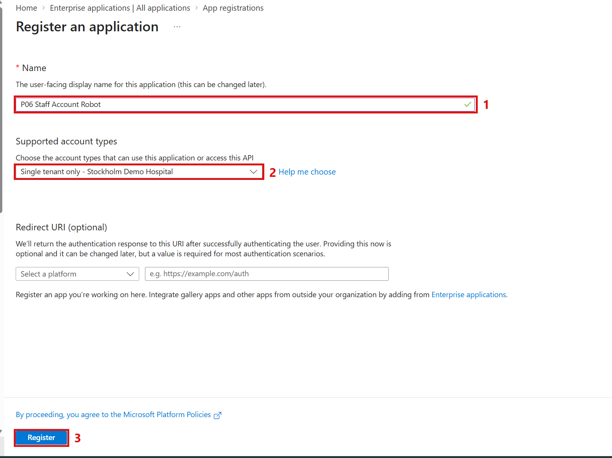

*Figure 11. Register an application in the Microsoft Entra admin center.*

Under **API permissions**, **Add a permission**, **Microsoft Graph**, **Application permissions**, two permissions were added. Application permissions are used by a program that runs without a signed-in person. An administrator must approve them (Figure 12):

1. **Grant admin consent for Stockholm Demo Hospital** approves the permissions for the whole organization.
2. **User.ReadWrite.All** lets the app create users and give them a license. **GroupMember.ReadWrite.All** lets the app add a user to a group. **User.Read** is added to every new app by default and is not used by the script.
3. All permissions are now granted.

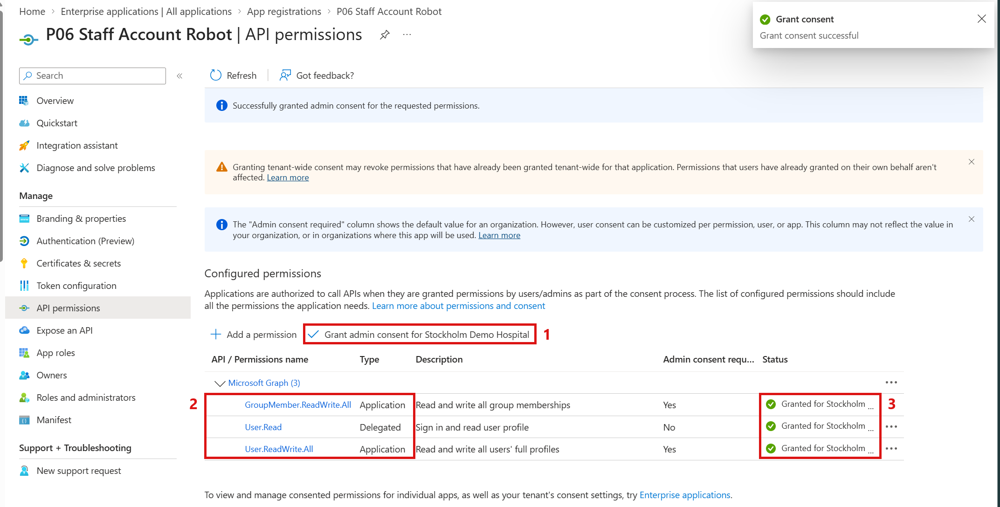

*Figure 12. The API permissions of P06 Staff Account Robot.*

The app cannot read mail, change roles or delete groups. It can only do what the script needs.

**Problem 2: a password in a file can be stolen.** A script that signs in with a client secret needs the secret in a file or in the script. Anyone who reads the file can then use the app.

*Solution: sign in with a certificate.* A certificate was created in Windows PowerShell on the computer of the robot. Its private key stays in the Windows certificate store and cannot be exported. Only the public part is saved to a file:

```powershell
$cert = New-SelfSignedCertificate -Subject 'CN=P06 Staff Account Robot' `
    -CertStoreLocation 'Cert:\CurrentUser\My' -KeySpec Signature `
    -KeyExportPolicy NonExportable -NotAfter (Get-Date).AddMonths(6)
Export-Certificate -Cert $cert -FilePath "$HOME\Documents\P06-Staff-Account-Robot.cer"
```

The certificate can be seen in **certmgr.msc** (Manage user certificates), under **Personal**, **Certificates** (Figure 13):

1. **P06 Staff Account Robot**, issued to itself, valid for six months.

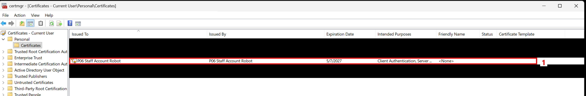

*Figure 13. The certificate of the robot in the certificate store of the current user.*

The public file was then uploaded to the app under **Certificates & secrets**, **Upload certificate** (Figure 14):

1. **Certificates (1)**: the app has one certificate and no client secret.
2. The uploaded certificate with its description and expiry date. The thumbprint and the certificate ID are blacked out here.

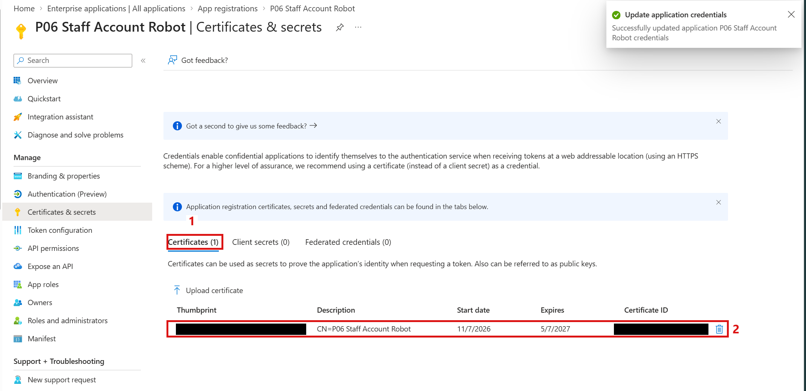

*Figure 14. Certificates & secrets of P06 Staff Account Robot.*

The script now signs in with the client ID of the app, the tenant ID and the thumbprint of the certificate. None of them is a secret, and no password is stored anywhere.

**Problem 3: Windows PowerShell has no commands for Microsoft Graph.** PowerShell can call Microsoft Graph only after the Microsoft Graph module is installed.

*Solution: install only the parts that are needed.* The full Microsoft Graph module has many parts. Only four of them were installed from the PowerShell Gallery, for the current user:

```powershell
Install-Module Microsoft.Graph.Authentication, Microsoft.Graph.Users, `
    Microsoft.Graph.Users.Actions, Microsoft.Graph.Groups -Scope CurrentUser
```

The installed parts are shown with one command (Figure 15):

1. `Get-InstalledModule Microsoft.Graph*` lists the installed Graph modules.
2. Authentication for the sign-in, Users for creating the user, Users.Actions for the license, and Groups for the group membership.

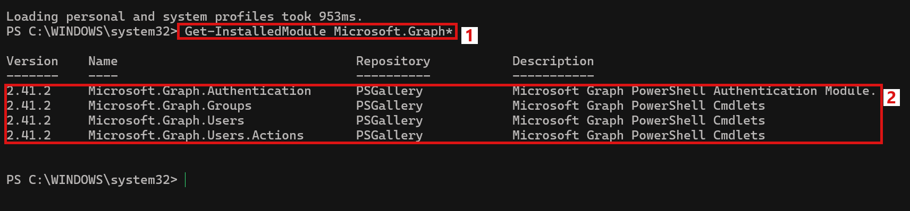

*Figure 15. The four Microsoft Graph modules in Windows PowerShell.*

**Problem 4: the account must be created in the same way every time.** By hand, every account depends on the person who types it.

*Solution: one short script, `P06_StaffOnboarding/Scripts/New-StaffAccount.ps1`.* The script is stored inside the UiPath project, so it is always delivered together with the robot. It gets the values from the form as parameters and does the same five steps as the admin center, in a fixed order:

1. It finds the group of the department. The group name is the department name plus " - Personal", for example "Kardiologi - Personal". An unknown department stops the script.
2. It checks if a user with the same username already exists.
3. It creates the user with name, title and department. The username is built from the names, in small letters and without å, ä, ö or é.
4. It gives the user the Microsoft 365 license.
5. It adds the user to the group of the department.

The main part of the script:

```powershell
# 1. The group of the department must exist
$groupName = "$Department - Personal"
$group = Get-MgGroup -Filter "displayName eq '$groupName'"
if (-not $group) {
    return New-Result 'Error' $upn "No group '$groupName' was found for the department '$Department'."
}

# 2. Do not create the same person twice
$existing = Get-MgUser -Filter "userPrincipalName eq '$upn'"
if ($existing) {
    return New-Result 'Exists' $upn "The account $upn already exists. Nothing was changed."
}

# 3. Create the user. The random first password must be changed at the first sign-in.
$user = New-MgUser -AccountEnabled `
    -GivenName $FirstName -Surname $LastName -DisplayName "$FirstName $LastName" `
    -JobTitle $JobTitle -Department $Department `
    -MailNickname $userName -UserPrincipalName $upn `
    -UsageLocation 'SE' -PasswordProfile $passwordProfile

# 4. Microsoft 365 license
Set-MgUserLicense -UserId $user.Id -AddLicenses @(@{ SkuId = $LicenseSkuId }) -RemoveLicenses @()

# 5. Member of the department group
New-MgGroupMember -GroupId $group.Id -DirectoryObjectId $user.Id
```

The first password is created at random inside the script. It is never shown, written to a log or returned. The new employee gets a first password from the service desk on the first day, and must change it at the first sign-in.

The script always returns one small table (a hashtable) with three values: the status **Created**, **Exists** or **Error**, the username, and a message in plain English. This result is what the robot uses to answer HR.

The script now creates a complete account in one step, through the official interface of Microsoft. It signs in with a certificate, so no password is stored anywhere.

## 7. The Robot in UiPath

The script creates the account, but somebody still has to read the email, check the form and answer HR. This is the UiPath part of the fix. The robot is the project `P06_StaffOnboarding`, built in UiPath Studio. It reads the mailbox that IT uses for new accounts, the mailbox of Andreas Henriksson.

**Problem 5: every value is typed again from the email.** In Section 2, the names, the title and the department were copied by hand into the wizard.

*Solution: the robot reads the form in the email.* The main workflow `Main.xaml` gets the emails from the Inbox and handles the oldest one first. Only emails from HR with a subject that starts with "Ny medarbetare:" are handled. All other emails stay in the Inbox. For each request, the workflow `ReadRequest.xaml` finds each field of the form by its label, for example the text after "Förnamn:".

The settings of the robot, such as the address of HR, the known departments and the folder for handled requests, are kept in `Data/Config.xlsx`. The client ID, the tenant ID and the certificate thumbprint from Section 6 are not in the project. They are stored as three assets in UiPath Orchestrator and read when the robot starts.

The numbers in Figure 16 show the main steps of `Main.xaml`:

1. **Get Inbox Emails** reads the Inbox of the mailbox.
2. **Request From HR?** handles only the emails from HR with the right subject.
3. **Invoke Read Request** reads the form, and **Invoke Check Request** checks it.
4. **Invoke Create Account** runs the PowerShell script, only when the form is complete.
5. **Invoke Reply To HR** sends the answer.
6. **Move Request To Done Folder** moves the request to the folder "Hanterade" (handled).

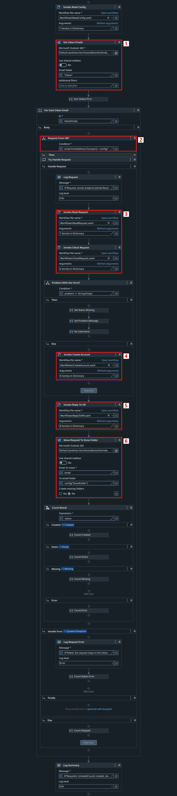

*Figure 16. Main.xaml in UiPath Studio, with the loop over the emails opened.*

If something goes wrong with one request, the error is written to the log, the request stays in the Inbox, and the robot continues with the next email. No request is moved to "Hanterade" without an answer.

**Problem 6: a missing field is found in the middle of the work.** For Sara Nilsson, the work had to stop because the department was empty.

*Solution: the form is checked before anything is created.* The workflow `CheckRequest.xaml` has one simple check for each required field: first name, last name, title and department. It also checks that the department is one of the known departments. When something is wrong, no account is created, and the problem is written in Swedish for the answer to HR, for example "Följande uppgifter saknas: Avdelning."

**Problem 7: UiPath must run the script and understand the result.** The robot should not click in the admin center, and it must know if the account was created, already existed, or failed.

*Solution: one Invoke Power Shell activity.* The workflow `CreateAccount.xaml` runs `New-StaffAccount.ps1` from the project folder with the activity **Invoke Power Shell** (Figure 17):

1. **Run New-StaffAccount.ps1**: the command text is the path to the script.
2. **Parameters**: the nine values for the script. The names, the title and the department come from the form. The IDs come from the Orchestrator assets, and the domain and the license from the settings file.
3. **Execution mode**: PowerShell 5.1 (64-bit), the Windows PowerShell where the Microsoft Graph modules are installed.
4. **Current type**: `System.Collections.Hashtable`, the same type as the result of the script.
5. **Output**: the result of the script. The next steps take the status, the username and the message from it.

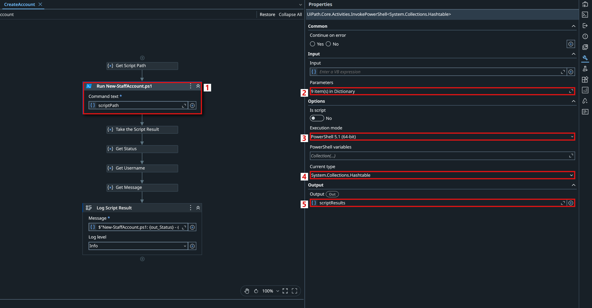

*Figure 17. CreateAccount.xaml with the properties of Invoke Power Shell.*

**Problem 8: HR gets no answer.** In Section 3, HR sent the same request again because nobody answered.

*Solution: the robot answers every request.* The workflow `ReplyToHR.xaml` chooses one of three answers in Swedish, from the status:

- **Created**: the account is ready, with the username, the department group and the start date. The answer also says that the first password is given out by the IT service desk on the first day.
- **Exists**: the account already exists, and no new account was created.
- **Missing**: what is missing in the form, and that HR should send the request again.

The answer is sent from the mailbox of Andreas Henriksson to Frida Sjöberg at HR, with the subject of the request. After the answer, the request is moved to "Hanterade".

## 8. Testing the Fix

The robot was tested with the same six requests from HR as in Section 2. The account of Elsa Lindqvist that was created by hand in Section 2 was deleted first, so that all six requests were handled in the same situation as on Friday morning. The robot was then started once from UiPath Studio.

The Output panel shows how each request was handled (Figure 18):

1. The first request for Elsa Lindqvist: the script returned **Created**. Johan Bergström, Amira Hassan and Oskar Wikström were created in the same way.
2. The request for Sara Nilsson: the check found that **Avdelning** is missing, so the script was not run.
3. The second request for Elsa Lindqvist: the script returned **Exists**, because her account had been created about a minute before, in the same run.
4. The summary: 4 created, 1 already existed, 1 incomplete, 0 errors. The 2 other emails were left in the Inbox.

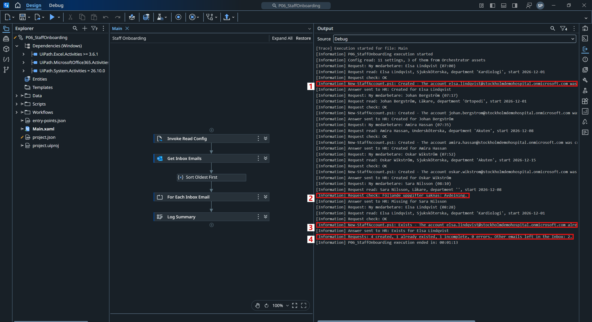

*Figure 18. The run of the robot in UiPath Studio. The six requests took 1 minute and 13 seconds.*

The mailbox shows the same result (Figure 19):

1. Only the 2 emails that are not from HR are left in the Inbox.
2. All six requests are in "Hanterade".

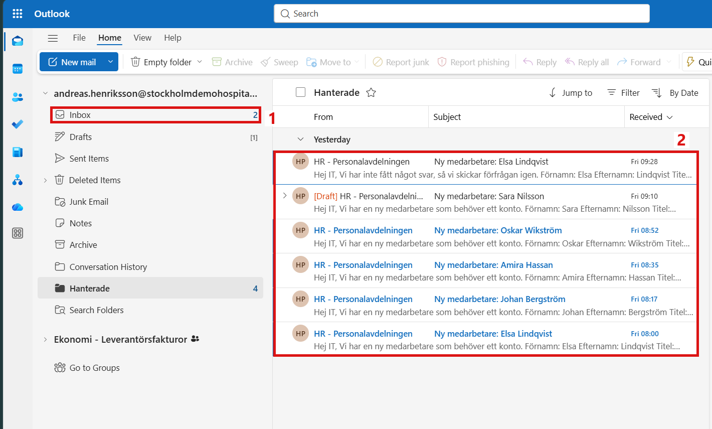

*Figure 19. The folder Hanterade after the run.*

HR got one answer for each request (Figure 20):

1. Six answers, one for each request, including the second request for Elsa Lindqvist.
2. The answer for Johan Bergström, with his username, his department group and the start date. No password is in the email.

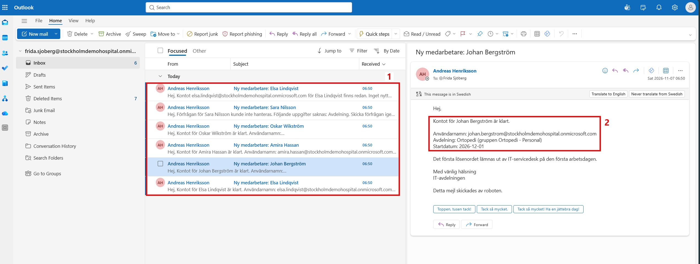

*Figure 20. The answers from the robot in the Inbox of Frida Sjöberg at HR.*

The answer for Sara Nilsson tells HR exactly what to do (Figure 21):

1. The field Avdelning is missing, the request should be sent again, and no account was created.

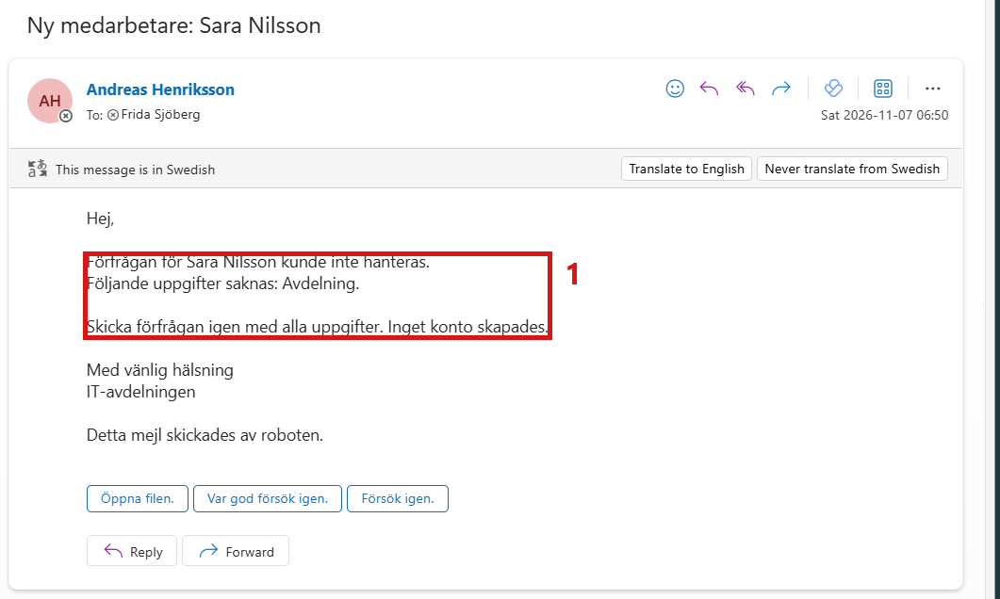

*Figure 21. The answer for Sara Nilsson.*

In the Microsoft Entra admin center, the four new accounts are in the list of users (Figure 22):

1. Amira Hassan, Elsa Lindqvist, Johan Bergström and Oskar Wikström. There is only one account for Elsa Lindqvist, and none for Sara Nilsson.

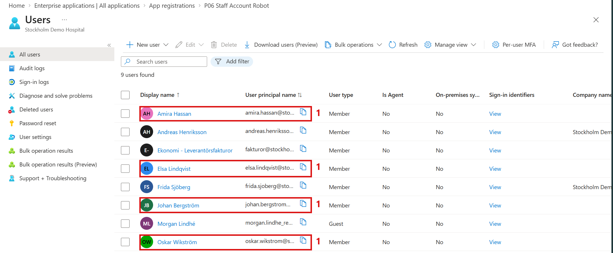

*Figure 22. The users after the run.*

The audit log of Amira Hassan shows who created the account (Figure 23):

1. **P06 Staff Account Robot** set the password profile, added the user, set the license and added the user to the group, all within three seconds. Nobody signed in to the admin center. The ID of the group is blacked out here.

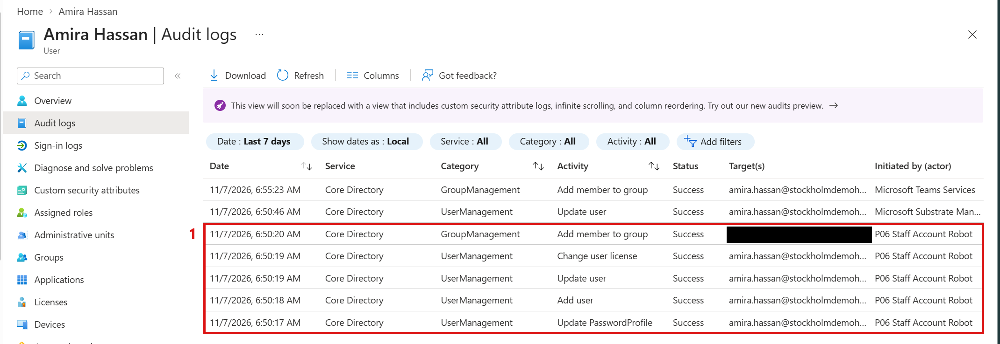

*Figure 23. The audit log of Amira Hassan.*

The account is complete, with the group of the department (Figure 24) and the license (Figure 25):

1. **Akuten - Personal**, the group of her department.

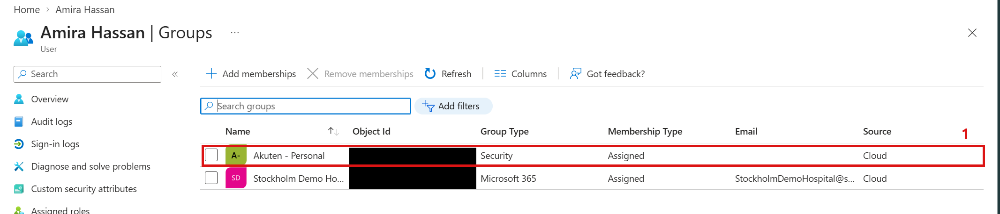

*Figure 24. The groups of Amira Hassan. The object IDs are blacked out here.*

1. **Microsoft 365 Business Standard** is active.

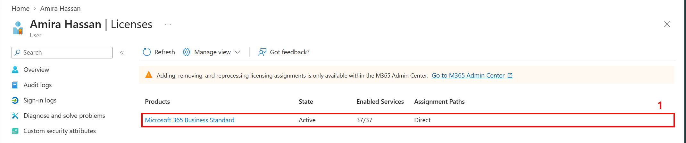

*Figure 25. The license of Amira Hassan.*

### 8.1 Before and After

| | Before (by hand) | After (robot) |
|---|---|---|
| Time | A few minutes for one account, in two places of the admin center | 1 minute 13 seconds for all six requests |
| Accounts created | One at a time, by typing | 4, with license and department group |
| Values typed by hand | All of them | None |
| Incomplete request | Found in the middle of the work, reply written by hand | Found by the check, answer sent automatically |
| Repeated request | The admin center stops after the work has started again | Answered with "already exists" |
| Answers to HR | None | 6 |
| First password | Shown on the screen to the IT person | Random, never shown or saved |

### 8.2 Goals

| Goal | Result | Shown in |
|---|---|---|
| **No typing** | Met. All values came from the form in the email | Figures 18, 20 |
| **Checked before use** | Met. The request for Sara Nilsson was stopped before anything was created | Figures 18, 21, 22 |
| **Correct group** | Met. Each new user is a member of the group of the department | Figures 20, 24 |
| **Clear answer to HR** | Met. Six requests got six answers | Figure 20 |
| **No second account** | Met. The second request for Elsa Lindqvist was answered with "already exists" | Figures 18, 22 |
| **No password on the screen** | Met. The password is not in the log, in the answer or on any screen | Figures 18, 20 |
| **No clicking in a web page** | Met. The account was created by the app through Microsoft Graph | Figure 23 |

Requests from HR used to be copied by hand into the admin center, and HR never got an answer. Now UiPath reads and checks each request, one PowerShell script creates the account through Microsoft Graph, and HR gets a clear answer for every request. Six requests were handled in about one minute, without a single value typed by hand.
