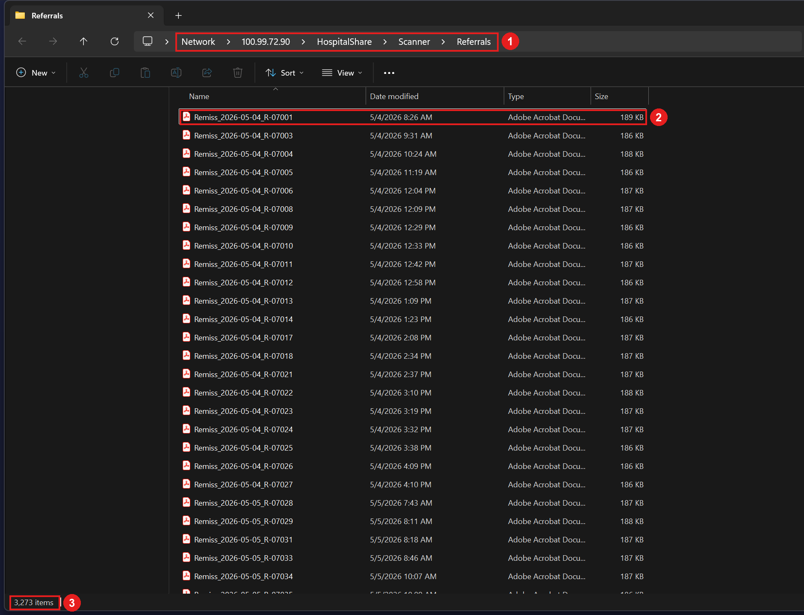
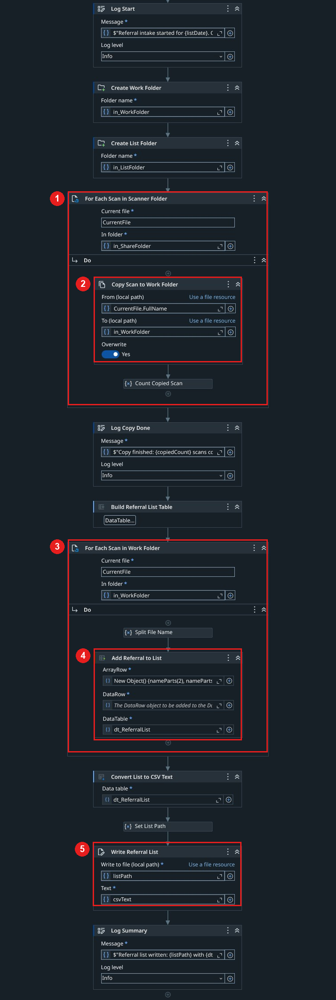
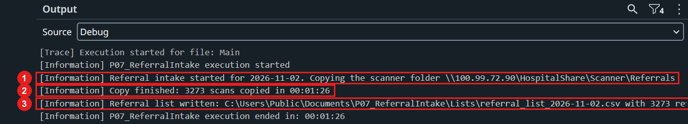
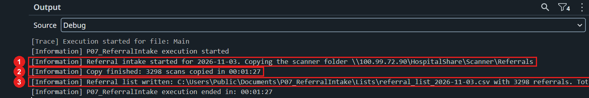
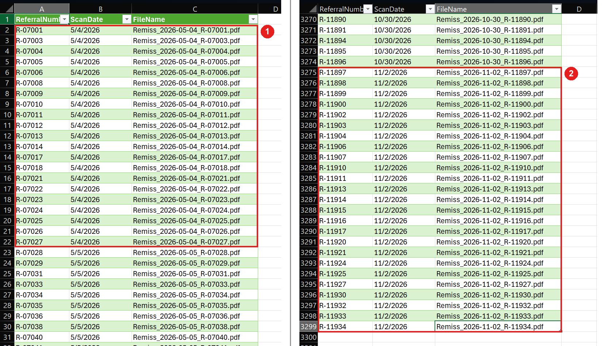
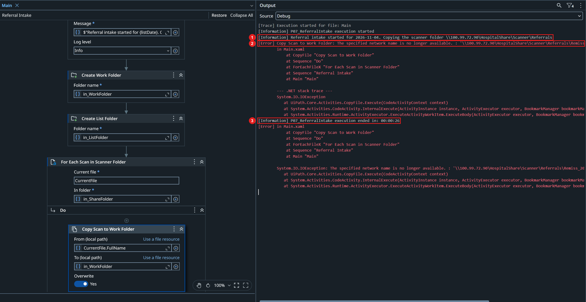
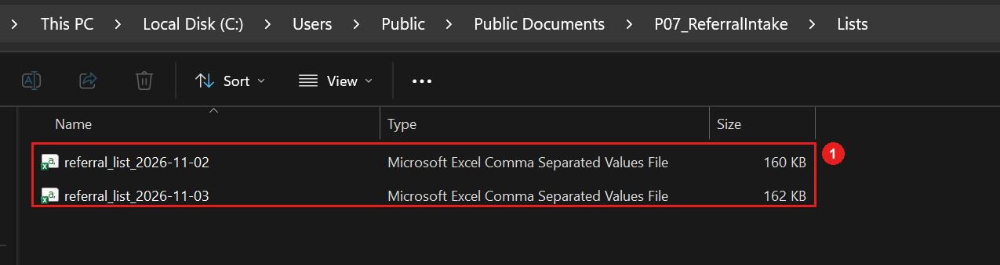
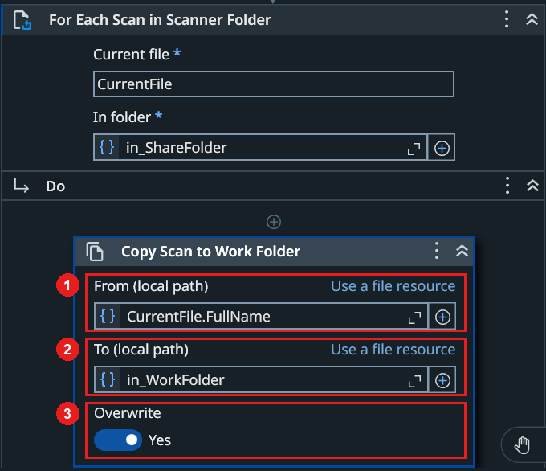

# P07 - Robocopy Brings Only the New Scanned Referrals

## 1. Project Goal

The goal of this project is to bring the scanned referrals of a hospital from a network folder to a robot, quickly and safely. Paper referrals are scanned during the day, and every morning a robot adds the new ones to a list for the coordination team.

The project shows why copying files is a job for Robocopy, a copy tool that is part of Windows, and how the robot uses it to work only with the new files. All data in this project is fictional.

### 1.1 Before - The Robot Copies the Whole Folder

1. **Scan the referrals:** During the day, the reception scans the paper referrals. Each scan is saved as a PDF in a folder on the department share.
2. **Copy every scan:** Every morning, a UiPath robot copies all scans in the folder to its own work folder, one file at a time. The scans from all earlier days are copied again.
3. **List every scan:** The robot goes through its work folder and adds every scan to the referral list, also the ones that were on the list the day before.
4. **Write the list:** The list is saved as a CSV file for the coordination team.
5. **Stop on a network error:** If the connection to the share is lost during the copy, the robot stops, and no list is written that morning.

On Tuesday, 25 new scans meant that 3,298 files were copied in 1 minute and 27 seconds, and that the list had 3,298 rows.

## 2. How the Referrals Reach the Coordination Team Today

Referrals from other clinics arrive on paper. The reception scans each referral, and the scanner saves it as a PDF in the department share. The folder keeps every scan, so it grows every day. On Monday morning, 2 November, it held all scans since 4 May.

The numbers in Figure 1 match these parts of the folder:

1. The scanner folder on the department share: `\\100.99.72.90\HospitalShare\Scanner\Referrals`.
2. One scan. The file name is `Remiss_<scan date>_<referral number>.pdf`, here a referral scanned on 4 May with the number R-07001.
3. 3,273 scans in the folder.

*Figure 1. The scanner folder on Monday morning.*

### 2.1 The Morning Robot

The robot was built in UiPath Studio in the usual way, with the activities For Each File in Folder and Copy File. It copies the scans to a work folder on the robot computer and then builds the list from that folder (Figure 2):

1. **For Each Scan in Scanner Folder** goes through every PDF in the scanner folder.
2. **Copy Scan to Work Folder** copies one scan to the work folder. A scan that is already there is overwritten.
3. **For Each Scan in Work Folder** goes through every file in the work folder.
4. **Add Referral to List** takes the referral number and the scan date from the file name and adds one row to the list.
5. **Write Referral List** saves the list as `referral_list_<date>.csv`.

*Figure 2. The workflow of the robot in UiPath Studio.*

The robot works, and the list has the right columns. But nothing in the workflow asks which scans are new.

## 3. A Slow Morning List Full of Old Referrals

On Monday morning, the robot copied all 3,273 scans and wrote a list with 3,273 referrals (Figure 3):

1. The robot starts the list for 2 November.
2. All 3,273 scans are copied in 1 minute and 26 seconds.
3. The list is written with 3,273 referrals.

*Figure 3. The run on Monday morning.*

During Monday, the reception scanned 25 new referrals. On Tuesday morning, the robot did the same work again (Figure 4):

1. The robot starts the list for 3 November.
2. All 3,298 scans are copied again in 1 minute and 27 seconds, although only 25 of them were new.
3. The list is written with 3,298 referrals.

*Figure 4. The run on Tuesday morning.*

The list of Tuesday shows what the coordination team gets (Figure 5):

1. The list starts with the referrals from 4 May, which were already handled months ago.
2. The 25 new referrals from Monday are at the very end, on rows 3275 to 3299.

*Figure 5. The list of Tuesday: the top of the list (left) and the end of the list (right).*

On Wednesday morning, there were 25 more scans from Tuesday. While the robot was copying, the network connection to the share was lost for about a minute (Figure 6):

1. The robot starts the list for 4 November.
2. Copy Scan to Work Folder fails with "The specified network name is no longer available" on a scan from 18 June.
3. The run ends after 26 seconds.

*Figure 6. The run on Wednesday morning, stopped by a network error.*

The share was back a minute later, but the robot had already stopped. The list folder shows the result (Figure 7):

1. Only the lists of Monday and Tuesday exist. There is no list for Wednesday, and none of the 25 referrals scanned on Tuesday reached the coordination team.

*Figure 7. The list folder on Wednesday morning.*

| Morning | Scans in the folder | New scans | Scans copied | Rows in the list | Run time |
|---|---|---|---|---|---|
| Monday, 2 November | 3,273 | - | 3,273 | 3,273 | 1 min 26 s |
| Tuesday, 3 November | 3,298 | 25 | 3,298 | 3,298 | 1 min 27 s |
| Wednesday, 4 November | 3,323 | 25 | Stopped | No list | Stopped after 26 s |

For the coordination team, this means:

- **New referrals are hidden among old ones.** On Tuesday, the 25 new referrals were at the end of a list with 3,298 rows. The team must find them by the scan date.
- **No list after a network break.** On Wednesday, a break of about one minute meant no list at all, and the new referrals waited until someone started the robot again.
- **The list comes later every day.** Every scan from earlier days is copied again, so each new day of scanning makes the morning run longer.

For the support team, this means:

- **No record of what was copied.** After the break, the error names only one file. Nobody can see which scans reached the work folder and which did not.
- **A failed run starts from the beginning.** A new run copies all 3,323 scans again, also the ones that were copied before the break.
- **The work grows with the folder.** The robot does more work every day, although the number of new scans stays about the same.

## 4. Finding the Cause

The share and the scanner work correctly. The problem is in how the robot copies the files. Copy File copies one file and has only three settings (Figure 8):

1. **From**, the file to copy.
2. **To**, the folder to copy to.
3. **Overwrite**, if a file with the same name may be replaced.

*Figure 8. The settings of Copy Scan to Work Folder.*

There is no setting to copy only new files, no setting to try again after a network error, and no log of the copied files. Because of this:

- The loop around Copy File goes through the whole scanner folder every morning, so the old scans are copied again.
- The work folder keeps every scan that was ever copied, so the list built from it contains every referral that was ever scanned.
- One network error on one file stops the whole run, and the next run starts from the first file again.

All of this could be built in UiPath: a check of each file against the work folder, a Retry Scope around each copy, and an own log file. That means many extra activities for a job that is not business logic, and the robot would still talk to the share one file at a time.

Windows already has a tool made for this job: Robocopy. One Robocopy command compares the scanner folder with the work folder and copies only the files that are new or changed. It can wait and try again when the network is lost, and it writes a log with every copied file.

The cause is not a mistake in the workflow. Copy File does exactly what it was asked to do. It is the wrong tool for keeping two folders in step over a network.

## 5. What Should Change

A faster Copy File loop would still copy the old scans, list the old referrals and stop on the first network error. After the change, the following goals are expected to be met:

| Goal | Today | Expected after the fix |
|---|---|---|
| **Only new scans are copied** | All scans in the folder are copied every morning (3,298 for 25 new) | Only the scans that are new or changed are copied |
| **Only new referrals in the list** | The list repeats every referral since May (3,298 rows for 25 new) | The list has only the referrals that arrived since the last run |
| **Safe on a network break** | One network error stops the run, and no list is written | The copy waits and tries again, and a short break does not stop the list |
| **Traceable** | Nothing shows which scans were copied | A copy log shows every copied scan and the result of the copy |
| **Fast** | The run gets longer every day as the folder grows | The run time depends on the new scans, not on the whole folder |
| **Same list for the team** | The list has the columns ReferralNumber, ScanDate and FileName | The same file name and the same columns |

In short, the coordination team should get a list of only the new referrals every morning, even if the network is lost for a moment.

How it should look after the change:

1. **The reception scans as today:** the same folder and the same file names.
2. **Robocopy copies the scans:** one command copies only the new scans to the work folder, tries again after a network error, and writes a log.
3. **UiPath builds the list:** the robot checks the result of Robocopy and adds only the scans that were copied this morning.
4. **The list is written as today:** the same file name and the same columns for the coordination team.
