# P08 - Task Scheduler Removes Old Robot Files

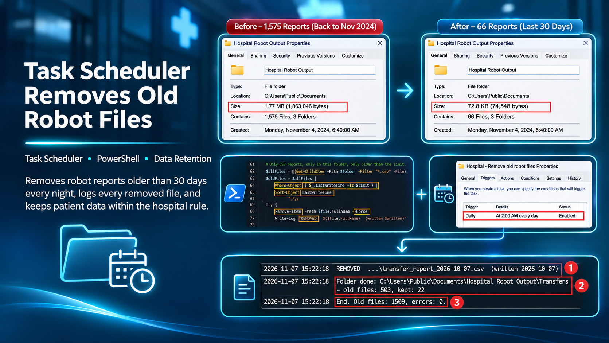

## 1. Project Goal

The goal of this project is to make sure that the files written by the hospital robots are not kept longer than the hospital allows. The robots save daily reports with patient data on the robot machine, and nobody removes the old ones.

The project shows how a short PowerShell script, started every night by Windows Task Scheduler, removes the old files and keeps a record of what was removed. All data in this project is fictional.

### 1.1 Before - Old Robot Reports Are Never Removed

1. **Write the reports:** Three robots write one report every weekday on the robot computer, each in its own folder under `C:\Users\Public\Documents\Hospital Robot Output`.
2. **Keep every report:** Nobody removes the reports. The folders keep every report since the robots started.
3. **No check against the rule:** The information security rule of the hospital says that robot output with patient data is kept for 30 days. Nothing checks that rule on the robot computer.

On Saturday, 7 November 2026, the folders held 1,575 reports. The oldest report was from 4 November 2024, and 1,509 reports were older than 30 days.

### 1.2 After - Windows Removes the Old Reports Every Night

1. **Write the reports:** The robots write their reports as before, to the same folders with the same file names.
2. **Start the cleanup at night:** Every night at 02:00, Windows Task Scheduler starts a short PowerShell script. No robot and no person is needed.
3. **Remove only old reports:** The script removes only the CSV reports older than 30 days, and only in the three robot folders.
4. **Keep a log:** Every removed report is written to a log, with a summary at the end.
5. **Check without risk:** With the option `-WhatIf`, the script only lists what it would remove, so the result can be checked before anything is removed.

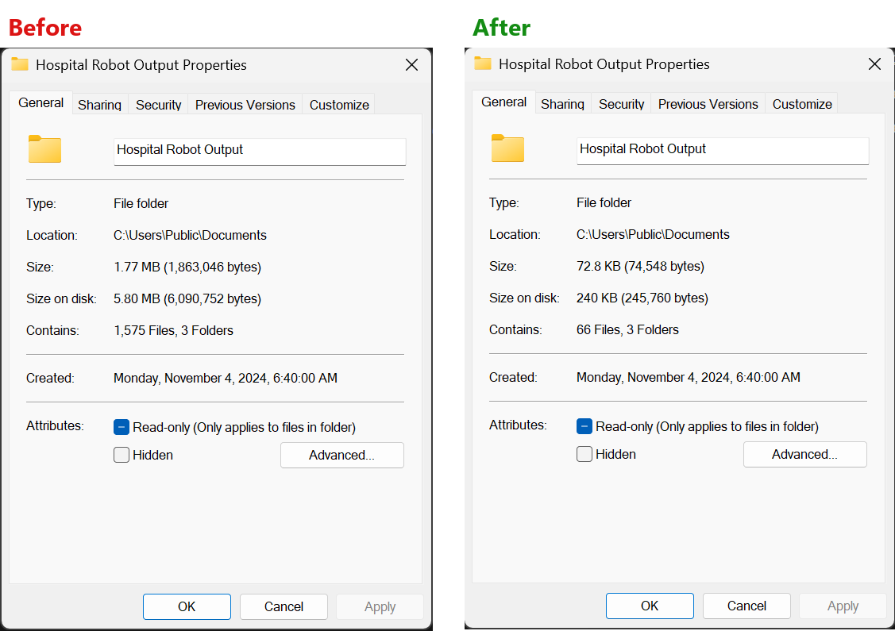

*The robot output folder before the cleanup (1,575 reports) and after it (66 reports).*

After the cleanup, the folders held 66 reports, all from the last 30 days, and the log shows exactly which reports were removed.

## 2. How the Robot Reports Are Kept Today

The hospital robots run on one robot computer. After each run, the robot saves a report as a CSV file, so that the staff and the support team can see what the robot did. All reports are saved in one place (Figure 1):

1. The folder `C:\Users\Public\Documents\Hospital Robot Output` on the robot computer.
2. One folder for each robot:
   - **Referral Check:** the robot that compares the referrals in two hospital systems writes `reconciliation_report_<date>.csv` every morning.
   - **Referral Lists:** the robot that lists the newly scanned referrals writes `referral_list_<date>.csv` every morning.
   - **Transfers:** the robot that retries failed patient transfers writes `transfer_report_<date>.csv` every afternoon.

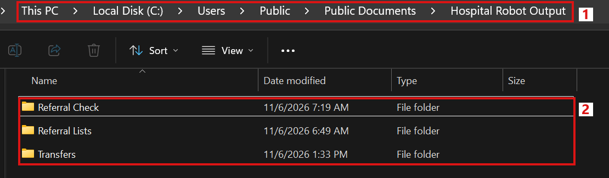

*Figure 1. The robot output folder with one folder for each robot.*

Each report is about patients: which referral or transfer was handled, and what was wrong with it. One report of the transfer robot shows this (Figure 2):

1. The time of the run, here 4 November 2024.
2. The transfer number of each patient transfer.
3. The reason why a transfer could not be completed, for example "personnummer saknas" (the personal identity number is missing).

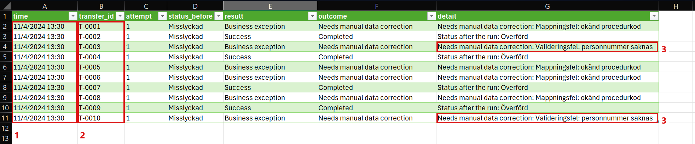

*Figure 2. The transfer report of 4 November 2024.*

The information security rule of the hospital says that robot output with patient data is kept for 30 days and then removed. The robots only write the reports. No part of the robots, and no person, removes them.

## 3. Two Years of Patient Reports on the Robot Computer

The Transfers folder shows how far back the reports go (Figure 3):

1. The oldest report is `transfer_report_2024-11-04`, written on 4 November 2024.
2. After that, there is one report for every weekday, and none of them has been removed.

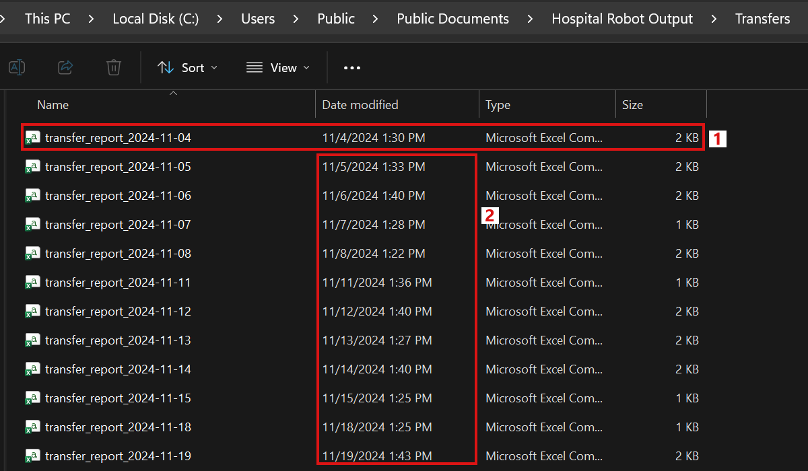

*Figure 3. The Transfers folder, oldest report first.*

The properties of the whole output folder show the size of the problem (Figure 4):

1. All reports together are only 1.77 MB, so the disk is not the problem.
2. The folder holds 1,575 reports.
3. The folder was created on 4 November 2024, and no report has been removed since then.

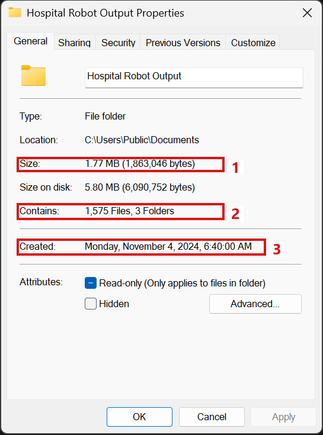

*Figure 4. The properties of the robot output folder on 7 November 2026.*

On Saturday, 7 November 2026, a report is allowed to stay if it was written on 8 October 2026 or later. The three folders looked like this:

| Folder | Reports | Oldest report | Older than 30 days | Allowed by the rule | Size |
|---|---|---|---|---|---|
| Referral Check | 525 | 4 November 2024 | 503 | 22 | 642 KB |
| Referral Lists | 525 | 4 November 2024 | 503 | 22 | 661 KB |
| Transfers | 525 | 4 November 2024 | 503 | 22 | 517 KB |
| **All folders** | **1,575** | **4 November 2024** | **1,509** | **66** | **1.77 MB** |

Only 66 of the 1,575 reports are allowed by the rule. The other 1,509 reports should have been removed, some of them almost two years ago.

For the patients and the hospital, this means:

- **Patient data is kept too long.** 1,509 reports with patient references are kept longer than the hospital allows, the oldest for two years.
- **The hospital breaks its own rule.** A security review of the robot computer would find two years of reports where only 30 days are allowed.
- **More data at risk.** If someone gets access to the robot computer, two years of patient reports can be read, not only one month.

For the support team, this means:

- **Nobody owns the job.** The robots only write reports, and removing them is not part of anyone's daily work.
- **Removing by hand is risky.** A person who removes old reports in File Explorer leaves no record of what was removed, and one wrong selection can also remove the reports of the last days.
- **The problem grows every day.** Three new reports are added every weekday, about 65 every month.

The robot computer keeps two years of patient reports, although the rule allows one month. Nothing removes them, and the number grows every weekday.

## 4. Finding the Cause

The robots work as they were built. Each robot has one job, to handle referrals or transfers and to write a report about it. Removing old files was never part of any robot, so the reports stay forever.

The cleanup could be added to UiPath, as one more process that runs every night and removes the old reports. But that means:

- A robot and a licence are used every night for a job that has no business logic.
- The cleanup runs only when the robot and Orchestrator are working.
- One more process must be built, published and kept up to date, only to remove files.

Windows already has the right tools for this job. PowerShell can find and remove files older than a given number of days and write a log line for each file. Task Scheduler can start the script every night at a fixed time, also when nobody is signed in and when no robot is running.

The cause is not a mistake in the robots. Removing old files is a housekeeping job of the computer, and nobody gave that job to the computer.

## 5. What Should Change

Removing the old reports by hand once would solve the problem for one day, but the reports would start to pile up again the next day. After the change, the following goals are expected to be met:

| Goal | Today (manual) | Expected after the fix |
|---|---|---|
| **Follow the rule** | 1,509 of 1,575 reports are older than 30 days, the oldest from 4 November 2024 | Only the reports of the last 30 days are kept |
| **Automatic** | Nobody removes the reports | The old reports are removed every night at 02:00, without a person |
| **Traceable** | There is no record of what was removed | A log lists every removed report |
| **Safe** | Removing by hand in File Explorer, where one wrong selection can also remove new reports | Only the three robot folders, only files older than 30 days, and a trial run that removes nothing |
| **Independent** | A cleanup in UiPath would need a robot, a licence and Orchestrator | The cleanup runs on Windows, without a robot and without Orchestrator |
| **Robots unchanged** | The robots write their reports to the three folders | The same folders, file names and columns |

In short, the robot computer should keep only the reports of the last 30 days, every day, without anyone having to remember it.

How it should look after the change:

1. **The robots write as today:** the same reports in the same folders.
2. **Task Scheduler starts the cleanup:** every night at 02:00, Windows starts one PowerShell script.
3. **PowerShell removes the old reports:** the script removes only the files older than 30 days in the three robot folders, and writes each removed file to a log.
4. **The support team can check:** the log shows what was removed, and the task history in Task Scheduler shows that the cleanup ran.

The robots keep their work, and Windows gets the cleanup. The goal is clear: only 30 days of reports, removed every night, with a log.

## 6. A Nightly Cleanup with PowerShell and Task Scheduler

Each problem from Sections 3 and 4 is solved by one part of the change. The robots, their folders and their reports stay the same.

**Problem 1:** Nobody removed the old reports.

*Solution:* A short PowerShell script, `Scripts\Remove-OldRobotFiles.ps1`, removes them. The whole script is about 100 lines long. Figure 5 shows all of it, with one short note for each part: the help text, the settings, the limit date, the log, the search for old reports, the removing, and the exit code for Task Scheduler.

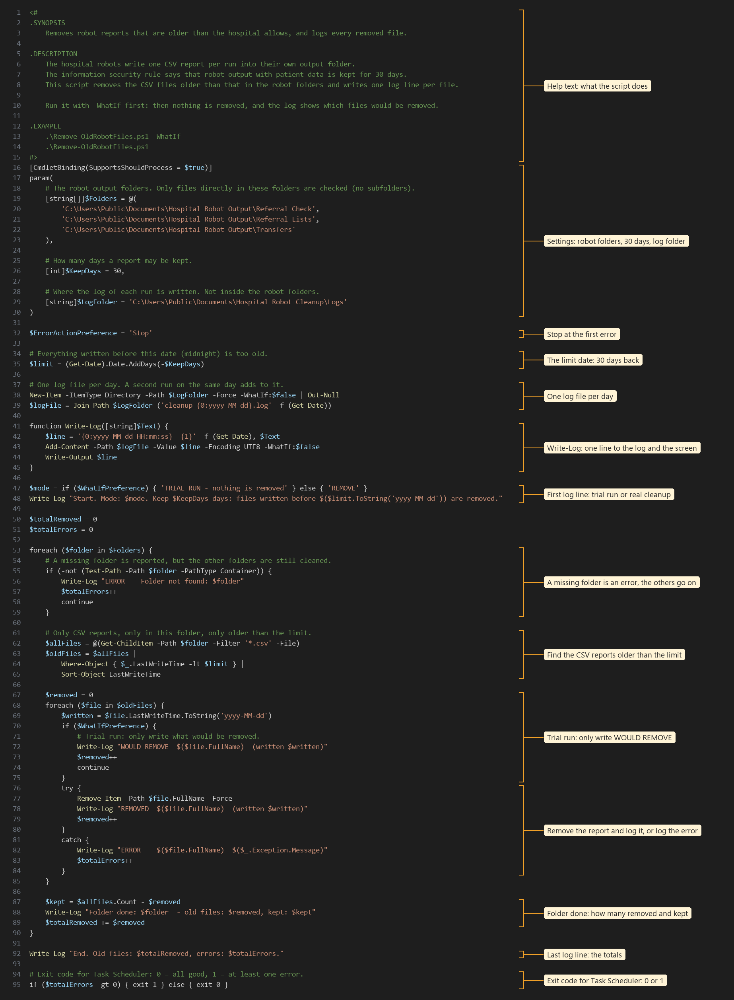

*Figure 5. Remove-OldRobotFiles.ps1 from the first to the last line, with its parts.*

The settings at the top are the three robot folders, the 30 days a report may be kept, and the folder for the log. The log folder is outside the robot folders, so the script never removes its own logs.

**Problem 2:** Removing by hand left no record of what was removed.

*Solution:* The script writes one log line for every report, with the full path and the date the report was written. One log file is kept for each day, in `C:\Users\Public\Documents\Hospital Robot Cleanup\Logs`.

Figure 6 shows the whole script again, now with the most important PowerShell words marked and a short note for each of them. For example, `Where-Object`, `LastWriteTime` and `-lt` together keep only the files that were written before the limit date.

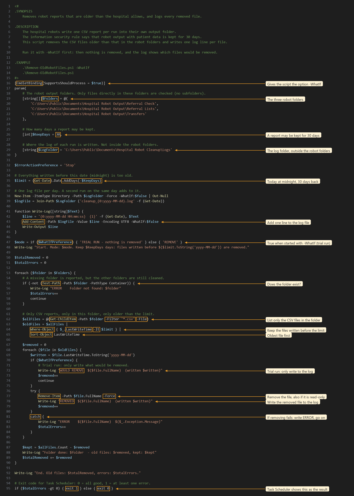

*Figure 6. Remove-OldRobotFiles.ps1 with the important PowerShell words marked.*

**Problem 3:** One wrong selection in File Explorer could also remove new reports.

*Solution:* The script can only touch the three robot folders, only CSV files, and only files older than 30 days. Before the first real cleanup, it was started by hand with the option `-WhatIf`. The log of this trial run starts like this (Figure 7):

1. The first line says "TRIAL RUN - nothing is removed" and that files written before 8 October 2026 are too old.
2. The oldest report, from 4 November 2024, would be removed.

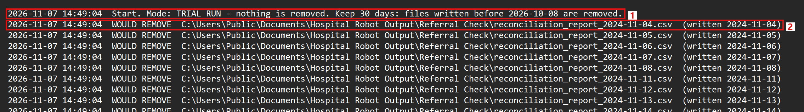

*Figure 7. The start of the trial run.*

The end of the same log shows the result of the trial run (Figure 8):

1. The newest report that would be removed is from 7 October 2026, one day before the limit.
2. In the Transfers folder, 503 reports would be removed and 22 kept.
3. In total, 1,509 reports would be removed, with no errors.

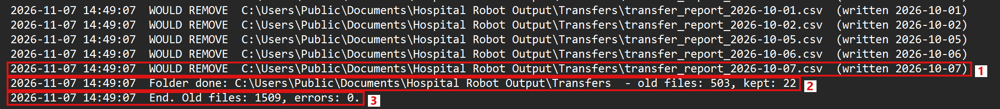

*Figure 8. The end of the trial run.*

The numbers match the table in Section 3 exactly, and all 1,575 reports were still in the folders after the trial run.

**Problem 4:** The cleanup must happen every night, without a person and without a robot.

*Solution:* A task in Windows Task Scheduler, "Hospital - Remove old robot files", starts the script. The General tab shows who runs it (Figure 9):

1. The name of the task.
2. The task runs as SYSTEM, the built-in account of Windows. No password is stored, and nobody has to be signed in.
3. Because of that, the task runs whether a user is signed in or not.

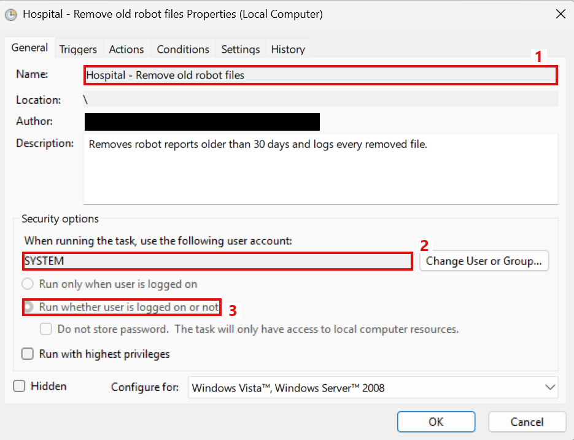

*Figure 9. The General tab of the task.*

The trigger starts the task every night (Figure 10):

1. Daily, at 2:00 AM.

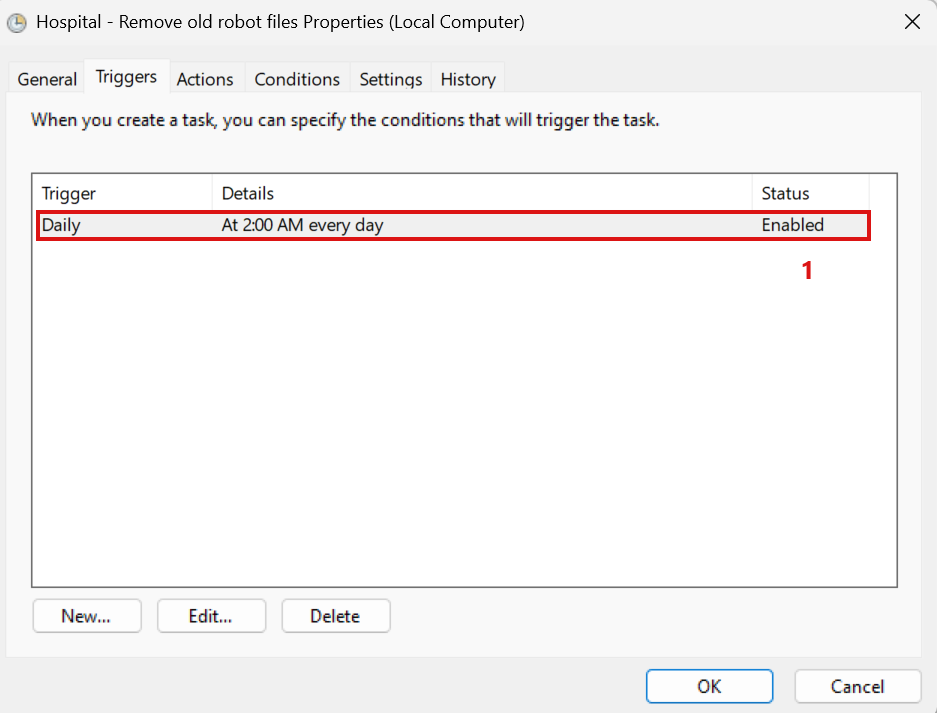

*Figure 10. The Triggers tab of the task.*

The action starts Windows PowerShell with the script (Figure 11):

1. The program is `powershell.exe`, with the arguments `-NoProfile -ExecutionPolicy Bypass -File "C:\Users\Public\Documents\Hospital Robot Cleanup\Remove-OldRobotFiles.ps1"`.

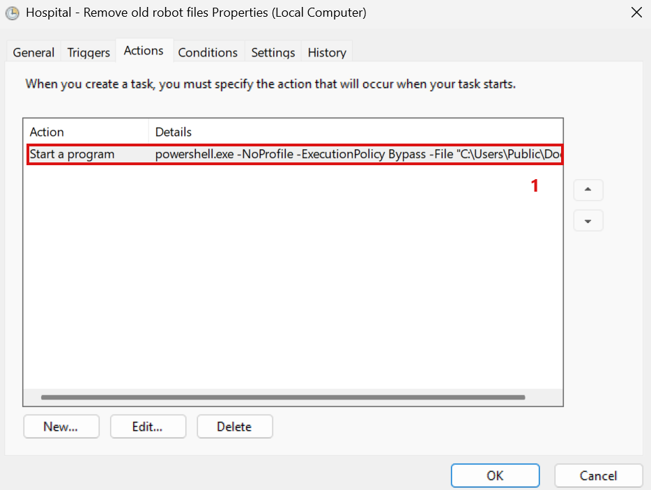

*Figure 11. The Actions tab of the task.*

The robot computer is a laptop, so three more settings make sure that the cleanup is not skipped (Figure 12):

1. The task also starts when the computer runs on battery.
2. The task asks Windows to wake the computer if it is asleep at 02:00.
3. If the computer was turned off at 02:00, the task runs as soon as possible after the computer starts again.

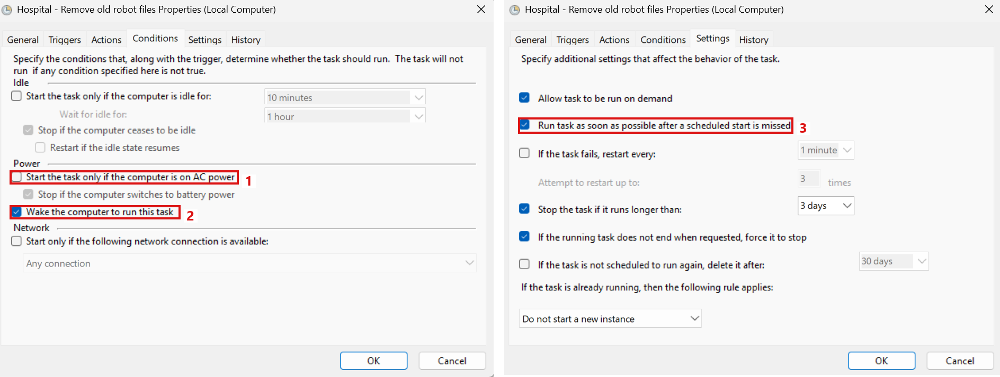

*Figure 12. The Conditions tab (left) and the Settings tab (right).*

The task was exported from Task Scheduler to `Scheduler\Hospital - Remove old robot files.xml`, so the same task can be imported on another robot computer.

Nothing in UiPath was changed. The robots still write their reports, and Windows now removes them when they are too old.

## 7. Testing the Cleanup

### 7.1 The First Cleanup

The task was started once from Task Scheduler with Run, on Saturday, 7 November 2026 at 15:22. It ran the same way as at night, as SYSTEM and without a window. Task Scheduler shows the result (Figure 13):

1. The task "Hospital - Remove old robot files" ran at 3:22:10 PM, and the next run is on 8 November at 2:00 AM.
2. The last run result is "The operation completed successfully. (0x0)", so the script returned 0.
3. The history shows "Task completed" eight seconds later.

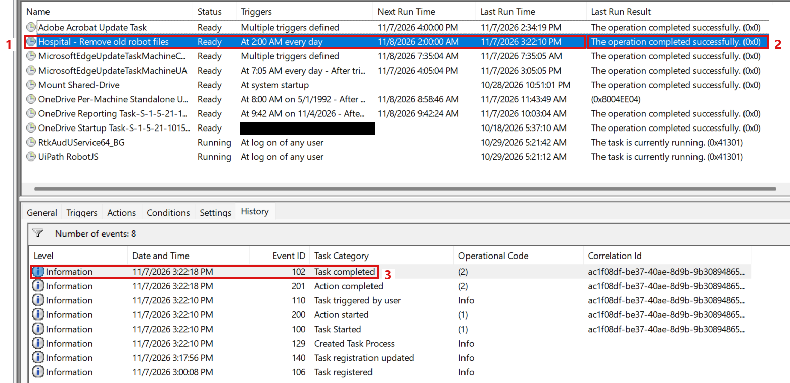

*Figure 13. The task after the run, with its history.*

The log shows what was removed (Figure 14):

1. The last removed report in the Transfers folder is from 7 October 2026.
2. In the Transfers folder, 503 reports were removed and 22 kept.
3. In total, 1,509 reports were removed, with no errors.

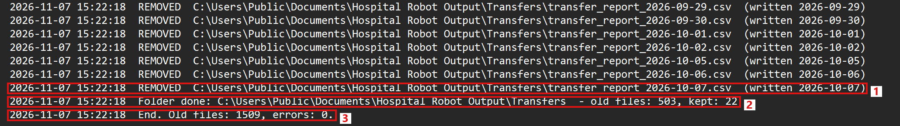

*Figure 14. The end of the log of the cleanup.*

The Transfers folder now starts at the limit date (Figure 15):

1. The oldest report is from 8 October 2026, exactly 30 days back.
2. The newest report, from 6 November 2026, is still there.

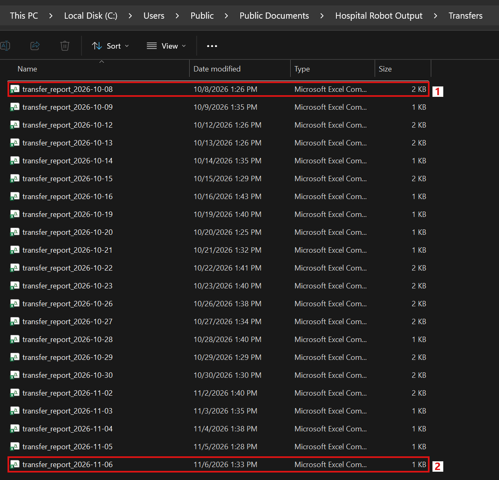

*Figure 15. The Transfers folder after the cleanup, oldest report first.*

The properties of the output folder show the result for all three folders (Figure 16):

1. The size went down from 1.77 MB to 72.8 KB.
2. The folder holds 66 reports instead of 1,575.

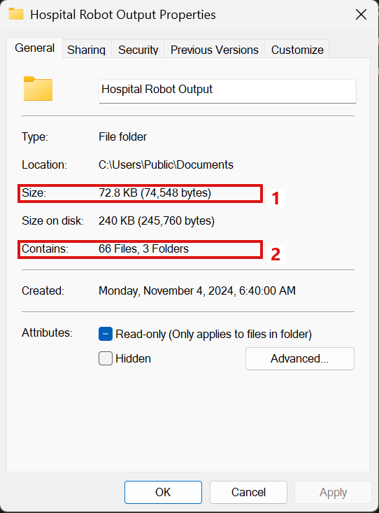

*Figure 16. The properties of the robot output folder after the cleanup.*

| Folder | Reports before | Removed | Reports after | Oldest report after |
|---|---|---|---|---|
| Referral Check | 525 | 503 | 22 | 8 October 2026 |
| Referral Lists | 525 | 503 | 22 | 8 October 2026 |
| Transfers | 525 | 503 | 22 | 8 October 2026 |
| **All folders** | **1,575** | **1,509** | **66** | **8 October 2026** |

### 7.2 The First Night

The next night was the first run without any person. The laptop was asleep at 02:00. When it woke up at 03:10, Task Scheduler saw that the 02:00 start was missed and started the task at once, because of the setting "Run task as soon as possible after a scheduled start is missed" (Figure 17):

1. The task ran at 3:10:20 AM on 8 November, and the next run is on 9 November at 2:00 AM.
2. The last run result is again "The operation completed successfully. (0x0)".
3. The history shows "Task triggered on scheduler": the task was started by the schedule, not by a person.
4. The task was completed less than a minute later.

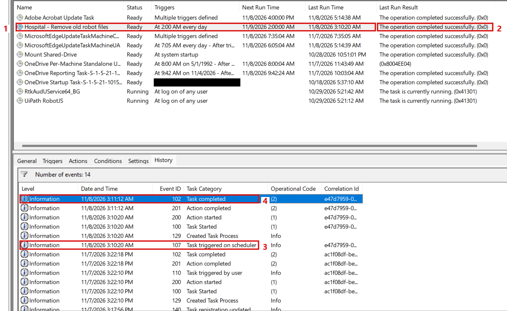

*Figure 17. The task after the first night, with its history.*

One day later, the limit date had moved one day forward. The log of the night shows this (Figure 18):

1. Files written before 9 October 2026 are now too old.
2. The report of 8 October was removed from each folder, here from the Transfers folder.
3. In total, 3 reports were removed, one from each folder, with no errors.

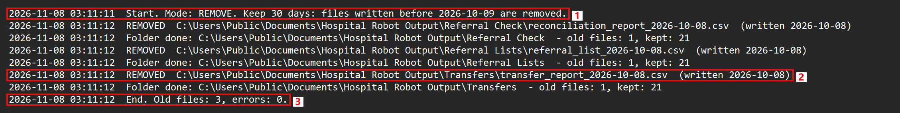

*Figure 18. The log of the cleanup on the first night.*

This is how the cleanup works from now on: every night, the reports that have just become older than 30 days are removed, and the log of that day lists them.

### 7.3 The Goals After the Cleanup

The goals from Section 5 were checked against these two runs:

| Goal | Result |
|---|---|
| **Follow the rule** | Only the 66 reports of the last 30 days are kept. The oldest is from 8 October 2026 |
| **Automatic** | The first night ran without any person. The laptop was asleep at 02:00, and the missed run started as soon as it woke up |
| **Traceable** | The logs list all 1,509 reports of the first cleanup and the 3 reports of the first night, one line each |
| **Safe** | The trial run listed the same 1,509 reports before anything was removed. Only the three robot folders were touched |
| **Independent** | Both runs ran as SYSTEM from Task Scheduler, without a robot and without Orchestrator |
| **Robots unchanged** | The 66 newest reports, the folders and the file names are the same as before |

Some things had to stay the same, and they did:

- **The reports of the last 30 days.** After each run, every report inside the 30 days is still there. After the first night, 21 reports are left in each folder, from 9 October to 6 November.
- **Other folders on the robot computer.** Other output folders in `C:\Users\Public\Documents` were not touched, because the script only knows the three robot folders.
- **The robots.** Nothing in UiPath was changed, and the robots write to the same folders as before.

Two years of patient reports were kept on the robot computer, because nobody owned the cleanup. Now a short PowerShell script, started by Task Scheduler every night, keeps only the last 30 days and logs every removed report. It needs no robot, no licence and no person.
