# P09 - Power Query Cleans a Messy System Export

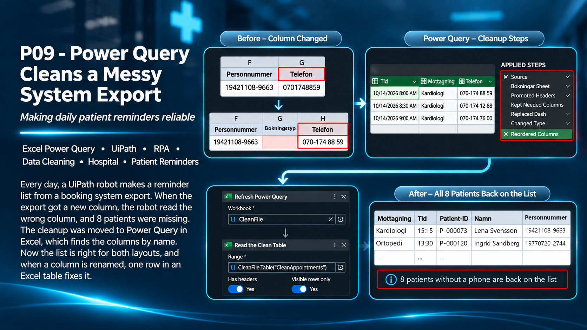

## 1. The Project: Making Daily Reminders Reliable

Every day, a UiPath robot makes a reminder list for the hospital clinics from the booking system's export of tomorrow's appointments. The export is made for printing, not for a robot, so it must be cleaned before the list can be made.

This project shows what happened when the layout of the export changed, and how the cleanup was moved to Power Query to make the list reliable. Power Query is a tool inside Excel that reads data from a file and cleans it with saved steps. All data in this project is fictional.

### 1.1 The Daily Patient Reminder List

Every afternoon at 15:00, the booking system BOKSYS exports the appointments of the next day. The export is an Excel file named `Bokningar_<date>.xlsx` in the shared folder `Exports\Appointments` on the hospital file server.

A UiPath robot reads the export and makes the reminder list `Påminnelser_<date>.xlsx` with two sheets:

- **Per mottagning:** the number of booked appointments for each clinic, so that the clinics can plan the next day.
- **Utan telefon:** the booked patients without a phone number. These patients cannot get the SMS reminder, so the reception contacts them in another way.

### 1.2 Before the Fix: The Robot Cleans the Export

1. **The daily export:** Every afternoon at 15:00, BOKSYS exports tomorrow's appointments to an Excel file. The file is designed for printing, not for a robot to read. It has title rows, headings spread over two rows, empty rows between the clinics and a total row at the end.
2. **The data needs cleaning:** The same clinic can appear as "Kardiologi", "Kard." or "KARDIOLOGI". Appointment times are stored as text, such as "13 okt 2026 kl 08:15". Missing phone numbers can be empty cells, "-" or "saknas". These differences must be cleaned before the robot can make the reminder list.
3. **The robot does all the cleaning:** The UiPath robot uses 30 activities to remove unwanted rows, clean the values and prepare the data. Only after these steps can it count the appointments and find the patients without a phone number.
4. **The robot depends on column positions:** The headings are spread over two rows, so the robot does not search for a column named "Telefon". Instead, it always reads column G, because that was where the phone numbers were when the robot was built.
5. **The reminder list is created:** After cleaning the export, the robot counts the booked appointments for each clinic and lists the booked patients without a phone number. The reception uses this list to contact the patients who cannot receive an SMS reminder.

**Then something changes.** On 13 October, the booking system was updated. The export for 14 October included a new column called "Bokningstyp", which moved the phone numbers one column to the right. The numbers in Figure 1 match these parts:

1. In the export for 13 October, column G contains **Telefon**.
2. In the export for 14 October, column G contains the new column **Bokningstyp**.
3. **Telefon** has moved to column H.

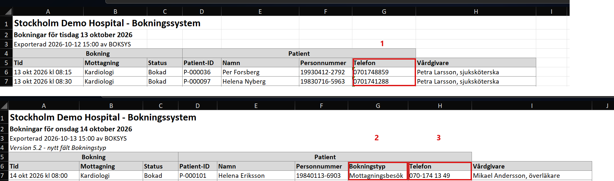

*Figure 1. The tops of the exports for 13 October (above) and 14 October (below).*

**The robot does not notice the change.** It continues reading column G as if it contains phone numbers, but column G now contains booking types, such as "Mottagningsbesök". The robot finishes without an error. The number of appointments per clinic is correct, but the list of patients without a phone number is empty.

In reality, 8 booked patients have no phone number. None of them appears on the list, so the reception does not contact them.

**Why is this a problem?**

- **For the patients and the clinics:** Patients without a phone number receive no SMS, and the reception does not know that it should contact them in another way. If a patient forgets the appointment, the clinic loses that time, and the patient must wait for a new appointment.
- **For the reception:** The reminder list looks normal. The appointment counts are correct, and an empty list of patients without a phone number is possible. There is no clear sign that something went wrong.
- **For IT support:** The robot finishes successfully, so there is no error message to investigate. When the problem is discovered, a developer must find and change the affected activities, test the robot and publish it again. The same work may be needed whenever the export layout changes.

### 1.3 After the Fix: Power Query Takes Over

The solution is to move the cleaning work from the UiPath robot into Power Query in Excel. The booking system and the final reminder list stay the same.

1. **BOKSYS exports the appointments as usual:** Every afternoon at 15:00, BOKSYS saves tomorrow's appointments in the same folder. The export still has title rows, mixed clinic names, text dates and other values that need cleaning.
2. **Power Query cleans the data:** An Excel file uses Power Query to read the export and apply saved cleaning steps. It removes the unwanted rows, fixes the values and prepares the appointments for the robot.
3. **Columns are found by name, not position:** Power Query finds the headings and uses column names such as "Telefon" instead of fixed positions. It does not matter whether "Telefon" is in column G or H.
4. **One clean table is ready:** Power Query produces a table called `CleanAppointments`, with one row per appointment and the same eight columns every day.
5. **The robot has less work:** Instead of running 30 cleaning activities, the UiPath robot refreshes the Excel file and reads `CleanAppointments`. It then creates the same reminder list as before, with the appointment counts per clinic and the patients without a phone number.
6. **A missing column stops the robot:** If a required column is missing, the refresh fails and the clean table stays empty. The robot stops with an error instead of making a list, and Excel shows which column is missing.
7. **A renamed column needs one row in Excel:** If the booking system gives a column a new name, the new name is added to a small table in the Excel file. Power Query then reads the column with its old name, and no workflow is changed.

**What happens with the export for 14 October now?** The new "Bokningstyp" column no longer causes the same problem. Power Query finds "Telefon" in column H and reads the correct phone numbers. All 8 patients without a phone number appear on the list for the reception, and the number of appointments per clinic stays correct, just as before.

**The main difference:** The robot no longer needs to understand the messy export. Power Query handles the cleaning, and the robot works with a table that has the same structure every day.

### 1.4 Before vs. After

| | Before (cleanup in the robot) | After (Power Query) |
|---|---|---|
| Robot activities (steps) to get a clean table | 30 | 9 (copy the file, refresh it, read the table) |
| Where the cleanup steps are seen | Hidden inside the robot's workflow | As named steps in the Power Query Editor |
| How the phone number is found | Always column G | The column called "Telefon" |
| Booked appointments, 13 and 14 October | 83 and 94 | 83 and 94 |
| Patients without a phone number on the list, 13 October | 8 of 8 | 8 of 8 |
| Patients without a phone number on the list, 14 October | **0 of 8** | 8 of 8 |
| When a column is added or moved | A wrong list without any error | The right list, no change needed |
| When a needed column is renamed | Not seen, the column is read by its position | One new row in a table in Excel, no workflow changed |
| When a needed column is missing | A wrong list without any error | The robot stops, and Excel names the missing column |
| Work for IT support after a layout change | Find the activity, change it, test and publish the robot again | None when a column is added or moved. One row in Excel when a column is renamed |

- After the change, the run for 14 October put all 8 booked patients without a phone number on the list. Before, the list was empty.
- The run for 13 October gave the same result as the old robot: 83 booked, 5 cancelled and 8 patients without a phone number.
- The same Power Query steps worked for both export layouts, with Telefon in column G and in column H, without any change.
- On 15 October, "Telefon" was renamed to "Mobilnummer". First the robot stopped instead of making a wrong list, and Excel named the missing column. After one row was added to a table in the Excel file, the list for 15 October was made with all 8 patients without a phone number, and no workflow was changed.

## 2. How It Started: A Messy Export and a Robot That Cleans It

To understand the problem, it helps to see first how the export looks and how the robot handled it on a normal day, with the export for 13 October.

The export looks like a printed report, not like a table. It has these parts (Figure 2):

1. Three title rows above the table.
2. The column headings in two rows. The upper row has merged cells, "Bokning" and "Patient".
3. **Tid** is text, for example "13 okt 2026 kl 08:15", not a real date and time.
4. **Mottagning** is written in many ways: "Kardiologi", " kardiologi" with a space, "Kard." and "KARDIOLOGI".
5. **Telefon** is written in many formats, and sometimes as "saknas" (missing) instead of an empty cell.

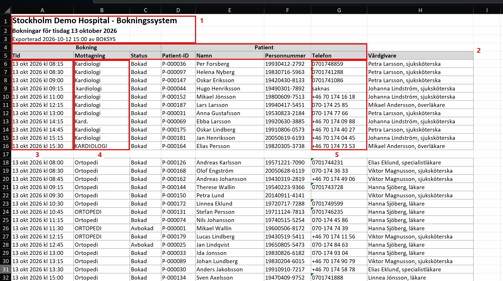

*Figure 2. The top of the export for 13 October 2026.*

The end of the same export has more rows that are not appointments (Figure 3):

1. An empty row between the clinics.
2. An empty phone number. Other rows use "-" for the same thing.
3. The total row, "Totalt antal bokningar: 88".

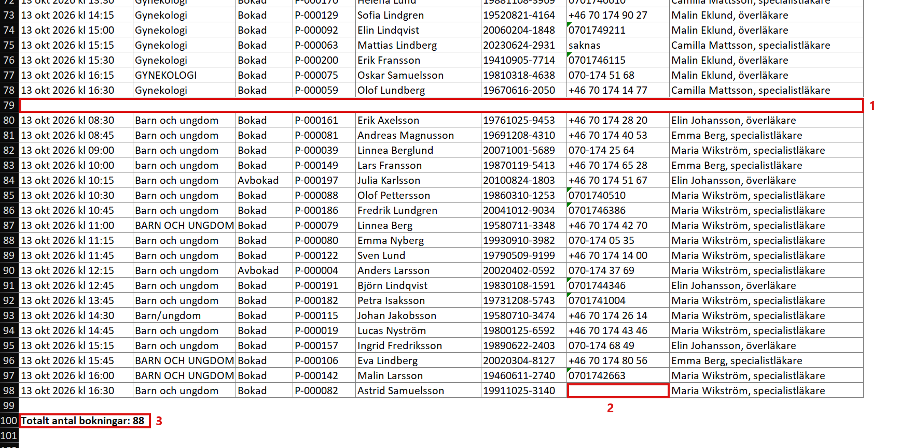

*Figure 3. The end of the export for 13 October 2026.*

Because of this layout, the robot does all the cleanup itself before it can count anything:

1. **Read the whole sheet:** The sheet "Bokningar" is read without headers, because the headings are spread over two rows.
2. **Keep only the appointments:** A row is kept only when column A contains " kl ". The title rows, the headings, the empty rows and the total row are skipped.
3. **Make a real date:** The text in column A is split, and the month is looked up in a list of short Swedish month names (jan, feb, ... okt, nov, dec).
4. **Fix the clinic names:** The name is trimmed and changed to lower case. A Switch writes the short names in full, and the first letter is made a capital.
5. **Clean the phone number:** "-" and "saknas" are changed to an empty value.
6. **Copy the columns by position:** Each value is taken by its place in the row. Column B is the clinic, and column G is the phone number. This last point becomes important later.

The cleanup is in the workflow `ReadAndCleanExport.xaml` (Figure 4):

1. The time text from column A, and the check for " kl ".
2. The time text is split and turned into a real date and time.
3. The clinic from column B, and the Switch with six short names.
4. The phone number from column G, `CurrentRow(6)` (the robot counts from 0, so 6 means column G), and the check for "-" and "saknas".
5. The clean row, with all values in a fixed order.

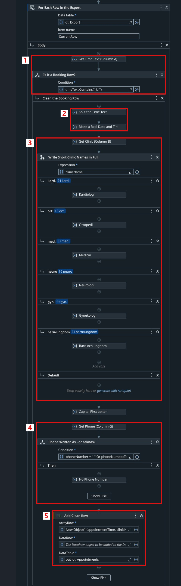

*Figure 4. The loop that cleans each row of the export in UiPath Studio.*

The cleanup workflow has 30 activities. After the cleanup, a second workflow, `MakeReminderList.xaml`, does the real work: it counts the appointments and writes the two sheets. Its loop goes through the appointments (Figure 5):

1. Only the appointments with the status "Bokad" (booked) are used.
2. The booked appointment is counted, both in total and for its clinic.
3. When the column Telefon is empty, the patient is added to the list without a phone number.
4. A cancelled appointment is only counted.

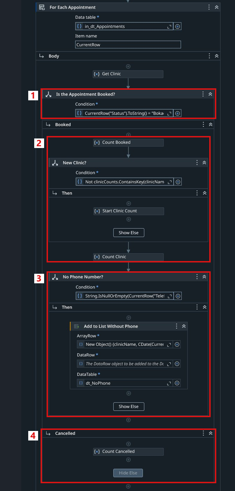

*Figure 5. The loop that counts the appointments and collects the patients without a phone number.*

The robot was run in UiPath Studio for the export of 13 October (Figure 6):

1. The cleanup workflow is started from `Main.xaml`.
2. 100 rows were read, and 88 appointments were left after the cleanup. This is the same number as the total row of the export.
3. The number of booked appointments for each clinic.
4. 83 booked, 5 cancelled, and 8 patients without a phone number.

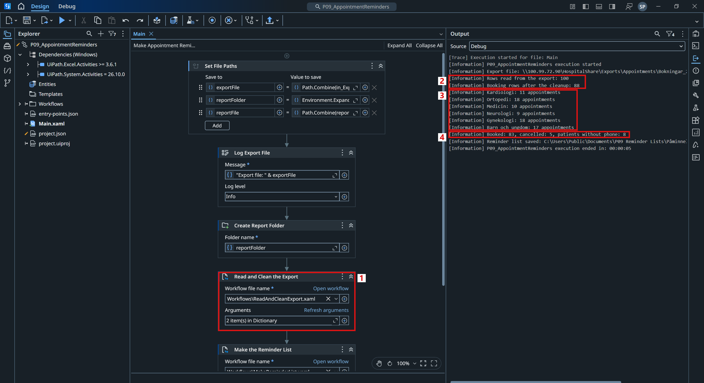

*Figure 6. The run for 13 October and the Output panel.*

The reminder list for 13 October has the right numbers (Figure 7):

1. The sheet "Per mottagning", with the six clinics.
2. The sheet "Utan telefon", with the 8 booked patients without a phone number.

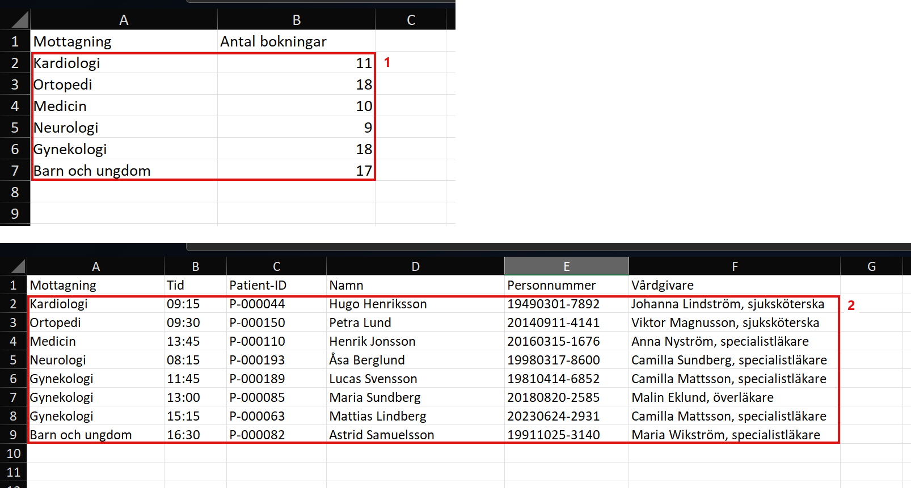

*Figure 7. The two sheets of `Påminnelser_2026-10-13.xlsx`.*

The robot gives the right result for this export. But everything it knows about the export is hidden in 30 activities, and every column is found only by its position. This works only as long as the layout of the export never changes.

## 3. October 14: The Robot Runs Successfully, but Patients Are Missing

On 13 October at 15:00, BOKSYS exported the appointments for the next day, 14 October, and the robot made the reminder list as usual. The run ended without any error (Figure 8):

1. 113 rows were read, and 100 appointments were left after the cleanup. The total row of the export also says 100.
2. The number of booked appointments for each clinic is right.
3. "patients without phone: 0".

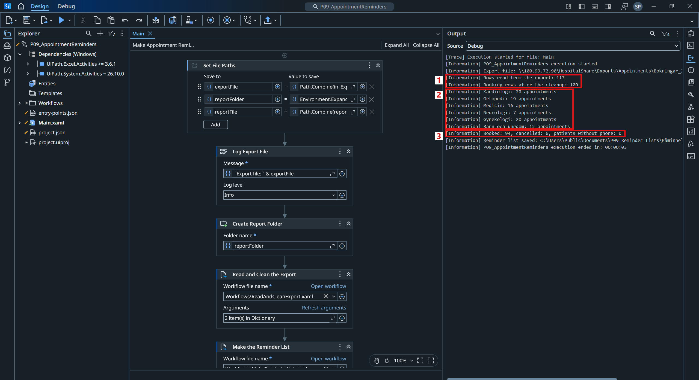

*Figure 8. The run for 14 October and the Output panel.*

The sheet "Utan telefon" has only the headings (Figure 9):

1. No patients in the list.

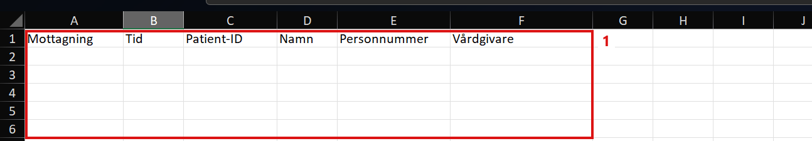

*Figure 9. The sheet "Utan telefon" of `Påminnelser_2026-10-14.xlsx`.*

But the export for 14 October has 8 booked patients without a phone number: P-000073 (Kardiologi), P-000120 and P-000078 (Ortopedi), P-000034 (Medicin), P-000159, P-000068 and P-000062 (Gynekologi), and P-000015 (Barn och ungdom). None of them is on the list.

Eight patients were missing from the list, and the run gave no sign of it. For the reception, the list looked normal.

## 4. Finding the Cause: The Robot Depends on Column G

The run had no error, so there was no message to start from. Instead, the exports of 13 and 14 October were compared in Excel. The export for 14 October looks different (Figure 10):

1. A new title row, "Version 5.2 - nytt fält Bokningstyp" (new field Bokningstyp). The booking system was updated.
2. Because of the new title row, the headings are now in rows 5 and 6, not in rows 4 and 5.
3. A new column, **Bokningstyp** (type of booking), in column G.
4. **Telefon** has moved from column G to column H, and **Vårdgivare** from column H to column I.

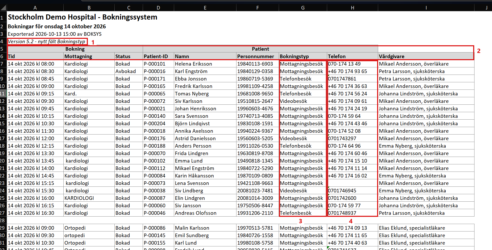

*Figure 10. The top of the export for 14 October 2026, after the update of the booking system.*

The extra title row did not matter, because the robot keeps the rows that contain " kl ", not a fixed row number. The columns A to F did not move either, so the time, the clinic and the status were still right. This is why the numbers per clinic are correct.

The phone number is different. The robot reads it from column G with `CurrentRow(6)` (Figure 4, number 4). Column G now holds Bokningstyp, for example "Mottagningsbesök", and that cell is never empty. So every patient seems to have a phone number, the check for an empty phone number (Figure 5, number 3) is never true, and the list "Utan telefon" stays empty. In the same way, the real phone number from column H is copied into the column Vårdgivare of the clean table.

Why does the robot use positions at all? Because it cannot easily read the columns by name: the headings are spread over two rows with merged cells, and the heading row moves when a title row is added. Cleaning data like this is a data job, but here it is built from 30 activities inside the robot. So every new column, new spelling or new row in the export needs a developer to find the right activity, change it, test it and publish the robot again.

The export of 14 October changed the place of one column, and the robot gave a wrong reminder list without any error. The cause is not the new column itself, but a cleanup that depends on the exact layout of the export.

## 5. Defining the Fix: One Reliable List, Even When the Layout Changes

The quickest fix would be to tell the robot to read column H instead of column G (`CurrentRow(7)` instead of `CurrentRow(6)`). That would make the list for 14 October right, but an export in the old layout, like the one for 13 October, would then be read wrong, and the next change in the booking system would break the list again. The cleanup itself has to stop depending on the layout of the export.

The fix has these goals:

| Goal | Before the fix (cleanup in the robot) | Expected after the fix |
|---|---|---|
| **Right list without phone** | 0 of 8 patients on the list for 14 October | All 8 patients on the list for 14 October |
| **Columns found by name** | Found by position, so column G is read as the phone number | Found by the heading name, so a new or moved column does not change the result |
| **Headings found by their content** | The headings are skipped, and the values are copied by position | The heading row is found by its content, not by a fixed number of title rows |
| **Same result as before** | 13 October: 83 booked, 5 cancelled, 8 without phone | The same numbers for 13 October, and 94 booked, 6 cancelled, 8 without phone for 14 October |
| **Cleanup outside the robot** | 30 activities in `ReadAndCleanExport.xaml` | Saved Power Query steps in an Excel file. The robot only refreshes the file and reads one clean table |
| **Steps that can be checked** | Hidden inside the robot's workflow | Each step listed by name in the Power Query Editor |
| **A clear error for a missing column** | A wrong list without any error | The robot stops instead of making a list, and Excel names the missing column |

In short, the reminder list must be right for both export layouts, and a change in the export must either be handled by the cleanup or stop the robot with a clear error, never give a wrong list.

## 6. The First Fix: Let Power Query Handle the Cleanup

The first fix moves the cleanup out of the robot and into Power Query. Power Query is part of Excel. It reads the export, cleans it with a list of saved steps, and puts the result in a normal Excel table. Every time the Excel file is refreshed, the same steps run again on the new export.

Each problem found in Sections 3 and 4 is solved by one part of the fix:

**Problem 1: The columns are taken by position.** The phone number is always read from column G, so a new column moves the data under the robot.
*Solution: Power Query takes the columns by name.* The heading row is found where column A says "Tid", and every column is chosen by its heading, such as "Telefon".

**Problem 2: The cleanup is hidden in 30 activities.** Every change in the export needs a developer to change the robot.
*Solution: The cleanup is saved as steps in an Excel file.* Each step has a name and can be checked in the Power Query Editor. The robot only refreshes the file and reads one clean table.

**Problem 3: A wrong list is made without any error.** Nothing stops the robot when the export does not look as expected.
*Solution: The robot stops when the clean table is empty.* The Excel file is saved with an empty table. If Power Query cannot read the export, the table stays empty, and the robot stops with an error instead of making a list.

### 6.1 Preparing Excel to Clean the Export Automatically

The Excel file `Templates\Appointments_Clean.xlsx` is part of the UiPath project. It has three sheets and holds the cleanup steps. A fourth sheet is added later, in Section 8.2.

The sheet "Inställningar" (settings) holds the path of the export that is cleaned (Figure 11):

1. The robot writes the path of the day's export into cell B1 before every refresh.

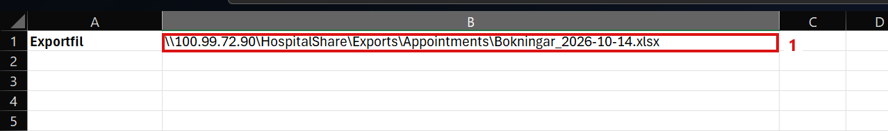

*Figure 11. The export file path in the sheet Inställningar.*

The sheet "Mottagningar" (clinics) holds a small table, `ClinicNames`, with every way a clinic is written in the export and the right name for it (Figure 12):

1. "Skrivs som" (written as) is the name in lower case, as it can appear in the export, and "Mottagning" is the right name. A new spelling only needs a new row in this table.

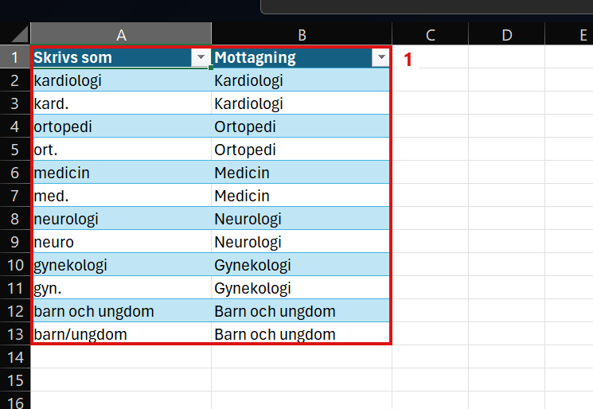

*Figure 12. The table ClinicNames in the sheet Mottagningar.*

The query `CleanAppointments` holds the cleanup steps. They are shown under Applied Steps in the Power Query Editor (Figure 13):

1. The export file is opened from the path in cell B1, and the sheet "Bokningar" is read.
2. The row with the heading "Tid" is found, the title rows above it are removed, and that row becomes the headings.
3. Only the eight needed columns are kept, chosen by name. Only the rows with " kl " in Tid are kept, and spaces are trimmed.
4. The clinic name is changed to lower case and matched with the table `ClinicNames`. The rows keep the order of the export.
5. "-", "saknas" and empty text in Telefon are changed to an empty value.
6. "kl" is removed from Tid, and the text is turned into a real date and time.
7. The result has 8 columns and 100 rows for 14 October.

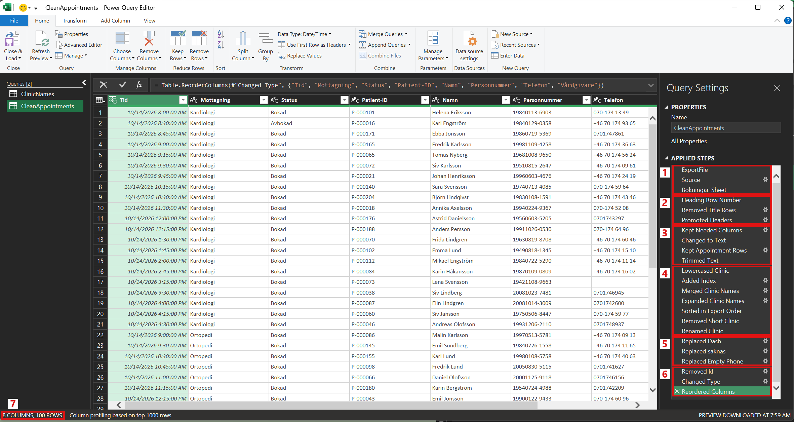

*Figure 13. The query CleanAppointments and its Applied Steps.*

The query loads the result into the sheet "CleanAppointments" (Figure 14):

1. Tid is a real date and time.
2. Every clinic has one name.
3. The patient P-000073 has an empty phone number. In the export, Telefon was in column H on this day.

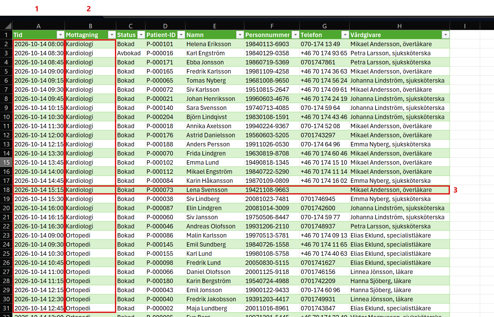

*Figure 14. The table CleanAppointments after the refresh for 14 October.*

### 6.2 Updating UiPath to Refresh Excel and Read One Table

The 30 cleanup activities were replaced by the workflow `RefreshCleanTable.xaml` (Figure 15):

1. The Excel file is copied from the project to the report folder. The copy starts with an empty table, so a result from an earlier day can never be read by mistake.
2. The copy is opened with Use Excel File.
3. The path of the export is written into cell B1 of the sheet Inställningar.
4. Refresh Excel Data Connections runs the Power Query steps.
5. The table `CleanAppointments` is read into the robot as a table (a DataTable).
6. If the table is empty, the robot stops with the error "Power Query gave no appointments" and the name of the file to check.

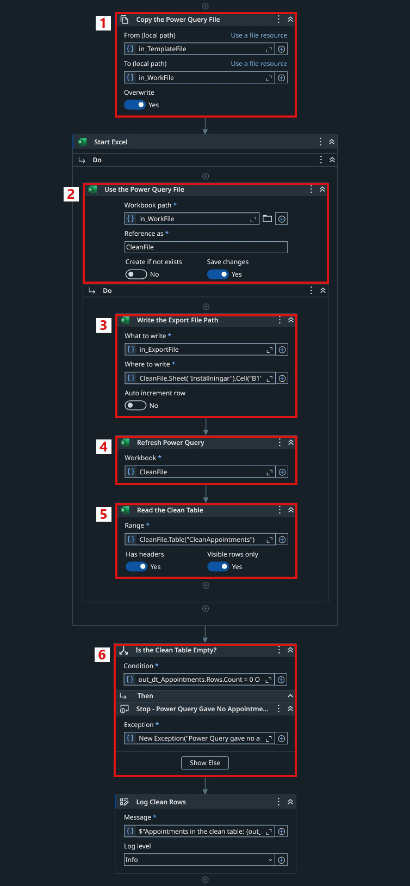

*Figure 15. The workflow RefreshCleanTable.xaml.*

In `Main.xaml`, only two things changed (Figure 16):

1. Two new paths: the Excel file in the project, and its copy in the report folder.
2. The workflow "Refresh the Clean Table" is started instead of the old cleanup.

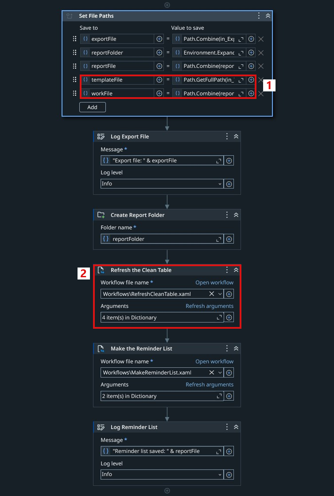

*Figure 16. Main.xaml after the change.*

The workflow `MakeReminderList.xaml` was not changed. It gets a table with the same eight columns as before, so it counts and writes the list in the same way.

## 7. Testing the Fix: Does It Work With Both Export Layouts?

The fix was tested with the two exports from before: 14 October, with the new layout that gave the wrong list, and 13 October, with the old layout that worked. Both must give the right list with the same steps.

### 7.1 October 14 Revisited: All 8 Patients Are Back

The export of 14 October gave the wrong list in Section 3. After the fix, the run should give these results:

| 14 October | Before the fix | Expected after the fix |
|---|---|---|
| Appointments after the cleanup | 100 | 100 |
| Booked appointments | 94 | 94 |
| Patients without a phone number on the list | **0 of 8** | 8 of 8 |

The robot was run again for 14 October, with the same export as in Section 3 (Figure 17):

1. The robot started "Refresh the Clean Table".
2. 100 appointments are in the clean table.
3. The numbers per clinic are the same as before.
4. 94 booked, 6 cancelled and 8 patients without a phone number.

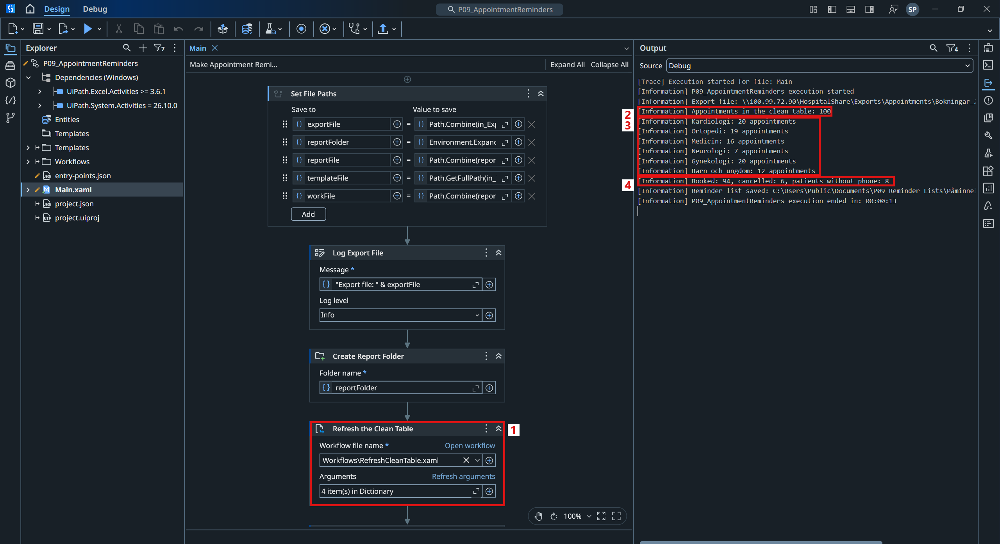

*Figure 17. The run for 14 October with Power Query.*

The reminder list now has all the patients (Figure 18):

1. The sheet "Per mottagning", with the same numbers as before.
2. The sheet "Utan telefon", with the 8 patients that were missing: P-000073, P-000120, P-000078, P-000034, P-000159, P-000068, P-000062 and P-000015.

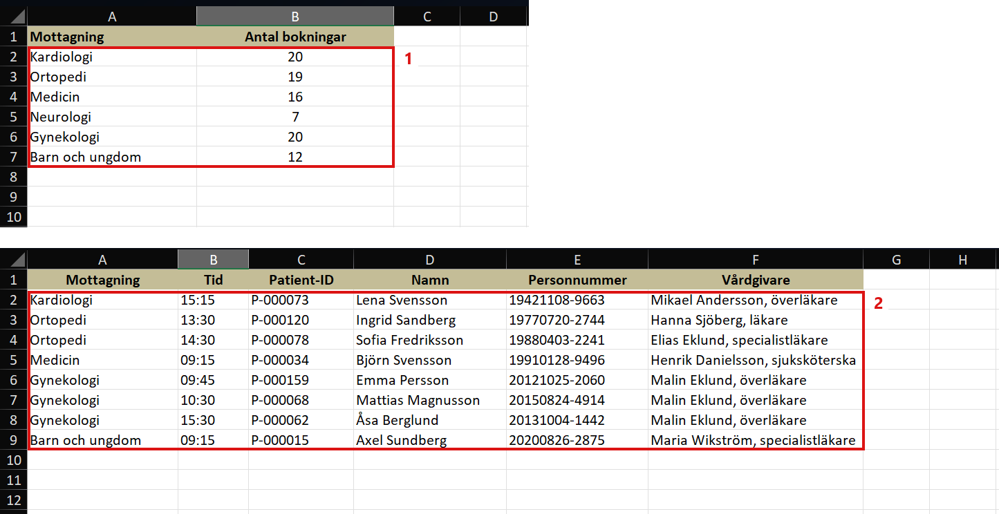

*Figure 18. The two sheets of `Påminnelser_2026-10-14.xlsx` after the fix.*

All the expected results in the table were reached. The 8 patients who were missing before are now on the list.

### 7.2 October 13 Revisited: The Old Layout Still Works

The export of 13 October has the old layout, with Telefon in column G. It worked before, so the result should not change:

| 13 October | Before the fix | Expected after the fix |
|---|---|---|
| Appointments after the cleanup | 88 | 88 |
| Booked and cancelled appointments | 83 and 5 | 83 and 5 |
| Patients without a phone number on the list | 8 of 8 | 8 of 8 |

The robot was run for 13 October (Figure 19):

1. 88 appointments are in the clean table.
2. 83 booked, 5 cancelled and 8 patients without a phone number, the same as with the old robot.

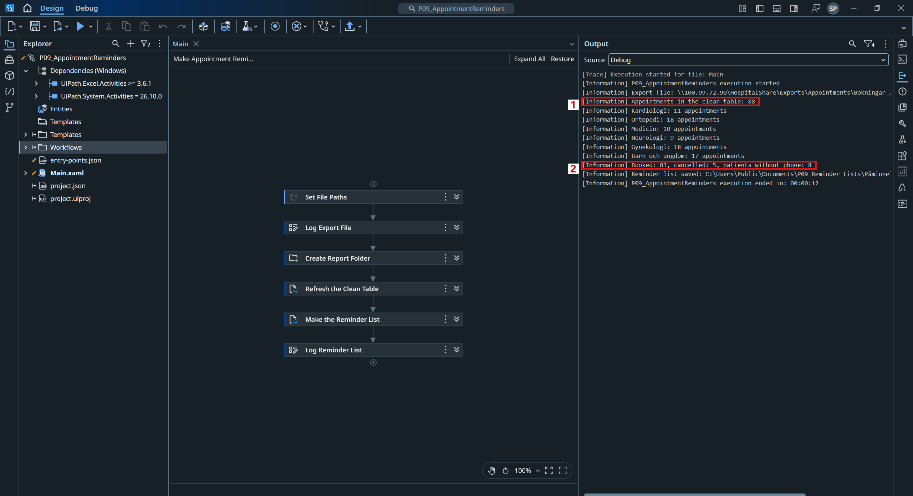

*Figure 19. The run for 13 October with Power Query.*

All the expected results in the table were reached. The same Power Query steps work for both layouts, without any change between the two runs.

## 8. October 15: A Renamed Phone Column Reveals a New Problem

### 8.1 A Different Failure: The Robot Stops Instead of Creating a Wrong List

The next day, the booking system was updated again. This time no column was added, but the phone column got a new name. The export for 15 October looks like this (Figure 20):

1. A new title row, "Version 5.3 - Telefon heter nu Mobilnummer" (Telefon is now called Mobilnummer).
2. The column that was called "Telefon" is now called "Mobilnummer".

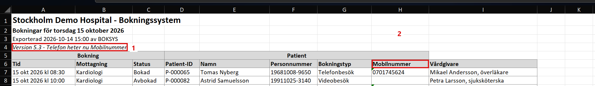

*Figure 20. The top of the export for 15 October 2026.*

Power Query looks for a column called "Telefon", and this export has none. The refresh failed, the clean table stayed empty, and the robot stopped, as planned in Section 6 (Problem 3) (Figure 21):

1. The robot stopped in the activity "Stop - Power Query Gave No Appointments".
2. The message names the export and the Excel file to check.

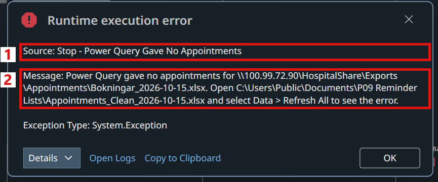

*Figure 21. The error from the run for 15 October.*

No reminder list was made for 15 October (Figure 22):

1. The Excel file with Power Query for 15 October is there, so the problem can be checked.
2. There are reminder lists for 13 and 14 October only.

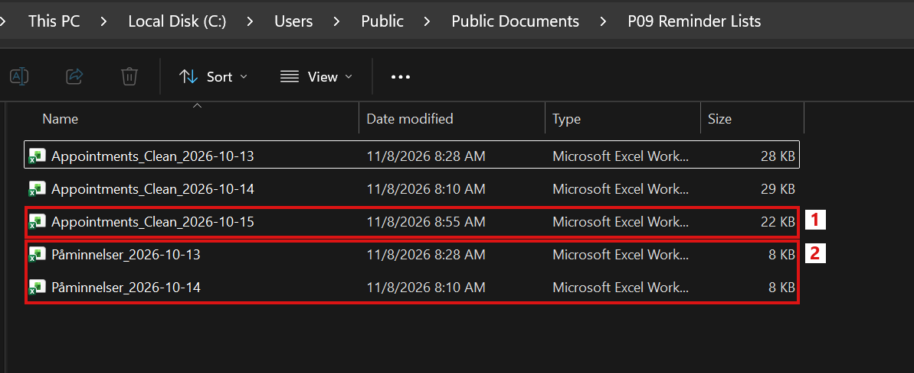

*Figure 22. The folder P09 Reminder Lists after the run for 15 October.*

When the file is opened and refreshed in Excel, the cause is shown at once (Figure 23):

1. The path of the export for 15 October.
2. The error "The column 'Telefon' of the table wasn't found."

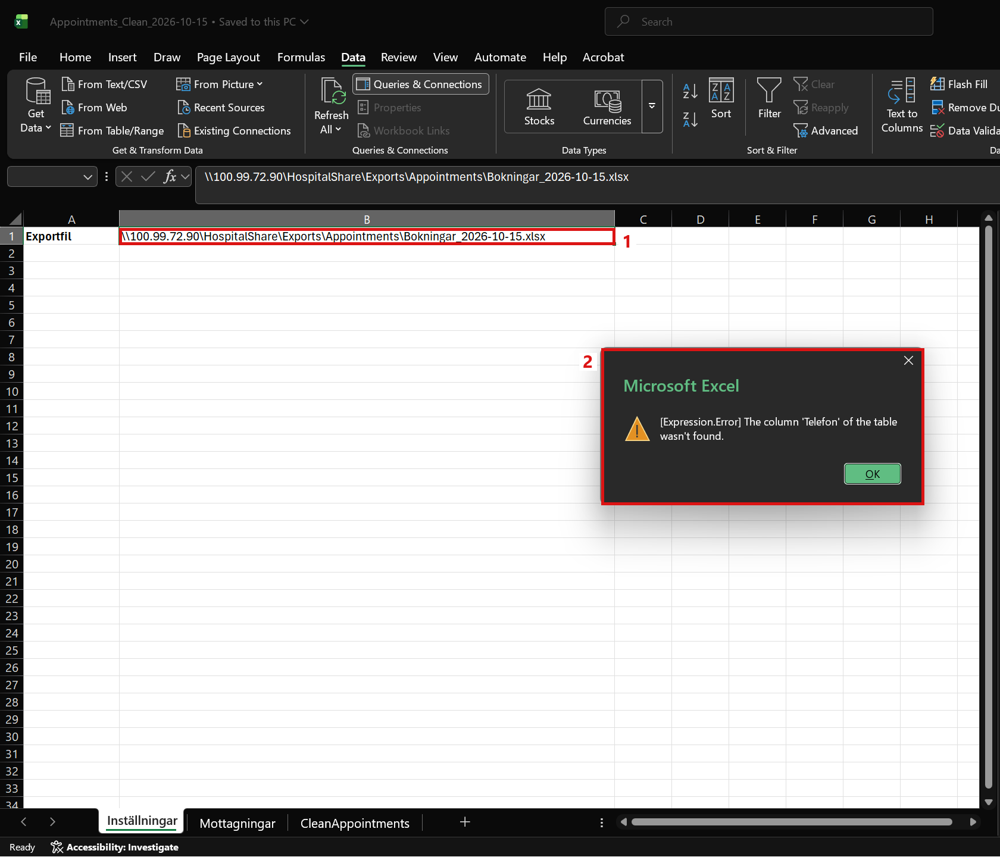

*Figure 23. The refresh error for 15 October.*

On 14 October, a change in the export gave a wrong list without any error. On 15 October, the change stopped the robot instead. No list was made, so the reception was not given a wrong list, and the error named the missing column, so IT support knew exactly what to look at.

### 8.2 The Second Fix: Using an Excel Table to Handle Column Name Changes

The error showed that the phone column was not really missing. It only had a new name. So the second fix was made in the Excel file only, and no workflow was changed.

**Problem 4: A renamed column stops the cleanup.** Power Query chooses the columns by name, so a column called "Mobilnummer" is not found as "Telefon".
*Solution: A table of new column names.* A new sheet holds a small table with the new names, in the same way as the table of clinic names. A new step in the query uses the table to give a renamed column its old name again.

After the second fix, the runs should give these results:

| 15 October | Before the fix (Section 8.1) | Expected after the fix |
|---|---|---|
| Result of the run | The robot stopped with an error | The reminder list is made |
| Booked and cancelled appointments | No list | 86 and 5 |
| Patients without a phone number on the list | No list | 8 of 8 |
| 13 and 14 October | 83, 5 and 8, and 94, 6 and 8 | The same results |
| Change for IT support | - | Only the Excel file, no workflow changed |

The Excel file got a new sheet, "Kolumnnamn" (column names) (Figure 24):

1. The table `ColumnNames`. "Skrivs som" (written as) is the name in the export, and "Kolumn" is the name that the query uses. One row was added: "Mobilnummer" is read as "Telefon".
2. The new sheet Kolumnnamn.
3. The new query `ColumnNames` reads the table. It is only used by the query CleanAppointments, so Excel shows it as "Connection only".

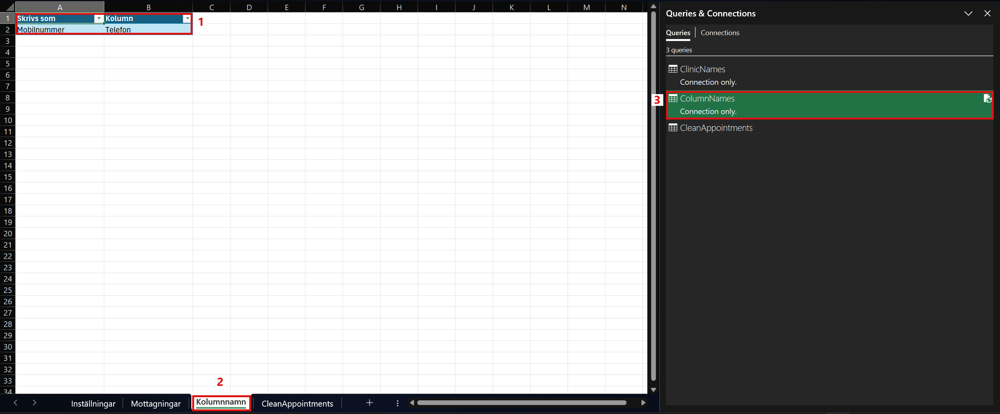

*Figure 24. The table ColumnNames and the new query.*

The query `CleanAppointments` got one new step (Figure 25):

1. The step "Renamed Column Names" comes right after the headings are made. If a name from the table is found in the export, the column gets the name from "Kolumn". If the export already has a column with that name, nothing is changed.
2. The export for 15 October has a column "Telefon" again, so the next steps work without any change.
3. The patient P-000073 has no phone number in the export, so the value is empty (null).

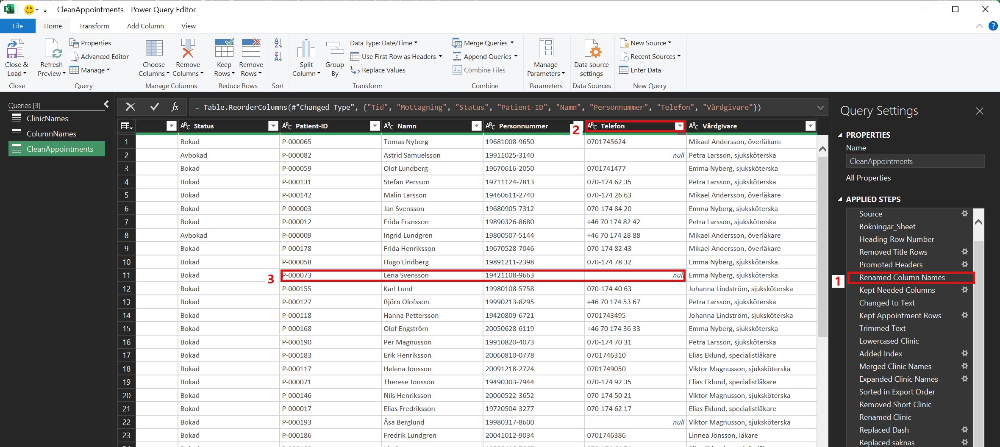

*Figure 25. The query CleanAppointments with the new step, for the export of 15 October.*

The robot was run again for 15 October, with the same export as in Section 8.1 (Figure 26):

1. 91 appointments are in the clean table.
2. 86 booked, 5 cancelled and 8 patients without a phone number.
3. The reminder list `Påminnelser_2026-10-15.xlsx` was saved.

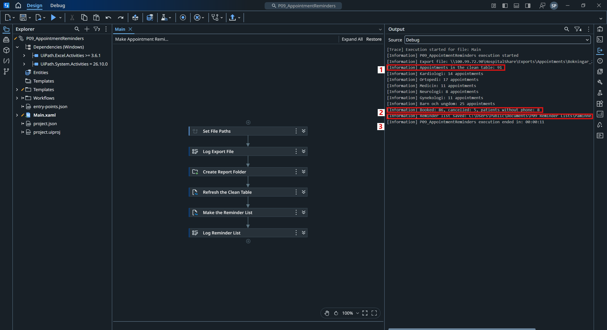

*Figure 26. The run for 15 October with the table ColumnNames.*

The sheet "Utan telefon" has the 8 booked patients without a phone number: P-000073, P-000193, P-000034, P-000189, P-000015, P-000062, P-000150 and P-000120 (Figure 27).

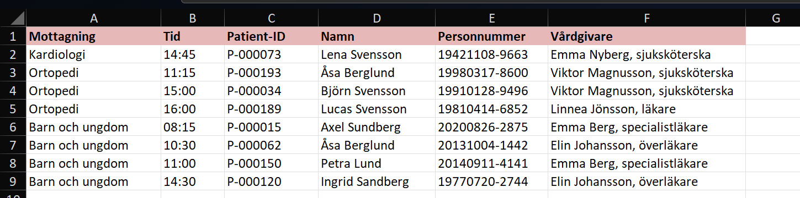

*Figure 27. The sheet "Utan telefon" of `Påminnelser_2026-10-15.xlsx`.*

The exports of 13 and 14 October were run again with the new step. The results were the same as in Sections 7.1 and 7.2: 83 booked, 5 cancelled and 8 without phone for 13 October, and 94, 6 and 8 for 14 October.

All the expected results in the table were reached. For IT support, the whole fix was one row in a table in Excel. A name that is not in the table is not changed, so a column that is really missing still stops the robot, as in Section 8.1.

## 9. The Final Result: A More Reliable Reminder Process

Two updates of the booking system tested the reminder robot. On 14 October, a new column made the old robot give a wrong list without any error, because it read the phone number from column G. With the first fix, Power Query finds the columns by name, and the robot reads the same clean table every day. The list for 14 October has all 8 patients without a phone number, and the list for 13 October is the same as before.

On 15 October, a renamed column stopped the robot with a clear error instead of a wrong list. With the second fix, one row in an Excel table was enough, and no workflow was changed. The cleanup steps can now be checked by name in Excel, and a change in the export no longer gives the reception a wrong list without any warning.
