# P10 - Robots for the Background Checks of New Staff

## 1. The Project: Faster and Safer Checks Before New Staff Start

Before a hospital can hire a doctor, a nurse or an assistant nurse, HR must check the person's background. At Stockholm Demo Hospital, this work is done by hand by one HR coordinator, with e-mails, PDF answers and two SharePoint lists.

This project shows how the checks were done by hand, what went wrong, and how UiPath robots take over the repeated work while a person stays in control of the results. All people, numbers and answers in this project are fictional. The authorities are copies of the real Swedish ones, marked "(demo)".

### 1.1 The Three Checks Before a New Hire

Depending on the job, a new hire needs one, two or all three of these checks:

- **Legitimation:** Is the person a licensed doctor or nurse, and is the licence valid? The answer comes from Socialstyrelsen's register of licensed health care staff (HOSP).
- **IVO:** Does the Health and Social Care Inspectorate (IVO) have any open or closed cases about the person?
- **Belastningsregister:** Does the person have a criminal record? The candidate orders a digital extract from the police and sends it to HR. HR checks in the police control service that the extract is genuine. The extract itself must never be stored.

A doctor or a nurse usually needs all three checks. An assistant nurse has no licence, so only IVO and the criminal record, or only the criminal record, are checked.

Real hospitals in Stockholm work the same way. For example, Karolinska checks every new doctor or nurse with IVO and HOSP ([Rekrytering på Karolinska](https://www.karolinska.se/jobba-hos-oss/rekrytering-pa-karolinska/)).

### 1.2 Before the Robots: HR Mails, Waits and Checks Every Candidate by Hand

Figure 1 shows the whole manual process for one request, from the first mail to the report. The numbers in the figure match the steps below.

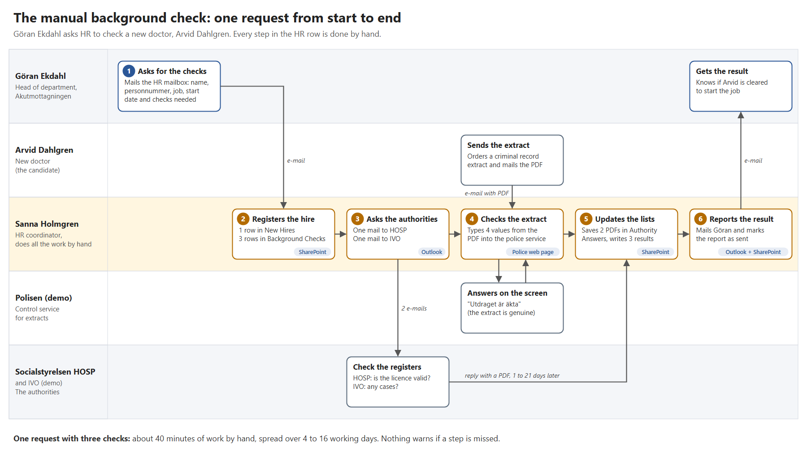

*Figure 1. One request from Göran Ekdahl for Arvid Dahlgren. All the work in the HR row is done by hand.*

1. **The request:** A head of department sends an e-mail to the shared HR mailbox. The mail names the candidate, the personnummer (Swedish personal identity number), the job, the start date and the checks that are needed.
2. **Registration:** The HR coordinator, Sanna Holmgren, adds the hire to the list "New Hires" and one row for each check to the list "Background Checks".
3. **Two requests to the authorities:** Sanna sends one e-mail to Socialstyrelsen HOSP and one to IVO. The answers come back days later as a reply with a PDF.
4. **The criminal record extract:** The candidate e-mails the extract as a PDF. Sanna types four values from it into the police control service and reads the result.
5. **Updating the lists:** For each answer, Sanna saves the PDF in the library "Authority Answers", writes a short result in the check row and sets it to Done.
6. **The report:** When all checks are done, Sanna writes to the head of department and marks the report as sent.

**Then the number of requests grows.** Between May and October 2026, 50 new hires were checked this way. Each one means a new mail, new rows, two or three answers to follow and a report, while other requests are still waiting.

**Nothing checks the work.** The lists only show what Sanna types into them. If a check row is never created, nobody is told. If a field is left empty, the request still looks finished.

**Why is this a problem?**

- **For the heads of department:** They wait 4 to 16 working days for an answer, and they cannot see where a request is. Two new hires were reported after their first working day.
- **For the new staff:** A forgotten check is not seen. Two hires were reported as cleared although one of their three checks was never made.
- **For HR:** One request with three checks takes about 40 minutes of typing, copying and checking, spread over several days. Every request is a chance for a small mistake.

## 2. How It Works Today: A Mail from the Department, Two Authorities and a Police Check

To understand the problem, it helps to follow one request through the whole manual process. All the work is done in Outlook on the web and in a SharePoint site called "Rekrytering", which only HR can open.

The list "New Hires" has one row for each new hire, with the checks that are needed and the result of the whole request (Figure 2):

1. The candidate, the personnummer, the job and the department.
2. **RequestedBy:** the head of department who asked for the checks.
3. **ChecksRequired:** which of the three checks are needed.
4. **OverallStatus:** In progress, Done or Failed.
5. **ReportSent, ReportSentBy and ReportSentDate:** when HR told the head of department the result.

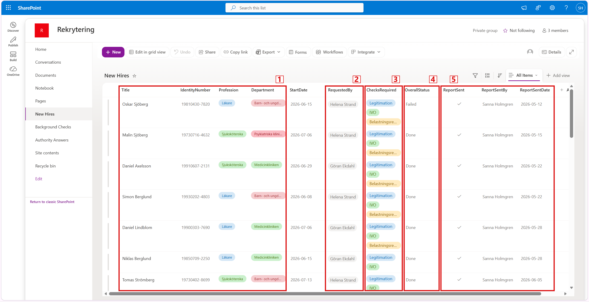

*Figure 2. The list "New Hires" with the requests from the last months.*

On 11 November at 11:28, Göran Ekdahl, head of the emergency department (Akutmottagningen), asked for the checks of a new doctor, Arvid Dahlgren. The mail has all the facts that HR needs, written as free text (Figure 3):

1. The mail from Göran Ekdahl to the HR mailbox, at 11:28.
2. The facts: the candidate, the personnummer, the job, the department, the start date 2026-12-21 and the three checks.

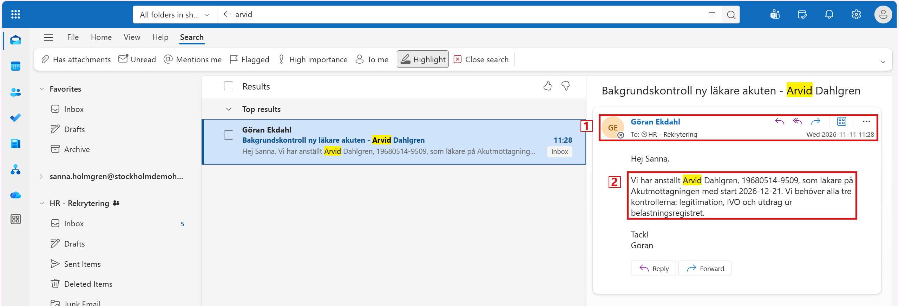

*Figure 3. The request for Arvid Dahlgren in the shared HR mailbox.*

Sanna added Arvid to "New Hires" and created one row for each check in "Background Checks". Each row has the status "Waiting for answer", the date of the request and the date when an answer is expected (Figure 4):

1. The three check rows, one for each check.
2. **Hire:** the link to Arvid's row in "New Hires".
3. **RequestedDate** and **AnswerDueDate**.

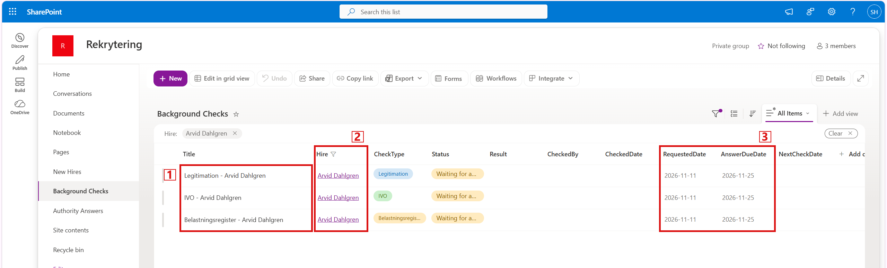

*Figure 4. The three check rows, filtered on Arvid Dahlgren.*

Next, two e-mails were written from the HR mailbox, one to Socialstyrelsen HOSP and one to IVO. Both have the same short text with the name and the personnummer (Figure 5):

1. From the HR mailbox to Socialstyrelsen HOSP (demo).
2. The subject with the name and the personnummer.
3. The request, typed by hand.

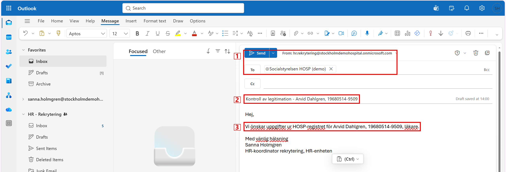

*Figure 5. The request to Socialstyrelsen HOSP (demo).*

The mail to IVO looks the same, only the receiver and the question are different (Figure 6):

1. From the HR mailbox to IVO Kontroll av legitimerad personal (demo).
2. The subject with the name and the personnummer.
3. The request, typed by hand again.

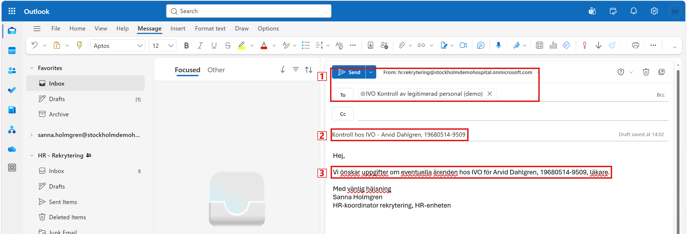

*Figure 6. The request to IVO (demo).*

The answers come back as replies to these mails, each with a PDF. The criminal record extract comes in a separate mail from the candidate (Figure 7):

1. The extract from the candidate, with the PDF "Registerutdrag".
2. The answer from IVO, "SV: Kontroll hos IVO".
3. The answer from Socialstyrelsen HOSP, "SV: Kontroll av legitimation".

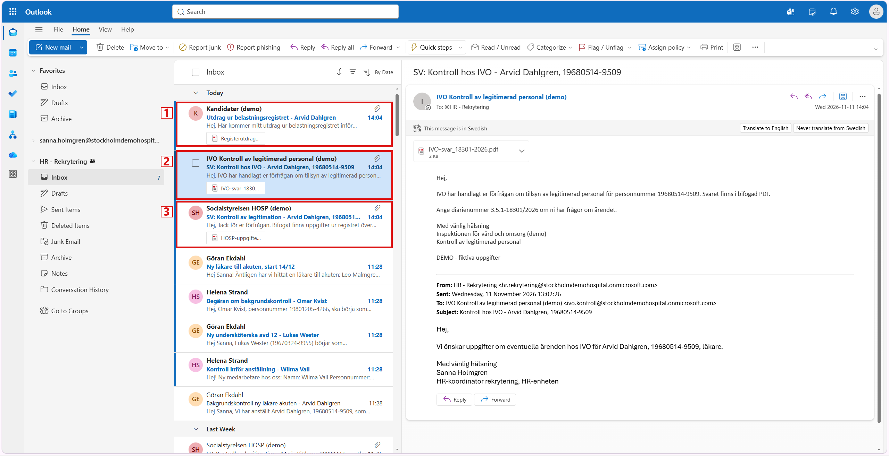

*Figure 7. The answers for Arvid Dahlgren in the HR mailbox.*

Sanna opens each PDF and reads the answer. The answer from Socialstyrelsen HOSP shows the licence (Figure 8):

1. The case number (diarienummer) of the answer.
2. The licence: a doctor since 1993-05-11, valid, with no limits.

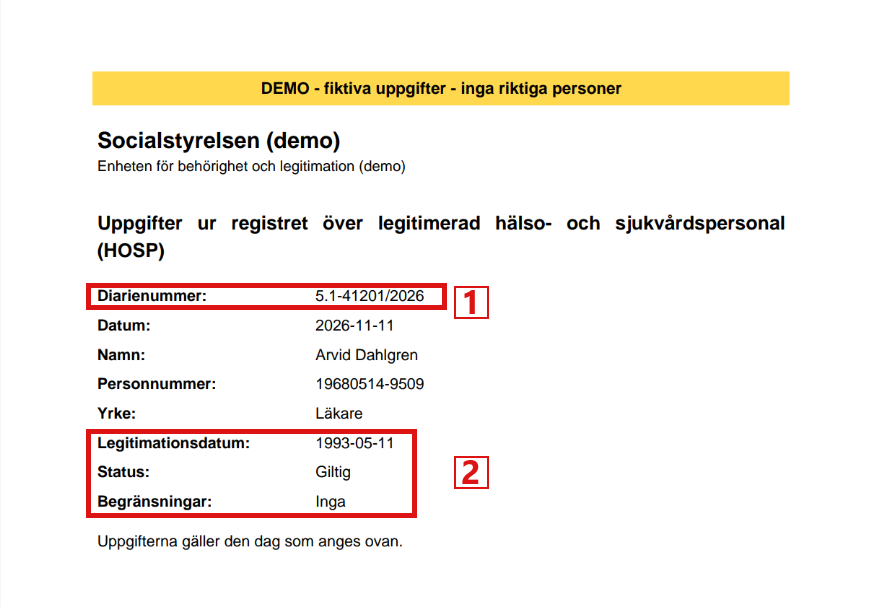

*Figure 8. The answer from Socialstyrelsen HOSP (demo).*

The HOSP PDF is saved in the library "Authority Answers". SharePoint first uploads only the file. The hire and the type of check must then be set by hand in the details panel, otherwise the file is not linked to anyone (Figure 9):

1. The uploaded HOSP answer.
2. **Hire:** Arvid Dahlgren.
3. **CheckType:** Legitimation.

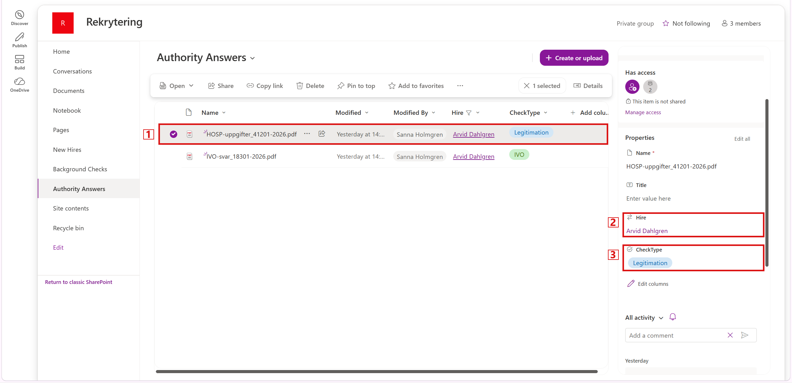

*Figure 9. The HOSP answer is saved and linked to Arvid Dahlgren.*

The answer from IVO is shorter (Figure 10):

1. The case number (diarienummer) of the answer.
2. The answer: IVO has no open or closed cases about Arvid Dahlgren.

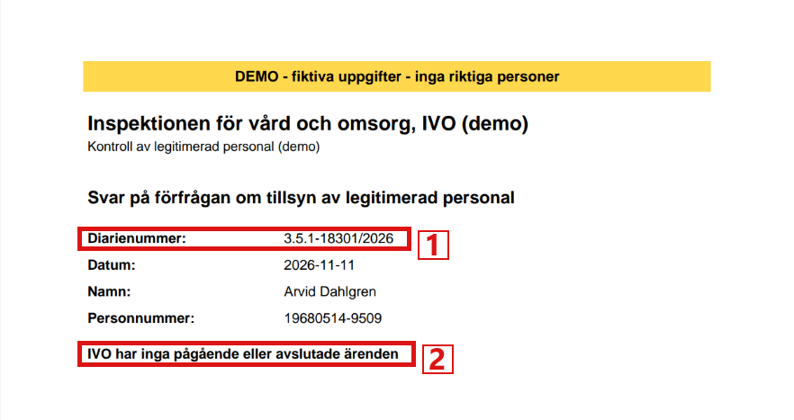

*Figure 10. The answer from IVO (demo).*

The IVO answer is saved in the same way (Figure 11):

1. The uploaded IVO answer.
2. **Hire:** Arvid Dahlgren.
3. **CheckType:** IVO.

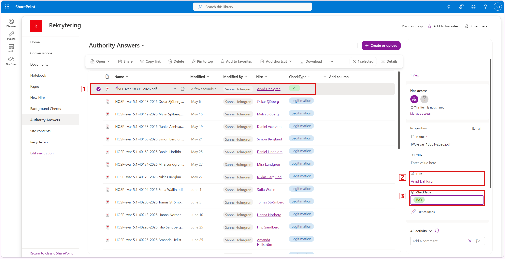

*Figure 11. The IVO answer is saved and linked to Arvid Dahlgren.*

The criminal record extract comes from the candidate (Figure 12):

1. The values that are needed to check the extract.
2. The result: "Inga uppgifter" (no records).

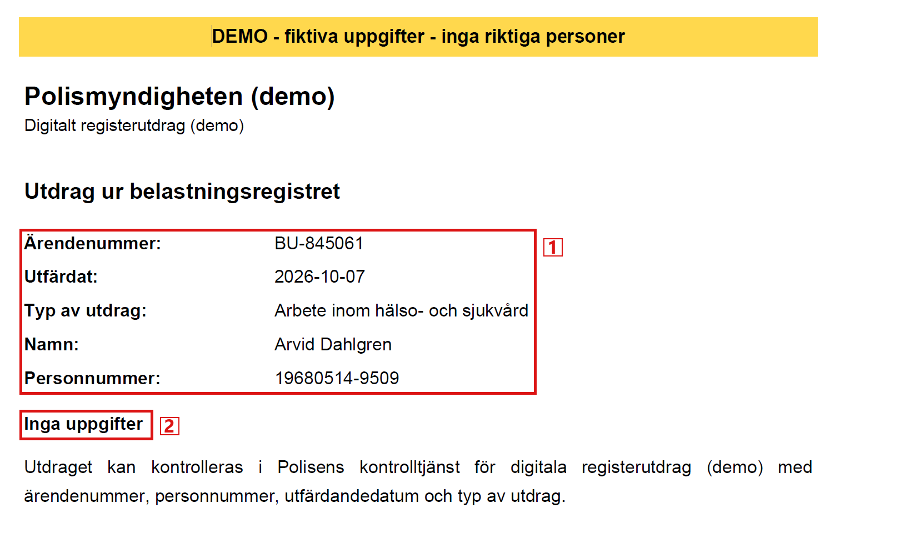

*Figure 12. Arvid Dahlgren's criminal record extract (demo).*

The criminal record extract is never saved. It is only checked in the police control service. Four values are typed from the PDF: the case number (ärendenummer), the personnummer, the date of issue and the type of extract. The service then says if the extract is genuine (Figure 13):

1. The four values from the extract.
2. The result: "Utdraget är äkta" (the extract is genuine).

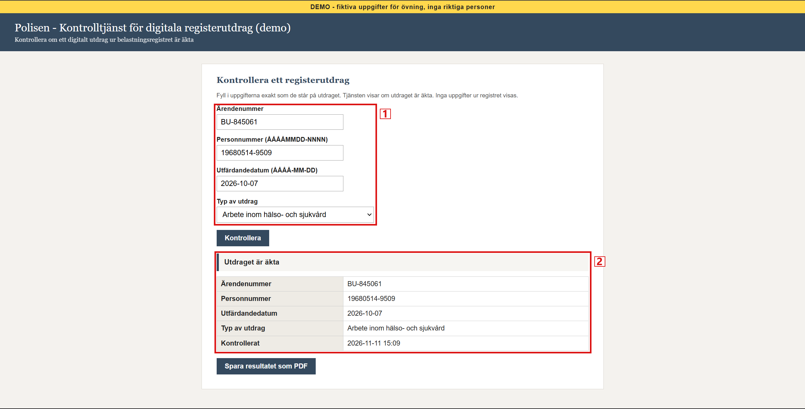

*Figure 13. Arvid Dahlgren's extract checked in Polisen's control service (demo).*

Last, Sanna writes a short result in each check row, sets it to Done and adds her name and the date. Every part of the result is copied by hand from the PDF or from the police service (Figure 14):

1. **Legitimation:** "Legitimerad läkare sedan 1993-05-11. Giltig, inga begränsningar. Dnr 5.1-41201/2026."
2. **IVO:** "Inga pågående eller avslutade ärenden. Dnr 3.5.1-18301/2026."
3. **Belastningsregister:** "Utdrag BU-845061 utfärdat 2026-10-07. Äkta enligt Polisens kontrolltjänst 2026-11-11. Inga uppgifter."

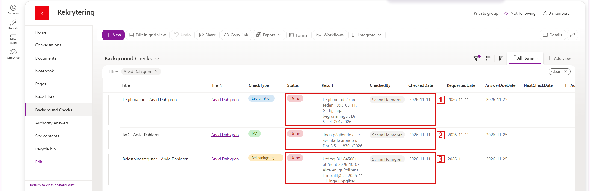

*Figure 14. All three checks for Arvid Dahlgren are Done.*

When all three checks were done, Sanna replied to Göran Ekdahl's mail with the result (Figure 15):

1. The reply to Göran Ekdahl's request.
2. The result: all three checks are done without remarks, and Arvid can start on 2026-12-21 as planned.

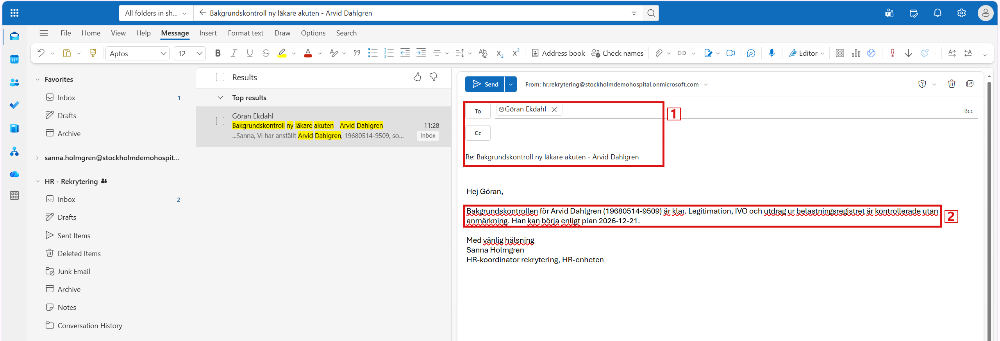

*Figure 15. The report to the head of department.*

The process works, but every step is typed by hand, and each request goes through two lists, one library, three mailboxes and a web page. Nothing checks that every step was really done.

## 3. November 11: One Request, Three Checks and 40 Minutes by Hand

The request for Arvid Dahlgren was handled from start to end, and the time for each part was measured:

| Part of the work | Time |
|---|---|
| Read the mail, add the hire and three check rows | 10 min |
| Write the requests to HOSP and IVO | 5 min |
| Save two PDFs, write three results, check the extract | 20 min |
| Write the report and close the request | 5 min |
| **Total for one request** | **40 min** |

The waiting time is not in the table. Between May and October, an answer or an extract came about 6 days after the request on average, and the slowest answer took 21 days.

In these 40 minutes, three small mistakes were made. None of them stopped the work, and none of them gave a warning.

1. **A check without a hire:** The Legitimation row was saved with an empty Hire field (Figure 16, number 1). The row exists, but it does not belong to Arvid, so a filter on his name does not show it.

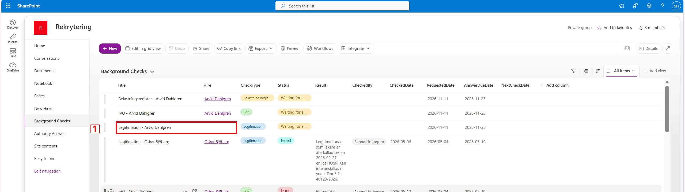

*Figure 16. The new check rows for Arvid Dahlgren. The Legitimation row has no hire.*

2. **A check without a name and a date:** The IVO row was set to Done, but CheckedBy and CheckedDate were left empty.
3. **A report that was not marked:** The request was set to Done (Figure 17, number 1), but ReportSent, ReportSentBy and ReportSentDate were left empty (number 2). From the list, nobody can see that Göran Ekdahl was told.

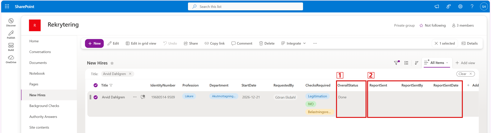

*Figure 17. Arvid Dahlgren's request is Done, but no report is marked.*

All three mistakes were found and fixed the same day, only because the rows were looked at again.

## 4. Finding the Cause: One Person, Many Places and No Check List per Request

The mistakes on 11 November were not new. To see how often such things happen, all requests from May to October were compared: the request mails, the rows in "New Hires" and "Background Checks", and the report mails. The same kinds of problems were found again and again.

**A check that was never created.** Every request says which checks are needed (ChecksRequired in "New Hires"). For each needed check, Sanna must create one row in "Background Checks" by hand. Only the rows that exist are followed. If a row is never created, nobody asks the authority, nobody waits for an answer, and nothing shows that something is missing.

The 50 hires needed 122 checks, but only 120 check rows exist, so two checks were forgotten. One of them belongs to Malin Sjöberg, a nurse at Psykiatriska kliniken. Her request asked for all three checks, but only two rows were created (Figure 18):

1. Only two check rows: Legitimation and Belastningsregister. There is no IVO row.
2. Both rows are Done.

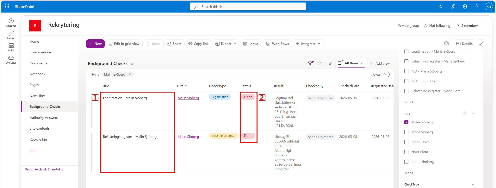

*Figure 18. The check rows for Malin Sjöberg. The IVO check is missing.*

Because both rows were Done, the request looked finished. On 15 May, the head of department, Helena Strand, was told that Malin was cleared, although IVO was never asked about her.

The second forgotten check belongs to Ida Lundin, a doctor. Her criminal record row was never created. She was reported as cleared on 14 August and started work on 31 August without a checked extract.

This is the most serious problem. A new member of staff can start work with a check that was never made, while the list says Done.

**A request without a personnummer.** HOSP, IVO and the police all look up a person by the personnummer, so no check can start without it. Three requests came without it, for example the request for Daniel Axelsson on 12 May. Sanna had to write back to the head of department and wait for the reply before she could register the hire. These three requests started 2 to 3 working days late.

**An answer that came too late.** Every check row has an AnswerDueDate, usually two weeks after the request. But nothing happens when this date passes. Sanna must notice it herself and send a reminder.

Gustav Bergström, a nurse, was asked for on 4 June and planned to start on 25 June. The HOSP answer was due on 18 June, but it came on 25 June, his first working day. The report was sent on 26 June, so the head of department got the result one day after Gustav had started. The same happened to Hanna Fransson: the HOSP answer came on her start date, 28 September, and the report was sent the day after.

**A long wait with no overview.** From request to report took 4 to 16 working days, 7.3 on average. During this time, the head of department cannot see where the request is, because only HR can open the lists. The only way to know is to send a mail to HR and ask.

Taken together, the cause is not one careless person. The process depends on memory:

- **Nothing compares ChecksRequired with the check rows.** Malin's and Ida's requests were closed with a check missing, and nothing warned.
- **Nothing checks that a row is complete.** On 11 November, one row was saved without a hire, and a Done row had no name and no date.
- **Nothing follows the waiting answers.** The AnswerDueDate is only a date in a column. Nothing reminded Sanna when the HOSP answers for Gustav and Hanna were late.
- **The same facts are typed many times.** The name and the personnummer are typed into the lists, the two mails, the file details and the police service. Every new place is a new chance for a mistake.

One person handles every request in many places, and nothing in the process says when a step is missing. As the number of requests grows, the risk of a missed check grows with it.

## 5. Defining the Fix: Every Check Done, Traced and Reported Once

Before anything was built, the goals were written down. Each goal answers one of the causes in section 4.

| Goal | Today (manual) | Expected after the fix |
|---|---|---|
| No forgotten check | 2 of 122 checks were never created, and nothing warned | Every check in ChecksRequired gets its row automatically |
| No typing | The name and the personnummer are typed into lists, mails and the police page | The robots copy the values from the list and never type them by hand |
| Complete rows | Rows were saved without a hire, a name or a date | Every finished row has Status, Result, CheckedBy and CheckedDate |
| Waiting answers followed | AnswerDueDate is only a date in a column | Waiting checks are looked at again on every run, and HR is told when an answer is late |
| A person decides the findings | Sanna decides everything | A clean answer is set to Done by the robot. Every finding goes to HR as Needs review |
| One report per hire | The report is written and marked by hand | The head of department gets exactly one report when the checks are finished |
| Less time per request | 40 minutes of work by hand | HR only handles the rows in Needs review |

The main goal is simple: no new member of staff starts work with a check that was never made.

**A quick fix that was not chosen.** The fastest idea would be one big robot that does all three checks for a candidate at once. But the three checks do not finish at the same time. HOSP and IVO answer days later, and the candidate sends the extract when it is ready. One robot would have to keep a half-finished candidate in memory, and one error in one check would stop the other two. So the work was split instead: one robot for each register, one Orchestrator queue for each robot, and one row in "Background Checks" for each check. Each robot only needs the row to know what to do next, and each check can fail, wait or finish on its own.

## 6. The First Fix: One Robot for Each Register

Three check robots were built, one for each check. All three are built on the UiPath Robotic Enterprise Framework (REFramework) and work in the same way:

- One item in the robot's queue is one row in "Background Checks".
- The robot reads the row's Status and does the next step: a **Pending** row is started, a row that is **Waiting for answer** is checked for an answer.
- A clean answer sets the row to **Done**. Anything else sets it to **Needs review**, with a short reason in the Result.
- The robot works in Microsoft 365 as the robot account rpa.rekrytering@, so CheckedBy always shows the robot, never a person.

Each robot has its own build guide. The guide starts with two pictures, what was added to the REFramework and what the robot needs around it, and then goes through every changed part with a screenshot and the milestones of the test.

| Robot | What it does | Build guide |
|---|---|---|
| HOSP robot | Mails Socialstyrelsen HOSP from the HR mailbox, reads the answer PDF, saves it in Authority Answers | [P10_CheckLegitimation](Robot%20Guides/P10_CheckLegitimation.md) |
| IVO robot | Mails IVO from the HR mailbox, reads the answer PDF, saves it in Authority Answers | [P10_CheckIVO](Robot%20Guides/P10_CheckIVO.md) |
| Criminal record robot | Reads the candidate's extract, checks the person, the age and the type, and asks the police control service if it is genuine. The extract is never saved | [P10_CheckBelastning](Robot%20Guides/P10_CheckBelastning.md) |

### 6.1 Three Queues, One for Each Check

Each robot has its own queue in Orchestrator: P10_Legitimation, P10_IVO and P10_Belastning. A queue item holds the IDs of the check row and the hire, the name, the personnummer and the profession. So the robots never type these values: they come from the list. The queues allow one retry, give each item a unique reference and encrypt the item data, because it contains personnummer.

### 6.2 The HOSP and IVO Robots: A Mail Out, an Answer Days Later

**Problem 1: the same request text is typed again for every candidate.** *Solution:* for a Pending row, the robot builds the request from the queue item and sends it from the HR mailbox. The row is set to Waiting for answer with RequestedDate and AnswerDueDate.

**Problem 2: nothing follows a waiting answer.** *Solution:* every run looks for the answer of each waiting row: a mail from the authority, with "SV:" and the person's personnummer in the subject. If it is not there, the row simply stays Waiting for answer.

**Problem 3: results and PDFs are saved by hand, and fields are forgotten.** *Solution:* the robot reads the values from the PDF, writes Status, Result, CheckedBy and CheckedDate in one step, and saves the PDF in Authority Answers with the hire and the check type filled in.

### 6.3 The Criminal Record Robot: Checking the Extract with the Police

**Problem 4: four values are typed from the PDF into the police page.** *Solution:* the robot reads the values from the extract and fills in the police control service itself, in a new Edge window that is closed right after.

**Problem 5: the extract must never be stored.** *Solution:* the PDF is only read in a temporary folder and deleted after every run, also after an error. Nothing is saved in Authority Answers.

### 6.4 The Result for Hugo Palm

The three robots were tested on a new request: Hugo Palm, a nurse for Akutmottagningen, with all three checks. Each robot took its own row from its own queue. The two request mails went out from the HR mailbox, the answers and the extract were read when they came, and all three rows ended as Done, checked by the robot account (Figure 19):

1. **Legitimation:** Done, with the licence result and the diarienummer from HOSP.
2. **IVO:** Done, with the IVO result and the diarienummer from IVO.
3. **Belastningsregister:** Done, with the extract number, the police check and "Inga uppgifter".

In all three rows, CheckedBy is RPA Rekrytering, the robot account.

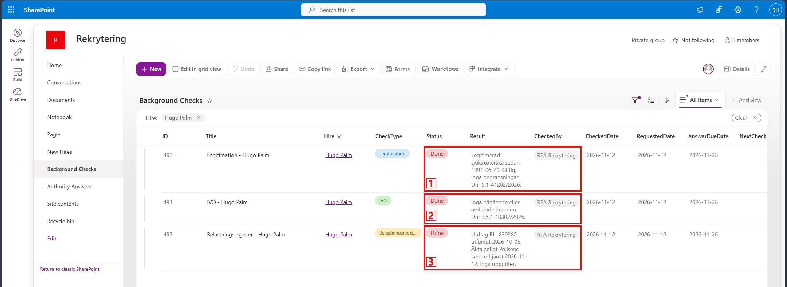

*Figure 19. The three check rows of Hugo Palm, each finished by its own robot.*

| Check | Result written by the robot |
|---|---|
| Legitimation | Legitimerad sjuksköterska sedan 1991-06-29. Giltig, inga begränsningar. Dnr 5.1-41202/2026. |
| IVO | Inga pågående eller avslutade ärenden. Dnr 3.5.1-18302/2026. |
| Belastningsregister | Utdrag BU-839380 utfärdat 2026-10-05. Äkta enligt Polisens kontrolltjänst 2026-11-12. Inga uppgifter. |

The three robots now do the typing, the mails and the checks for each row they are given. But someone still has to create the rows, fill the queues and tell the head of department when everything is finished.
