# Build Guide: The Criminal Record Robot (P10_CheckBelastning)

This guide shows how the criminal record robot was built, part by part. The robot checks the extract from the criminal record register (belastningsregistret). The candidate orders the extract from the police and e-mails the PDF to HR. The robot reads the PDF, checks that it belongs to the right person and is new enough, and asks the police control service on the web if the extract is genuine. The extract itself is never saved.

The robot is built on the UiPath Robotic Enterprise Framework (REFramework), like the HOSP and IVO robots. It is the only one of the three that uses a web page, so it also has UI automation: the Object Repository and the activities that type into the police page.

[Back to the Project Record](../Project%20Record.md)

## 1. The Big Picture

### 1.1 Inside the Robot: What Was Added to the REFramework

Figure 1 shows the four states of the REFramework from left to right. Under each state are the files that run in it. Grey files come from the template and were not changed. Orange-red files were changed or added for this robot.

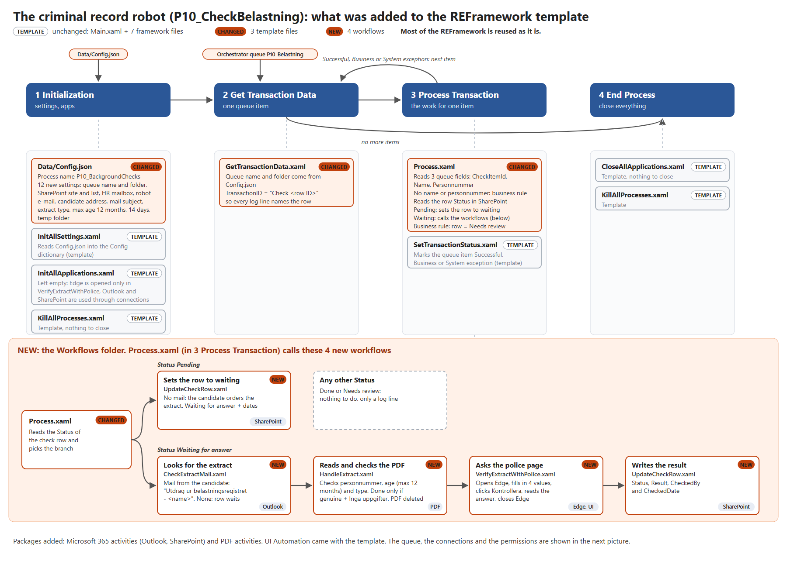

*Figure 1. The criminal record robot. Only three template files were changed: Config.json, GetTransactionData.xaml and Process.xaml. The work is in four new workflows.*

Two things are different from the HOSP and IVO robots:

- **A Pending row gets no mail.** HR does not ask an authority. The candidate orders the extract, so the robot only sets the row to Waiting for answer.
- **The answer is checked on a web page.** `VerifyExtractWithPolice.xaml` opens Edge, fills in the police control service and reads the answer.

### 1.2 Around the Robot: Queue, Connections and Permissions

Figure 2 shows what the robot needs outside its own files. The grey boxes were there before this robot. The orange-red boxes were set up for it.

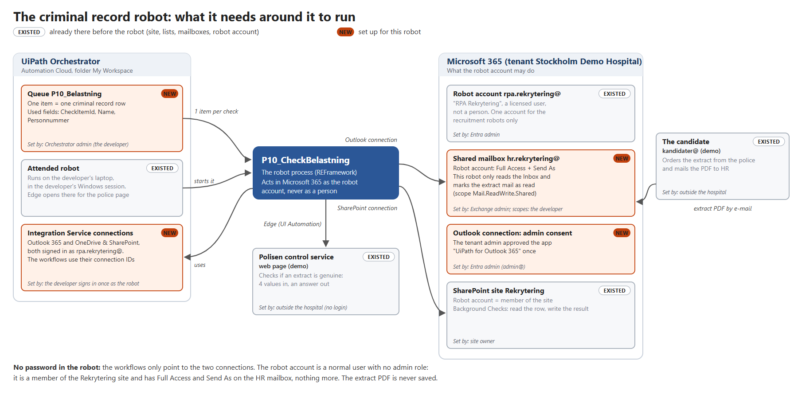

*Figure 2. The robot gets its work from an Orchestrator queue, reads the candidate's mail in the HR mailbox and uses the police page in Edge on the same laptop.*

## 2. The Starting Point: A New REFramework Project

The project was created in UiPath Studio from the Robotic Enterprise Framework template, as a Windows project with VB expressions (Figure 3):

1. The new project P10_CheckBelastning.
2. `Main.xaml` with the four states of the REFramework, as it comes from the template. `Main.xaml` was not changed.

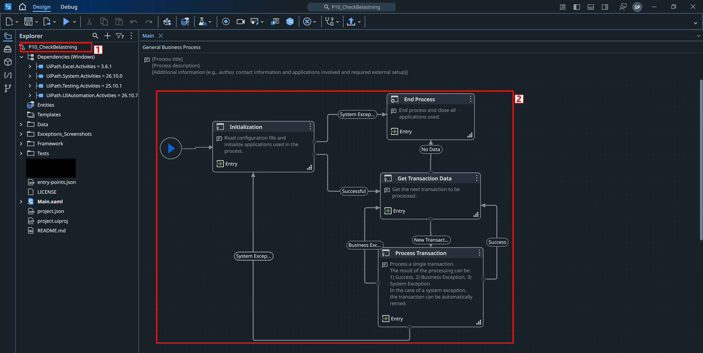

*Figure 3. The new project P10_CheckBelastning is created from the REFramework template.*

Two activity packages were added. The UI Automation package that drives the police page was already part of the template.

| Package | Used for |
|---|---|
| UiPath.MicrosoftOffice365.Activities | Outlook (read and mark mails) and SharePoint (read and update list rows) |
| UiPath.PDF.Activities | Read the text of the extract PDF |
| UiPath.UIAutomation.Activities (template) | Open Edge, type into the police page, click and read the answer |

## 3. Initialization: The Settings in Config.json

The REFramework reads `Data/Config.json` once at the start (`InitAllSettings.xaml`, not changed). The business rules for the extract are settings too, so they can be changed without opening a workflow.

| Setting | Value | Why it is needed |
|---|---|---|
| logF_BusinessProcessName | P10_BackgroundChecks | Groups the logs of all four P10 robots |
| OrchestratorQueueName | P10_Belastning | The queue this robot works on |
| OrchestratorQueueFolder | (empty) | Empty means the folder the process runs in |
| SharePointSiteUrl | .../sites/rekrytering | The recruitment site |
| ChecksListName | Background Checks | The list with one row per check |
| HrMailbox | hr.rekrytering@ | The candidate's extract arrives here |
| RobotEmail | rpa.rekrytering@ | Written in CheckedBy |
| CandidateMailAddress | kandidater@ | The sender of the extract mails (demo) |
| ExtractMailSubject | Utdrag ur belastningsregistret - | The start of the subject; the candidate's name follows |
| ExtractTypeRequired | Arbete inom hälso- och sjukvård | The only type of extract that is accepted |
| ExtractMaxAgeMonths | 12 | An older extract is not accepted |
| AnswerDueDays | 14 | AnswerDueDate = the waiting start + 14 days |
| TempFolder | %TEMP%\P10_CheckBelastning | A local folder for the PDF while it is read |

There is no setting for an answer library: the extract is never saved.

The template's Config.json already had the first three settings. For this robot, two of them got new values and ten settings were added. The red boxes in the pictures of this guide always mark what was changed or added for the robot. Everything outside the boxes is the template. The numbers in Figure 4 match this list:

1. **Changed values:** the process name `P10_BackgroundChecks` and the queue `P10_Belastning`.
2. **New, SharePoint:** the site and the list Background Checks.
3. **New, mail addresses:** the HR mailbox, the robot account and the candidates' address.
4. **New, rules for the extract:** the start of the mail subject, the type of extract that is accepted, and the maximum age in months.
5. **New, timing and files:** 14 days to wait, and the local folder for the PDF.

The Constants part (from line 17) is the template and was not changed.

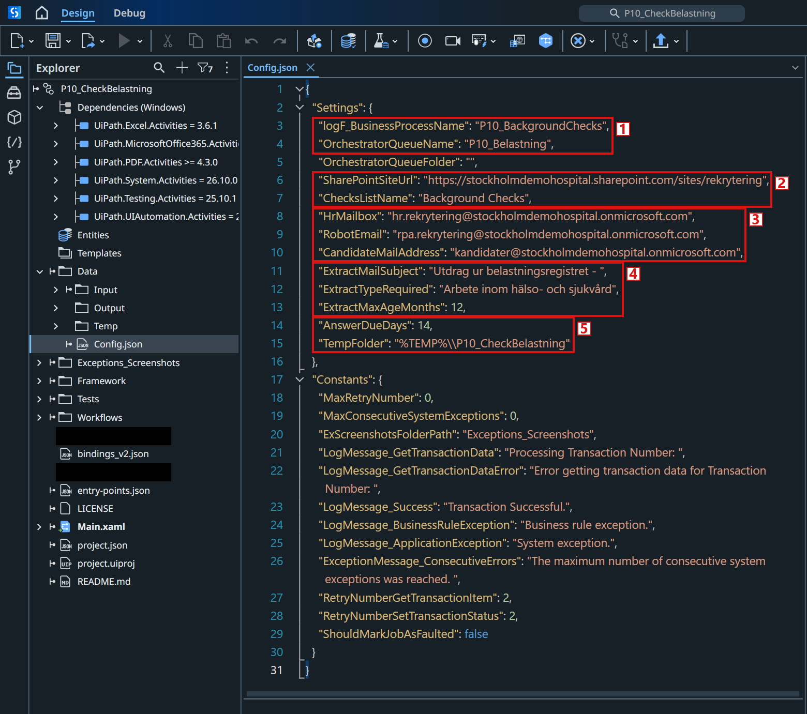

*Figure 4. The settings of the criminal record robot. The red boxes are the changed and new settings.*

`InitAllApplications.xaml` was left empty on purpose. Edge is opened only when an extract is checked, inside `VerifyExtractWithPolice.xaml`, and closed right after.

## 4. Get Transaction Data: One Check Row from the Queue

Only two places were changed in this template file (Figure 5):

1. **Get transaction item:** the Orchestrator folder and the queue name are read from Config.json (`OrchestratorQueueFolder` and `OrchestratorQueueName`). The queue is not typed into the activity.
2. **Assign out_TransactionID:** the ID is `"Check " + CheckItemId`, for example "Check 492". Every log line of the item then names the check row it belongs to.

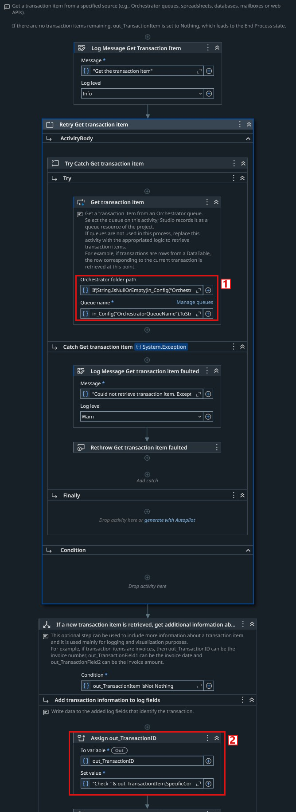

*Figure 5. GetTransactionData.xaml. Only the two red boxes were changed; the rest is the template.*

The queue items have the same five fields as in the other two queues. This robot uses three of them: **CheckItemId**, **Name** and **Personnummer**.

The queue `P10_Belastning` was created in Orchestrator (Figure 6):

1. **Name and description** of the queue.
2. **Unique reference and encrypted format.** The same item cannot be added twice, and the item data is stored encrypted, because it contains personnummer.
3. **Auto retry for failed items, one time.** A run that fails with a system error is tried once more.

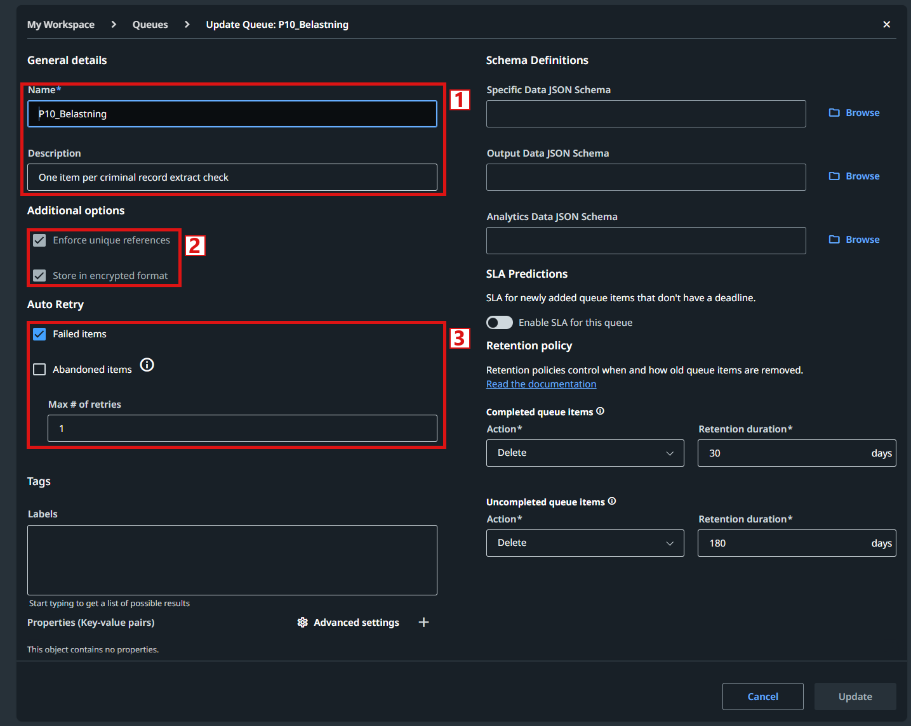

*Figure 6. The queue P10_Belastning in Orchestrator.*

## 5. Process Transaction: Process.xaml Picks the Branch

In the template, `Process.xaml` is almost empty. Everything in Figures 7 and 8 was added for this robot. It handles one queue item, in this order (the numbers match the red boxes):

1. **Reads three fields** of the queue item: CheckItemId, Name and Personnummer.
2. **Checks the data.** A missing name or personnummer is a *business rule exception*.
3. **Reads the check row** in Background Checks with "Get Single SharePoint List Item".
4. **Picks the branch** from the row's Status:
   - **Pending:** no mail. The row is set to **Waiting for answer** with RequestedDate and AnswerDueDate, through `UpdateCheckRow.xaml`. *Seen in [Case 1](../Running%20the%20Robots%20Unattended.md#43-round-1-request-registered-check-queued), round 1.*
   - **Waiting for answer:** invoke `CheckExtractMail.xaml`.
   - **Any other Status:** only a log line.
5. **Catches business rule exceptions:** the row is set to **Needs review** with the exception text as the Result, and the exception is thrown again.

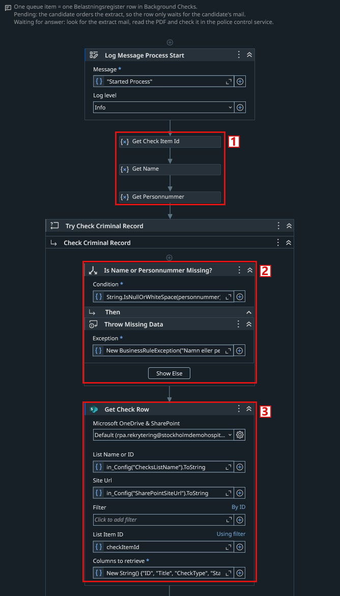

*Figure 7. Process.xaml, part 1: read the item (1), check the data (2) and read the check row (3).*

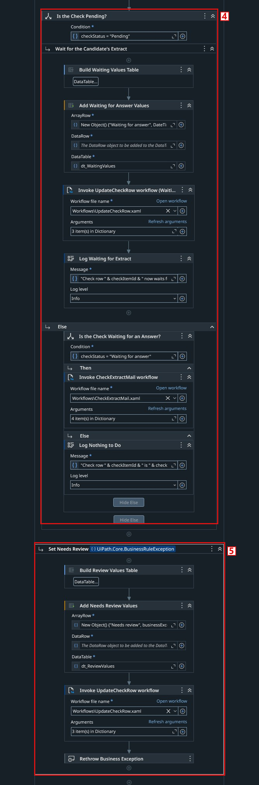

*Figure 8. Process.xaml, part 2: a Pending row only starts to wait, a waiting row looks for the extract (4). Wrong data goes to Needs review (5).*

## 6. The New Workflows

### 6.1 UpdateCheckRow.xaml: One Place That Writes to the List

All writes to Background Checks go through this one small workflow, the same as in the other two robots. It runs "Update List Item" (Figure 9):

1. **Where:** the list name and the site come from Config.json.
2. **What:** the ID of the row, and a data row with only the columns to change (for example Status, RequestedDate and AnswerDueDate).

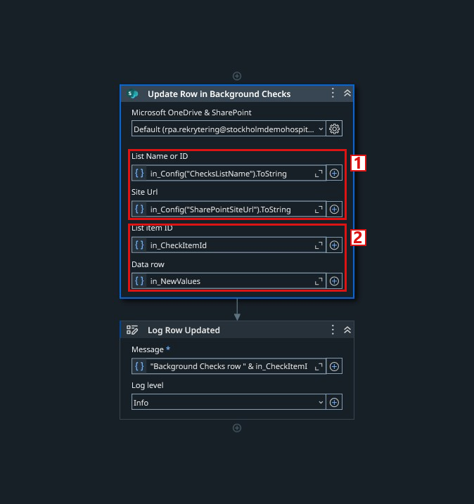

*Figure 9. UpdateCheckRow.xaml updates one row in Background Checks.*

### 6.2 CheckExtractMail.xaml: Has the Candidate Sent the Extract?

This workflow runs for a row that is Waiting for answer (Figure 10):

1. **Get Email List** reads the mails with attachments in the Inbox of the shared HR mailbox.
2. **For Each** goes through the mails. One If keeps the mail that matches both rules: the sender is kandidater@, and the subject is exactly "Utdrag ur belastningsregistret - " + the candidate's name.
3. **No extract yet:** the workflow only writes a log line, and the row stays Waiting for answer.
4. **The extract is there:** `HandleExtract.xaml` is invoked.

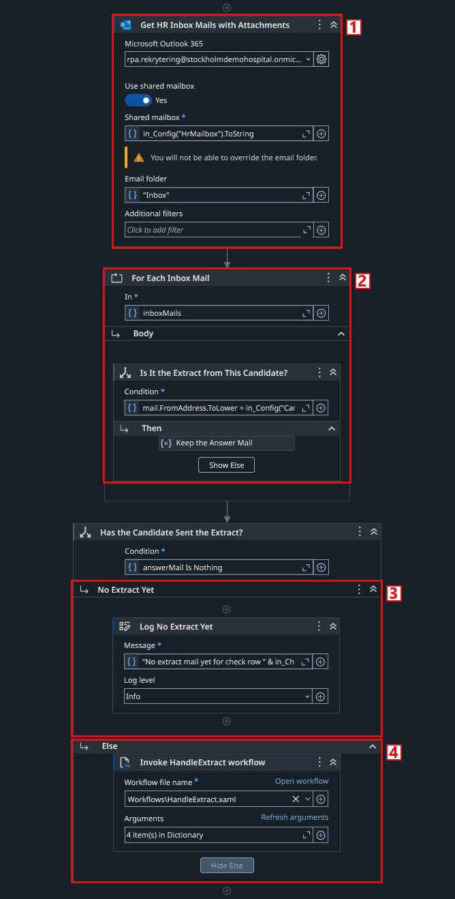

*Figure 10. One If finds the extract mail from this candidate.*

### 6.3 HandleExtract.xaml: Read and Check the Extract

The workflow runs in this order. The numbers match the red boxes in the three pictures of the workflow, Figures 11, 12 and 13.

1. **Downloads the PDF** to the temp folder with "Download Email Attachments". A mail without a PDF is a business rule exception.
2. **Reads the PDF text** with "Read PDF Text".
3. **Finds four values** with "Matches" (Find Matching Patterns):

   | Value | Label in the PDF | Example |
   |---|---|---|
   | Ärendenummer | Ärendenummer: | BU-839380 |
   | Date of issue | Utfärdat: | 2026-10-05 |
   | Personnummer | Personnummer: | 19661004-2428 |
   | Type of extract | Typ av utdrag: | Arbete inom hälso- och sjukvård |

4. **Checks the extract**, one If for each rule. When a rule fails, the robot throws a business rule exception with a clear text, and the row goes to HR as Needs review:

   | Rule | Text in Result when the rule fails |
   |---|---|
   | All four values could be read | "Uppgifterna på utdraget kunde inte läsas. Behöver granskas av HR." |
   | The personnummer is the candidate's | "Personnumret på utdraget (X) stämmer inte med kandidatens personnummer. Behöver granskas av HR." |
   | Not older than 12 months | "Utdrag X utfärdades Y och är äldre än 12 månader. Kandidaten behöver beställa ett nytt utdrag." |
   | The right type of extract | "Fel typ av utdrag (X). Utdraget ska gälla Arbete inom hälso- och sjukvård." |

5. **Asks the police page** by invoking `VerifyExtractWithPolice.xaml` with the four values.
6. **Decides the result:**

   | Police answer and PDF | Status | Result | Seen in |
   |---|---|---|---|
   | "Utdraget är äkta" and "Inga uppgifter" | Done | "Utdrag BU-839380 utfärdat 2026-10-05. Äkta enligt Polisens kontrolltjänst 2026-11-12. Inga uppgifter." | [Case 1](../Running%20the%20Robots%20Unattended.md#44-round-2-extract-verified-with-the-police-service) to Case 3 |
   | "Utdraget är äkta" and "Uppgifter finns" | Needs review | "Utdrag X utfärdat Y. Äkta enligt Polisens kontrolltjänst Z. Uppgifter finns i registret. Behöver granskas av HR." | |
   | Any other police answer | Needs review | "Polisens kontrolltjänst Z: <the answer>. Utdrag X. Behöver granskas av HR." | [Case 5](../Running%20the%20Robots%20Unattended.md#84-round-2-extract-not-confirmed-by-the-police-service): not genuine |

7. **Updates the row** with Status, Result, CheckedBy and CheckedDate, and **marks the mail as read**.
8. **Deletes the local copy** of the PDF. It is deleted in two places: after a normal run, and in a Catch for any error, before the error is thrown again. So the extract never stays on the laptop, also when a step fails.

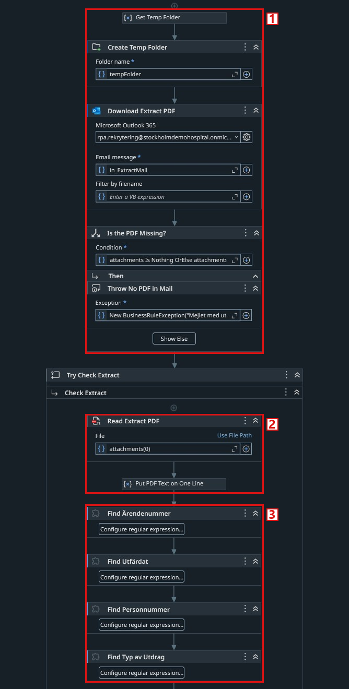

*Figure 11. HandleExtract.xaml, part 1: download and read the PDF, and find the four values.*

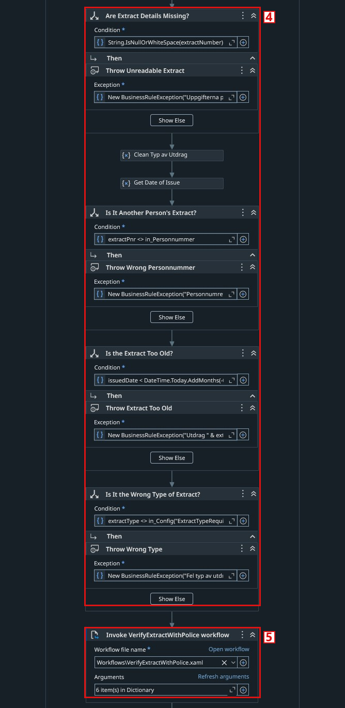

*Figure 12. HandleExtract.xaml, part 2: the four rules, then the police page.*

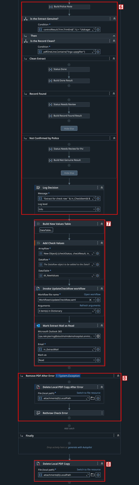

*Figure 13. HandleExtract.xaml, part 3: decide, update the row and mark the mail. The PDF is deleted in both places marked 8.*

### 6.4 VerifyExtractWithPolice.xaml: The Police Control Service

This is the UI automation part. The page "Polisen - Kontrolltjänst för digitala registerutdrag (demo)" has four fields, a button and a result area.

The same check, done by hand on the page (Figure 14):

1. The four values from the extract: Ärendenummer, Personnummer, Utfärdandedatum and Typ av utdrag.
2. The button Kontrollera.
3. The answer, here "Utdraget är äkta". This is the text the robot reads.

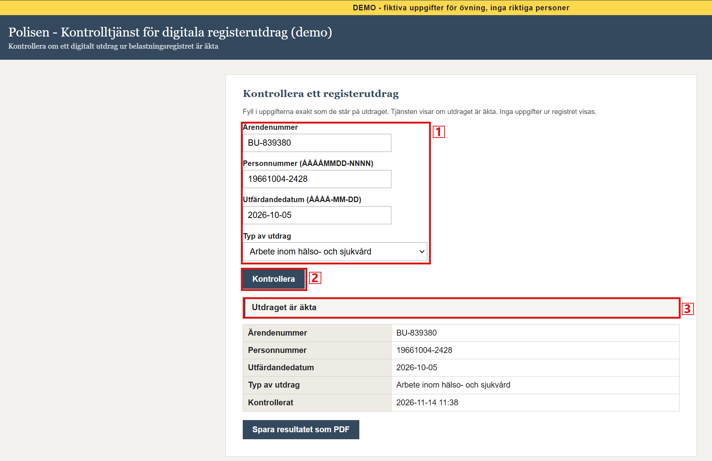

*Figure 14. The police control service: four values in, an answer out.*

**The targets in the Object Repository.** Each element of the page was captured once in Edge and saved in the Object Repository, under the application "Polisen Kontrolltjanst" and the screen "Kontrolltjanst". The elements are found by their id on the page, for example `<webctrl id='arendenummer' tag='INPUT' />`, and not by their position on the screen. No selector was typed by hand.

| Element | What it is | Activity |
|---|---|---|
| Arendenummer Field | Text box "Ärendenummer" | Type Into |
| Personnummer Field | Text box "Personnummer (ÅÅÅÅMMDD-NNNN)" | Type Into |
| Utfardandedatum Field | Text box "Utfärdandedatum (ÅÅÅÅ-MM-DD)" | Type Into |
| Typ Av Utdrag Dropdown | List "Typ av utdrag" | Select Item |
| Kontrollera Button | The button "Kontrollera" | Click |
| Kontroll Resultat Text | The answer area, for example "Utdraget är äkta" | Get Text |

In Studio, the Object Repository panel shows (Figure 15):

1. The application "Polisen Kontrolltjanst".
2. The screen "Kontrolltjanst".
3. The six elements of the table above.

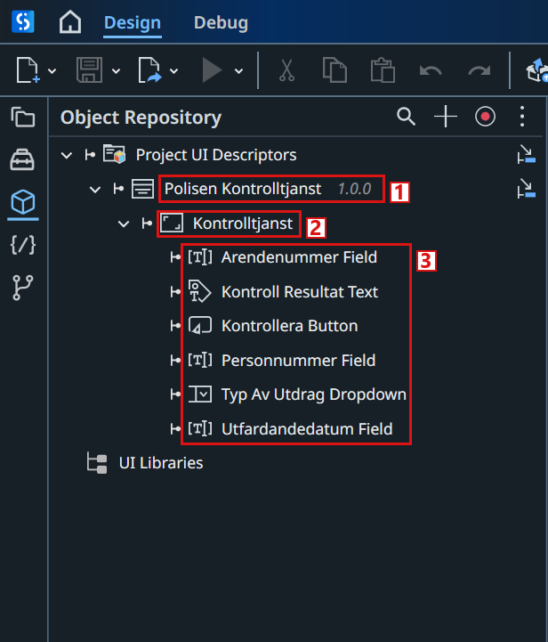

*Figure 15. The six elements of the police page in the Object Repository.*

**The workflow.** All the steps are inside one "Use Application/Browser" activity:

- **Open:** Always. A new Edge window opens on the police page.
- **Close:** Always. The window is closed when the check is done, so no extract data stays on the screen.
- **Input mode:** Simulate (section 8.3 explains why).

In the workflow (Figure 16):

1. **Use Application/Browser** opens the police page in Edge. The address is blacked out in the picture.
2. **Three Type Into:** Ärendenummer, Personnummer and Utfärdandedatum.
3. **Select Item:** the type of extract.
4. **Click** on Kontrollera.
5. **Get Text** reads the answer and returns it to `HandleExtract.xaml`.

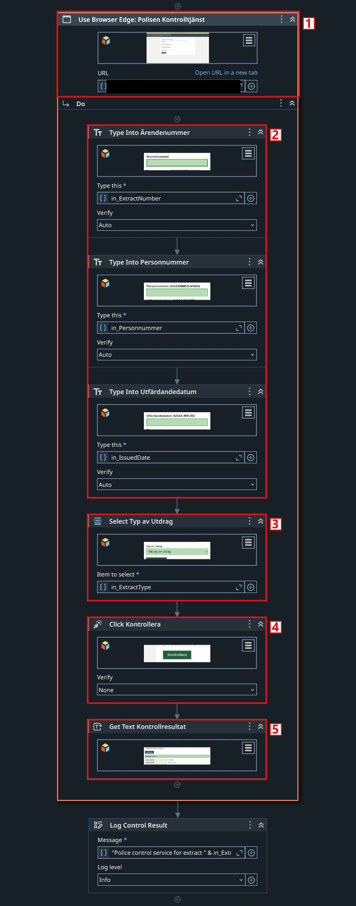

*Figure 16. VerifyExtractWithPolice.xaml fills in the police page and reads the answer.*

## 7. Connections and Permissions

The robot uses the same two Integration Service connections as the other check robots, both signed in as the robot account rpa.rekrytering@. It does not send mail. It only reads the extract mail and marks it as read.

| What | Set to | Set by |
|---|---|---|
| Robot account rpa.rekrytering@ | A licensed user, no admin role | Entra admin |
| HR mailbox hr.rekrytering@ | Full Access for the robot account (it reads the Inbox) | Exchange admin |
| Outlook connection | Signed in as the robot account, scope Mail.ReadWrite.Shared (mark the mail as read) | The developer |
| SharePoint connection | Signed in as the robot account | The developer |
| Site Rekrytering | The robot account is a member | Site owner |
| Queue P10_Belastning | Created in the Orchestrator folder | Orchestrator admin |
| Police control service | A public web page, no login | (outside the hospital) |

The connections page in Orchestrator (Figure 17):

1. The two connections of the robot account rpa.rekrytering@: Microsoft OneDrive & SharePoint, and Microsoft Outlook 365. Both are Connected. The third row is an older connection of another user and is not used by these robots.

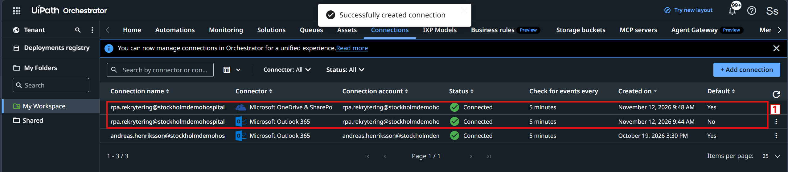

*Figure 17. The Outlook and SharePoint connections of the robot account.*

## 8. Build Milestones: How Each Part Was Checked

The robot was tested on the same request as the other two: Hugo Palm. His criminal record row in Background Checks has ID 492. His extract has the number BU-839380 and was issued on 2026-10-05.

### 8.1 Milestone 1: The Police Page Is Captured

Before any workflow was written, the six elements of the police page were captured in Edge and saved in the Object Repository. Each target was checked on the live page: the fields were filled with Hugo Palm's values, the button was clicked, and Get Text on the result area returned "Utdraget är äkta".

### 8.2 Milestone 2: A Pending Row Starts to Wait

The first run took the queue item "Check 492". No mail was sent. The row was set to Waiting for answer, and the log said "Check row 492 now waits for the candidate's extract."

### 8.3 Milestone 3: The Extract Arrives, but the Police Step Fails

The candidate's mail "Utdrag ur belastningsregistret - Hugo Palm" arrived in the HR Inbox with the PDF Registerutdrag_Hugo_Palm.pdf.

In the HR mailbox (Figure 18):

1. The Inbox of the shared mailbox HR - Rekrytering.
2. The mail from Kandidater (demo).
3. The subject "Utdrag ur belastningsregistret - Hugo Palm", which the robot matches.
4. The PDF Registerutdrag_Hugo_Palm.pdf.

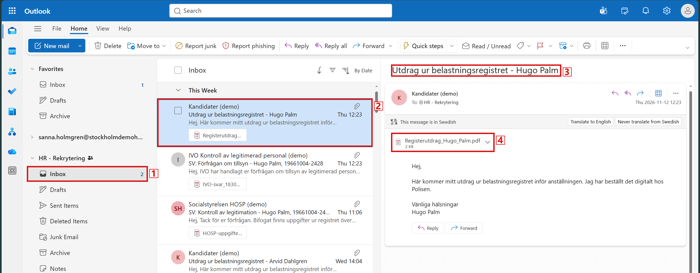

*Figure 18. The extract mail from the candidate in the HR Inbox.*

The next run read the PDF and passed all four rules, but stopped at the first field of the police page with "Type Into Ärendenummer: Timeout reached." The queue retried the item once, with the same error. Two problems were found:

**Problem 1: the robot could not reach the new Edge window.** The activities used the input mode "Chromium API", which had worked while the page was captured. A test showed the difference: when the police page was already open in Edge, the robot filled it in and read "Utdraget är äkta". When the robot opened a new Edge window itself, it timed out. *Solution:* the input mode was changed to **Simulate**. With Simulate, the robot opened its own window, filled in the page, read the answer and closed the window.

**Problem 2: the extract stayed on the laptop after the error.** The PDF was still in the temp folder. The delete step had been in a Finally block, but it did not run when the error went up to the REFramework. *Solution:* the delete step was moved into a Catch that deletes the PDF and then throws the error again, plus the normal delete after the check. After the change, the run that failed again left the temp folder empty.

The queue items of row 492 in Orchestrator (Figure 19):

1. "492-2026-11-12": the first run, which set the row to Waiting for answer.
2. Three extract runs that failed during the two fixes. The queue retried each of them once (Retried), and each ended as Failed.
3. "492-2026-11-12-extract4": the run after the fixes, Successful.

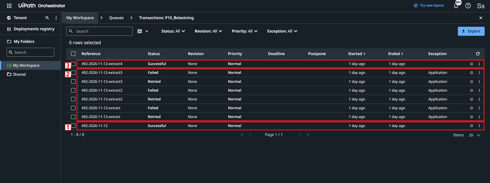

*Figure 19. The queue items of the criminal record robot.*

### 8.4 Milestone 4: The Row Is Done, and Nothing Is Saved

The run after the fixes set row 492 to **Done** with the Result "Utdrag BU-839380 utfärdat 2026-10-05. Äkta enligt Polisens kontrolltjänst 2026-11-12. Inga uppgifter." and CheckedBy = the robot account. The extract mail was marked as read. The temp folder was empty, and no new file was added to Authority Answers.

All three rows of Hugo Palm in Background Checks (Figure 20):

1. **Legitimation:** Done, with the licence result and the diarienummer from HOSP.
2. **IVO:** Done, with the IVO result and the diarienummer from IVO.
3. **Belastningsregister:** Done, with the extract number, the police check and "Inga uppgifter".

In all three rows, CheckedBy is RPA Rekrytering, the robot account.

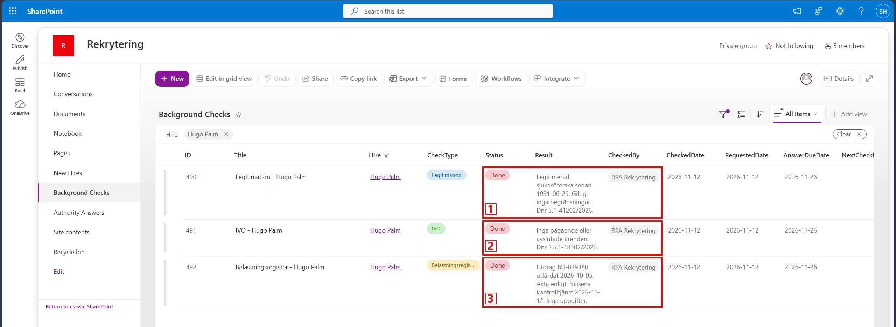

*Figure 20. All three checks of Hugo Palm are Done, each by its own robot.*

## 9. What the Criminal Record Robot Does Now

The criminal record robot waits for the candidate's extract, checks that it belongs to the right person, is new enough and is the right type, and asks the police page if it is genuine. Only a genuine extract with "Inga uppgifter" is set to Done. Everything else goes to HR as Needs review with a clear reason. The extract is read but never saved: the PDF is deleted after every run, also after an error.
