# Build Guide: The IVO Robot (P10_CheckIVO)

This guide shows how the IVO robot was built, part by part. The robot checks one thing: does the Health and Social Care Inspectorate (IVO) have any open or closed cases about a new hire? It asks IVO by e-mail, waits for the answer, reads the PDF and writes the result in the list "Background Checks".

The robot is built on the UiPath Robotic Enterprise Framework (REFramework), in the same way as the HOSP robot. The guide first shows the whole robot in two pictures, then goes through each changed or new part in the same order as the framework runs.

[Back to the Project Record](../Project%20Record.md)

## 1. The Big Picture

### 1.1 Inside the Robot: What Was Added to the REFramework

Figure 1 shows the four states of the REFramework from left to right. Under each state are the files that run in it. Grey files come from the template and were not changed. Orange-red files were changed or added for this robot.

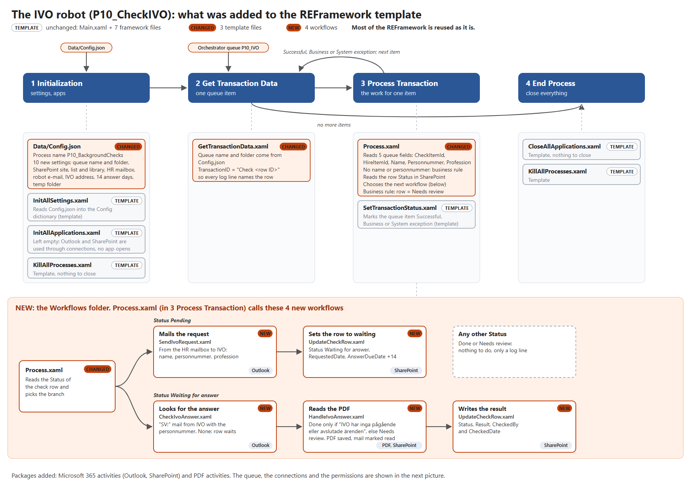

*Figure 1. The IVO robot. Only three template files were changed: Config.json, GetTransactionData.xaml and Process.xaml. All the IVO work is in four new workflows.*

- **Initialization** only reads more settings. There is no desktop application to open, because Outlook and SharePoint are used through connections.
- **Get Transaction Data** takes one item from the queue `P10_IVO`. One item is one IVO check row.
- **Process Transaction** reads the Status of the check row and picks one of two branches. A Pending row gets a request mail. A row that is "Waiting for answer" is matched with the answer mail.

### 1.2 Around the Robot: Queue, Connections and Permissions

Figure 2 shows what the robot needs outside its own files. The grey boxes were there before this robot. The orange-red boxes were set up for it.

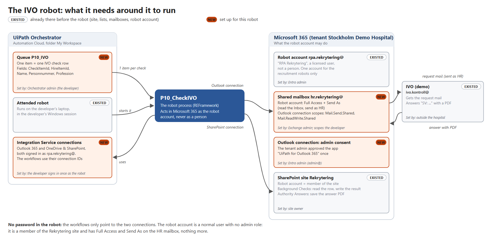

*Figure 2. The robot gets its work from an Orchestrator queue and acts in Microsoft 365 as the robot account rpa.rekrytering@, never as a person.*

## 2. The Starting Point: A New REFramework Project

The project was created in UiPath Studio from the Robotic Enterprise Framework template, as a Windows project with VB expressions (Figure 3):

1. The new project P10_CheckIVO.
2. `Main.xaml` with the four states of the REFramework, as it comes from the template. `Main.xaml` was not changed.

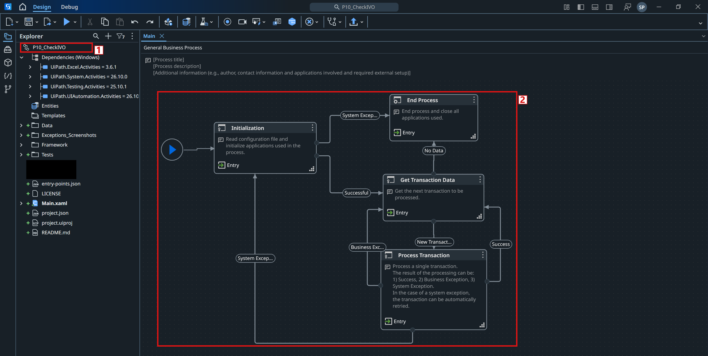

*Figure 3. The new project P10_CheckIVO is created from the REFramework template.*

Two activity packages were added to the template's packages:

| Package | Used for |
|---|---|
| UiPath.MicrosoftOffice365.Activities | Outlook (send, read and mark mails) and SharePoint (read and update list rows, upload files) |
| UiPath.PDF.Activities | Read the text of the answer PDF |

## 3. Initialization: The Settings in Config.json

The REFramework reads `Data/Config.json` once at the start (`InitAllSettings.xaml`, not changed). Every value that can change between test and real use is a setting.

| Setting | Value | Why it is needed |
|---|---|---|
| logF_BusinessProcessName | P10_BackgroundChecks | Groups the logs of all four P10 robots |
| OrchestratorQueueName | P10_IVO | The queue this robot works on |
| OrchestratorQueueFolder | (empty) | Empty means the folder the process runs in |
| SharePointSiteUrl | .../sites/rekrytering | The recruitment site |
| ChecksListName | Background Checks | The list with one row per check |
| AnswersLibraryUrl | .../sites/rekrytering/Authority Answers | Where the answer PDF is saved |
| HrMailbox | hr.rekrytering@ | The shared HR mailbox: the request is sent from it, and the answer arrives in it |
| RobotEmail | rpa.rekrytering@ | Written in CheckedBy, so the list shows that the robot did the check |
| IvoMailAddress | ivo.kontroll@ | IVO (demo) |
| AnswerDueDays | 14 | AnswerDueDate = the request date + 14 days |
| TempFolder | %TEMP%\P10_CheckIVO | A local folder for the PDF while it is read |

The template's Config.json already had the first three settings. For this robot, two of them got new values and eight settings were added. The red boxes in the pictures of this guide always mark what was changed or added for the robot. Everything outside the boxes is the template. The numbers in Figure 4 match this list:

1. **Changed values:** the process name `P10_BackgroundChecks` and the queue `P10_IVO`.
2. **New, SharePoint:** the site, the list Background Checks and the library Authority Answers.
3. **New, mail addresses:** the HR mailbox, the robot account and IVO.
4. **New, timing and files:** 14 days for the answer, and the local folder for the PDF.

The Constants part (from line 15) is the template and was not changed.

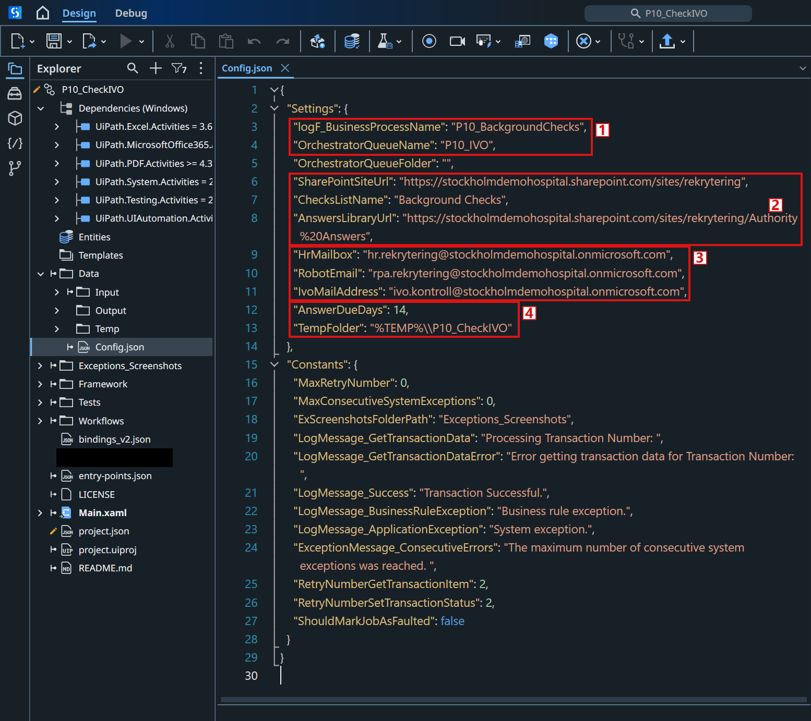

*Figure 4. The settings of the IVO robot. The red boxes are the changed and new settings.*

`InitAllApplications.xaml` and `KillAllProcesses.xaml` were left as they are. This robot opens no application.

## 4. Get Transaction Data: One Check Row from the Queue

Only two places were changed in this template file (Figure 5):

1. **Get transaction item:** the Orchestrator folder and the queue name are read from Config.json (`OrchestratorQueueFolder` and `OrchestratorQueueName`). The queue is not typed into the activity.
2. **Assign out_TransactionID:** the ID is `"Check " + CheckItemId`, for example "Check 491". Every log line of the item then names the check row it belongs to.

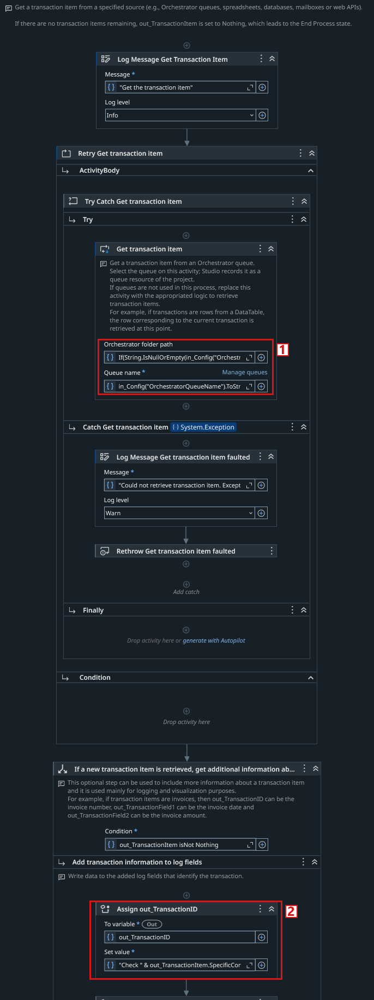

*Figure 5. GetTransactionData.xaml. Only the two red boxes were changed; the rest is the template.*

Each queue item carries five fields from the list: **CheckItemId**, **HireItemId**, **Name**, **Personnummer** and **Profession**.

The queue `P10_IVO` was created in Orchestrator (Figure 6):

1. **Name and description** of the queue.
2. **Unique reference and encrypted format.** The same item cannot be added twice, and the item data is stored encrypted, because it contains personnummer.
3. **Auto retry for failed items, one time.** A run that fails with a system error is tried once more.

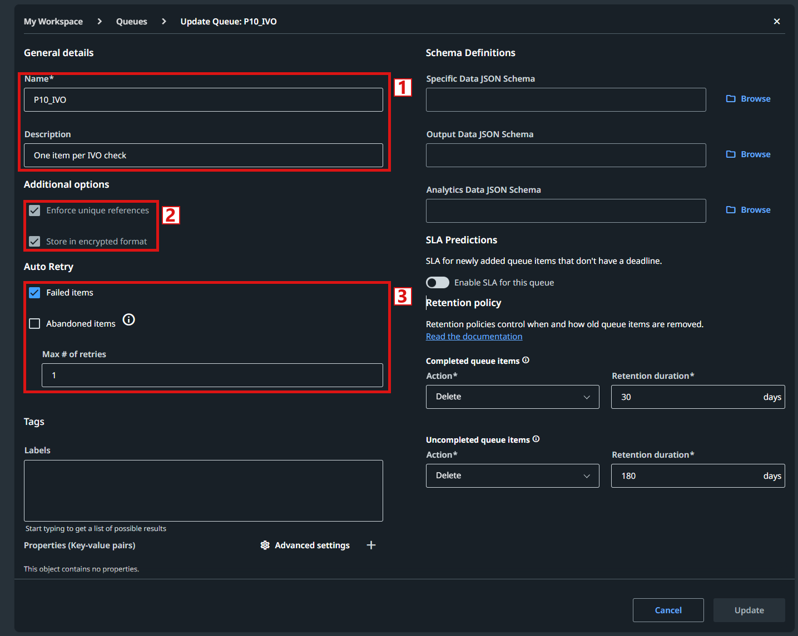

*Figure 6. The queue P10_IVO in Orchestrator.*

## 5. Process Transaction: Process.xaml Picks the Branch

In the template, `Process.xaml` is almost empty. Everything in Figures 7 and 8 was added for this robot. It handles one queue item, in this order (the numbers match the red boxes):

1. **Reads the five fields** of the queue item into variables.
2. **Checks the data.** A missing name or personnummer is a *business rule exception*: "Namn eller personnummer saknas. Kontrollera raden i New Hires."
3. **Reads the check row** in Background Checks with "Get Single SharePoint List Item", by its ID.
4. **Picks the branch** from the row's Status:
   - **Pending:** invoke `SendIvoRequest.xaml`.
   - **Waiting for answer:** invoke `CheckIvoAnswer.xaml`.
   - **Any other Status** (Done, Needs review): only a log line.
5. **Catches business rule exceptions:** the row is set to **Needs review** with the exception text as the Result, and the exception is thrown again, so the queue item ends as a Business Exception.

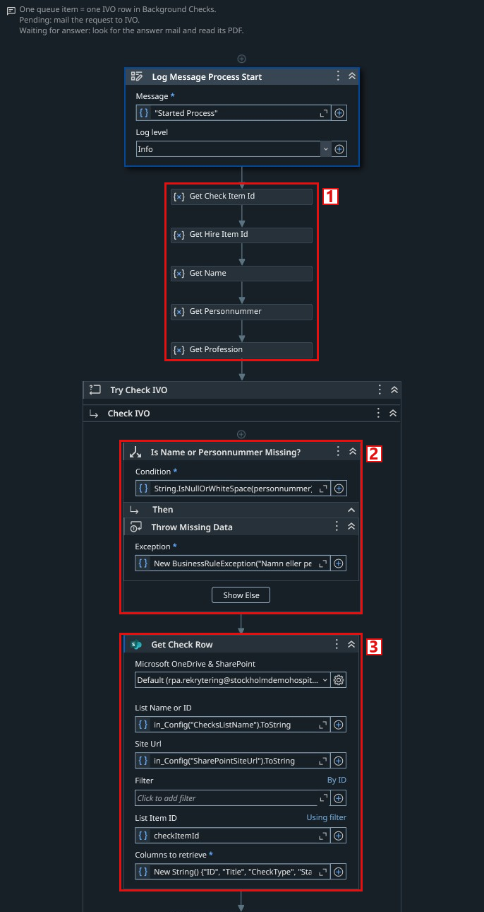

*Figure 7. Process.xaml, part 1: read the item (1), check the data (2) and read the check row (3).*

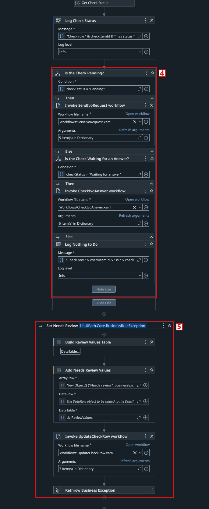

*Figure 8. Process.xaml, part 2: pick the branch from the Status (4), and set Needs review when the data is wrong (5).*

## 6. The New Workflows

### 6.1 SendIvoRequest.xaml: The Request Mail

This workflow runs for a Pending row. It has three parts (Figure 9):

1. **Builds the subject and the text** with the name, the personnummer and the profession.
2. **Sends the mail from the shared HR mailbox** with "Send Mail" (Outlook 365). "Send as" is the HR mailbox, so the receiver sees HR - Rekrytering, not the robot.
   - **To:** ivo.kontroll@ (from Config.json)
   - **Subject:** "Förfrågan om tillsyn - Hugo Palm, 19661004-2428"
   - **Text:** "Hej, Vi ber om uppgifter om pågående eller avslutade tillsynsärenden för Hugo Palm, personnummer 19661004-2428, inför anställning som sjuksköterska vid Stockholm Demo Hospital. Med vänlig hälsning, HR-enheten, rekrytering, Stockholm Demo Hospital"
3. **Sets the row to Waiting for answer:** a small table with Status, RequestedDate = today and AnswerDueDate = today + 14 days is written through `UpdateCheckRow.xaml`.

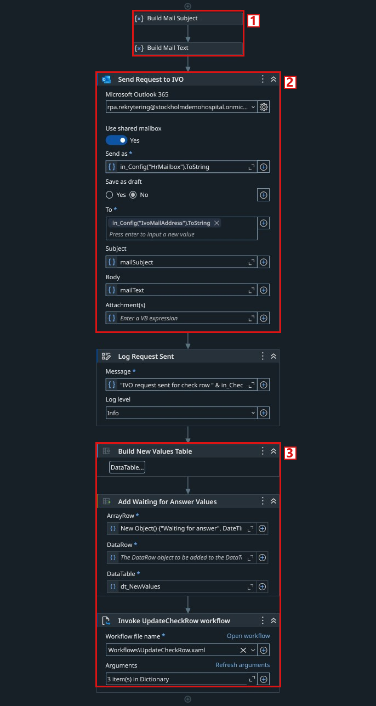

*Figure 9. The request mail is sent from the HR mailbox, then the row waits.*

### 6.2 UpdateCheckRow.xaml: One Place That Writes to the List

All writes to Background Checks go through this one small workflow. It runs "Update List Item" (Figure 10):

1. **Where:** the list name and the site come from Config.json.
2. **What:** the ID of the row, and a data row with only the columns to change (for example Status, RequestedDate and AnswerDueDate).

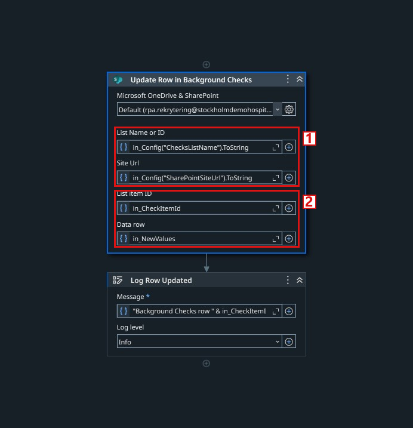

*Figure 10. UpdateCheckRow.xaml updates one row in Background Checks.*

### 6.3 CheckIvoAnswer.xaml: Is the Answer Here?

This workflow runs for a row that is Waiting for answer (Figure 11):

1. **Get Email List** reads the mails with attachments in the Inbox of the shared HR mailbox.
2. **For Each** goes through the mails. One If keeps the mail that matches all three rules: the sender is ivo.kontroll@, the subject starts with "SV:", and the subject contains the person's personnummer.
3. **No answer yet:** the workflow only writes a log line, and the row stays Waiting for answer. The next morning's run looks again.
4. **The answer is there:** `HandleIvoAnswer.xaml` is invoked.

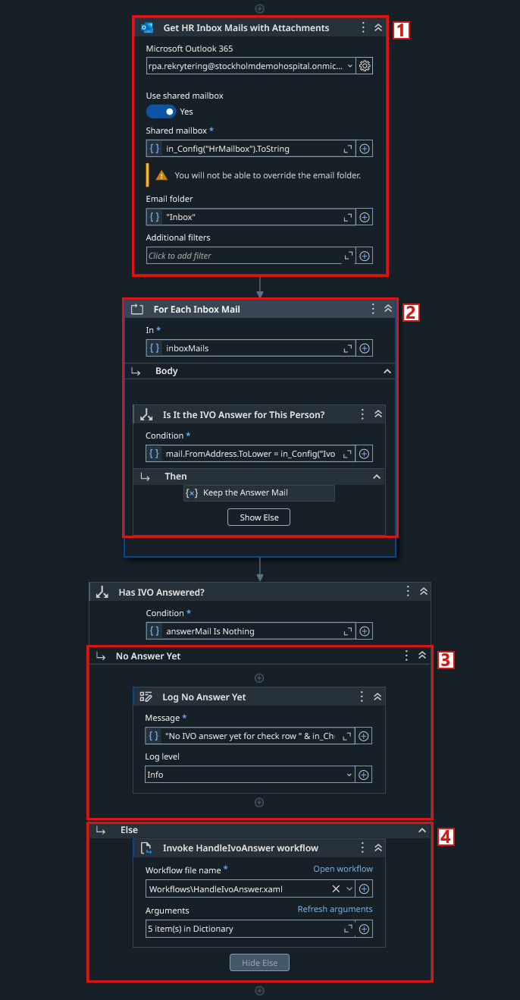

*Figure 11. One If with three rules finds the answer mail for this person.*

### 6.4 HandleIvoAnswer.xaml: Read, Decide, Save

The workflow runs in this order (the numbers match the red boxes in Figures 12 and 13):

1. **Downloads the PDF** of the answer mail to the temp folder with "Download Email Attachments". A mail without a PDF is a business rule exception.
2. **Reads the PDF text** with "Read PDF Text", and puts the text on one line, so a sentence that is broken over two lines in the PDF can still be found.
3. **Finds the diarienummer** with "Matches" (Find Matching Patterns). The pattern looks for the shape of an IVO diarienummer, for example 3.5.1-18302/2026 (section 8.3 explains why).
4. **Decides the result:**

   | Answer | Status | Result |
   |---|---|---|
   | "IVO har inga pågående eller avslutade ärenden" | Done | "Inga pågående eller avslutade ärenden. Dnr 3.5.1-18302/2026." |
   | The personnummer is not known to IVO | Needs review | "Personnumret finns inte i IVO:s uppgifter. Kontrollera personnumret. Dnr X." |
   | IVO lists one or more cases | Needs review | "IVO har ett eller flera ärenden för personen, se PDF i Authority Answers. Behöver granskas av HR. Dnr X." |

5. **Saves the PDF** in Authority Answers with "Upload Files", with **Hire** (the hire in New Hires) and **CheckType** = IVO.
6. **Updates the row** with Status, Result, CheckedBy (the robot account) and CheckedDate.
7. **Marks the answer mail as read** and **deletes the local copy** of the PDF.

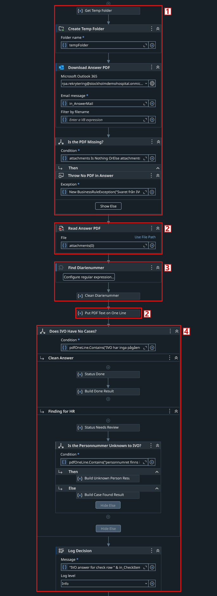

*Figure 12. HandleIvoAnswer.xaml, part 1: download and read the PDF, find the diarienummer and decide.*

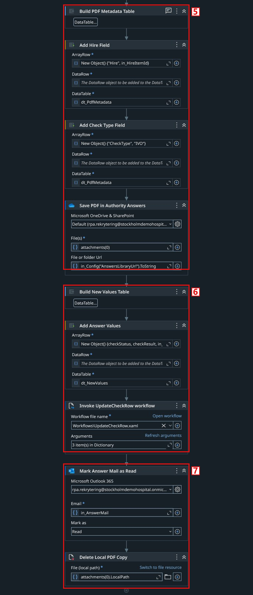

*Figure 13. HandleIvoAnswer.xaml, part 2: save the PDF, update the row, mark the mail and delete the local copy.*

## 7. Connections and Permissions

The IVO robot uses the same two Integration Service connections as the HOSP robot, both signed in as the robot account rpa.rekrytering@. The workflows contain no password and no user name.

| What | Set to | Set by |
|---|---|---|
| Robot account rpa.rekrytering@ | A licensed user, no admin role | Entra admin |
| HR mailbox hr.rekrytering@ | Full Access and Send As for the robot account | Exchange admin |
| Outlook connection | Signed in as the robot account, with the scopes Mail.Send.Shared and Mail.ReadWrite.Shared | The developer |
| "UiPath for Outlook 365" | Admin consent for the tenant, given once | Entra admin |
| SharePoint connection | Signed in as the robot account | The developer |
| Site Rekrytering | The robot account is a member | Site owner |
| Queue P10_IVO | Created in the Orchestrator folder | Orchestrator admin |

The connections page in Orchestrator (Figure 14):

1. The two connections of the robot account rpa.rekrytering@: Microsoft OneDrive & SharePoint, and Microsoft Outlook 365. Both are Connected. The third row is an older connection of another user and is not used by these robots.

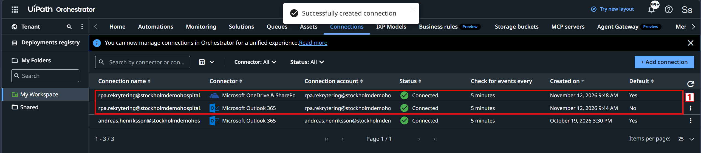

*Figure 14. The Outlook and SharePoint connections of the robot account.*

## 8. Build Milestones: How Each Part Was Checked

The robot was tested on the same request as the HOSP robot: Hugo Palm, a nurse for Akutmottagningen. His IVO row in Background Checks has ID 491.

### 8.1 Milestone 1: A Pending Row Gets a Request Mail

The first run took the queue item "Check 491". The request mail was sent from the HR mailbox to IVO, and the row was set to Waiting for answer with RequestedDate 2026-11-12 and AnswerDueDate 2026-11-26.

In the HR mailbox (Figure 15):

1. The Sent Items folder of the shared mailbox HR - Rekrytering.
2. The request mail for Hugo Palm.
3. Sent from HR - Rekrytering to IVO Kontroll av legitimerad personal (demo), not from a person.
4. The text with the name, the personnummer and the profession.

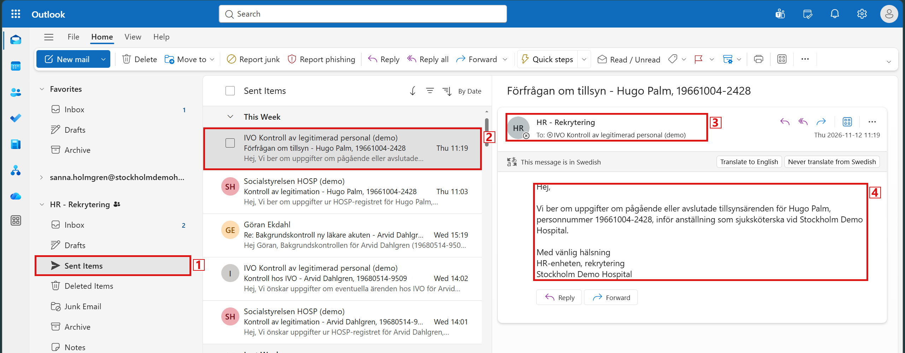

*Figure 15. The request to IVO, sent by the robot from the HR mailbox.*

### 8.2 Milestone 2: No Answer Yet, Nothing Changes

The robot ran again before IVO had answered. It found no matching mail, wrote "No IVO answer yet for check row 491. The row stays Waiting for answer." in the log, and changed nothing. This is the normal case on most mornings: waiting is not an error.

The queue items of row 491 in Orchestrator (Figure 16):

1. "491-2026-11-12": the first run, which sent the request.
2. "491-2026-11-12-noanswer": the run before IVO had answered. It changed nothing and ended as Successful.
3. The two answer runs (sections 8.3 and 8.4).

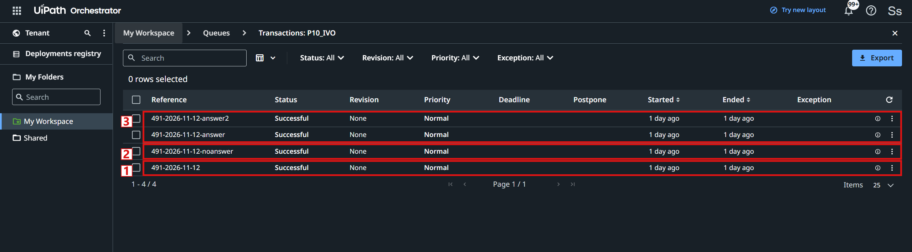

*Figure 16. The queue items of row 491.*

### 8.3 Milestone 3: The Answer Arrives, but the Diarienummer Is Wrong

IVO answered with "SV: Förfrågan om tillsyn - Hugo Palm, 19661004-2428" and the PDF IVO-svar_18302-2026.pdf.

In the HR mailbox (Figure 17):

1. The Inbox of the shared mailbox HR - Rekrytering.
2. The answer "SV: Förfrågan om tillsyn - Hugo Palm, 19661004-2428".
3. The PDF IVO-svar_18302-2026.pdf, which the robot reads.
4. The diarienummer 3.5.1-18302/2026.

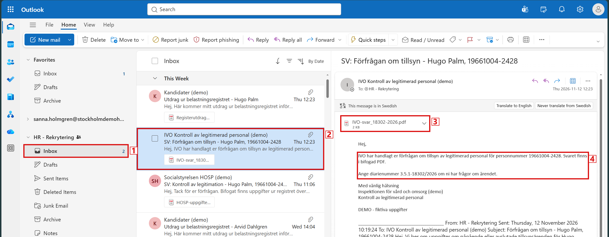

*Figure 17. The answer with the PDF in the HR Inbox.*

The next run set the row to Done with the right decision, but the Result ended with "Dnr Datum:." instead of the diarienummer. The pattern was copied from the HOSP robot, and it read the word after the label "Diarienummer:". In the IVO PDF, the text comes out in another order: after "Diarienummer:" comes the next label, "Datum:". So the pattern was changed to look for the **shape** of a diarienummer instead (digits and dots, a dash, digits, a slash and a year). The row was set back to Waiting for answer, and the robot ran again.

### 8.4 Milestone 4: The Row Is Done and the PDF Is Saved

The second answer run set row 491 to **Done** with the Result "Inga pågående eller avslutade ärenden. Dnr 3.5.1-18302/2026." and CheckedBy = the robot account. The PDF was saved in Authority Answers with Hire = Hugo Palm and CheckType = IVO. The answer mail was marked as read, and the local copy was deleted.

All three rows of Hugo Palm in Background Checks (Figure 18):

1. **Legitimation:** Done, with the licence result and the diarienummer from HOSP.
2. **IVO:** Done, with the IVO result and the diarienummer from IVO.
3. **Belastningsregister:** Done, with the extract number, the police check and "Inga uppgifter".

In all three rows, CheckedBy is RPA Rekrytering, the robot account.

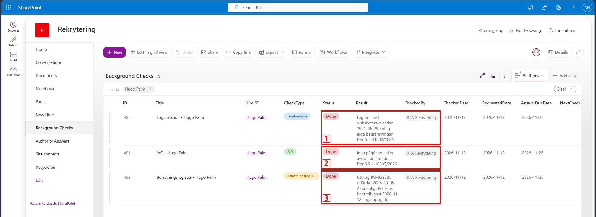

*Figure 18. The IVO row of Hugo Palm (2) is Done, checked by the robot.*

In the library Authority Answers, filtered on Hugo Palm (Figure 19):

1. The two answer PDFs: from HOSP and from IVO.
2. **Modified By** is RPA Rekrytering: the robot uploaded them.
3. **Hire** and **CheckType**: the two columns the robot filled in, so each PDF is linked to the person and the check.

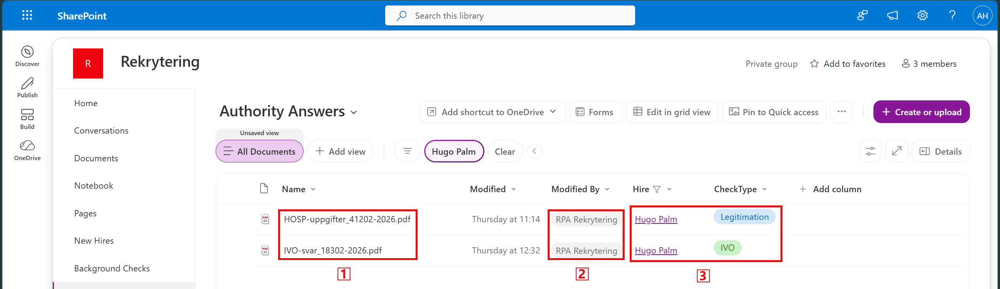

*Figure 19. The IVO answer PDF in Authority Answers, linked to the hire.*

The saved PDF, opened in Authority Answers (Figure 20):

1. The diarienummer, written at the end of the Result.
2. The sentence "IVO har inga pågående eller avslutade ärenden", which made the row Done.

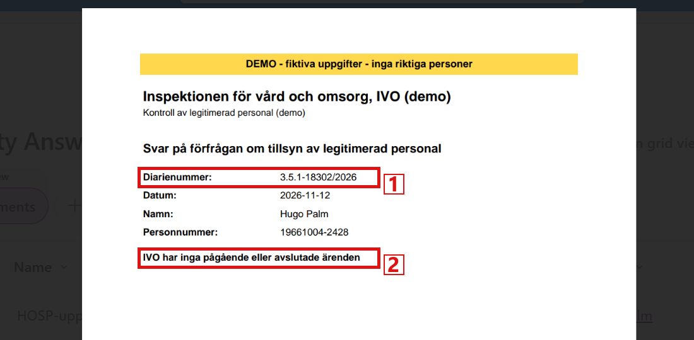

*Figure 20. The IVO answer PDF and the values the robot read.*

## 9. What the IVO Robot Does Now

The IVO robot sends the request, waits without errors while IVO works on it, and closes the row when the answer comes. A clean answer is set to Done. Any case or an unknown personnummer goes to HR as Needs review, with the PDF saved for the person who decides. The wrong diarienummer showed that a pattern copied from another robot must be checked against the real PDF of the new authority.
