# Build Guide: The Manager Robot (P10_CheckManager)

This guide shows how the manager robot was built, part by part. The robot starts and ends the work of the background checks. It reads the request mails from the heads of department, creates the rows in "New Hires" and "Background Checks", fills the queues of the three check robots and sends one report for each new hire.

The robot is built on the UiPath Robotic Enterprise Framework (REFramework), like the three check robots. The guide first shows the whole robot in two pictures, then goes through each changed or new part in the same order as the framework runs.

[Back to the Project Record](../Project%20Record.md)

## 1. The Big Picture

### 1.1 Inside the Robot: What Was Added to the REFramework

Figure 1 shows the four states of the REFramework from left to right. Under each state are the files that run in it. Grey files come from the template and were not changed. Orange-red files were changed or added for this robot.

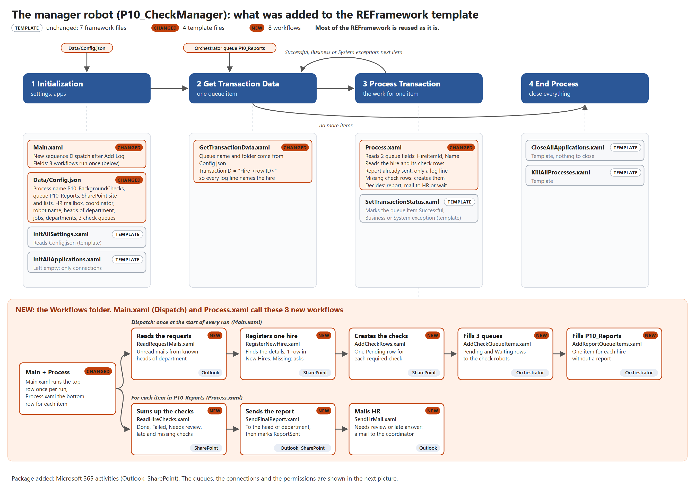

*Figure 1. The manager robot. Four template files were changed, and the work is done in eight new workflows.*

- **Initialization** reads the settings and then runs a new sequence, Dispatch, once. Dispatch reads the request mails, creates the missing rows and fills the queues.
- **Get Transaction Data** takes one item from the robot's own queue, `P10_Reports`. One item is one new hire without a report.
- **Process Transaction** reads the hire and its check rows and decides: a report, a mail to HR, or nothing yet.

The manager robot is the only robot with work in two places. The top row in the orange box runs once at the start of every run. The bottom row runs once for every item in `P10_Reports`.

### 1.2 Around the Robot: Queues, Connections and Permissions

Figure 2 shows what the robot needs outside its own files. The robot uses the same robot account and the same two connections as the check robots. Only its own queue, `P10_Reports`, was new.

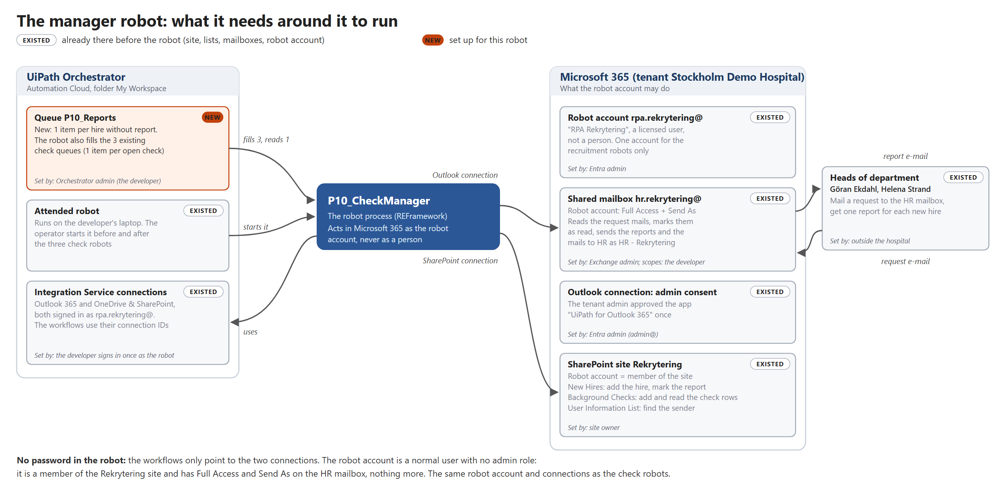

*Figure 2. The robot reads the request mails and sends the reports through the HR mailbox, and it works in the lists of the site Rekrytering, always as the robot account rpa.rekrytering@.*

## 2. The Starting Point: A New REFramework Project

The project was created in UiPath Studio from the Robotic Enterprise Framework template, as a Windows project with VB expressions (Figure 3):

1. The new project P10_CheckManager.
2. `Main.xaml` with the four states of the REFramework, as it comes from the template.

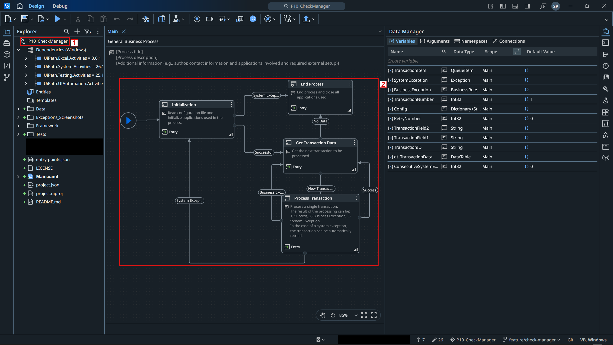

*Figure 3. The new project P10_CheckManager is created from the REFramework template.*

The package Microsoft 365 activities was added for Outlook and SharePoint. No PDF or UI Automation activities are needed, because the manager robot reads no PDF and opens no application.

## 3. Initialization: The Settings in Config.json

All values that could change are kept in `Data/Config.json`, so the workflows contain no names, addresses or list names (Figure 4):

1. **The process and the queue:** the process name P10_BackgroundChecks, as in the check robots, and the robot's own queue P10_Reports.
2. **SharePoint:** the site Rekrytering and the lists New Hires, Background Checks and User Information List. The last one is SharePoint's own list of site users. The robot needs it to find the SharePoint user of the head of department who sent a request.
3. **The mailboxes and names:** the HR mailbox, the HR coordinator who gets the review mails, the name of the robot account for ReportSentBy, and the signature of the mails.
4. **The known heads of department**, as "name=e-mail" pairs. Only a mail from one of them is read as a request.
5. **The jobs and the departments** that the robot looks for in a request mail.
6. **The queues of the three check robots.**

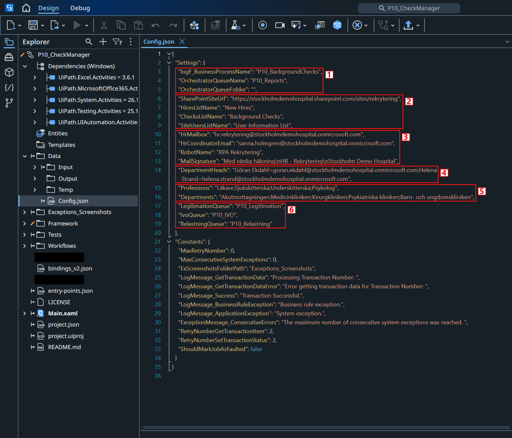

*Figure 4. The settings that were added to Config.json.*

## 4. Main.xaml: The Dispatch Sequence

`Main.xaml` was changed in one place. In the Initialization state, after the template's Add Log Fields, a new sequence called Dispatch runs once at the start of every run (Figure 5):

1. The new sequence Dispatch.
2. Invoke ReadRequestMails: new requests from the HR mailbox become rows.
3. Invoke AddCheckQueueItems: every open check goes to the queue of its check robot.
4. Invoke AddReportQueueItems: every new hire without a report goes to `P10_Reports`.

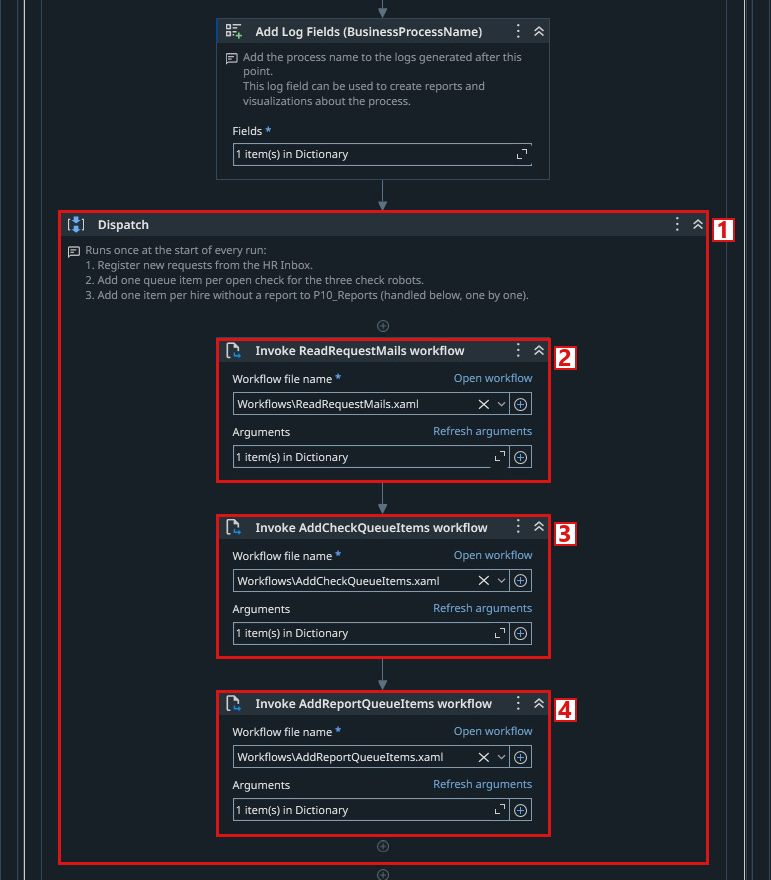

*Figure 5. The Dispatch sequence in the Initialization state.*

Dispatch is in Initialization, not in Process Transaction, because it is not work for one item. It creates the items that the rest of the run, and the check robots, work on.

## 5. Get Transaction Data: One New Hire from the Queue

`GetTransactionData.xaml` takes the next item from `P10_Reports` (Figure 6):

1. The queue name and the folder come from Config.json, not from a fixed text.
2. The TransactionID is "Hire" and the row ID of the new hire, so every log line says which hire it is about.

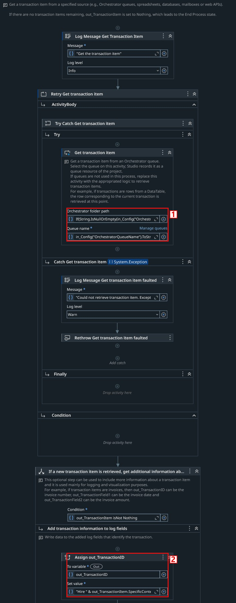

*Figure 6. The changes in GetTransactionData.xaml.*

## 6. Process Transaction: Process.xaml Decides What Happens Next

`Process.xaml` handles one new hire. It never trusts the queue item alone, but reads the hire and its check rows again (Figure 7):

1. The two queue fields, HireItemId and Name.
2. The hire row is read from New Hires.
3. **Report already sent?** Then only a log line is written. This keeps the rule of one report for each new hire.
4. The check rows of the hire are read and summed up by ReadHireChecks.
5. **A check row is missing?** Then AddCheckRows creates it at once.

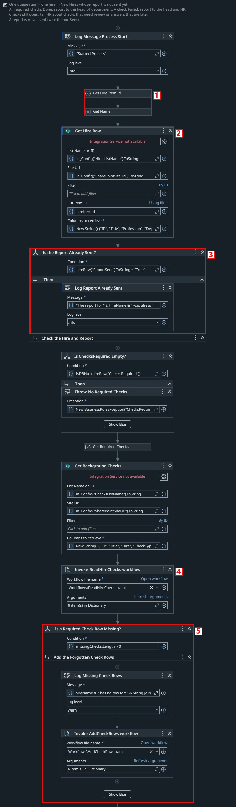

*Figure 7. Process.xaml, part 1: reading the hire and its checks.*

The second part makes the decision (Figure 8):

1. **A check is Failed:** SendFinalReport sends the report that the person cannot be approved.
2. **All checks are Done:** SendFinalReport sends the report that the employment can start.
3. **A check is in Needs review:** SendHrMail sends "Behöver granskas" to the HR coordinator, at most once a day.
4. **An answer is late:** SendHrMail sends "Svar dröjer" to the HR coordinator, at most once a day.
5. **The hire is still Pending:** OverallStatus is set to In progress.

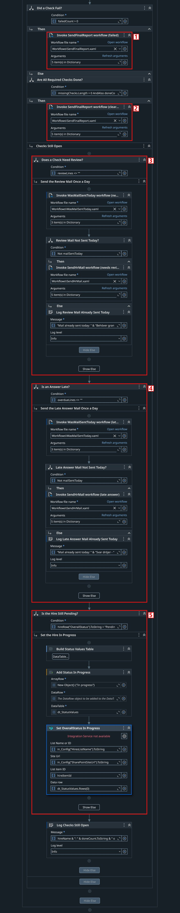

*Figure 8. Process.xaml, part 2: the decision for one new hire.*

## 7. The New Workflows

### 7.1 ReadRequestMails.xaml: The New Requests

This workflow reads all unread mails in the Inbox of the HR mailbox, the oldest first (Figure 9):

1. Get Email List: the unread mails in the HR Inbox.
2. Get List Items: the hires that already exist, to find a request that was sent twice.
3. The site users, to find the SharePoint user of the sender.
4. For each mail: is the sender a known head of department? Other mails are left alone.
5. A Try Catch around RegisterNewHire: if one mail fails, the error is logged, the mail stays unread, and the next mail is handled.

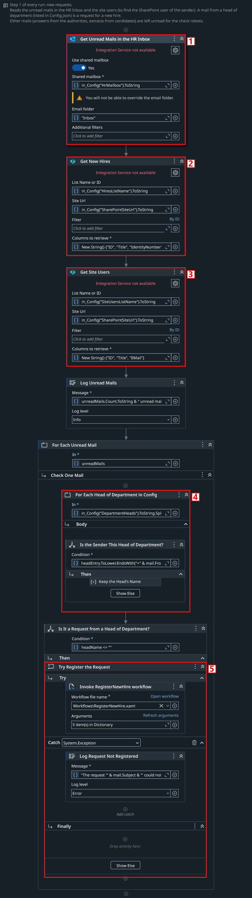

*Figure 9. ReadRequestMails.xaml.*

### 7.2 RegisterNewHire.xaml: One Mail Becomes One Hire

The heads of department write their mails in their own way, as a sentence or as a list. This workflow finds the details with Matches activities (Figure 10):

1. **The personnummer:** eight digits, a dash and four digits.
2. **The name:** the words with capital letters just before the personnummer.
3. **The start date:** a date in the form 2026-12-14.
4. **The job and the department:** each value in Config.json is looked for in the mail. "Akuten" is understood as Akutmottagningen.
5. **The checks:** the words "legitimation", "IVO" and "belastningsregister" or "utdrag". If no check is named, the job decides.

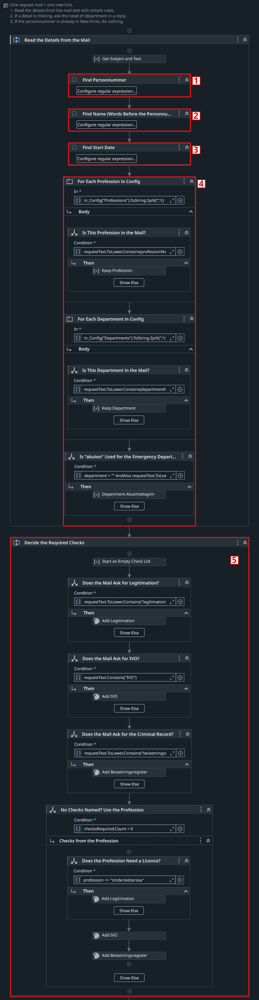

*Figure 10. RegisterNewHire.xaml, part 1: finding the details in the mail.*

Then the hire is registered (Figure 11):

1. **A detail is missing?** The robot replies to the head of department and asks for it. No row is created.
2. **The personnummer already exists?** The mail is a repeat, and nothing new is created.
3. Add List Item: one row in New Hires, with RequestedBy set to the sender.
4. Invoke AddCheckRows: one row for each check.
5. The mail is marked as read.

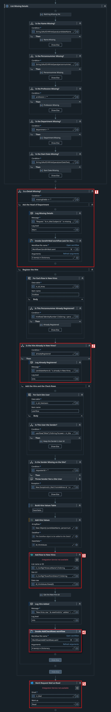

*Figure 11. RegisterNewHire.xaml, part 2: registering the hire.*

### 7.3 AddCheckRows.xaml: One Row for Each Check

For each check in the list it gets, this workflow adds one row to Background Checks (Figure 12):

1. For Each Required Check: one round for each check.
2. Add Data Row: the values of the new row. The Title, for example "IVO - Wilma Vall", the CheckType, the Status Pending and the link to the hire.
3. Add List Item: the row is added to Background Checks.

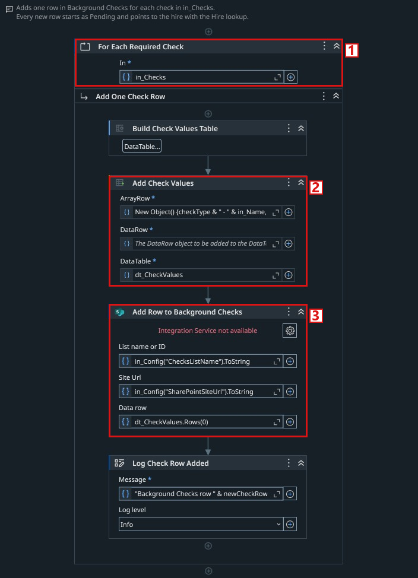

*Figure 12. AddCheckRows.xaml.*

The same workflow is used in two places: when a hire is registered, and in Process.xaml when a row is missing.

### 7.4 AddCheckQueueItems.xaml: Work for the Check Robots

This workflow puts every open check into the queue of its check robot (Figure 13):

1. Get List Items: all rows in Background Checks.
2. Only rows that are Pending or Waiting for answer.
3. The queue is chosen by the CheckType: Legitimation, IVO or Belastningsregister.
4. The reference: the row ID, the date and the time of the run.
5. Add Queue Item: the check goes to its queue, with the fields CheckItemId, HireItemId, Name, Personnummer and Profession.

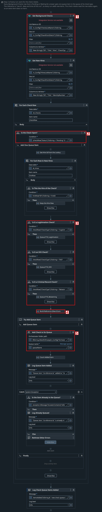

*Figure 13. AddCheckQueueItems.xaml.*

### 7.5 AddReportQueueItems.xaml: Work for the Manager Robot

This workflow adds one item to `P10_Reports` for every new hire without a report (Figure 14):

1. Get List Items: all rows in New Hires.
2. Only rows where ReportSent is not set.
3. Add Queue Item: one item in `P10_Reports`, with the fields HireItemId and Name.

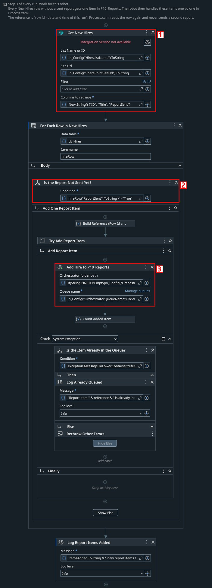

*Figure 14. AddReportQueueItems.xaml.*

### 7.6 ReadHireChecks.xaml: The Checks of One Hire

This workflow goes through the check rows of one hire and gives Process.xaml a short summary (Figure 15):

1. How many checks are Done and how many are Failed.
2. One result line for each check, used in the report.
3. The checks in Needs review and the checks whose AnswerDueDate has passed, used in the mails to HR.
4. The checks in ChecksRequired that have no row.

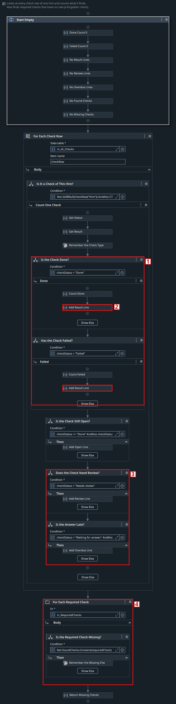

*Figure 15. ReadHireChecks.xaml.*

### 7.7 SendFinalReport.xaml: One Report to the Head of Department

This workflow sends the report and marks it in one place (Figure 16):

1. The e-mail of the head of department, found by the name in RequestedBy.
2. The subject: "Bakgrundskontroll klar" or "kan inte godkännas". A report that cannot be approved also goes to HR as a copy.
3. Invoke SendHrMail: the report, with one line for each check and the decision.
4. Update List Item: OverallStatus, ReportSent, ReportSentBy and ReportSentDate.

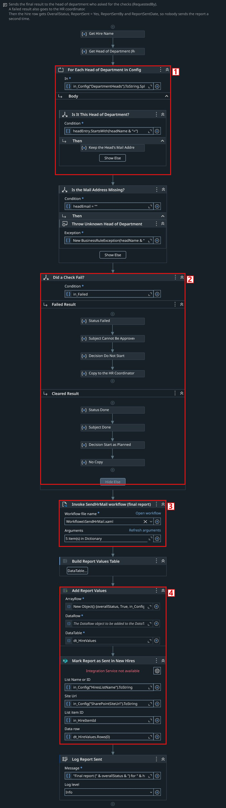

*Figure 16. SendFinalReport.xaml.*

### 7.8 SendHrMail.xaml: All Mails from the HR Mailbox

Every mail of the manager robot is sent by this one workflow, from the HR mailbox and with the same signature (Figure 17):

1. Send Email with a shared mailbox: the mail is sent as the HR mailbox, not as the robot account.
2. To, Subject and Body come from the workflow that calls it. The signature from Config.json is added to the end of the body.
3. A log line for every mail that was sent.

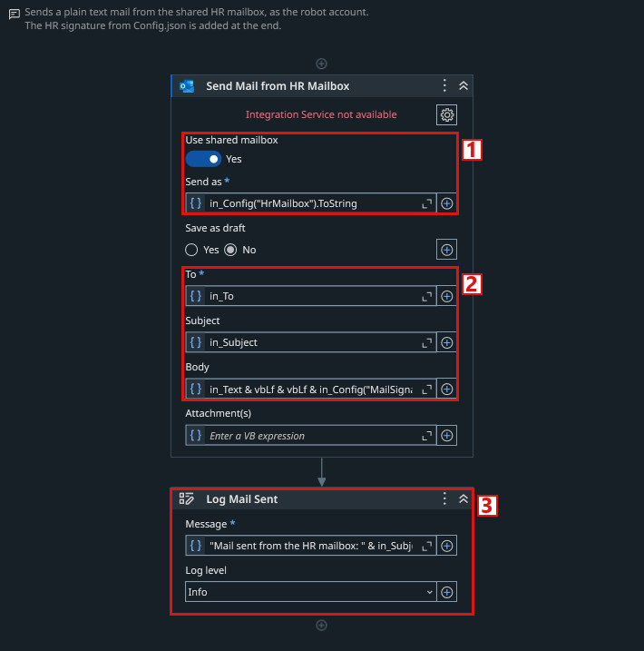

*Figure 17. SendHrMail.xaml.*

## 8. Connections and Permissions

The manager robot uses the same two Integration Service connections as the check robots, both signed in as the robot account rpa.rekrytering@. The workflows contain no password and no user name.

| What | Set to | Set by |
|---|---|---|
| Robot account rpa.rekrytering@ | A licensed user, no admin role | Entra admin |
| HR mailbox hr.rekrytering@ | Full Access and Send As for the robot account | Exchange admin |
| Outlook connection | Signed in as the robot account, with the scopes Mail.Send.Shared and Mail.ReadWrite.Shared | The developer |
| SharePoint connection | Signed in as the robot account | The developer |
| Site Rekrytering | The robot account is a member | Site owner |
| Queue P10_Reports | Created in the Orchestrator folder, one retry, unique reference | Orchestrator admin |

## 9. Build Milestones: How Each Part Was Checked

Each part was checked on real requests. The pictures are in the Project Record.

1. **Request mails become rows.** Two request mails from Helena Strand, one written as a sentence and one as a list, became two rows in New Hires and five check rows (Project Record, Figures [21](../Screenshots/manager-request-mail-omar.png), [22](../Screenshots/manager-request-mail-wilma.png), [23](../Screenshots/manager-new-hires-registered.png) and [24](../Screenshots/manager-checks-created.png)).
2. **The queues are filled.** The three check queues got the five new checks, and `P10_Reports` got one item for each hire without a report (Project Record, Figure [25](../Screenshots/manager-queues-filled.png)).
3. **A report is sent once.** Hugo Palm's and Wilma Vall's reports went to the right head of department, and both rows were marked as sent by the robot account (Project Record, Figures [28](../Screenshots/manager-report-hugo.png), [35](../Screenshots/manager-report-wilma.png) and [36](../Screenshots/manager-new-hires-final.png)).
4. **A finding goes to HR.** Omar Kvist's probation went to Sanna Holmgren as a review mail, and no report was sent (Project Record, Figures [37](../Screenshots/manager-review-mail-omar.png) and [38](../Screenshots/manager-checks-omar-final.png)).
5. **More than one run on the same day.** Each queue item gets a reference with the date and the time of the run, so every run gives the check robots the rows that are still open (Project Record, section 8.4).

## 10. What the Manager Robot Does Now

The manager robot turns a request mail into a hire and its checks, gives the checks to the three check robots and sends the report when the checks are done. A finding or a late answer goes to HR instead of a report. Each head of department gets one report for each new hire, sent and marked by the robot account.
