# Running the Robots Unattended

The [Project Record](Project%20Record.md) shows four attended robots: an RPA operator starts them in UiPath Assistant, one at a time. This document starts from that working process. It shows what a hospital prepares so that the same four robots can run by themselves, and then follows real cases from the request mail to the report, from the simplest to the most complex. The robots' own work, the SharePoint lists and the mailboxes stay the same.

## 1. Before: Every Robot Is Started by Hand (Attended)

In the attended setup, one round of work needs five starts by hand, always in the same order ([Project Record, section 8](Project%20Record.md#8-testing-the-fix-three-new-hires-from-two-heads-of-department)). The operator does this:

| Step | What the RPA operator does | What happens if it is skipped or late |
|---|---|---|
| 1 | Opens UiPath Assistant and starts P10_CheckManager | New request mails are not registered, and no check rows or queue items are created |
| 2 | Waits for the job to finish, then starts P10_CheckLegitimation | No licence request goes to HOSP, and no HOSP answer is read |
| 3 | Starts P10_CheckIVO | No IVO request goes out, and no IVO answer is read |
| 4 | Starts P10_CheckBelastning, and leaves the PC while it opens Microsoft Edge | No extract is checked with the police |
| 5 | Starts P10_CheckManager again | No report goes to the head of department, and no reminder goes to HR |
| Again | Repeats the round when new mails and answers have come in, several times a day | Every answer waits until the next round |

For the RPA operator, this means:

- **Five clicks and waits for every round,** and the round must be repeated during the day, because answers come in at any time.
- **The order matters.** The manager robot runs first, then the three check robots, and then the manager robot again.
- **The PC is busy.** The criminal record robot uses the screen, so nobody can work on the PC while it runs.

For HR and the heads of department, this means:

- **A request or an answer waits** until the operator runs the next round. When the operator is ill, in a meeting or on holiday, nothing moves.

The goal is to take the same robots to the next level: nobody starts them by hand.

| Goal | Today (attended) | Expected (unattended) |
|---|---|---|
| The manager robot starts on time | Started by the operator in Assistant | Started by a schedule, every 15 minutes from 07:00 to 17:45 |
| A check robot starts when there is work | Started by the operator, in the right order | Started by its queue as soon as a new item arrives |
| The robots run without a person at the PC | The operator is signed in and waits for each job | An unattended robot runs the jobs |
| The robots have their own access | The connections are made for the developer's workspace | A robot account with its own rights in Microsoft 365 and its own connections in Orchestrator |
| HR is not flooded with reminders | One review mail for every run | At most one reminder a day for each subject |
| The results stay the same | Rows, mails and reports by the four robots | The same rows, mails and reports, from the same packages |

The main goal: every new request and every answer is handled within 15 minutes, without anyone starting a robot.

## 2. Overview: Attended and Unattended Side by Side

Figure 1 shows the end result of both ways side by side. Each row is one robot run: what starts it, what the robot does, and what comes out of it.

1. **Attended (left):** the RPA operator clicks Start in UiPath Assistant five times, in a fixed order. Nothing happens while the operator is away.
2. **Unattended (right):** in the Orchestrator folder Shared, a time trigger starts the manager robot every 15 minutes, and a queue trigger starts each check robot as soon as its queue gets a new item. The robot account Default Robot runs the jobs on the same PC.
3. **The middle and the right columns are the same on both sides:** the same robots do the same work and give the same results in SharePoint and the mailboxes. Only the first column, what starts the robot, is different.

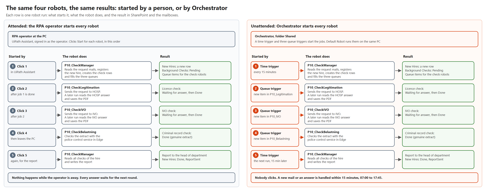

*Figure 1. The same four robots and the same results, started by a person (left) or by Orchestrator (right).*

To get from the left side to the right side, the robots are not rebuilt. Each part that already exists after the attended project is taken and changed, or copied to the folder Shared (Figure 2):

1. **What we have (attended):** the four processes, the manager robot's reminders, two connections, four queues, UiPath Assistant, the operator's clicks and the robot account in Microsoft 365.
2. **What is done:** the change for each part, with the section of this document that shows it.
3. **The result (unattended):** the part as it is used by the unattended robots.
4. **The robot account in Microsoft 365** is the only part that is not changed. Its rights are prepared once and used by both ways (sections 3.1 to 3.3).

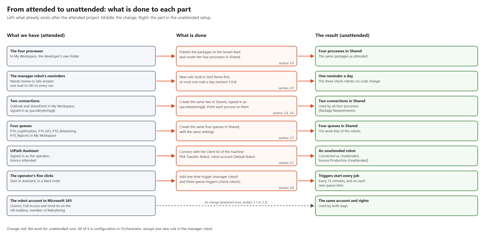

*Figure 2. From attended to unattended: what is done to each part.*

## 3. Setup for Unattended Runs (Microsoft 365 and Orchestrator)

The hospital already has Microsoft 365: the HR mailbox, the SharePoint site Rekrytering with its three lists, and the staff who work with them. Nothing of this changes. What is new is a worker that is not a person, and it needs the same kind of access as the HR coordinator, but no more.

The preparation is done once, on five platforms, in the order of Figure 3:

1. **Microsoft 365 (steps 1 to 6):** a Microsoft 365 administrator creates the robot account and gives it a licence, rights on the HR mailbox and a place on the site Rekrytering, and approves the UiPath connector apps.
2. **UiPath (steps 7 to 14):** a UiPath administrator creates the connections, sets up the unattended robot on the PC, and adds the processes, queues and triggers in the folder Shared.
3. **Ready:** after step 14, the first unattended job can start, and from then on the triggers start every robot.

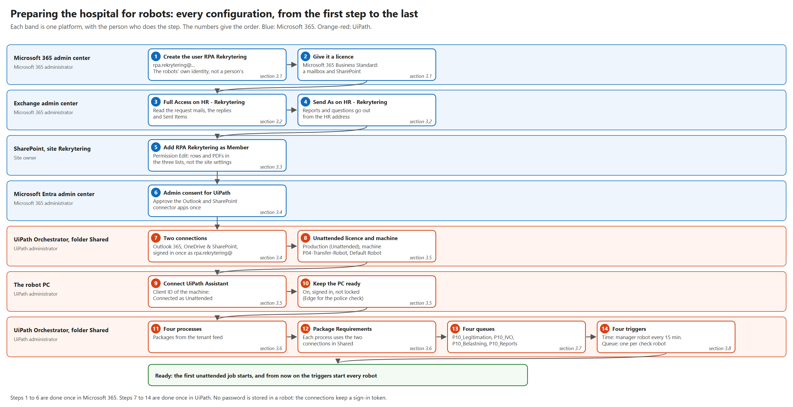

*Figure 3. Preparing the hospital for robots: every configuration, from the first step to the last.*

Figure 3 shows the order of the work. Figure 4 shows why each part is needed: it follows one robot job from the moment it is started until the robot works in Outlook and SharePoint.

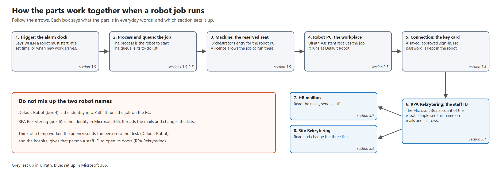

*Figure 4. How the parts work together when a robot job runs.*

The sections below follow the steps of Figure 3. Each step says where the setting is, what it means in plain words, what is set and why, and shows the final state.

### 3.1 Steps 1 and 2: Robot Account and Licence

**Where:** Microsoft 365 admin center > Users > Active users.

**In plain words:** The robot gets its own staff account, in the same way as a new employee gets a name and a login.

**What is set:** a new user, RPA Rekrytering, with a licence. The robots do not use the account of a person. If they did, every mail and every list change would look as if that person did it, and the robots would stop when the person changes the password or leaves the job. The robot signs in to Outlook and SharePoint like a person, so it needs a licence with a mailbox and SharePoint.

**Final state (Figure 5):**

1. The menu Users > Active users, where the account is found.
2. The user RPA Rekrytering, rpa.rekrytering@stockholmdemohospital047.onmicrosoft.com.
3. The licence Microsoft 365 Business Standard.

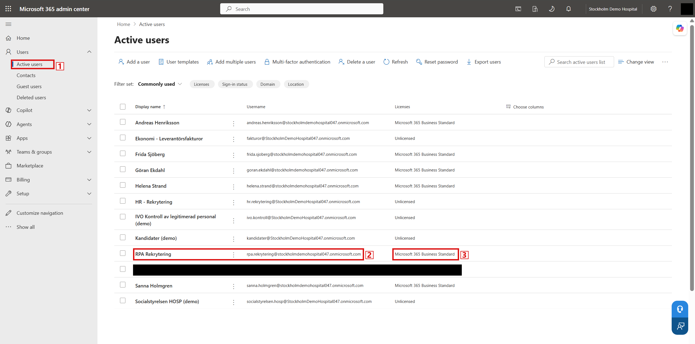

*Figure 5. The robot account RPA Rekrytering in the Microsoft 365 admin center.*

Everything the robots do is marked with this name. In SharePoint, a row changed by a robot shows "RPA Rekrytering", and a report shows RPA Rekrytering in ReportSentBy.

> **Seen in the cases:** every row that a robot writes shows RPA Rekrytering, for example ReportSentBy in [Figure 42](Screenshots/case1-new-hires-done.png). When HR decides a check instead, the row shows Sanna Holmgren ([Figure 97](Screenshots/case4-background-check-done.png) and [Figure 117](Screenshots/case5-background-check-failed.png)), so the list tells who made each decision.

### 3.2 Steps 3 and 4: Robot Account Rights on the HR Mailbox

**Where:** Exchange admin center > Recipients > Mailboxes > HR - Rekrytering > Mailbox delegation.

**In plain words:** A shared mailbox belongs to a team, not to one person. Full Access is the key to that mailbox. Send As lets the robot sign a mail with the name of the team.

**What is set:** two rights for the robot account on the shared mailbox HR - Rekrytering, where the request mails come in.

**Step 3, Full Access. Final state (Figure 6):**

1. The menu Recipients > Mailboxes.
2. The shared mailbox HR - Rekrytering is selected.
3. Mailbox delegation in the toolbar opens the panel on the right.
4. Full Access: the account can open the mailbox and read its mails, like the owner.
5. rpa.rekrytering@ is in the list. The manager robot reads the request mails and the replies, and looks in Sent Items before it sends a reminder. The HR coordinator Sanna Holmgren is in the list too, because she also works in this mailbox.

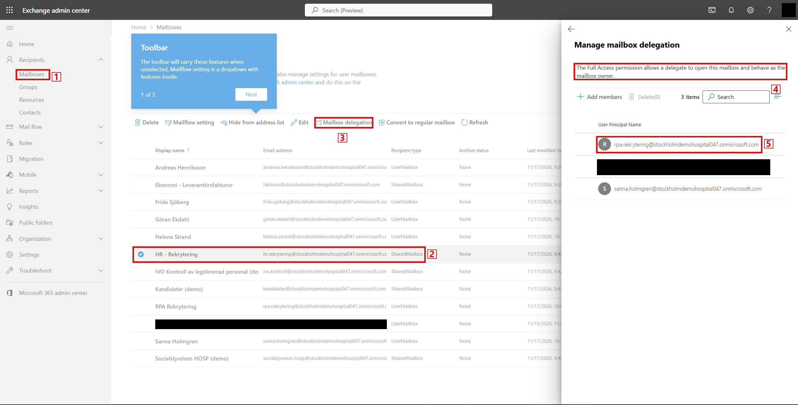

*Figure 6. Full Access on the HR mailbox.*

**Step 4, Send As. Final state (Figure 7):**

1. The menu Recipients > Mailboxes.
2. The shared mailbox HR - Rekrytering is selected.
3. Mailbox delegation in the toolbar opens the panel on the right.
4. Send As: a mail sent by the account looks as if it was sent by the HR mailbox itself.
5. rpa.rekrytering@ is in the list. A head of department gets the report from HR - Rekrytering, not from a robot, and a reply comes back to the HR mailbox, where the manager robot reads it.

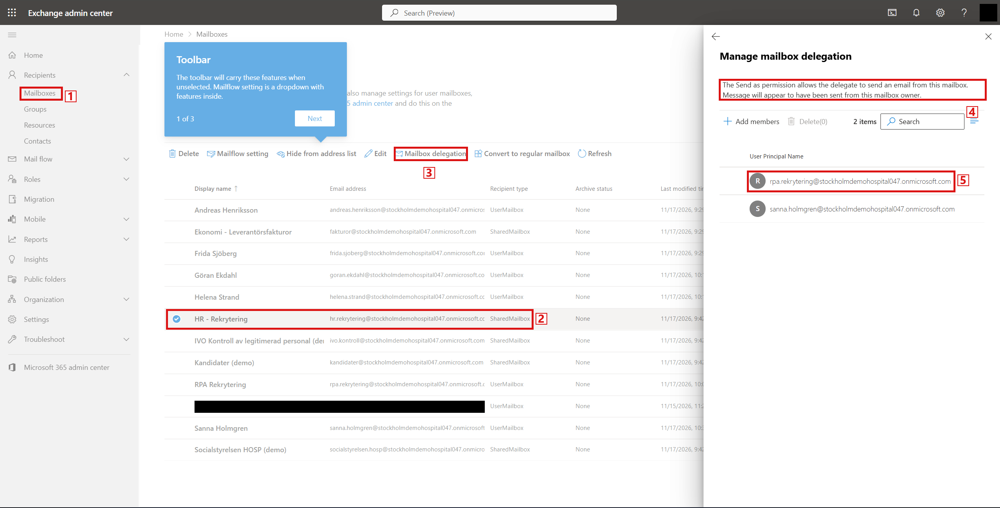

*Figure 7. Send As on the HR mailbox.*

> **Seen in the cases:** Full Access lets the manager robot count the unread mails at the start of every run ("2 unread mails in the HR Inbox" in [section 4.3](#43-round-1-request-registered-check-queued)) and look in Sent Items before a reminder ([section 7.6](#76-round-3-review-mail-to-the-hr-coordinator)). Send As is why every report arrives from HR - Rekrytering ([Figure 41](Screenshots/case1-report-goran.png)), and why the reply of the head of department in Case 3 comes back to the HR Inbox ([Figure 73](Screenshots/case3-reply-hr-inbox.png)).

### 3.3 Step 5: Robot Account as a Member of the SharePoint Site

**Where:** the SharePoint site Rekrytering > gear icon > Site permissions.

**In plain words:** The robot joins the team site as an ordinary team member. It can work with the content, but it cannot decide who gets access.

**What is set:** the robot account is added as a member of the site, not as an owner. The robot must read and change the rows of the three lists and save the answer PDFs, but it must not change who has access to the site.

**Final state (Figures 8 and 9):**

1. The site Rekrytering.
2. The panel Permissions.
3. The site members have the permission Edit: they can add, change and delete rows and files, but not change the site's settings or its permissions.
4. The card of the group Rekrytering, with the link to its members.

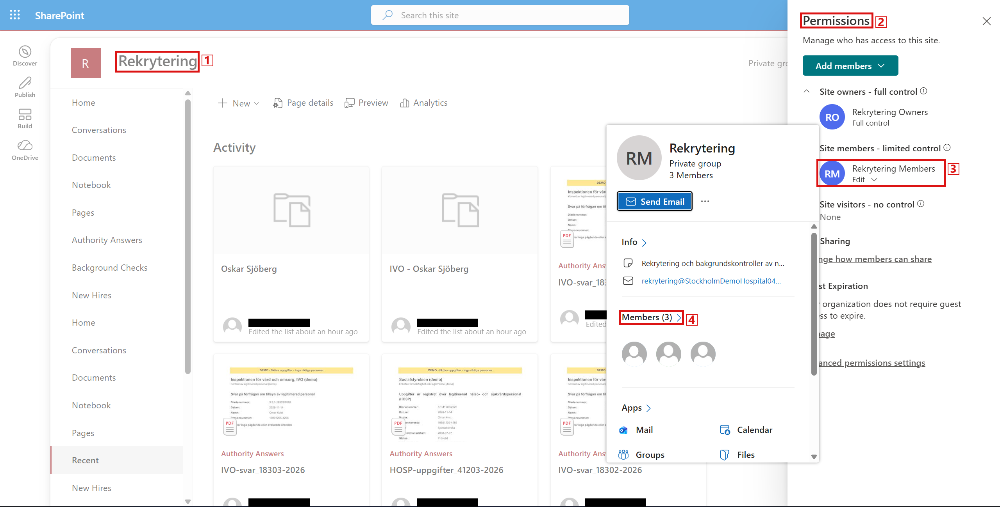

*Figure 8. The members of the site Rekrytering have Edit.*

1. The group Rekrytering.
2. The tab Members.
3. RPA Rekrytering, with the role Member.

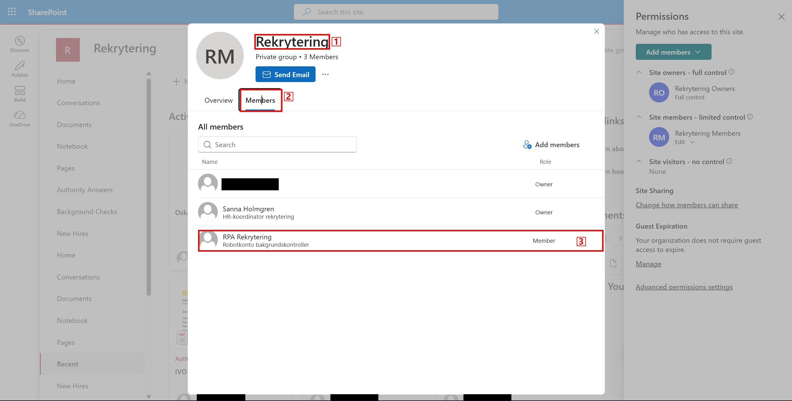

*Figure 9. RPA Rekrytering is a member of the site Rekrytering.*

> **Seen in the cases:** with Edit, the robots add one row in New Hires and one row for each check in Background Checks, and change the status of the rows as the work goes on, for example from Pending to Done ([Figures 38](Screenshots/case1-background-check-done.png) and [42](Screenshots/case1-new-hires-done.png)). HR changes the same rows by hand when a person must decide (Cases 4 and 5).

### 3.4 Steps 6 and 7: Connections to Outlook and SharePoint (Integration Service)

The robots reach Outlook and SharePoint through UiPath Integration Service. A connection is made by signing in once as the robot account in the browser. Microsoft then gives UiPath a sign-in token for that account, so the password is never stored in a robot, a config file or Orchestrator.

**Step 6. Where:** Microsoft Entra admin center > Enterprise applications > the UiPath app > Permissions.

**In plain words:** The UiPath connector is an outside app that asks Microsoft for access to mail and files. Admin consent means that the administrator says, once for the whole hospital: this app may ask. It does not open any mailbox by itself. The type Delegated in the figures means that the app can only do what the signed-in user is already allowed to do.

**What is set:** a Microsoft 365 administrator approves the UiPath connector apps once for the whole organization (admin consent). Without it, the sign-in in step 7 stops and asks for an administrator.

**Final state (Figures 10 and 11):**

1. The menu Enterprise apps.
2. The app: UiPath for Outlook 365 in Figure 10, and UiPath for OneDrive and SharePoint in Figure 11.
3. The page Permissions of the app.
4. The tab Admin consent.
5. Every permission is granted through Admin consent, by an administrator.

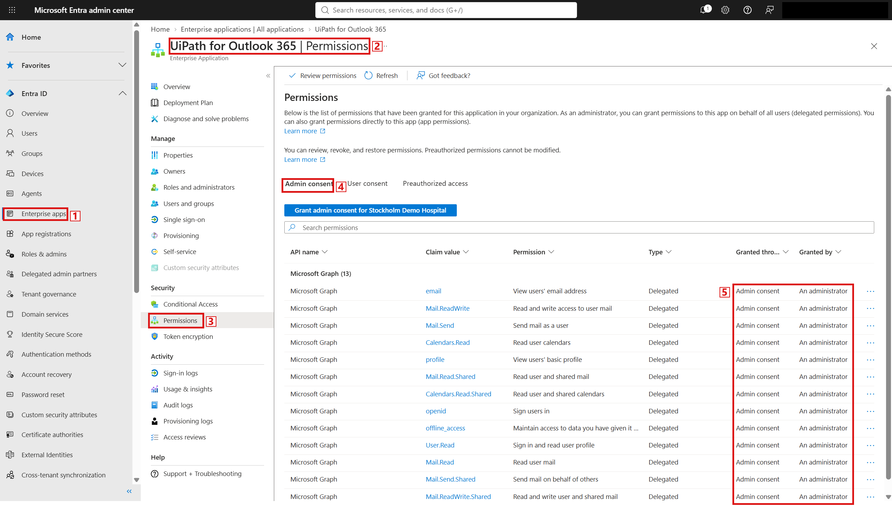

*Figure 10. UiPath for Outlook 365 is approved for the organization.*

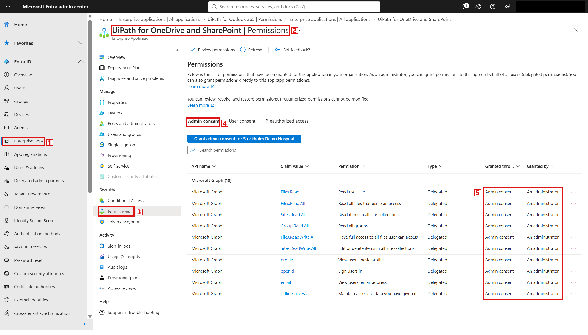

*Figure 11. UiPath for OneDrive and SharePoint is approved for the organization.*

**Step 7. Where:** Orchestrator > folder Shared > Connections.

**In plain words:** A connection is a saved and approved sign-in. The robot uses it like a key card, so nobody has to type a password when the robot runs.

**What is set:** two connections, Microsoft Outlook 365 and Microsoft OneDrive & SharePoint, signed in as the robot account. They are created in the folder Shared, because a process in Shared can only use connections that it can reach from Shared.

**Final state (Figure 12):**

1. The folder Shared.
2. The tab Connections.
3. The two connectors, Microsoft OneDrive & SharePoint and Microsoft Outlook 365.
4. Both connections use the robot account rpa.rekrytering@.
5. Both have the status Connected.

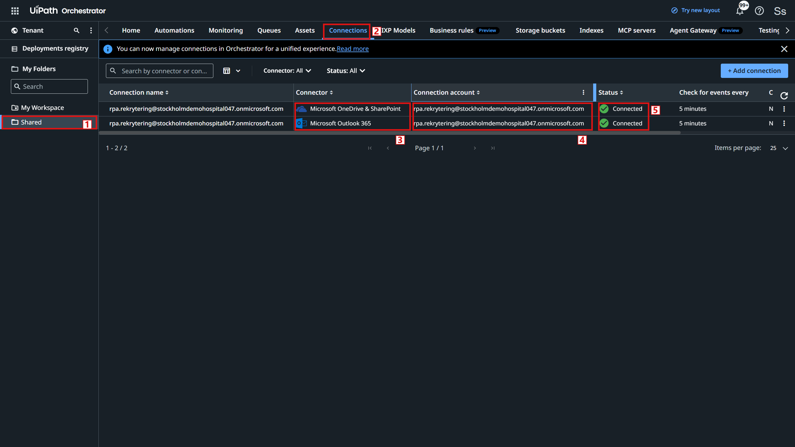

*Figure 12. The Outlook and SharePoint connections in the folder Shared.*

> **Seen in the cases:** each log line "Mail sent from the HR mailbox" uses the Outlook connection, and each line "New Hires row ... added" or "Background Checks row ... updated" uses the SharePoint connection. No password is typed in any job of the cases.

### 3.5 Steps 8 to 10: Unattended Robot and Machine

**Step 8. Where:** UiPath Administration > Licenses, and Orchestrator > folder Shared > Settings.

**In plain words:** Three things must exist before a robot can work alone:

| Part | In plain words |
|---|---|
| Licence | The permission to run a robot without a person |
| Machine template and runtime | The entry in Orchestrator that stands for the robot PC, and one seat on it: one seat means one job at a time |
| Robot account Default Robot | The identity in UiPath that runs the job. It is not the Microsoft 365 account RPA Rekrytering ([Figure 4](Screenshots/unattended-how-it-works.png)) |

**What is set:** an unattended job needs a Production (Unattended) licence, a machine that runs it, and a robot account in Orchestrator that it runs as. The machine P04-Transfer-Robot is the laptop that runs the robots.

**Final state (Figures 13 to 15):**

1. The page Licenses.
2. The tab Robots & services.
3. The organization has 2 Production (Unattended) Robot licences.
4. Both are allocated to the tenant DefaultTenant.

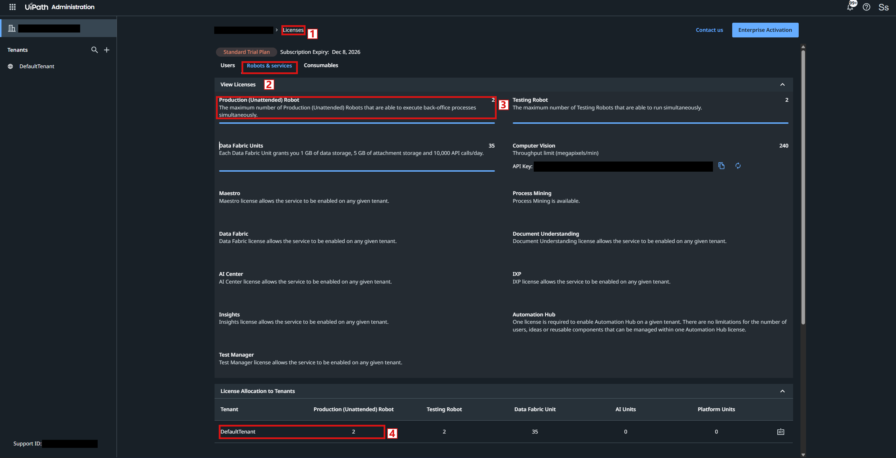

*Figure 13. The Production (Unattended) licences of the tenant.*

1. The folder Shared.
2. The tab Settings.
3. The tab Machines.
4. The machine template P04-Transfer-Robot.
5. One Production (Unattended) runtime: one job can run at a time.

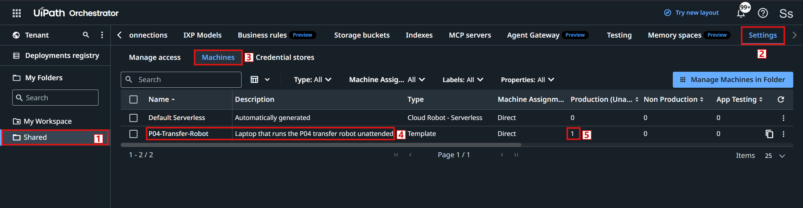

*Figure 14. The machine P04-Transfer-Robot with one unattended runtime in Shared.*

1. The folder Shared.
2. The tab Settings.
3. The tab Manage access.
4. Default Robot: a robot account of the type Unattended, with the role Automation User.

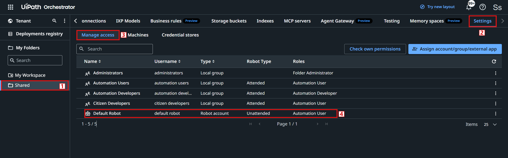

*Figure 15. Default Robot runs the unattended jobs in Shared.*

> **Seen in the cases:** one runtime means one job at a time. In Case 1, the criminal record job waits as Pending until the manager job has finished ([Figure 35](Screenshots/case1-jobs-belastning-pending.png)). In Case 2, the three check robots run one after the other ([Figure 53](Screenshots/case2-jobs-round2.png)).

**Step 9. Where:** on the robot PC, UiPath Assistant > Preferences > Orchestrator Connection.

**In plain words:** UiPath Assistant is the small program on the PC that receives the jobs. The Client ID and Client Secret are like a username and password for the PC itself, so it can connect without a person signing in.

**What is set:** Assistant is connected with the Client ID and Client Secret of the machine P04-Transfer-Robot, copied from Orchestrator, instead of the operator's sign-in.

**Final state (Figure 16):**

1. The page Orchestrator Connection in Preferences.
2. The connection type Client ID.
3. The address of the tenant in Orchestrator.
4. The Client ID and Client Secret of the machine. They work like a password, so they are hidden here.
5. The status Connected, Licensed.

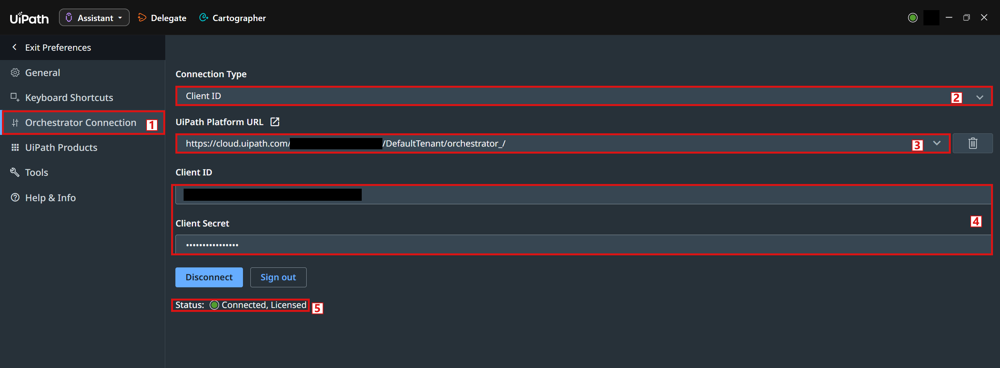

*Figure 16. UiPath Assistant is connected as an unattended robot.*

**Step 10. Where:** the robot PC.

**In plain words:** Unattended means that nobody sits at the PC, not that the PC is off. User mode means that the robot works on the Windows desktop of the signed-in user, as a person would.

**What is set:** the robot is installed in user mode, so the jobs run in the Windows session of the signed-in user. The PC must be on, awake, signed in and not locked. A PC that is asleep cannot start a job. The criminal record robot needs this, because it opens Microsoft Edge to ask the police control service.

**Final state (Figure 17):**

1. The folder Shared.
2. The tab Monitoring.
3. The tab Machines.
4. The tab Real time.
5. The robot PC, its machine template and the status Available. Available means that the robot is ready for a job.
6. The timeline of the PC. Red means Unresponsive, blue means that a job is running, and green means Available.

This page can keep showing Unresponsive for some time after the PC has been asleep, even when the robot is connected again. In the timeline, the red part ends when the next job runs at 11:00. After that job the PC is shown as Available.

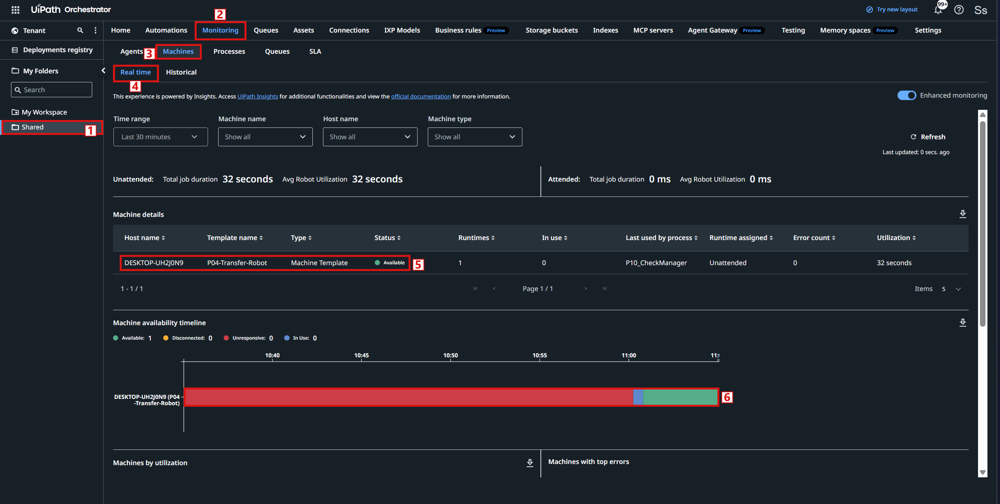

*Figure 17. The robot PC is Available in Orchestrator.*

> **Seen in the cases:** every check of an extract opens Microsoft Edge on this desktop, with nobody at the screen ([Figure 37](Screenshots/case1-jobs-belastning-reads-extract.png)). In Case 5, this is how the robot finds an extract that the police cannot confirm ([section 8.4](#84-round-2-extract-not-confirmed-by-the-police-service)).

### 3.6 Steps 11 and 12: Processes and Their Connections

**Step 11. Where:** Orchestrator > folder Shared > Automations > Processes.

**In plain words:** A package is the finished robot, saved as one file. A process is that package made available in a folder, so that it can be started there.

**What is set:** the four packages are published to the tenant feed and added as processes in Shared. To publish a package, the project is opened in UiPath Studio, Publish is clicked, and Orchestrator Tenant Processes Feed is chosen as the place to publish. The manager package already holds the code change from [section 3.9](#39-code-change-reminder-mails-at-most-once-a-day) (version 1.0.5).

**Final state (Figure 18):**

1. The folder Shared.
2. The tab Automations.
3. The tab Processes.
4. The four P10 processes. The two P04 processes belong to another automation and are not changed.

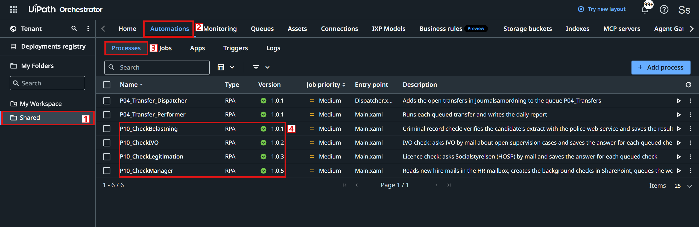

*Figure 18. The four P10 processes in the folder Shared.*

**Step 12. Where:** Orchestrator > folder Shared > Automations > Processes > each process > tab Package Requirements.

**In plain words:** Package Requirements is the list of what the robot needs in this folder. Here, it says which key cards from step 7 the robot uses.

**What is set:** a package remembers the connections it was built with, and those are the developer's connections in My Workspace. Each process is pointed to the two connections in Shared from step 7. No code is changed.

**Final state (Figures 19 to 22):**

In each of the four figures:

1. The folder Shared.
2. The tab Automations.
3. The process, clicked in the list.
4. Its package version and the tab Package Requirements.
5. The two connections of the robot account.

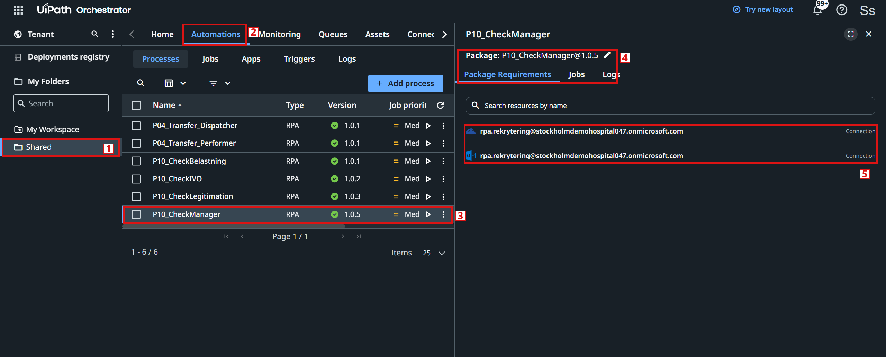

*Figure 19. P10_CheckManager uses the two connections in Shared.*

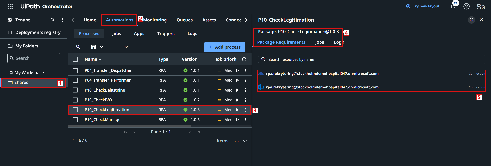

*Figure 20. P10_CheckLegitimation uses the two connections in Shared.*

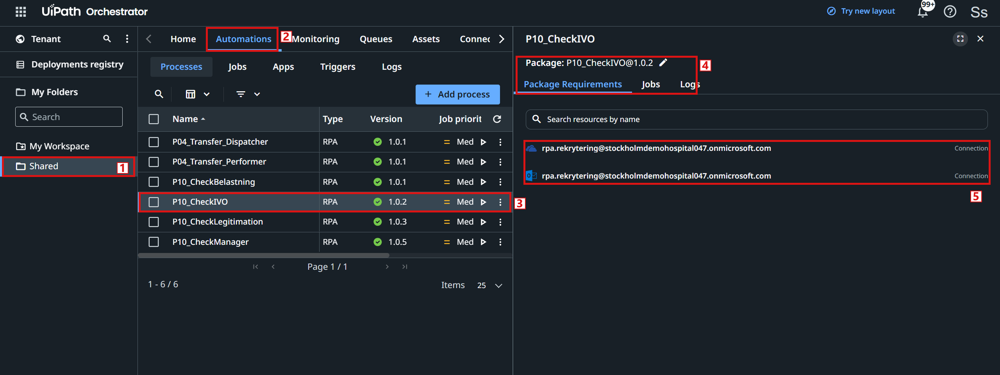

*Figure 21. P10_CheckIVO uses the two connections in Shared.*

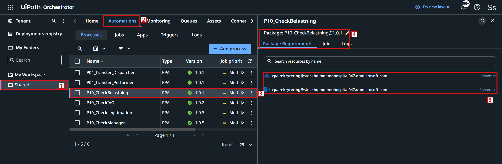

*Figure 22. P10_CheckBelastning uses the two connections in Shared.*

### 3.7 Step 13: Queues

**Where:** Orchestrator > folder Shared > Queues.

**In plain words:** A queue is a to-do list for robots. Each item is one piece of work, and Orchestrator keeps track of which items are new, in progress or done.

**What is set:** the same four queues as in My Workspace, with the same settings. P10_Legitimation, P10_IVO and P10_Belastning hold one item for each check row that a check robot must work on. P10_Reports holds one item for each new hire without a report, and the manager robot works on it itself.

| Setting | Value | Why |
|---|---|---|
| Unique reference | Yes | The same row cannot be added twice in the same manager run |
| Auto retry | No, max 1 | A failed item is not retried at once. The row is still open, so the next manager run, 15 minutes later, adds it again |

**Final state (Figure 23):**

1. The folder Shared.
2. The tab Queues at the top.
3. The list Queues.
4. The four P10 queues. P04_Transfers belongs to another automation.

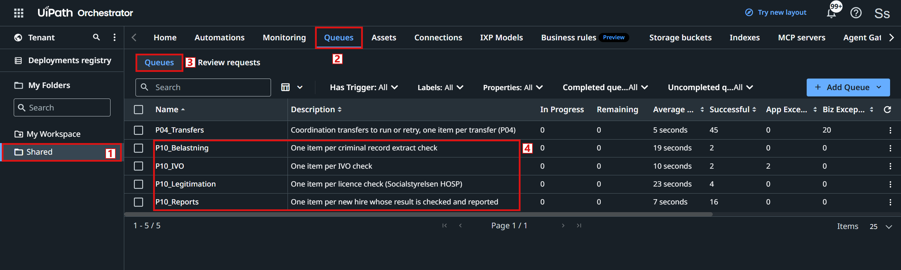

*Figure 23. The four P10 queues in the folder Shared.*

> **Seen in the cases:** while a check is open, every manager run adds a new item for it. The reference holds the row number and the time, for example 135-2026-11-18-1150 in round 1 and 135-2026-11-18-1152 in round 2 of Case 1 ([section 4.4](#44-round-2-extract-verified-with-the-police-service)), so each item is unique. In Case 3, no item is added in round 1, because the request cannot be registered yet ([Figure 69](Screenshots/case3-jobs-round1.png)).

### 3.8 Step 14: Triggers (Time Trigger and Queue Triggers)

**Where:** Orchestrator > folder Shared > Automations > Triggers.

**In plain words:** A trigger starts a robot so that no person has to. A time trigger works like an alarm clock. A queue trigger works like a doorbell: it starts the robot when new work arrives.

**What is set:** one time trigger for the manager robot, and one queue trigger for each check robot. No trigger is set on P10_Reports: the manager robot fills that queue itself at the start of every run, so a trigger on it would start the manager robot again and again.

| Time trigger "P10 Manager - every 15 minutes 07-18" | Value |
|---|---|
| Schedule (cron) | `0 0/15 7-17 * * ?`: at minute 0, 15, 30 and 45 of every hour from 07:00 to 17:45 |
| Time zone | W. Europe Standard Time (Stockholm) |
| Runtime | Production (Unattended) |

| Queue triggers, one for each check queue | Value | Why |
|---|---|---|
| Minimum number of items to trigger the first job | 1 | One new check is enough to start the robot |
| Maximum number of pending and running jobs | 1 | Only one job for each queue at a time |
| Another job for each | 20 new items | One job handles many checks |
| Runtime | Production (Unattended) | |

**Final state (Figures 24 and 25):**

1. The folder Shared.
2. The tab Automations.
3. The tab Triggers.
4. The tab Time triggers.
5. The manager trigger and its schedule. The green icon shows that the trigger is on.
6. Next Run Time: how long it is until the robot starts by itself.

The other line belongs to an older robot project. It is switched off and is not used here.

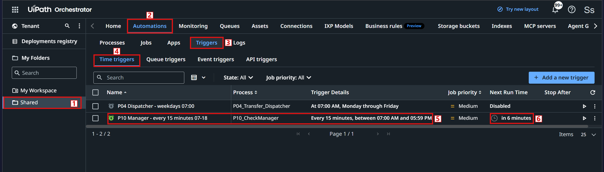

*Figure 24. The manager robot runs every 15 minutes.*

1. The folder Shared.
2. The tab Automations.
3. The tab Triggers.
4. The tab Queue triggers.
5. One trigger for each check robot, each on its own queue. The green icon shows that the trigger is on.

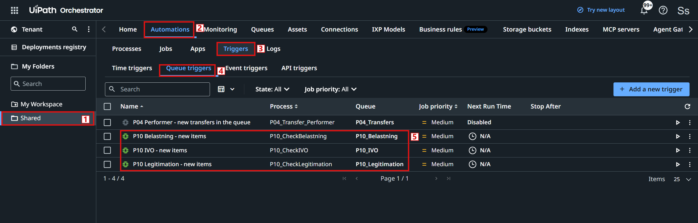

*Figure 25. One queue trigger for each check robot.*

> **Seen in the cases:** the column Source in the Jobs list shows which trigger started each job, for example "P10 Manager - every 15 minutes 07-18" or "P10 Belastning - new items" ([Figure 43](Screenshots/case1-jobs-all-end.png)). A check robot starts only when its queue gets an item: one robot in Case 1, three robots in Case 2 ([Figure 49](Screenshots/case2-jobs-round1-queued.png)), and none in round 1 of Case 3.

### 3.9 Code Change: Reminder Mails at Most Once a Day

The robots were built and tested attended, so the question is what must change in them for unattended runs. Figure 26 answers it robot by robot:

1. **The three check robots:** no change in the code. Their Main, Process, workflows and Config.json are the same as in the robot guides.
2. **The manager robot:** one new rule. Process.xaml is changed, and one new workflow, WasMailSentToday.xaml, is added. Everything else is the same.
3. **All four processes:** the connections are pointed to Shared in Orchestrator (step 12). This is configuration, not code.

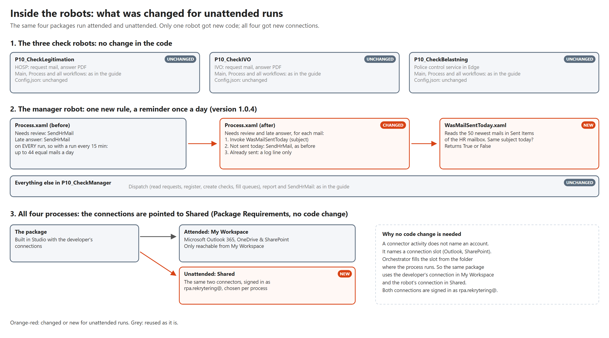

*Figure 26. Inside the robots: one changed workflow and one new workflow, in the manager robot only.*

**Problem.** When a check is in Needs review, or an answer is late, the manager robot sends a mail to the HR coordinator Sanna Holmgren. In the attended setup, it did this on every run, which was acceptable with a few runs a day. With a run every 15 minutes, Sanna would get up to 44 identical mails a day for each hire that waits for her, and a real reminder would be lost among them.

*Solution.* Before a review mail or a late-answer mail is sent, the manager robot looks in the Sent Items of the HR mailbox. If a mail with the same subject was already sent today, no new mail is sent. A new workflow does this check (Figure 27):

1. Get the Latest Sent Mails of the HR Mailbox: the 50 newest mails in Sent Items.
2. For each of them, Same Subject and Sent Today?
3. If so, Mark as Sent Today sets the result to True.

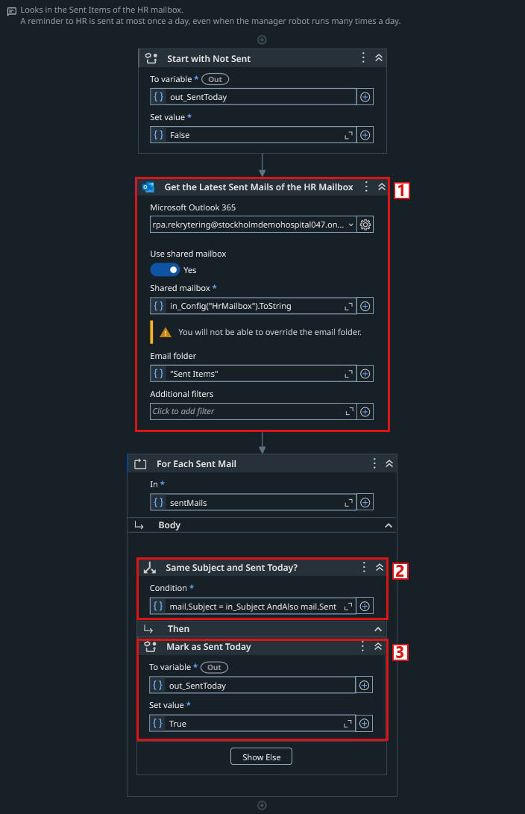

*Figure 27. WasMailSentToday.xaml.*

In `Process.xaml`, both mails to HR are wrapped in the same way (Figure 28, the review mail on the left and the late-answer mail on the right):

1. WasMailSentToday is invoked with the subject of the mail.
2. If the mail was not sent today, SendHrMail sends it, as before.
3. Otherwise, only a log line is written: "Mail already sent today".

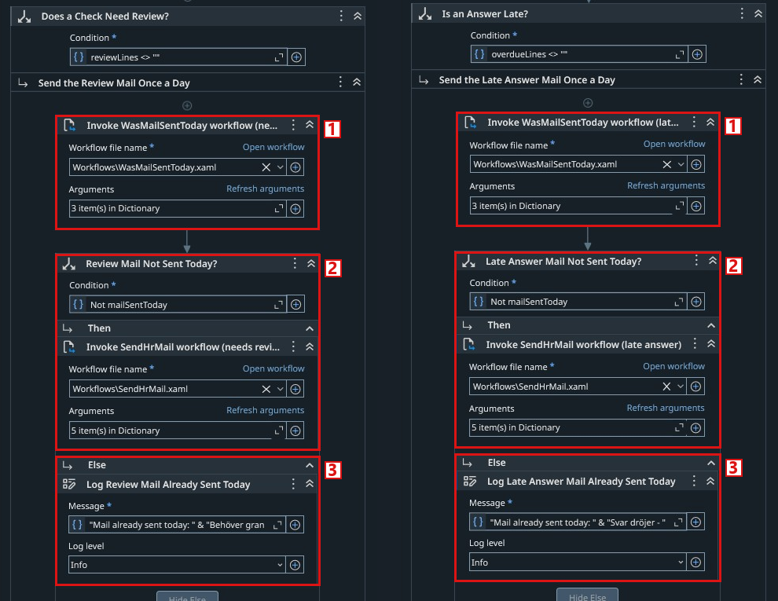

*Figure 28. Process.xaml: each mail to HR is sent at most once a day.*

> **Seen in the cases:** in Case 4, the review mail for Tilda Lilja is sent once ([Figure 93](Screenshots/case4-review-sent-items.png)), and the later runs only write "Mail already sent today". The logs of Case 5 show the same line for another hire, Omar Kvist, who still waits for a review.

The Sent Items are used because they are the real record of what was sent. No new list column or file is needed, and the rule still works if the robot is started by hand. This is the reason for the Full Access right in [Figure 6](Screenshots/setup-hr-mailbox-full-access.png): the robot must be able to read Sent Items, not only the Inbox.

The robots are now ready. From here on, nobody starts a robot by hand. The next sections follow real requests, one at a time, from the mail in the HR mailbox to the report.

## 4. Case 1: Criminal Record Check Only

The head of department Göran Ekdahl has hired an assistant nurse, Ebba Åberg, for Akutmottagningen. For this job, only one check is needed: an extract from the criminal record register (in Swedish, *belastningsregistret*). This is the simplest case, so it shows the whole unattended flow with the fewest robots. Nobody opens UiPath Assistant, and nobody clicks Start.

### 4.1 Overview: All Jobs of the Case

Figure 29 shows what Orchestrator lists at the end of the case. The newest job is at the top, so the case is read from the bottom up:

1. P10_CheckManager registers the request.
2. P10_CheckBelastning prepares the check.
3. P10_CheckManager runs again and sees that the check is still open.
4. P10_CheckBelastning reads the extract and checks it with the police.
5. P10_CheckManager sends the report to Göran.

The lower rows without a box belong to earlier work.

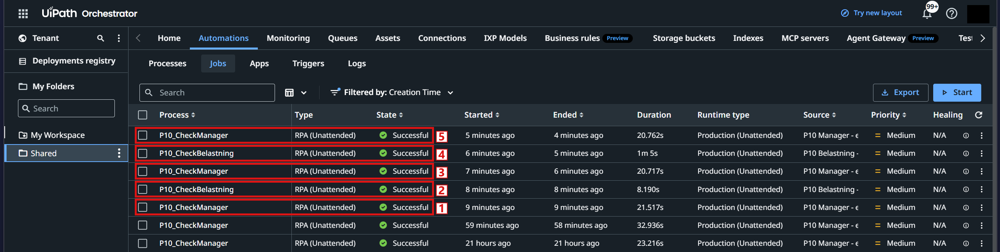

*Figure 29. The five jobs of Case 1, in the folder Shared > Automations > Jobs.*

The five jobs form three rounds. A round is one run of the manager robot and the check robot that it gives work to.

| Round | Job | Started by | What the robot does | Result |
|---|---|---|---|---|
| 1 | P10_CheckManager | Time trigger | Reads the request and registers it | A row in New Hires, a row in Background Checks and an item in the queue P10_Belastning |
| 1 | P10_CheckBelastning | Queue trigger | Marks the check as waiting for the extract | Status Waiting for answer |
| 2 | P10_CheckManager | Time trigger | Sees that the check is open and adds a new queue item | No report yet: 0 of 1 checks done |
| 2 | P10_CheckBelastning | Queue trigger | Reads the extract and asks the police control service | Status Done |
| 3 | P10_CheckManager | Time trigger | Sees that all checks are done and sends the report | Report sent, the hire is Done |

The triggers are the ones from [Figure 24](Screenshots/setup-time-triggers.png) and [Figure 25](Screenshots/setup-queue-triggers.png).

### 4.2 Input: Request and Extract in the HR Mailbox

Two new mails are in the shared mailbox HR - Rekrytering (Figure 30). The view is from the Outlook of the HR coordinator Sanna Holmgren. Nobody needs to act on these mails.

1. The Inbox of HR - Rekrytering, with 2 unread mails. The manager robot looks for unread mails, so unread means "not handled yet".
2. The request from Göran Ekdahl.
3. The mail from the candidate, with the extract as a PDF.

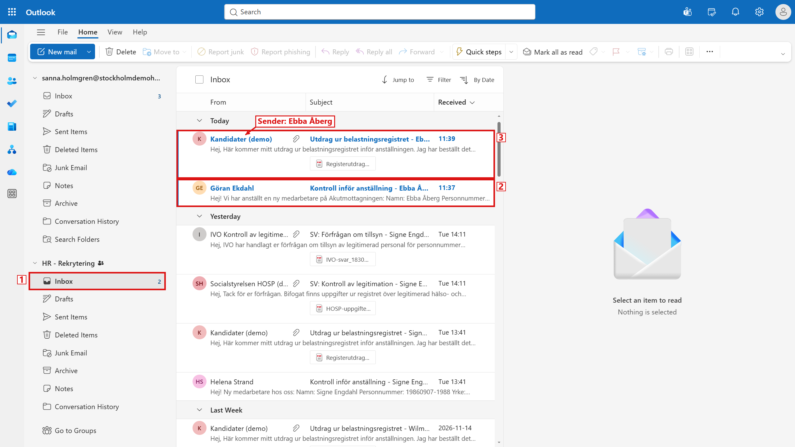

*Figure 30. The request and the extract in the HR Inbox.*

The request is written as a normal mail (Figure 31):

1. The sender is the head of department, and the mail goes to HR - Rekrytering.
2. The details of the new hire: name, personnummer (the Swedish personal identity number), profession, department and start date.
3. "For this position, we only need an extract from the criminal record register." This sentence decides which checks are made.

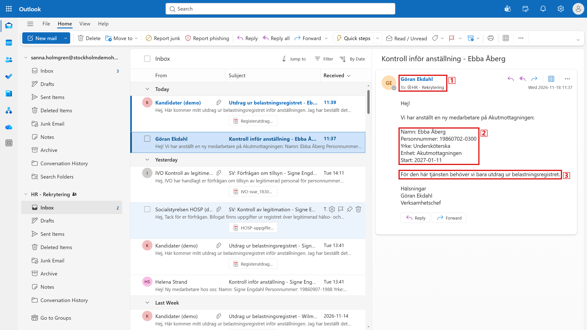

*Figure 31. The request names one check.*

Ebba has ordered the extract from the police and sends it to HR (Figure 32):

1. The sender is the candidate.
2. The extract is attached as a PDF file.

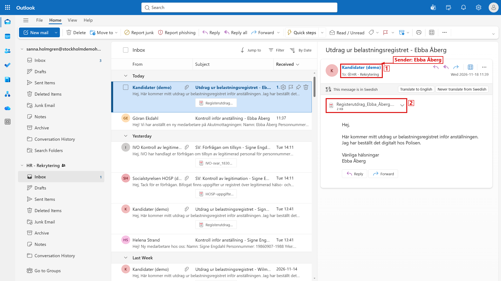

*Figure 32. The candidate's mail with the extract.*

At this moment, SharePoint knows nothing about Ebba (Figure 33):

1. The list New Hires on the site Rekrytering.
2. The newest row is number 56, Signe Engdahl. There is no row for Ebba Åberg.

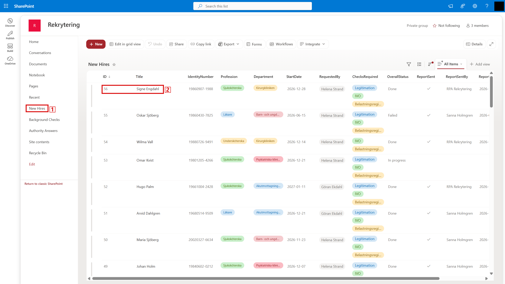

*Figure 33. New Hires before the first robot run.*

### 4.3 Round 1: Request Registered, Check Queued

At its next scheduled time, the time trigger starts the manager robot (Figure 34):

1. P10_CheckManager is Running as an unattended job.
2. Source shows what started the job: the trigger P10 Manager. No person is named here.

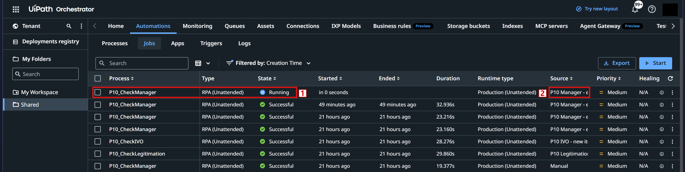

*Figure 34. The time trigger has started the manager robot.*

The job log shows what the robot does with the request:

```text
2 unread mails in the HR Inbox.
New Hires row 57 added: Ebba Åberg, Undersköterska, Akutmottagningen, checks: Belastningsregister
Background Checks row 135 added: Belastningsregister - Ebba Åberg (Pending).
Queue item 135-2026-11-18-1150 added to P10_Belastning (Belastningsregister - Ebba Åberg).
1 new check queue items added.
Ebba Åberg: 0 of 1 required checks done. No final report yet.
```

*Where to see this log: after the job P10_CheckManager of round 1 has run, open Orchestrator, go to the folder Shared > Automations > Jobs, click the three dots at the end of the job's row and choose View Logs. Only the lines about this request are shown here, from first to last.*

Only one check row is created, because the request names only one check. The queues for the licence check and the IVO check get nothing, so those two robots do not start.

The new item in P10_Belastning rings the doorbell: the queue trigger creates a job at once (Figure 35).

1. P10_CheckBelastning has the state Pending. For a job, this means that it waits for a free robot, because the manager robot is still working on the same PC.
2. P10_CheckManager is still Running.
3. Source shows that the queue trigger P10 Belastning created this job.

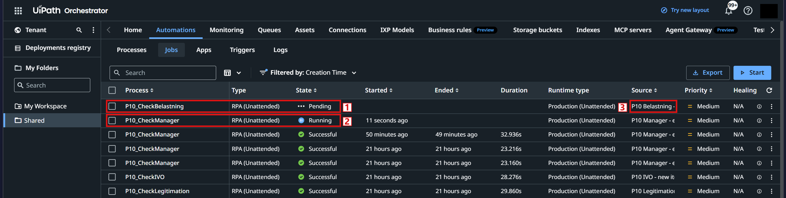

*Figure 35. The check robot waits until the manager robot has finished.*

When the manager robot finishes, the check robot starts. It finds the check row with the status Pending. For a check row, this word means that the work has not begun. The robot's first step is short: it changes the row to Waiting for answer and does not open the mail yet.

```text
Check row 135 has status Pending.
Background Checks row 135 updated.
Check row 135 now waits for the candidate's extract.
```

*Log of P10_CheckBelastning, round 1. Where to see it: Orchestrator > folder Shared > Automations > Jobs > the three dots at the end of the job's row > View Logs.*

Round 1 is now finished (Figure 36):

1. P10_CheckBelastning is Successful, after about 8 seconds.
2. P10_CheckManager is Successful, after about 21 seconds.

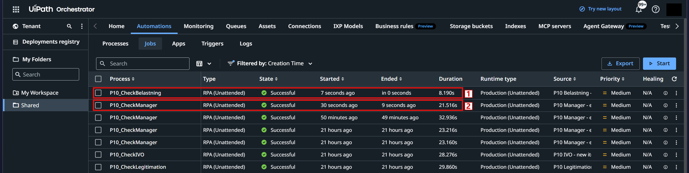

*Figure 36. Round 1 is finished.*

### 4.4 Round 2: Extract Verified with the Police Service

The time trigger starts the manager robot again. The check row is still open, so the manager robot adds a new item to the queue. The one unread mail is the extract, not a request, so no new hire is registered.

```text
1 unread mails in the HR Inbox.
Queue item 135-2026-11-18-1152 added to P10_Belastning (Belastningsregister - Ebba Åberg).
1 new check queue items added.
Ebba Åberg: 0 of 1 required checks done. No final report yet.
```

*Log of P10_CheckManager, round 2. Where to see it: Orchestrator > folder Shared > Automations > Jobs > the three dots at the end of the job's row > View Logs.*

The new item starts the check robot again (Figure 37). This job takes about a minute, because the robot opens Microsoft Edge on the robot PC, with nobody at the screen.

1. P10_CheckBelastning is Running.
2. It was started by the queue trigger, as in round 1.

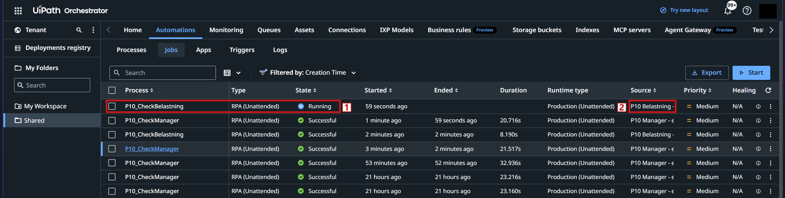

*Figure 37. The check robot works with the extract.*

Now the row has the status Waiting for answer, so the robot looks for the candidate's mail, reads the PDF and enters the details in the police control service. The service answers "Utdraget är äkta", which means "the extract is genuine".

```text
Check row 135 has status Waiting for answer.
Police control service for extract BU-833648: Utdraget är äkta
Extract for check row 135: Done (extract BU-833648).
Background Checks row 135 updated.
```

*Log of P10_CheckBelastning, round 2. Where to see it: Orchestrator > folder Shared > Automations > Jobs > the three dots at the end of the job's row > View Logs.*

The result is saved in SharePoint (Figure 38):

1. The list Background Checks.
2. Row 135, the criminal record check for Ebba Åberg.
3. The status is Done.
4. The result says that extract BU-833648 was issued on 2026-10-25, that it is genuine according to the police control service, and that it has no entries ("Inga uppgifter").

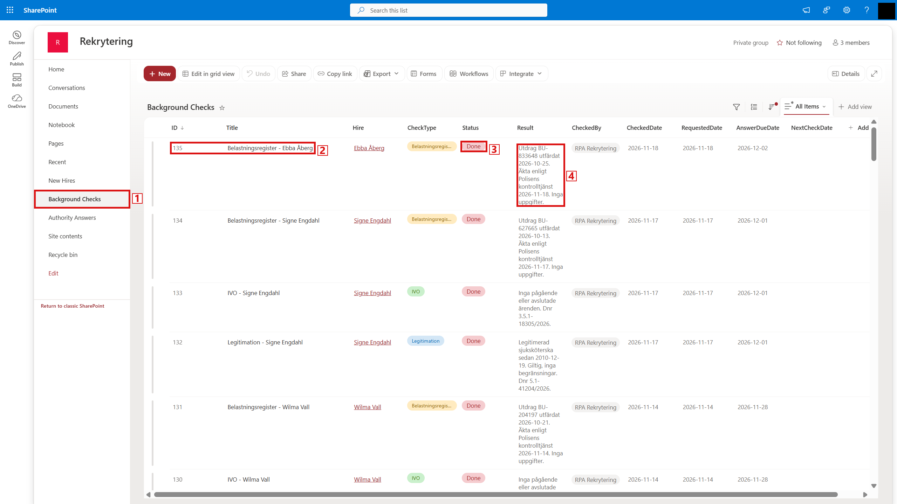

*Figure 38. The check is finished.*

### 4.5 Round 3: Final Report Sent

The time trigger starts the manager robot a third time (Figure 39). No check is open any more, so no queue item is added and no check robot starts.

1. P10_CheckManager is Successful.
2. It was started by the time trigger.

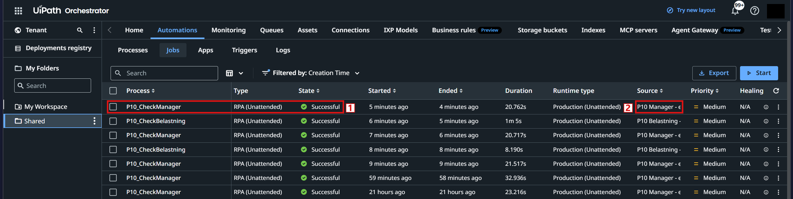

*Figure 39. The last job of the case.*

```text
0 unread mails in the HR Inbox.
0 new check queue items added.
Mail sent from the HR mailbox: Bakgrundskontroll klar - Ebba Åberg
Final report (Done) for Ebba Åberg sent to Göran Ekdahl. New Hires row 57 updated.
```

*Log of P10_CheckManager, round 3. Where to see it: Orchestrator > folder Shared > Automations > Jobs > the three dots at the end of the job's row > View Logs.*

The report is sent from the HR mailbox, so it is also found in its Sent Items (Figure 40):

1. Sent Items of HR - Rekrytering.
2. The report "Bakgrundskontroll klar - Ebba Åberg" (background check finished).
3. It goes to Göran Ekdahl, who made the request.
4. The result of the one check that was requested.

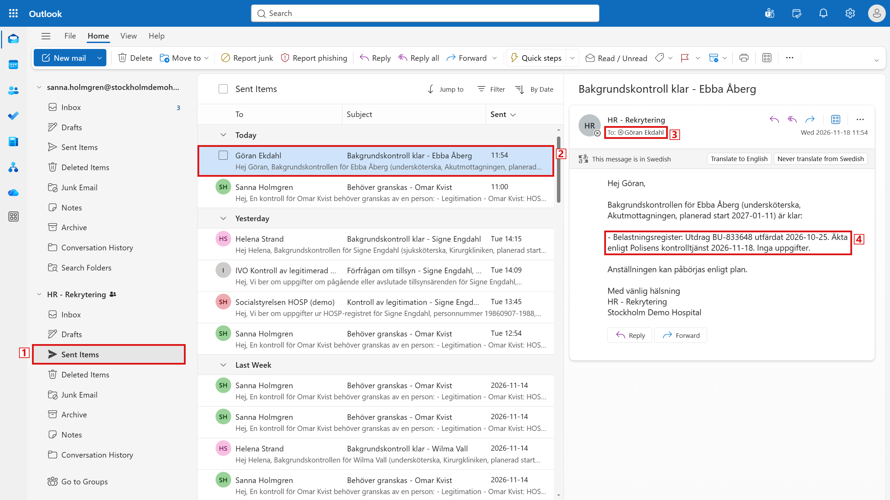

*Figure 40. The report in the HR mailbox.*

The report also arrives in Göran's Inbox (Figure 41):

1. The mailbox of Göran Ekdahl.
2. The report from HR - Rekrytering.
3. The criminal record check, with the extract number and the police control.
4. "Anställningen kan påbörjas enligt plan": the employment can start as planned.

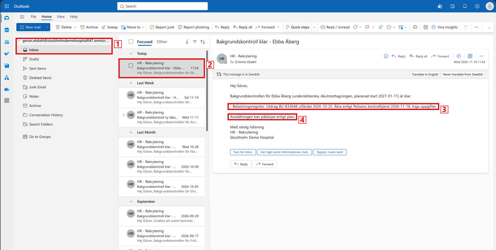

*Figure 41. The head of department has the answer.*

The hire is closed in SharePoint (Figure 42):

1. The list New Hires.
2. The new row 57, Ebba Åberg.
3. OverallStatus is Done.
4. ReportSent is ticked.
5. The report was sent by the robot account RPA Rekrytering on 2026-11-18.

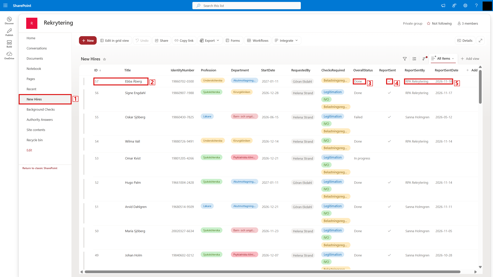

*Figure 42. The hire is Done and the report is recorded.*

### 4.6 Result: Jobs and Their Triggers

Figure 43 shows the same five jobs as [Figure 29](Screenshots/case1-jobs-all-start.png), now as the proof of the case:

1. All five jobs are Successful.
2. Every job was started by a trigger. No job has the source Manual.

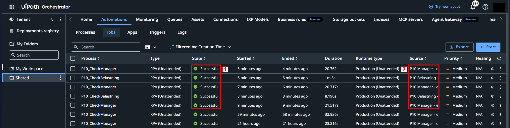

*Figure 43. Five successful jobs, all started by triggers.*

Göran sent one mail and Ebba sent one mail. The manager robot and the criminal record robot did the rest: they registered the hire, checked the extract with the police and sent the report, and no one started a robot.

## 5. Case 2: All Three Checks (Licence, IVO and Criminal Record)

The head of department Helena Strand has hired a nurse, Viktor Björklund, for Barn- och ungdomskliniken. A nurse is a licensed profession, so all three checks are needed:

- **Legitimation:** the robot asks Socialstyrelsen (the National Board of Health and Welfare) for the details in HOSP, the register of licensed health care staff.
- **IVO:** the robot asks IVO (the Health and Social Care Inspectorate) whether there are any supervision cases.
- **Belastningsregister:** the robot checks the candidate's extract with the police, as in [section 4](#4-case-1-criminal-record-check-only).

The new part is that two authorities must answer by mail, and nobody knows when. The robots do not wait for them. Every round looks again, until all the answers are in.

### 5.1 Overview: All Jobs of the Case

Figure 44 shows the 14 jobs of the case. The newest job is at the top, so the rounds are read from the bottom up. Each box is one round:

1. Round 1: the manager robot registers the request, and all three check robots start.
2. Round 2: the extract is checked. The two authorities have not answered yet.
3. Round 3: the HOSP answer is read.
4. Round 4: the IVO answer is read.
5. Round 5: the manager robot sends the report.

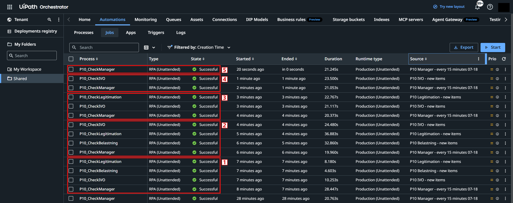

*Figure 44. The 14 jobs of Case 2, grouped by round.*

| Round | Jobs | What happens | Checks done after the round |
|---|---|---|---|
| 1 | Manager, IVO, Belastning, Legitimation | The request is registered. The requests go to IVO and HOSP, and the extract check is prepared | 0 of 3 |
| 2 | Manager, Belastning, Legitimation, IVO | The extract is genuine. No answer from HOSP or IVO yet | 1 of 3 |
| 3 | Manager, IVO, Legitimation | The HOSP answer is read. No IVO answer is found yet | 2 of 3 |
| 4 | Manager, IVO | The IVO answer is read | 3 of 3 |
| 5 | Manager | The report goes to Helena | Hire closed |

The manager robot is always started by the time trigger. Each check robot is always started by its queue trigger.

### 5.2 Input: Request and Extract in the HR Mailbox

Two new mails are in the HR mailbox (Figure 45):

1. The Inbox of HR - Rekrytering, with 2 unread mails.
2. The request from Helena Strand.
3. The mail from the candidate, with the extract as a PDF.

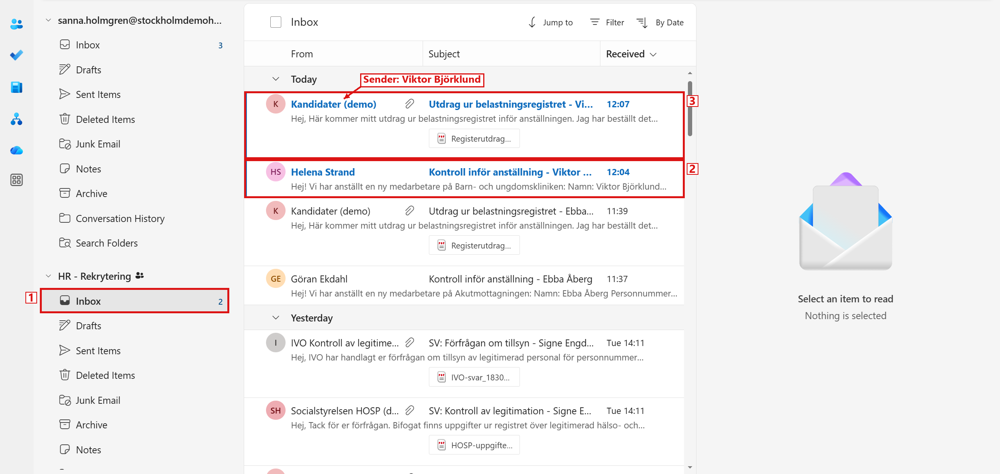

*Figure 45. The request and the extract in the HR Inbox.*

The request names all three checks (Figure 46):

1. The sender is the head of department, and the mail goes to HR - Rekrytering.
2. The details of the new hire.
3. "We need a check of the licence, IVO and an extract from the criminal record register."

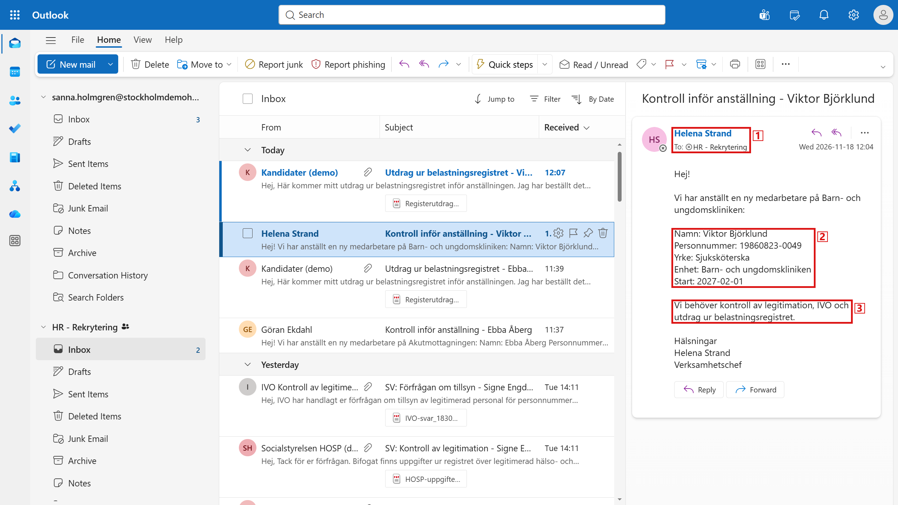

*Figure 46. The request names three checks.*

The extract arrives from Viktor (Figure 47):

1. The sender is the candidate.
2. The extract is attached as a PDF file.

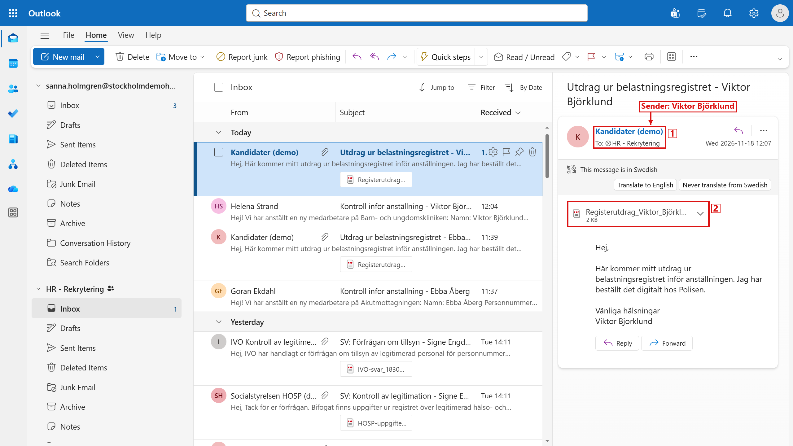

*Figure 47. The candidate's mail with the extract.*

SharePoint has no row for Viktor yet (Figure 48):

1. The list New Hires.
2. The newest row is number 57, Ebba Åberg, from [section 4](#4-case-1-criminal-record-check-only).


*Figure 48. New Hires before the first robot run.*

### 5.3 Round 1: Request Registered, Three Checks Queued

The time trigger starts the manager robot. It registers one hire with three check rows, and adds one item to each of the three check queues:

```text
2 unread mails in the HR Inbox.
New Hires row 58 added: Viktor Björklund, Sjuksköterska, Barn- och ungdomskliniken, checks: Legitimation, IVO, Belastningsregister
Background Checks row 136 added: Legitimation - Viktor Björklund (Pending).
Background Checks row 137 added: IVO - Viktor Björklund (Pending).
Background Checks row 138 added: Belastningsregister - Viktor Björklund (Pending).
Queue item 136-2026-11-18-1214 added to P10_Legitimation (Legitimation - Viktor Björklund).
Queue item 137-2026-11-18-1214 added to P10_IVO (IVO - Viktor Björklund).
Queue item 138-2026-11-18-1214 added to P10_Belastning (Belastningsregister - Viktor Björklund).
3 new check queue items added.
Viktor Björklund: 0 of 3 required checks done. No final report yet.
```

*Where to see this log: after the job P10_CheckManager of round 1 has run, open Orchestrator, go to the folder Shared > Automations > Jobs, click the three dots at the end of the job's row and choose View Logs. Only the lines about this request are shown here, from first to last.*

Three queues got work, so three queue triggers create three jobs (Figure 49):

1. P10_CheckManager is still Running.
2. The three check robots are Pending. There is one robot on the PC, so the jobs run one at a time.
3. Source shows that each job was created by the queue trigger of its own queue.

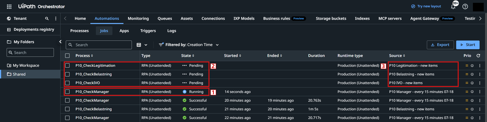

*Figure 49. One request has started three check robots.*

Each check robot then does its first step:

```text
P10_CheckIVO
Check row 137 has status Pending.
IVO request sent for check row 137.
Background Checks row 137 updated.

P10_CheckBelastning
Check row 138 has status Pending.
Background Checks row 138 updated.
Check row 138 now waits for the candidate's extract.

P10_CheckLegitimation
Check row 136 has status Pending.
HOSP request sent for check row 136.
Background Checks row 136 updated.
```

*Log of the three check robots, round 1, one job each. Where to see it: Orchestrator > folder Shared > Automations > Jobs > the three dots at the end of the job's row > View Logs.*

The two requests are sent from the HR mailbox. The request to HOSP (Figure 50):

1. Sent Items of HR - Rekrytering.
2. The request "Kontroll av legitimation" (check of licence).
3. It goes to Socialstyrelsen HOSP.
4. It asks for the HOSP details of Viktor Björklund, and gives the personnummer and the new job.

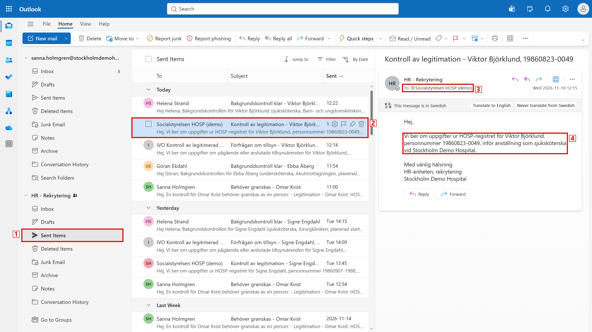

*Figure 50. The licence robot asks HOSP.*

The request to IVO (Figure 51):

1. Sent Items of HR - Rekrytering.
2. The request "Förfrågan om tillsyn" (question about supervision).
3. It goes to IVO.
4. It asks for ongoing or closed supervision cases for Viktor Björklund.

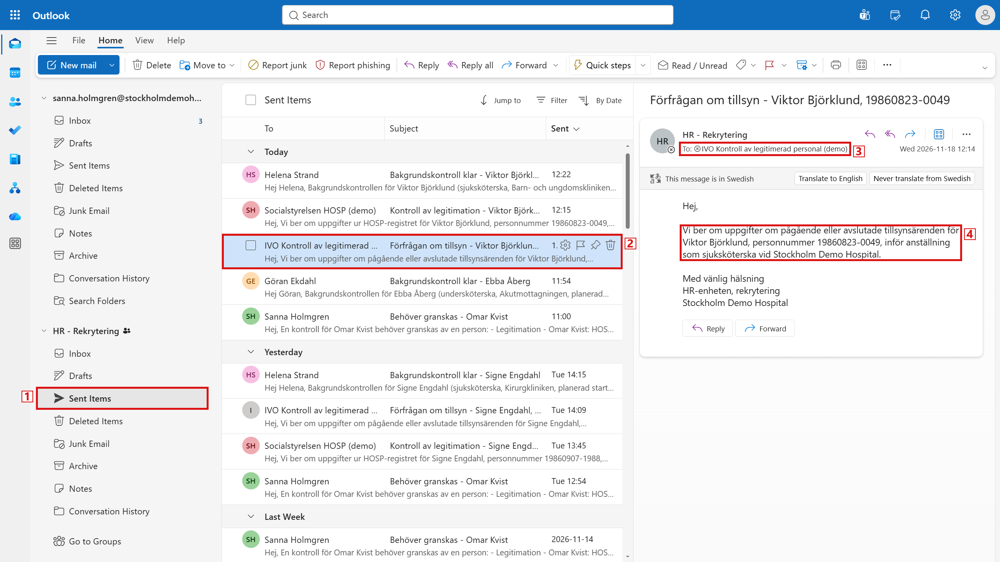

*Figure 51. The IVO robot asks IVO.*

Round 1 is now finished (Figure 52):

1. All four jobs are Successful. A job is successful when it has done its part, even though the check itself is not finished.
2. Source shows the three queue triggers and the time trigger.


*Figure 52. Round 1 is finished. All three checks are now waiting.*

### 5.4 Round 2: Extract Verified, Authority Answers Pending

The manager robot runs again. All three checks are open, so each gets a new queue item (Figure 53):

1. P10_CheckManager is Successful.
2. P10_CheckBelastning is Running.
3. The other two check robots are Pending and wait for their turn.


*Figure 53. Round 2: the check robots run one after the other.*

The criminal record robot finishes its check. The other two robots look for an answer, find none, and leave their rows as they are:

```text
P10_CheckBelastning
Check row 138 has status Waiting for answer.
Police control service for extract BU-704285: Utdraget är äkta
Extract for check row 138: Done (extract BU-704285).
Background Checks row 138 updated.

P10_CheckLegitimation
Check row 136 has status Waiting for answer.
No HOSP answer yet for check row 136. The row stays Waiting for answer.

P10_CheckIVO
Check row 137 has status Waiting for answer.
No IVO answer yet for check row 137. The row stays Waiting for answer.
```

*Log of the three check robots, round 2, one job each. Where to see it: Orchestrator > folder Shared > Automations > Jobs > the three dots at the end of the job's row > View Logs.*

A missing answer is normal and is not an error. These jobs are Successful, and the next round looks again.

### 5.5 Round 3: HOSP Answer Read

The manager robot now counts one finished check, so only the two open checks get new queue items:

```text
Queue item 136-2026-11-18-1218 added to P10_Legitimation (Legitimation - Viktor Björklund).
Queue item 137-2026-11-18-1218 added to P10_IVO (IVO - Viktor Björklund).
2 new check queue items added.
Viktor Björklund: 1 of 3 required checks done. No final report yet.
```

*Log of P10_CheckManager, round 3. Where to see it: Orchestrator > folder Shared > Automations > Jobs > the three dots at the end of the job's row > View Logs.*

During this round, both authorities answer. The answer from HOSP (Figure 54):

1. The Inbox of HR - Rekrytering.
2. The answer from Socialstyrelsen HOSP. "SV:" means that it is a reply.
3. The details are in the attached PDF file.
4. The case number (*diarienummer*, Dnr) of the answer.


*Figure 54. The answer from HOSP.*

The answer from IVO (Figure 55):

1. The Inbox of HR - Rekrytering.
2. The answer from IVO.
3. The details are in the attached PDF file.
4. The case number of the answer.


*Figure 55. The answer from IVO.*

In Orchestrator, round 3 looks like this (Figure 56):

1. P10_CheckManager is Successful.
2. P10_CheckIVO is Successful, but it found no answer in this run.
3. P10_CheckLegitimation is Running, and it finds the HOSP answer.


*Figure 56. Round 3: the licence robot reads the answer.*

```text
P10_CheckIVO
Check row 137 has status Waiting for answer.
No IVO answer yet for check row 137. The row stays Waiting for answer.

P10_CheckLegitimation
Check row 136 has status Waiting for answer.
HOSP answer for check row 136: Done (Dnr 5.1-41205/2026).
Background Checks row 136 updated.
```

*Log of the two check robots, round 3, one job each. Where to see it: Orchestrator > folder Shared > Automations > Jobs > the three dots at the end of the job's row > View Logs.*

### 5.6 Round 4: IVO Answer Read

Only one check is open now, so the manager robot adds one queue item and only one check robot starts (Figure 57):

1. P10_CheckManager is Successful.
2. P10_CheckIVO is Running.


*Figure 57. Round 4: only the IVO robot still has work.*

```text
Queue item 137-2026-11-18-1220 added to P10_IVO (IVO - Viktor Björklund).
1 new check queue items added.
Viktor Björklund: 2 of 3 required checks done. No final report yet.

P10_CheckIVO
Check row 137 has status Waiting for answer.
IVO answer for check row 137: Done (Dnr 3.5.1-18306/2026).
Background Checks row 137 updated.
```

*Log of P10_CheckManager and P10_CheckIVO, round 4, one job each. Where to see it: Orchestrator > folder Shared > Automations > Jobs > the three dots at the end of the job's row > View Logs.*

All three checks are now finished in SharePoint (Figure 58):

1. The list Background Checks.
2. Row 136, Legitimation: Done. Licensed nurse since 2014-09-03. The licence is valid, with no restrictions.
3. Row 137, IVO: Done. There are no ongoing or closed cases.
4. Row 138, Belastningsregister: Done. The extract is genuine, and it has no entries.


*Figure 58. The three checks of Viktor Björklund.*

### 5.7 Round 5: Final Report with Three Results

The manager robot finds that every required check is done (Figure 59):

1. P10_CheckManager is Running.
2. It was started by the time trigger.


*Figure 59. The last job of the case.*

```text
0 unread mails in the HR Inbox.
0 new check queue items added.
Mail sent from the HR mailbox: Bakgrundskontroll klar - Viktor Björklund
Final report (Done) for Viktor Björklund sent to Helena Strand. New Hires row 58 updated.
```

*Log of P10_CheckManager, round 5. Where to see it: Orchestrator > folder Shared > Automations > Jobs > the three dots at the end of the job's row > View Logs.*

The report is in the Sent Items of the HR mailbox (Figure 60):

1. Sent Items of HR - Rekrytering.
2. The report "Bakgrundskontroll klar - Viktor Björklund".
3. It goes to Helena Strand, who made the request.
4. One line for each of the three checks.


*Figure 60. One report for three checks.*

The report also arrives in Helena's Inbox (Figure 61):

1. The mailbox of Helena Strand.
2. The new report from HR - Rekrytering.
3. The results of the licence check, the IVO check and the criminal record check.
4. "Anställningen kan påbörjas enligt plan": the employment can start as planned.


*Figure 61. The head of department has the answer.*

The hire is closed in SharePoint (Figure 62):

1. The list New Hires.
2. The new row 58, Viktor Björklund.
3. The three required checks.
4. OverallStatus is Done.
5. ReportSent is ticked.
6. The report was sent by the robot account RPA Rekrytering on 2026-11-18.


*Figure 62. The hire is Done and the report is recorded.*

### 5.8 Result: Jobs and Their Triggers

Figure 63 shows the same 14 jobs as [Figure 44](Screenshots/case2-jobs-all-start.png):

1. All 14 jobs are Successful, also the runs that found no answer.
2. Every job was started by a trigger. No job has the source Manual.


*Figure 63. Fourteen successful jobs, all started by triggers.*

Helena sent one mail and Viktor sent one mail. The four robots asked two authorities, checked the extract with the police, kept looking until both answers had arrived, and sent one report with all three results. No one started a robot or kept track of the answers.

## 6. Case 3: Missing Personnummer (the Robot Asks the Sender)

The head of department Helena Strand has hired an assistant nurse, Albin Nordin, for Kirurgkliniken, but the personnummer is missing from the request. Without it, the hire cannot be registered and no check can start. In this case the manager robot does not stop and does not guess: it asks Helena by mail, waits for the reply and continues from there. Only the criminal record check is requested, so the rest of the flow is the one from [section 4](#4-case-1-criminal-record-check-only).

### 6.1 Overview: All Jobs of the Case

Figure 64 shows the jobs of the case. The newest job is at the top, so the case is read from the bottom up:

1. Round 1: P10_CheckManager finds that details are missing and sends the question.
2. Round 2: P10_CheckManager reads the reply and registers the hire. P10_CheckBelastning prepares the check.
3. Round 3: P10_CheckManager sees that the check is still open. P10_CheckBelastning reads the extract and checks it with the police.
4. Round 4: P10_CheckManager sends the report to Helena.


*Figure 64. The six jobs of Case 3, in the folder Shared > Automations > Jobs.*

| Round | Job | Started by | What the robot does | Result |
|---|---|---|---|---|
| 1 | P10_CheckManager | Time trigger | Reads the request and finds that details are missing | A question to Helena. Nothing is registered |
| Between rounds | No robot | Helena Strand | Replies to the question with the details | A new unread mail in the HR Inbox |
| 2 | P10_CheckManager | Time trigger | Reads the reply and registers it | A row in New Hires, a row in Background Checks and an item in the queue P10_Belastning |
| 2 | P10_CheckBelastning | Queue trigger | Marks the check as waiting for the extract | Status Waiting for answer |
| 3 | P10_CheckManager | Time trigger | Sees that the check is open and adds a new queue item | No report yet: 0 of 1 checks done |
| 3 | P10_CheckBelastning | Queue trigger | Reads the extract and asks the police control service | Status Done |
| 4 | P10_CheckManager | Time trigger | Sees that all checks are done and sends the report | Report sent, the hire is Done |

### 6.2 Input: Request Without Personnummer, and Extract

Two new mails are in the shared mailbox HR - Rekrytering (Figure 65):

1. The Inbox of HR - Rekrytering, with 2 unread mails.
2. The request from Helena Strand.
3. The mail from the candidate, with the extract as a PDF.


*Figure 65. The request and the extract in the HR Inbox.*

The request looks like the earlier ones, with one difference (Figure 66):

1. The sender is the head of department, and the mail goes to HR - Rekrytering.
2. The details of the new hire: name, profession, department and start date. **There is no personnummer.**
3. "For this position, we only need an extract from the criminal record register." This sentence decides which check is made.


*Figure 66. The request has no personnummer.*

Albin has already sent the extract (Figure 67):

1. The sender is the candidate.
2. The extract is attached as a PDF file.


*Figure 67. The candidate's mail with the extract.*

SharePoint knows nothing about Albin yet (Figure 68):

1. The list New Hires on the site Rekrytering.
2. The newest row is number 58, Viktor Björklund. There is no row for Albin Nordin.


*Figure 68. New Hires before the first robot run.*

### 6.3 Round 1: Question Mail About the Missing Details

The time trigger starts the manager robot. The robot reads the request, finds that it cannot be registered, and sends a question instead:

```text
2 unread mails in the HR Inbox.
Request 'Kontroll inför anställning - Albin Nordin' is missing: - namn - personnummer
Mail sent from the HR mailbox: SV: Kontroll inför anställning - Albin Nordin
0 new check queue items added.
```

*Where to see this log: after the job P10_CheckManager of round 1 has run, open Orchestrator, go to the folder Shared > Automations > Jobs, click the three dots at the end of the job's row and choose View Logs. Only the lines about this request are shown here, from first to last.*

The log lists two missing details, *namn* (name) and *personnummer*, although the name is written in the mail. The reason is how the robot reads a request: it looks for the name directly before the personnummer. When the personnummer is missing, the robot does not find the name either.

No queue item is added, so no check robot starts in this round (Figure 69):

1. P10_CheckManager is Successful. It is the only job of round 1.
2. The time trigger has already created the next run of the manager robot. It is Pending, so it waits for a free robot.


*Figure 69. Round 1 ends without a check robot.*

The question is sent from the HR mailbox, so it is found in its Sent Items (Figure 70):

1. Sent Items of HR - Rekrytering.
2. The question goes to Helena Strand, who sent the request.
3. The subject is the subject of the request, with "SV:" in front. *SV* is the Swedish short form for a reply.
4. The list of missing details.


*Figure 70. The robot's question in the HR mailbox.*

The question arrives in Helena's Inbox (Figure 71):

1. The mailbox of Helena Strand.
2. The mail from HR - Rekrytering.
3. "De här uppgifterna saknas": these details are missing.
4. "Svara gärna på det här mejlet med uppgifterna, så startar kontrollen direkt": please reply to this mail with the details, and the check will start.


*Figure 71. The head of department is asked for the details.*

### 6.4 Between Rounds: Reply from the Head of Department

Helena replies to the question. The robot's question does not quote the first request, and the robot reads the reply as a new request. This is why the reply repeats all the details and not only the personnummer (Figure 72):

1. The Sent Items of Helena Strand.
2. The reply to HR - Rekrytering.
3. Name, personnummer, profession, department and start date.


*Figure 72. The reply has all the details.*

The reply is now an unread mail in the HR Inbox (Figure 73):

1. The Inbox of HR - Rekrytering.
2. The reply, as the newest mail.
3. The sender is Helena Strand, a head of department, so the robot accepts the mail as a request.
4. This time the personnummer is there.


*Figure 73. The reply waits for the next robot run.*

### 6.5 Round 2: Reply Registered, Check Queued

At its next scheduled time, the manager robot finds two unread mails: Helena's reply and the extract. The first request was marked as read in round 1, so it is not handled twice. The reply has everything the robot needs, and the hire is registered as in Case 1:

```text
2 unread mails in the HR Inbox.
New Hires row 59 added: Albin Nordin, Undersköterska, Kirurgkliniken, checks: Belastningsregister
Background Checks row 139 added: Belastningsregister - Albin Nordin (Pending).
Queue item 139-2026-11-18-1458 added to P10_Belastning (Belastningsregister - Albin Nordin).
1 new check queue items added.
Albin Nordin: 0 of 1 required checks done. No final report yet.
```

*Log of P10_CheckManager, round 2. Where to see it: Orchestrator > folder Shared > Automations > Jobs > the three dots at the end of the job's row > View Logs.*

The new queue item starts the check robot, which marks the check as waiting for the extract:

```text
Check row 139 has status Pending.
Background Checks row 139 updated.
Check row 139 now waits for the candidate's extract.
```

*Log of P10_CheckBelastning, round 2. Where to see it: Orchestrator > folder Shared > Automations > Jobs > the three dots at the end of the job's row > View Logs.*

Figure 74 shows the two jobs of the round:

1. P10_CheckManager registers the reply.
2. P10_CheckBelastning prepares the check.


*Figure 74. Round 2: the first check robot of the case.*

### 6.6 Round 3: Extract Verified with the Police Service

The manager robot sees that the check is still open and adds a new item to the queue. The one unread mail is the extract, so no new hire is registered.

```text
1 unread mails in the HR Inbox.
Queue item 139-2026-11-18-1459 added to P10_Belastning (Belastningsregister - Albin Nordin).
1 new check queue items added.
Albin Nordin: 0 of 1 required checks done. No final report yet.
```

*Log of P10_CheckManager, round 3. Where to see it: Orchestrator > folder Shared > Automations > Jobs > the three dots at the end of the job's row > View Logs.*

The check robot now reads the PDF and enters the details in the police control service, which answers "Utdraget är äkta" (the extract is genuine):

```text
Check row 139 has status Waiting for answer.
Police control service for extract BU-541808: Utdraget är äkta
Extract for check row 139: Done (extract BU-541808).
Background Checks row 139 updated.
```

*Log of P10_CheckBelastning, round 3. Where to see it: Orchestrator > folder Shared > Automations > Jobs > the three dots at the end of the job's row > View Logs.*

Figure 75 shows the two jobs of the round:

1. P10_CheckManager adds the new queue item.
2. P10_CheckBelastning checks the extract. This job takes longer, because the robot opens Microsoft Edge on the robot PC.


*Figure 75. Round 3: the extract is checked.*

The result is saved in SharePoint (Figure 76):

1. The list Background Checks.
2. Row 139, the criminal record check for Albin Nordin.
3. The status is Done.
4. Extract BU-541808 was issued on 2026-10-02, it is genuine according to the police control service, and it has no entries ("Inga uppgifter").


*Figure 76. The check is finished.*

### 6.7 Round 4: Final Report Sent

No check is open any more, so the manager robot adds no queue item and sends the report (Figure 77):

1. P10_CheckManager is Successful. No check robot follows it.
2. It was started by the time trigger.


*Figure 77. The last job of the case.*

```text
0 unread mails in the HR Inbox.
0 new check queue items added.
Mail sent from the HR mailbox: Bakgrundskontroll klar - Albin Nordin
Final report (Done) for Albin Nordin sent to Helena Strand. New Hires row 59 updated.
```

*Log of P10_CheckManager, round 4. Where to see it: Orchestrator > folder Shared > Automations > Jobs > the three dots at the end of the job's row > View Logs.*

The report is in the Sent Items of the HR mailbox (Figure 78):

1. Sent Items of HR - Rekrytering.
2. The report "Bakgrundskontroll klar - Albin Nordin" (background check finished).
3. It goes to Helena Strand.
4. The result of the one check that was requested.


*Figure 78. The report in the HR mailbox.*

The report also arrives in Helena's Inbox (Figure 79):

1. The mailbox of Helena Strand.
2. The report from HR - Rekrytering.
3. The criminal record check, with the extract number and the police control.
4. "Anställningen kan påbörjas enligt plan": the employment can start as planned.


*Figure 79. The head of department has the answer.*

The hire is closed in SharePoint (Figure 80):

1. The list New Hires.
2. The new row 59, Albin Nordin, with the personnummer from the reply.
3. OverallStatus is Done.
4. ReportSent is ticked.
5. The report was sent by the robot account RPA Rekrytering on 2026-11-18.


*Figure 80. The hire is Done and the report is recorded.*

### 6.8 Result: Jobs and Their Triggers

Figure 81 shows the same six jobs as [Figure 64](Screenshots/case3-jobs-all-start.png):

1. All six jobs are Successful, also the first one, which could not register the request. Asking for the missing details is a normal result, not an error.
2. Every job was started by a trigger. No job has the source Manual.


*Figure 81. Six successful jobs, all started by triggers.*

The request could not be used as it was, and nobody at HR had to notice this or write to Helena. The manager robot asked for the missing details, registered the hire from the reply, and the case then ended like Case 1, with a checked extract and a report to the head of department.

## 7. Case 4: Needs Review (the Robot Cannot Decide, HR Reviews)

The head of department Göran Ekdahl has hired a nurse, Tilda Lilja, for Medicinkliniken, and asks only for the licence check. The answer from HOSP shows that the licence is valid, but with probation (*prövotid*) until 2027-05-31. The robot does not decide such a case. It sets the check to Needs review and asks the HR coordinator Sanna Holmgren to look at it. When Sanna has decided, the robot sends the report on its own.

### 7.1 Overview: All Jobs of the Case

Figure 82 shows the jobs of the case. The newest job is at the top, so the case is read from the bottom up:

1. Round 1: P10_CheckManager registers the request. P10_CheckLegitimation sends the request to HOSP.
2. Round 2: P10_CheckManager sees that the check is open. P10_CheckLegitimation reads the HOSP answer and finds the restriction.
3. Round 3: P10_CheckManager asks Sanna Holmgren to review the check.
4. Round 4: after Sanna's decision, P10_CheckManager sends the report to Göran.


*Figure 82. The six jobs of Case 4, in the folder Shared > Automations > Jobs.*

| Round | Job | Started by | What the robot does | Result |
|---|---|---|---|---|
| 1 | P10_CheckManager | Time trigger | Reads the request and registers it | A row in New Hires, a row in Background Checks and an item in the queue P10_Legitimation |
| 1 | P10_CheckLegitimation | Queue trigger | Sends the request to HOSP | Status Waiting for answer |
| Between rounds | No robot | Socialstyrelsen | Answers with a PDF | A new unread mail in the HR Inbox |
| 2 | P10_CheckManager | Time trigger | Sees that the check is open and adds a new queue item | No report yet: 0 of 1 checks done |
| 2 | P10_CheckLegitimation | Queue trigger | Reads the answer and finds the probation | Status Needs review |
| 3 | P10_CheckManager | Time trigger | Sees the check in Needs review | A mail to Sanna Holmgren. No report yet |
| Between rounds | No robot | Sanna Holmgren | Reviews the check in SharePoint | Status Done, with her own result text |
| 4 | P10_CheckManager | Time trigger | Sees that all checks are done and sends the report | Report sent, the hire is Done |

### 7.2 Input: Request for the Licence Check

One new mail is in the shared mailbox HR - Rekrytering (Figure 83):

1. The Inbox of HR - Rekrytering, with 1 unread mail.
2. The request from Göran Ekdahl.


*Figure 83. The request in the HR Inbox.*

The request has the same form as in Case 1 (Figure 84):

1. The sender is the head of department, and the mail goes to HR - Rekrytering.
2. The details of the new hire: name, personnummer, profession, department and start date.
3. "For this position, we only need a check of the licence." This sentence decides which check is made.


*Figure 84. Only the licence check is requested.*

SharePoint knows nothing about Tilda yet (Figure 85):

1. The list New Hires on the site Rekrytering.
2. The newest row is number 59, Albin Nordin from [Case 3](#6-case-3-missing-personnummer-the-robot-asks-the-sender). There is no row for Tilda Lilja.


*Figure 85. New Hires before the first robot run.*

### 7.3 Round 1: Request Registered, HOSP Request Sent

The time trigger starts the manager robot. It registers the request as in Case 1, but this time the queue item goes to P10_Legitimation:

```text
1 unread mails in the HR Inbox.
New Hires row 61 added: Tilda Lilja, Sjuksköterska, Medicinkliniken, checks: Legitimation
Background Checks row 141 added: Legitimation - Tilda Lilja (Pending).
Queue item 141-2026-11-19-0904 added to P10_Legitimation (Legitimation - Tilda Lilja).
1 new check queue items added.
Tilda Lilja: 0 of 1 required checks done. No final report yet.
```

*Where to see this log: after the job P10_CheckManager of round 1 has run, open Orchestrator, go to the folder Shared > Automations > Jobs, click the three dots at the end of the job's row and choose View Logs. Only the lines about this request are shown here, from first to last.*

The new row in New Hires is number 61 and not 60. SharePoint never reuses a row number, also not the number of a row that was deleted.

The queue item starts the licence robot, which sends the request to HOSP:

```text
Check row 141 has status Pending.
HOSP request sent for check row 141.
Background Checks row 141 updated.
```

*Log of P10_CheckLegitimation, round 1. Where to see it: Orchestrator > folder Shared > Automations > Jobs > the three dots at the end of the job's row > View Logs.*

Figure 86 shows the two jobs of the round:

1. P10_CheckManager registers the request.
2. P10_CheckLegitimation sends the request to HOSP.


*Figure 86. Round 1: the manager robot and the licence robot.*

The request is sent from the HR mailbox (Figure 87):

1. Sent Items of HR - Rekrytering.
2. The request "Kontroll av legitimation" (check of licence), sent at 09:04.
3. It goes from HR - Rekrytering to Socialstyrelsen HOSP.
4. It asks for the HOSP details of Tilda Lilja, and gives the personnummer and the new job.


*Figure 87. The licence robot asks HOSP.*

### 7.4 Between Rounds: HOSP Answer with a Restriction

The answer arrives one minute later (Figure 88):

1. The Inbox of HR - Rekrytering.
2. The answer from Socialstyrelsen HOSP, with "SV:" in front of the subject.
3. The details are in the attached PDF file.
4. The case number (*diarienummer*) of the answer.


*Figure 88. The answer from HOSP.*

The PDF holds the details from the register (Figure 89):

1. The name and personnummer, the same as in the request.
2. Status: *Prövotid* (probation). In the earlier cases, the status was *Giltig* (valid).
3. Restrictions (*Begränsningar*): probation until 2027-05-31. In the earlier cases, this line said *Inga* (none).


*Figure 89. The licence has a restriction.*

### 7.5 Round 2: Check Set to Needs Review

At its next run, the manager robot sees that the check is still open and adds a new queue item. The one unread mail is the HOSP answer, so no new hire is registered:

```text
1 unread mails in the HR Inbox.
Queue item 141-2026-11-19-0907 added to P10_Legitimation (Legitimation - Tilda Lilja).
1 new check queue items added.
Tilda Lilja: 0 of 1 required checks done. No final report yet.
```

*Log of P10_CheckManager, round 2. Where to see it: Orchestrator > folder Shared > Automations > Jobs > the three dots at the end of the job's row > View Logs.*

The licence robot reads the PDF. It approves a licence only when the status is *Giltig* and the restrictions are *Inga*. Here the status is *Prövotid*, so the robot sets the check to Needs review:

```text
Check row 141 has status Waiting for answer.
HOSP answer for check row 141: Needs review (Dnr 5.1-41206/2026).
Background Checks row 141 updated.
```

*Log of P10_CheckLegitimation, round 2. Where to see it: Orchestrator > folder Shared > Automations > Jobs > the three dots at the end of the job's row > View Logs.*

Both jobs are Successful (Figure 90). A finding in an answer is a normal result, not an error:

1. P10_CheckManager adds the new queue item.
2. P10_CheckLegitimation reads the answer.


*Figure 90. Round 2: the answer is read.*

The result is saved in SharePoint (Figure 91):

1. The list Background Checks.
2. Row 141, the licence check for Tilda Lilja.
3. The status is Needs review.
4. The robot's result: "HOSP: status Prövotid, begränsningar: Prövotid till 2027-05-31. Behöver granskas av HR." The last sentence means: needs to be reviewed by HR.


*Figure 91. The check waits for a person.*

### 7.6 Round 3: Review Mail to the HR Coordinator

At its next run, the manager robot sees the check in Needs review. It cannot send the report, so it asks the HR coordinator instead:

```text
0 unread mails in the HR Inbox.
0 new check queue items added.
Mail sent from the HR mailbox: Behöver granskas - Tilda Lilja
Tilda Lilja: 0 of 1 required checks done. No final report yet.
```

*Log of P10_CheckManager, round 3. Where to see it: Orchestrator > folder Shared > Automations > Jobs > the three dots at the end of the job's row > View Logs.*

The robot sends this mail at most once a day for each hire, as described in [section 3.9](#39-code-change-reminder-mails-at-most-once-a-day). At the runs after this one, the log only says that the mail was already sent today.

The round has only one job (Figure 92). No check robot starts, because no queue item was added:

1. P10_CheckManager sends the mail to Sanna.


*Figure 92. Round 3: the manager robot alone.*

The mail is in the Sent Items of the HR mailbox (Figure 93):

1. Sent Items of HR - Rekrytering.
2. The mail "Behöver granskas - Tilda Lilja" (needs to be reviewed), sent at 09:09.
3. It goes from HR - Rekrytering to Sanna Holmgren.
4. The check and the robot's result, the same text as in Background Checks.
5. "Set the row in Background Checks to Done or Failed when it is reviewed. The report to the head of department is then sent automatically."


*Figure 93. The robot asks HR for a decision.*

The mail arrives in Sanna's own Inbox (Figure 94):

1. The Inbox of Sanna Holmgren.
2. The mail from HR - Rekrytering. The other mails with the same subject are the daily reminders for another hire that also waits for a review.
3. The check and the robot's result.
4. What Sanna is asked to do.


*Figure 94. The HR coordinator gets the question.*

Until the check is decided, the hire stays open (Figure 95):

1. The list New Hires.
2. The new row 61, Tilda Lilja.
3. OverallStatus is In progress.
4. ReportSent is empty, so no report has been sent.


*Figure 95. The hire waits for the decision.*

### 7.7 Between Rounds: Manual Review in SharePoint

Sanna reads the HOSP answer and decides that the probation does not stop the employment. She opens row 141 in Background Checks and changes three fields (Figure 96):

1. Status: from Needs review to **Done**.
2. Result: her own text, "Legitimerad sjuksköterska sedan 1991-02-07. Prövotid till 2027-05-31, granskad och godkänd av HR. Dnr 5.1-41206/2026." It means: licensed nurse since 1991-02-07, probation until 2027-05-31, reviewed and approved by HR.
3. CheckedBy: Sanna Holmgren, so the list shows who made the decision.


*Figure 96. The decision is written in the row.*

The Result must be changed together with the Status. The report copies the Result of each check into the mail to the head of department. If only the Status were changed, Göran would read "Behöver granskas av HR" (needs to be reviewed by HR) in a report that also says that the employment can start.

After Save, the row shows the decision (Figure 97):

1. The list Background Checks.
2. Row 141, the licence check for Tilda Lilja.
3. The status is Done.
4. The new result text.
5. CheckedBy is Sanna Holmgren. In the other rows, it is the robot account RPA Rekrytering.


*Figure 97. The check is decided by HR.*

### 7.8 Round 4: Final Report Sent

At its next run, the manager robot finds no open check and sends the report (Figure 98):

1. P10_CheckManager is Successful. No check robot follows it.
2. It was started by the time trigger, as every manager job.


*Figure 98. The last job of the case.*

```text
0 unread mails in the HR Inbox.
0 new check queue items added.
Mail sent from the HR mailbox: Bakgrundskontroll klar - Tilda Lilja
Final report (Done) for Tilda Lilja sent to Göran Ekdahl. New Hires row 61 updated.
```

*Log of P10_CheckManager, round 4. Where to see it: Orchestrator > folder Shared > Automations > Jobs > the three dots at the end of the job's row > View Logs.*

The report is in the Sent Items of the HR mailbox (Figure 99):

1. Sent Items of HR - Rekrytering.
2. The report "Bakgrundskontroll klar - Tilda Lilja" (background check finished), sent at 09:26.
3. It goes to Göran Ekdahl.
4. The licence check, with Sanna's result text.
5. "Anställningen kan påbörjas enligt plan": the employment can start as planned.


*Figure 99. The report in the HR mailbox.*

The report arrives in Göran's Inbox (Figure 100):

1. The mailbox of Göran Ekdahl.
2. The report from HR - Rekrytering.
3. The licence check, with the probation and the approval by HR.
4. The employment can start as planned.


*Figure 100. The head of department has the answer.*

The hire is closed in SharePoint (Figure 101):

1. The list New Hires.
2. Row 61, Tilda Lilja.
3. OverallStatus is Done.
4. ReportSent is ticked.
5. The report was sent by the robot account RPA Rekrytering.


*Figure 101. The hire is Done and the report is recorded.*

### 7.9 Result: Jobs and Their Triggers

Figure 102 shows the same six jobs as [Figure 82](Screenshots/case4-jobs-all-start.png):

1. All six jobs are Successful, also the job that found the restriction.
2. Every job was started by a trigger. No job has the source Manual.


*Figure 102. Six successful jobs, all started by triggers.*

The robots did not approve a licence with a restriction, and they did not stop the hire either. They collected the answer, asked the HR coordinator for a decision, and waited. Sanna's only work was the decision itself, written in one row in SharePoint. The robots then sent the report to the head of department, with her result text, without anyone starting them.

## 8. Case 5: Extract Not Genuine (Check Failed)

The head of department Helena Strand has hired an assistant nurse, Selma Hägg, for Akutmottagningen, and asks only for the criminal record check. Selma sends an extract that looks correct, but the police control service cannot confirm that it is genuine. The robot does not reject a candidate on its own. It sets the check to Needs review, and the HR coordinator Sanna Holmgren decides that the check has failed. The robot then sends a report that says that the employment cannot be approved.

### 8.1 Overview: All Jobs of the Case

Figure 103 shows the jobs of the case. The newest job is at the top, so the case is read from the bottom up:

1. Round 1: P10_CheckManager registers the request. P10_CheckBelastning prepares the check.
2. Round 2: P10_CheckManager sees that the check is open. P10_CheckBelastning reads the extract and asks the police control service.
3. Round 3: P10_CheckManager asks Sanna Holmgren to review the check.
4. Round 4: after Sanna's decision, P10_CheckManager sends the report to Helena.


*Figure 103. The six jobs of Case 5, in the folder Shared > Automations > Jobs.*

| Round | Job | Started by | What the robot does | Result |
|---|---|---|---|---|
| 1 | P10_CheckManager | Time trigger | Reads the request and registers it | A row in New Hires, a row in Background Checks and an item in the queue P10_Belastning |
| 1 | P10_CheckBelastning | Queue trigger | Marks the check as waiting for the extract | Status Waiting for answer |
| 2 | P10_CheckManager | Time trigger | Sees that the check is open and adds a new queue item | No report yet: 0 of 1 checks done |
| 2 | P10_CheckBelastning | Queue trigger | Reads the extract and asks the police control service | Status Needs review |
| 3 | P10_CheckManager | Time trigger | Sees the check in Needs review | A mail to Sanna Holmgren. No report yet |
| Between rounds | No robot | Sanna Holmgren | Reviews the check in SharePoint | Status Failed, with her own result text |
| 4 | P10_CheckManager | Time trigger | Sees that all checks are decided and sends the report | Report "kan inte godkännas" sent, the hire is Failed |

### 8.2 Input: Request and Extract in the HR Mailbox

Two new mails are in the shared mailbox HR - Rekrytering (Figure 104):

1. The Inbox of HR - Rekrytering, with 2 unread mails.
2. The request from Helena Strand.
3. The mail from the candidate, with the extract as a PDF. The candidates' mails arrive through the demo mailbox Kandidater, so the real sender is written next to it.


*Figure 104. The request and the extract in the HR Inbox.*

The request has the same form as in Case 1 (Figure 105):

1. The sender is the head of department, and the mail goes to HR - Rekrytering.
2. The details of the new hire: name, personnummer, profession, department and start date.
3. "For this position, we only need an extract from the criminal record register." This sentence decides which check is made.


*Figure 105. Only the criminal record check is requested.*

Selma sends her extract to HR (Figure 106):

1. The sender is the candidate, and the mail goes to HR - Rekrytering.
2. The extract is attached as a PDF file.


*Figure 106. The candidate's mail with the extract.*

The PDF looks like every other extract (Figure 107). Nothing in it shows a problem:

1. The case number (*ärendenummer*) BU-618347, the date of issue 2026-10-20 and the type "Arbete inom hälso- och sjukvård" (work in health care), which is the type the robot requires.
2. The name and personnummer, the same as in the request.
3. "Inga uppgifter": no entries in the register.


*Figure 107. The extract looks correct.*

SharePoint knows nothing about Selma yet (Figure 108):

1. The list New Hires on the site Rekrytering.
2. The newest row is number 61, Tilda Lilja from [Case 4](#7-case-4-needs-review-the-robot-cannot-decide-hr-reviews). There is no row for Selma Hägg.


*Figure 108. New Hires before the first robot run.*

### 8.3 Round 1: Request Registered, Check Queued

The time trigger starts the manager robot. It registers the request as in Case 1:

```text
2 unread mails in the HR Inbox.
New Hires row 62 added: Selma Hägg, Undersköterska, Akutmottagningen, checks: Belastningsregister
Background Checks row 142 added: Belastningsregister - Selma Hägg (Pending).
Queue item 142-2026-11-19-0956 added to P10_Belastning (Belastningsregister - Selma Hägg).
1 new check queue items added.
Selma Hägg: 0 of 1 required checks done. No final report yet.
```

*Where to see this log: after the job P10_CheckManager of round 1 has run, open Orchestrator, go to the folder Shared > Automations > Jobs, click the three dots at the end of the job's row and choose View Logs. Only the lines about this request are shown here, from first to last. The other lines are about the hire Omar Kvist, who still waits for a review.*

The queue item starts the criminal record robot. As in Case 1, its first step is short: it changes the row from Pending to Waiting for answer and does not open the mail yet.

```text
Check row 142 has status Pending.
Background Checks row 142 updated.
Check row 142 now waits for the candidate's extract.
```

*Log of P10_CheckBelastning, round 1. Where to see it: Orchestrator > folder Shared > Automations > Jobs > the three dots at the end of the job's row > View Logs.*

Figure 109 shows the two jobs of the round:

1. P10_CheckManager registers the request.
2. P10_CheckBelastning prepares the check.


*Figure 109. Round 1: the manager robot and the criminal record robot.*

### 8.4 Round 2: Extract Not Confirmed by the Police Service

At its next run, the manager robot sees that the check is still open and adds a new queue item. The one unread mail is the extract, so no new hire is registered:

```text
1 unread mails in the HR Inbox.
Queue item 142-2026-11-19-0958 added to P10_Belastning (Belastningsregister - Selma Hägg).
1 new check queue items added.
Selma Hägg: 0 of 1 required checks done. No final report yet.
```

*Log of P10_CheckManager, round 2. Where to see it: Orchestrator > folder Shared > Automations > Jobs > the three dots at the end of the job's row > View Logs.*

The criminal record robot reads the PDF. Number, date, personnummer and type are all correct, so it enters them in the police control service, as in Case 1. This time, the service does not answer "Utdraget är äkta" (the extract is genuine). It answers "Utdraget kan inte bekräftas som äkta": the extract cannot be confirmed as genuine.

```text
Check row 142 has status Waiting for answer.
Police control service for extract BU-618347: Utdraget kan inte bekräftas som äkta
Extract for check row 142: Needs review (extract BU-618347).
Background Checks row 142 updated.
```

*Log of P10_CheckBelastning, round 2. Where to see it: Orchestrator > folder Shared > Automations > Jobs > the three dots at the end of the job's row > View Logs.*

The robot does not set the check to Failed by itself. An answer like this can have more than one cause, for example a typing error in the extract or a forged extract, and it decides whether a person can be employed. Such a decision belongs to a person, so the robot sets the check to Needs review.

Both jobs are Successful (Figure 110). The robot did its work: it asked the police and saved the answer.

1. P10_CheckManager adds the new queue item.
2. P10_CheckBelastning checks the extract with the police.


*Figure 110. Round 2: the extract is checked.*

The result is saved in SharePoint (Figure 111):

1. The list Background Checks.
2. Row 142, the criminal record check for Selma Hägg.
3. The status is Needs review.
4. The robot's result: "Polisens kontrolltjänst 2026-11-19: Utdraget kan inte bekräftas som äkta. Utdrag BU-618347. Behöver granskas av HR." It means: police control service 2026-11-19, the extract cannot be confirmed as genuine, extract BU-618347, needs to be reviewed by HR.


*Figure 111. The check waits for a person.*

### 8.5 Round 3: Review Mail to the HR Coordinator

At its next run, the manager robot sees the check in Needs review and asks the HR coordinator, as in [Case 4](#76-round-3-review-mail-to-the-hr-coordinator):

```text
0 unread mails in the HR Inbox.
0 new check queue items added.
Mail sent from the HR mailbox: Behöver granskas - Selma Hägg
Selma Hägg: 0 of 1 required checks done. No final report yet.
```

*Log of P10_CheckManager, round 3. Where to see it: Orchestrator > folder Shared > Automations > Jobs > the three dots at the end of the job's row > View Logs.*

The round has only one job (Figure 112):

1. P10_CheckManager sends the mail to Sanna.


*Figure 112. Round 3: the manager robot alone.*

The mail is in the Sent Items of the HR mailbox (Figure 113):

1. Sent Items of HR - Rekrytering.
2. The mail "Behöver granskas - Selma Hägg" (needs to be reviewed), sent at 10:01.
3. It goes from HR - Rekrytering to Sanna Holmgren.
4. The check and the robot's result, the same text as in Background Checks.
5. "Set the row in Background Checks to Done or Failed when it is reviewed. The report to the head of department is then sent automatically."


*Figure 113. The robot asks HR for a decision.*

The mail arrives in Sanna's own Inbox (Figure 114). The box at the top right is Outlook's notice of the new mail.

1. The Inbox of Sanna Holmgren.
2. The mail from HR - Rekrytering.
3. The check and the robot's result.
4. What Sanna is asked to do.


*Figure 114. The HR coordinator gets the question.*

Until the check is decided, the hire stays open (Figure 115):

1. The list New Hires.
2. The new row 62, Selma Hägg.
3. OverallStatus is In progress, and ReportSent is empty, so no report has been sent.


*Figure 115. The hire waits for the decision.*

### 8.6 Between Rounds: Manual Review in SharePoint (Status Failed)

Sanna decides that an extract that the police cannot confirm is not accepted. She opens row 142 in Background Checks and changes three fields (Figure 116):

1. Status: from Needs review to **Failed**.
2. Result: her own text, "Polisens kontrolltjänst 2026-11-19: Utdraget kan inte bekräftas som äkta. Utdrag BU-618347. Granskat av HR, kan inte godkännas." The end of the text means: reviewed by HR, cannot be approved.
3. CheckedBy: Sanna Holmgren.


*Figure 116. The decision is written in the row.*

As in [Case 4](#77-between-rounds-manual-review-in-sharepoint), the Result is changed together with the Status, because the report copies the Result into the mail to the head of department.

After Save, the row shows the decision (Figure 117):

1. The list Background Checks.
2. Row 142, the criminal record check for Selma Hägg.
3. The status is Failed.
4. The new result text.
5. CheckedBy is Sanna Holmgren.


*Figure 117. The check is decided by HR.*

### 8.7 Round 4: Report "Cannot Be Approved" Sent

At its next run, the manager robot finds no open check and sends the report (Figure 118):

1. P10_CheckManager is Successful. No check robot follows it.
2. It was started by the time trigger.


*Figure 118. The last job of the case.*

```text
0 unread mails in the HR Inbox.
0 new check queue items added.
Mail sent from the HR mailbox: Bakgrundskontroll Selma Hägg - kan inte godkännas
Final report (Failed) for Selma Hägg sent to Helena Strand. New Hires row 62 updated.
```

*Log of P10_CheckManager, round 4. Where to see it: Orchestrator > folder Shared > Automations > Jobs > the three dots at the end of the job's row > View Logs.*

One failed check is enough for this kind of report. It differs from the report in the earlier cases in three ways: the subject says "kan inte godkännas" (cannot be approved) instead of "klar" (finished), Sanna gets a copy, and the last sentence is different.

The report is in the Sent Items of the HR mailbox (Figure 119):

1. Sent Items of HR - Rekrytering.
2. The report "Bakgrundskontroll Selma Hägg - kan inte godkännas", sent at 10:09.
3. It goes to Helena Strand, with a copy (Cc) to Sanna Holmgren.
4. The criminal record check, with Sanna's result text.
5. "Enligt vår rutin kan anställningen inte påbörjas...": according to the hospital's routine, the employment cannot start. The decision is made by the head of department together with the HR manager.


*Figure 119. The report in the HR mailbox.*

The report arrives in Helena's Inbox (Figure 120):

1. The mailbox of Helena Strand.
2. The report from HR - Rekrytering.
3. To Helena Strand, Cc Sanna Holmgren.
4. The criminal record check, with the decision by HR.
5. The employment cannot start, and Helena is asked to get in touch.


*Figure 120. The head of department has the answer.*

Sanna gets the same report as a copy (Figure 121), so HR knows that the head of department has been told:

1. The Inbox of Sanna Holmgren.
2. The report from HR - Rekrytering, above the review mail from round 3.
3. To Helena Strand, Cc Sanna Holmgren.
4. The criminal record check.
5. The employment cannot start.


*Figure 121. HR gets a copy of the report.*

The hire is closed in SharePoint (Figure 122):

1. The list New Hires.
2. Row 62, Selma Hägg.
3. OverallStatus is Failed, ReportSent is ticked, and the report was sent by the robot account RPA Rekrytering on 2026-11-19.


*Figure 122. The hire is Failed and the report is recorded.*

### 8.8 Result: Jobs and Their Triggers

Figure 123 shows the same six jobs as [Figure 103](Screenshots/case5-jobs-all-start.png):

1. All six jobs are Successful. A failed check is a result of the work, not an error in a robot.
2. Every job was started by a trigger. No job has the source Manual.


*Figure 123. Six successful jobs, all started by triggers.*

The extract looked correct, and only the police control service showed the problem. The robots found it, did not decide on their own, and asked the HR coordinator. Sanna's decision in one SharePoint row was enough: the robots sent the report "kan inte godkännas" to the head of department, with a copy to HR, and closed the hire as Failed.
